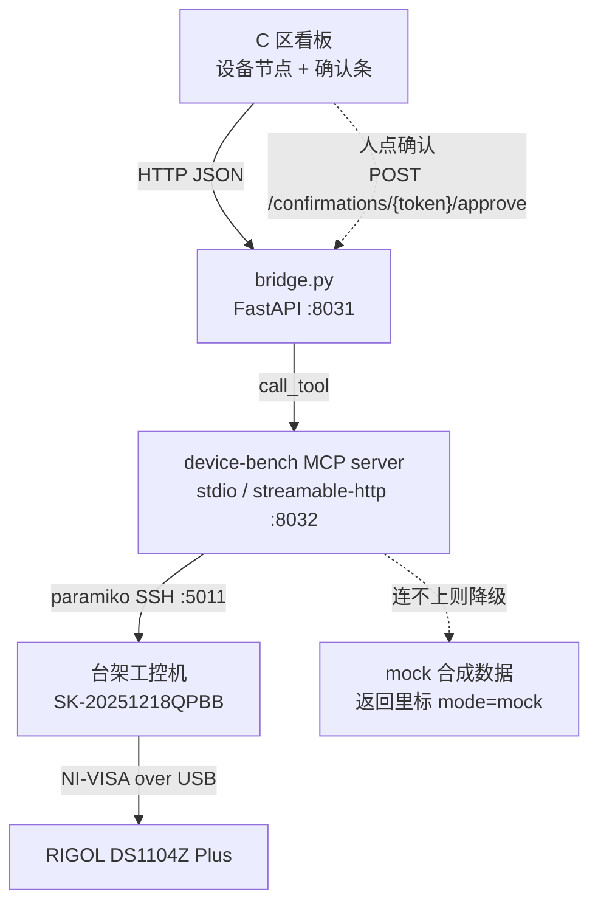

# spike-device-mcp — 把台架做成一个 MCP 设备

一次可落地性验证（spike）。要回答的问题只有一个：**设备能不能像客户 Copilot 里那些工具一样，作为一个 MCP 服务端集成进 C 区看板，后台走 SSH，而不必为 SSH 单独做一个页面。**

结论是能。这个目录里是跑通了的最小实现加取证。

验证环境：Python 3.12.13，`mcp` 2.2.0（官方 Python SDK），`paramiko` 5.0.0，`fastapi` 0.141.1，`uvicorn` 0.53.0。台架为峰岹（Fortior）电机测试 Windows 工控机 `SK-20251218QPBB`，`administrator@172.25.5.166:5011`，公钥认证。

---

## 1. 架构

```
┌──────────────────────────────┐
│  C 区看板（画布 / 网格视图）    │
│                              │
│  ┌────────────────────────┐  │      ① 画节点：设备名、连接徽章、分层工具菜单
│  │ 设备节点「峰岹台架工控机」│  │         GET /devices
│  │  ● live   13 个工具      │  │      ② 刷状态：徽章轮询
│  │  [连接层][观测层][动作层] │  │         GET /devices/{id}/status
│  └────────────────────────┘  │      ③ 点工具：菜单项直接调用
│  ┌────────────────────────┐  │         POST /devices/{id}/tools/{name}
│  │ 确认条（红线动作弹出）    │  │      ④ 人点确认：只有这一条路能放行红线动作
│  │  启动电机？ [确认][拒绝]  │  │         POST /confirmations/{token}/approve
│  └────────────────────────┘  │
└──────────────┬───────────────┘
               │ HTTP + JSON（x-bridge-token 鉴权）
               ▼
┌──────────────────────────────┐
│  bridge.py（FastAPI，:8031）   │  同进程持有 MCPServer 对象
│  · 工具调用一律转 call_tool    │  桥不是第二套业务逻辑
│  · 独有：人工批准接口          │  批准只从这里进，MCP 面上进不来
└──────────────┬───────────────┘
               │ 同进程调用（也可换成跨进程 MCP 客户端）
               ▼
┌──────────────────────────────┐
│  device-bench MCP server      │  stdio  ←─ 给 DSH / Claude Code 这类客户端
│  13 个工具，三层分组           │  streamable-http :8032/mcp  ←─ 给网页客户端
│  动作层挂人工确认闸口           │
└──────────────┬───────────────┘
               │ paramiko SSH（公钥，凭据只在服务端）
               ▼
┌──────────────────────────────┐
│  台架 Windows 工控机           │  C:\fc_pull\FgPoll.exe       读 FG1/FG2
│  SK-20251218QPBB · Session 0  │  C:\fc_pull\ScopeCtl.exe     发 SCPI
│                              │  C:\fc_pull\DeepCapture4.exe 深存储读波形
│                              │  MotorDebug\logs\*.log       软件运行日志
└──────────────┬───────────────┘
               │ NI-VISA over USB
               ▼
     RIGOL DS1104Z Plus 示波器
     CH1 电流 · CH2 FG1 · CH3 FG2 · CH4 PWM1
```

同一张图的 mermaid 版本：



三点说明。

设备节点画在画布上，靠的是 `GET /devices` 一次返回的三样东西：设备元信息、`status` 工具的实时结果、按层分好组的工具清单（含每个工具的 JSON Schema）。前端不需要知道 SSH 的存在。

桥和 MCP 客户端走的是同一条代码路径，都落到 `MCPServer.call_tool`。红线闸口写在工具函数里而不是写在桥的路由里，所以换任何一个 MCP 客户端接进来，闸口一样生效。

连不上台架时后端降级为 mock，但**每一条返回都带 `mode` 字段**，mock 还额外带一句 `mock_warning`。mock 不冒充实测。

---

## 2. 工具清单

13 个工具，三层。层名写在每个工具的 `meta.group` 上，前端据此渲染菜单分组。

### 连接层 `connection`

| 工具 | 作用 | 参数 | 只读 |
| --- | --- | --- | --- |
| `connect` | 建立或重建到台架的 SSH 会话；连不上则降级 mock 并写明原因 | `force_mock` | 否 |
| `status` | 连接状态、live/mock 模式、主机名、在线时长、最近错误、待确认凭据数 | 无 | 是 |
| `disconnect` | 关闭 SSH 会话 | 无 | 否 |

`status` 就是画布节点连接徽章的数据源。它的 `mode` 字段有三个取值：`unknown`（没连过）、`live`（真连上台架）、`mock`（连不上，返回合成数据）。

### 观测层 `observation`

| 工具 | 作用 | 参数 | 台架侧实现 |
| --- | --- | --- | --- |
| `read_fg` | 读 FG1 电气转速与 FG2 红外机械转速的频率，换算转速与 FG1/FG2 比值 | `samples`、`interval_s` | `C:\fc_pull\FgPoll.exe` |
| `read_pwm` | 读 PWM1 占空比 | `channel` | `C:\fc_pull\ScopeCtl.exe` 发 `:MEAS:ITEM? PDUTy` |
| `capture_scope` | 从示波器深存储读逐点时序；默认 `dry_run` 只出计划不真抓 | `channels`、`time_per_div_s`、`dry_run` | `C:\fc_pull\DeepCapture4.exe` |
| `tail_log` | 读 MotorDebug（原 Altior）后端运行日志尾部 | `lines`、`date` | PowerShell 读文件后 base64 回传 |

观测层全部不受确认闸口约束，模型可以随便调。

三条实现上的讲究。`read_fg` 会把示波器返回的 `9.9E37` 识别成「VISA 无有效测量」的哨兵值，判成「电机未转或探头未接」，而不是把这个数当频率报出去。`capture_scope` 默认不真抓，因为真抓一次约 20 到 25 秒、出约 100 MB CSV、且会独占示波器，必须调用方显式把 `dry_run` 置 `false`。`tail_log` 把日志内容在远端 base64 成纯 ASCII 再传回本地解码，绕开 Windows 控制台 GBK 与日志文件 UTF-8 打架导致的乱码。

### 动作层 `action`

六个工具，恰好对应六条红线：启动、停止、急停、写回参数、导出、归档。

| 工具 | 作用 | 参数 |
| --- | --- | --- |
| `start` | 启动被测电机 | `duty_percent`、`duration_s`、`confirm_token` |
| `stop` | 正常停止 | `confirm_token` |
| `estop` | 急停，立即切断驱动输出 | `reason`、`confirm_token` |
| `write_param` | 把参数写回驱动板 | `key`、`value`、`confirm_token` |
| `export` | 导出本轮产物 | `run_id`、`fmt`、`confirm_token` |
| `archive` | 归档本轮结果 | `run_id`、`note`、`confirm_token` |

六个都标了 `annotations.destructiveHint = true` 与 `meta.guarded = true`，前端据此把它们渲染成另一种样式（本 spike 不做界面，只保证数据齐备）。

本 spike 阶段动作层拿到批准后也不真下发控制命令，返回里写明 `dispatch` 是占位。验证的是闸口，不是控制链路。

---

## 3. 红线怎么实现的

红线的原话是：启动、停止、急停、写回参数、导出、归档这六个动作只能人点。

难点在于，MCP 工具面是给模型用的。如果「申请」和「批准」都做成 MCP 工具，模型调完申请再调批准就自己把自己放行了，闸口等于没有。

所以做成三段式，而且**批准接口只挂在桥的 HTTP 面上，不做成 MCP 工具**：

1. 模型调动作工具，不带 `confirm_token`。工具**拒绝执行**，返回 `status: confirmation_required`、`executed: false`，附一张 `pending` 状态的凭据。
2. 前端在 C 区看板弹确认条，把凭据的 `prompt`（「启动被测电机：台架会真的转起来」）和参数摆给人看。人点确认，前端调 `POST /confirmations/{token}/approve`，必须带 `operator`。
3. 模型带着这张 token 和**同一组参数**重调同一个工具，才会执行。

凭据还有四道约束：单次使用，用完转 `consumed`；180 秒过期；绑定工具名，为 `start` 批的票不能用于 `estop`；绑定参数指纹，批准时是 `value=1.25`、执行时改成 `9.99` 一律拒。

模型能调到的 13 个工具里，没有任何一个能把凭据从 `pending` 推到 `approved`。这是闸口成立的根据。

### 3.1 两级鉴权：调用票与批准权（2026-09-20 加）

上面那句「模型无法自批」只在 MCP 工具面上成立。对**持有 `BRIDGE_TOKEN` 的 HTTP 调用方**
它此前不成立：桥的全部鉴权就是一个 `x-bridge-token`，而前端把它当 `VITE_BRIDGE_TOKEN`
打进了浏览器包。任何拿到那份构建产物的人，都能自己调工具签一张凭据、自己调 approve
批准、再带票执行，全程不需要任何人点任何按钮。这条被独立核验记为 P1
（`07i-交互打通独立核验.md` 第十节）。

现在鉴权拆成两级：

| 秘密 | 请求头 | 存在哪 | 能做什么 |
| --- | --- | --- | --- |
| `BRIDGE_TOKEN` | `x-bridge-token` | 桥的 `.env`，并随前端构建产物进浏览器——按**公开**处理 | 列设备、查状态、调工具、驳回凭据。调红线工具只拿得到一张 `pending` 凭据 |
| `BRIDGE_APPROVER_PIN` | `x-approver-pin` | **只在桥的 `.env` 与桥进程内存**，不进任何 `VITE_` 变量、不进任何构建产物 | 把一张 `pending` 凭据批成 `approved` |

规则：

- 只有 `POST /confirmations/{token}/approve` 要 PIN，其余接口不变。
- 比较用 `hmac.compare_digest`（常量时间），不用 `==`。
- 没带 PIN、PIN 不对一律 **403**，凭据**保持 pending**：不消耗、不作废、不降级，人可以带正确 PIN 重来。
- 连续错 `BRIDGE_APPROVER_PIN_MAX_FAILS` 次（默认 5）锁 `BRIDGE_APPROVER_PIN_LOCK_SECONDS` 秒（默认 60）。锁定期间 PIN 正确也拒。计数全进程一份，不按来[源] IP 分桶——按 IP 分等于给换源留口子。**没带 PIN 也计一次失败**，所以空手撞五次同样会锁。
- 批准成功后凭据上多两个字段：`approved_by` 记前端传来的操作者名，`approve_channel` 记 `human_pin`。台账因此能分清「有人现场敲过 PIN」与别的放行方式；前端那条「演示自动放行」的旁路已于同日删除（独立核验 P2）。
- 桥在 `BRIDGE_APPROVER_PIN` 未设置、或与 `BRIDGE_TOKEN` 同值时**拒绝启动**，与 `BRIDGE_TOKEN` 缺失时同样处理。同值等于没有第二道闸口。
- `GET /health` 与 `GET /devices/{id}/status` 会回 `approve_requires_pin: true` 与 `approver_pin_gate`（是否锁定、还剩几秒），便于前端把 403 解释清楚。

**PIN 到了浏览器这一侧的边界，说清楚，别含糊。** 前端确认卡上是一个 `type="password"`
输入框，值只存在于那个组件的 `useState` 里：换一张凭据即清空，卡一关随组件卸载消失，
不写 `localStorage`、不写 `sessionStorage`、不进全局 store、不进任何模块级变量，因此
**不会出现在构建产物里**。但它确实会在「敲进去到请求发出」这段时间里存在于浏览器内存，
也会以明文出现在那一次请求的头里。能读这台机器浏览器内存、或能嗅这条回环流量的人，
仍然拿得到它。这条边界这一版改不掉。它换来的是那条真正要堵的口子：**光有构建产物批不动
任何红线动作**。要再收一档，下一步是把批准挪到桥所在主机上做本地确认，页面只展示待批
清单，PIN 连浏览器都不经过。

急停多一句。软件急停只是补充，落地时应另有一条物理急停回路，不能拿软件急停当唯一手段——这一点写在 `estop` 工具的 `meta.note` 里，模型看得到。

取证见 `evidence/08` 到 `evidence/16`，六种情形逐一跑过：无 token 拒、未批准的 token 拒、批准后放行、重放拒、换参数拒、完整留痕。

---

## 4. 与 `c/components/webssh` 的关系

`c/components/webssh` 是上一轮做的独立 SSH 页面：浏览器里一个 xterm.js 全屏终端，经 Node 网关（`ssh2` + `ws`）连同一台台架机。本 spike **没有改动它的任何文件**。

### 建议：废弃独立页面，保留它的 SSH 连接与安全设计

理由三条。

**用户要的是设备作为 MCP 集成进看板，不是多一个页面。** 一个全权 shell 页面和「设备节点 + 工具菜单」是两种交互范式。前者要人自己知道敲什么命令，后者把台架的能力显式列成十来个带 schema 的工具，模型和人都能用。看板里再塞一个终端页签，等于把这条路又走回去。

**全权 shell 与红线互斥。** `webssh` 自己的 README 在「安全说明」里写明「命令未做白名单，终端是全权 shell，能连上就等于拿到 administrator 权限」。这意味着只要终端页面还在，任何人都能绕过确认闸口，直接在终端里把电机转起来。红线在 MCP 面上做得再严，旁边开着一扇后门也无意义。

**MCP 工具面天然可审计。** 每次调用是一条结构化记录，带工具名、参数、mode、结果。终端是一片自由文本，事后只能靠人读日志复原发生了什么。

### 该从 `webssh` 继承的三样东西

**凭据约定原样照搬。** `devices.json` 里写的是 `keyRef`（环境变量名），环境变量存的是私钥**文件路径**，私钥本体不进代码、不进浏览器、不进环境变量本体。本 spike 的 `device_bench/config.py` 用的是同一套（字段名 `key_env`），两边可以共用同一份 `.env`。

**无 token 不启动。** `webssh` 网关在 `GATEWAY_TOKEN` 未设置时直接退出，堵死「忘了配就裸奔」。`bridge.py` 照此在 `BRIDGE_TOKEN` 未设置时 `SystemExit`。

**`gateway/server.js` 的连接与转发代码仍有价值。** 如果后面确实需要一个「给运维兜底的终端」（例如 MCP 工具覆盖不到的现场排障），不要另写，把它降级成一个需要单独权限、默认关闭的运维入口，别摆在 C 区看板的常规路径上。本 spike 的 SSH 后端是 Python `paramiko`，与它并存不冲突，两者连的是同一台机器同一把钥匙。

一个已知的重复：现在台架的 SSH 连接逻辑存在两份实现（Node 的 `ssh2` 与 Python 的 `paramiko`）。落地时应收敛成一份。收敛方向建议留 Python 这一份，因为 MCP server、知识库流水线、时序分析脚本都在 Python 侧。

---

## 5. 怎么嵌进 C 区看板

### 画布节点需要的数据

`GET /devices` 一次给全：

```jsonc
{
  "devices": [{
    "id": "bench",
    "name": "峰岹台架工控机",
    "model": "SK-20251218QPBB / Windows 11",
    "kind": "host",
    "transport": "mcp:device-bench",
    "backend": "ssh",
    "target": "administrator@172.25.5.166:5011",
    "status": { "mode": "live", "connected": true, "hostname": "SK-20251218QPBB",
                "uptime_s": 12.3, "pending_confirmations": 0 },
    "tool_groups": {
      "connection":  [ { "name": "connect", "title": "连接台架", "guarded": false, "input_schema": {} } ],
      "observation": [ /* 4 个 */ ],
      "action":      [ { "name": "start", "guarded": true, "human_gate": "confirm_token",
                         "risk": "物理后果：台架会真的转起来", "input_schema": {} } ]
    }
  }],
  "guarded_actions": { "start": "启动被测电机：台架会真的转起来" }
}
```

节点徽章的三色映射建议：`mode=live` 走绿（主色 `#2E5E45`），`mode=mock` 走中性灰并显式标「合成」，`mode=unknown` 或 `connected=false` 走暗红（`#A6353A`）。这与 C 区「状态只用三档」的既定视觉决策一致。

### 工具菜单

三层就是菜单的三个分组。观测层的项直接点直接调。动作层的项点下去只会拿回一张待确认凭据，界面据此弹确认条——**确认条不是前端自己加的一层礼貌询问，而是后端明确拒绝执行后必须走的一步**，前端骗不过去。

### 轮询建议

徽章 5 秒轮一次 `GET /devices/{id}/status` 足够。待确认凭据一并在这个返回里（`pending`），不需要另开一路。真要做实时推送，MCP 的 streamable-http 传输本身支持服务端推流，再接也不迟。

### 接进 DSH 的方式

交接文档第 6.2 节已定：智能体运行时用 DeepSeek Harness，设备工具经 `@deepseek-ai/dsh-mcp-client` 桥接。本 spike 的 stdio 传输就是为这条路准备的，配置形如：

```jsonc
{ "mcpServers": { "device-bench": {
    "command": "[源] bin/python",
    "args": ["-m", "device_bench.server", "--transport", "stdio"],
    "env": { "FORTIOR_WIN_KEY": "[源] .ssh/fortior_win" } } } }
```

注意 `env` 必须显式给。MCP SDK 默认只给 stdio 子进程一套最小环境，会把私钥路径这类变量滤掉，结果 server 连不上台架、静默降级 mock——这个坑本 spike 踩过，见 `mcp_client_check.py` 里的 `passthru`。

---

## 6. 起来跑

```bash
cd c/components/spike-device-mcp
cp .env.example .env                      # 填 FORTIOR_WIN_KEY、BRIDGE_TOKEN、BRIDGE_APPROVER_PIN
# BRIDGE_TOKEN 用 openssl rand -hex 16 生成
# BRIDGE_APPROVER_PIN 同样随机生成，且必须与 BRIDGE_TOKEN 不同值；两者同值桥会拒绝启动

./run-bridge.sh                           # HTTP 桥，127.0.0.1:8031；起完自动 connect 一次台架
./run-bridge.sh --no-connect              # 只起桥不连台架，status 会停在 mode=unknown
./run-mcp-http.sh                         # MCP streamable-http，127.0.0.1:8032/mcp（可选）
./run-evidence.sh                         # 跑一遍全部取证，产物落 evidence/

# 单独起 MCP server
.venv/bin/python -m device_bench.server --transport stdio
.venv/bin/python -m device_bench.server --transport streamable-http --port 8032

# 用官方 MCP 客户端验一遍两种传输
.venv/bin/python mcp_client_check.py stdio
.venv/bin/python mcp_client_check.py http 8032
```

手动摸一下桥：

```bash
set -a; . ./.env; set +a
H="x-bridge-token: $BRIDGE_TOKEN"
curl -s -H "$H" localhost:8031/devices | jq '.devices[0].status'
curl -s -H "$H" -X POST localhost:8031/devices/bench/tools/read_fg \
     -H 'content-type: application/json' -d '{"arguments":{"samples":2}}' | jq
```

### 桥的接口

| 方法 | 路径 | 说明 |
| --- | --- | --- |
| GET | `/health` | 存活探测，无鉴权 |
| GET | `/devices` | 设备清单 + 实时状态 + 分层工具菜单 |
| GET | `/devices/{id}/status` | 单台设备状态 + 待确认凭据 |
| POST | `/devices/{id}/tools/{name}` | 调工具，体 `{"arguments": {...}}` |
| GET | `/confirmations` | 待确认凭据列表；`?include_done=true` 连已处理的一并给 |
| GET | `/confirmations/{token}` | 单张凭据 |
| POST | `/confirmations/{token}/approve` | 人工批准，体 `{"operator": "...", "note": "..."}`，**另需 `x-approver-pin` 头**（见 3.1）；PIN 缺失或不对回 403，凭据保持 pending |
| POST | `/confirmations/{token}/reject` | 人工拒绝，体 `{"reason": "..."}` |

除 `/health` 外全部要 `x-bridge-token` 头。批准接口在此之外**再要一个 `x-approver-pin` 头**——
`x-bridge-token` 是调用票，不是批准权，见 3.1。

### 桥重启之后要补的一步

凭据是纯内存的，桥一重启全部失效，这是设计如此。但 SSH 会话也一样是纯内存的：重启后
`status` 会回 `mode: unknown`、`hostname: null`，并且**不会自行恢复**。此前做完一次重启
就直接接着跑，结果整段走查是在 `unknown` 态下完成的（独立核验第五节的附带观察）。

`run-bridge.sh` 因此在起桥之后会自动调一次 `connect` 工具（它不是红线动作，不需要凭据），
并把拿到的 `mode` 打出来：`live` 真连上台架、`mock` 连不上回合成数据、`unknown` 连接没
建立。想跳过用 `--no-connect`，脚本会打出手动补这一步的命令：

```bash
set -a; . ./.env; set +a
curl -s -X POST localhost:8031/devices/bench/tools/connect \
     -H "x-bridge-token: $BRIDGE_TOKEN" -H 'content-type: application/json' \
     -d '{"arguments":{}}' | jq '.mode'
```

---

## 7. 取证

`evidence/` 下 21 份 JSON，全部由 `./run-evidence.sh` 与 `mcp_client_check.py` 当场生成。

| 文件 | 证的是什么 | 结果 |
| --- | --- | --- |
| `00-versions.txt` | 依赖版本 | mcp 2.2.0 / paramiko 5.0.0 / fastapi 0.141.1 |
| `01-devices.json` | 画布节点要的数据齐不齐 | 2 台设备，13 个工具，三组齐备 |
| `02-connect-live.json` | 真能 SSH 上台架 | `mode: live`，`hostname: SK-20251218QPBB` |
| `03-status-live.json` | 徽章数据[源] | `connected: true` |
| `04-read_fg-live.json` | 真台架读 FG | `FG2=9.9E37 FG1=9.9E37`，判为电机未转，非通信故障 |
| `05-read_pwm-live.json` | 真台架读 PWM | `OPEN_FAIL`，如实标 `status: unavailable` 并给出两类成因 |
| `06-tail_log-live.json` | 真台架读日志 | 11 行，中文正常，文件路径确认为 MotorDebug 而非 Altior |
| `07-capture_scope-dryrun.json` | 重动作默认不真跑 | `executed: false`，给出 120 秒窗口 / 25 kSa/s / 约 96 MB 的计划 |
| `08` `13` `15` | 红线：无 token 一律拒 | 三个动作全部 `executed: false` + 发 pending 凭据 |
| `09` | 红线：拿到票但没人批，也拒 | `该 confirm_token 尚未经人工批准` |
| `10` | 人工批准留痕 | `state: approved`，`approved_by` 记名 |
| `11` | 批准后才放行 | `executed: true` |
| `12` | 票不能重放 | `状态为 consumed，拒绝执行` |
| `14` | 换了参数的票不认 | `参数与批准时不一致，拒绝执行` |
| `16` | 完整审计轨迹 | 三张票，状态分别 pending / approved / consumed |
| `17` `18` `19` | mock 路径跑得通且不冒充 | `mode: mock` + `mock_warning`，转速按正弦变化，FG1/FG2 沿用实测的 2.19 |
| `20` | stdio 传输，官方 MCP 客户端 | 13 工具，`mode: live` |
| `21` | streamable-http 传输，官方 MCP 客户端 | 13 工具，`mode: live` |

`evidence/bridge.log` 与 `evidence/mcp-http.log` 是两个服务的运行日志。

---

## 8. 已知限制

分四类。

### 验证范围没覆盖到的

动作层六个工具拿到批准后不真下发控制命令，返回里写的是 `dispatch: spike 阶段不真发控制命令`。本 spike 验的是闸口机制，控制链路怎么接（走 MotorDebug 的 `hid_preset_speed_test` 工作流还是别的路子）是下一步的事。

`capture_scope` 的真抓路径（`dry_run: false`）没有实跑过。`DeepCapture4.exe` 的深读逻辑在既有工程里验证过，但没有在 MCP 调用链里端到端跑一次。

`read_fg` 取到的是电机未转时的哨兵值。要拿到有意义的真转速数，必须有人在台架现场把电机跑起来——SSH 会话在 Session 0，点不了 Session 1 的 GUI，这是台架的固有约束，不是本 spike 的缺陷。

`read_pwm` 在真台架上没取到数，因为 `ScopeCtl.exe` 返回 `OPEN_FAIL`。这是既有的已知问题（`C:\fc_pull` 下的 .exe 会变坏档，需在台架机用 `csc /platform:x64` 当场重编），本 spike 没有去修它，只是把失败如实报出来并给出成因。

### 机制本身的边界

确认凭据存在进程内存里。桥一重启，所有待确认凭据就没了。落地要换成带持久化的存储，否则「人批了、服务重启、模型拿着票来执行」会失败。

凭据的绑定粒度是「工具名 + 参数指纹」，没有绑定会话或操作人。也就是说甲申请的票，乙批准之后，丙也能拿去用——前提是丙拿得到那串 token。内网单机场景下可接受，多人协作场景要补会话绑定。

桥的 token 是单一共享密钥，比较未做常数时间；默认监听 `127.0.0.1` 且是明文 HTTP。要跨机访问得放到 TLS 反向代理之后，并换成按人签发的短期凭据。

### 与已定决策的对齐情况

交接文档第 6.2 节定的是「硬件输入输出层自建成标准 MCP 服务端再桥接」。本 spike 是这条决策的一次落地验证，形态对得上。

但有一处口径需要留意：客户软件的先例（AItior/Altior 在本机 58043 端口用 WebSocket 承载 MCP）与本 spike 选的 streamable-http 不同。streamable-http 是 MCP 规范的当前标准传输，客户那边是更早的做法。两边要不要对齐、谁迁就谁，是个待拍板的事，不是技术障碍——stdio 与 streamable-http 两种传输本 spike 都给了，要再加一种也不难。

权限三档的模型（交接文档第 6.1 节）本 spike 没有实现，只实现了「红线动作需人工确认」这一条。三档权限是服务端 Hook 统一校验的事，该在真系统里做，不在设备 MCP 这一层。

### 环境相关

`MotorDebug` 是客户软件当前的名字，日志路径为 `C:\Users\Administrator\AppData\Local\MotorDebug\logs\motordebug.YYYY-MM-DD.log`。既有资料里写的 `Altior\logs\altior-ai.*.log` 路径在台架上已不存在——`tail_log` 用的是新路径，取证时实测确认过。这一条也需要同步回 `fortior-test-bench` skill。

台架上最新的一份日志是 2026-09-11 的，说明客户软件最近没在跑。`tail_log` 取的是「最新的一份」而非「今天的一份」，避免因为当天没日志就返回失败。

---

## 9. 目录

```
spike-device-mcp/
├── device_bench/
│   ├── config.py        设备定义、台架侧工具路径、超时；凭据只从环境变量取
│   ├── backend.py       paramiko SSH 后端 + mock 合成器，带自动降级
│   ├── confirm.py       人工确认闸口：凭据的签发、批准、核销、审计
│   └── server.py        MCP server，13 个工具，两种传输
├── bridge.py            FastAPI HTTP 桥，给 C 区看板用
├── mcp_client_check.py  用官方 MCP 客户端验两种传输
├── run-bridge.sh        起/重启桥
├── run-mcp-http.sh      起/重启 MCP streamable-http
├── run-evidence.sh      跑一遍全部取证
├── evidence/            取证产物
├── .env.example         配置模板
└── README.md
```
