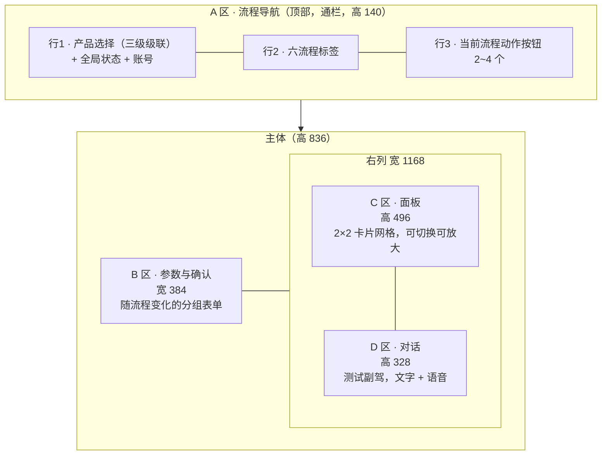
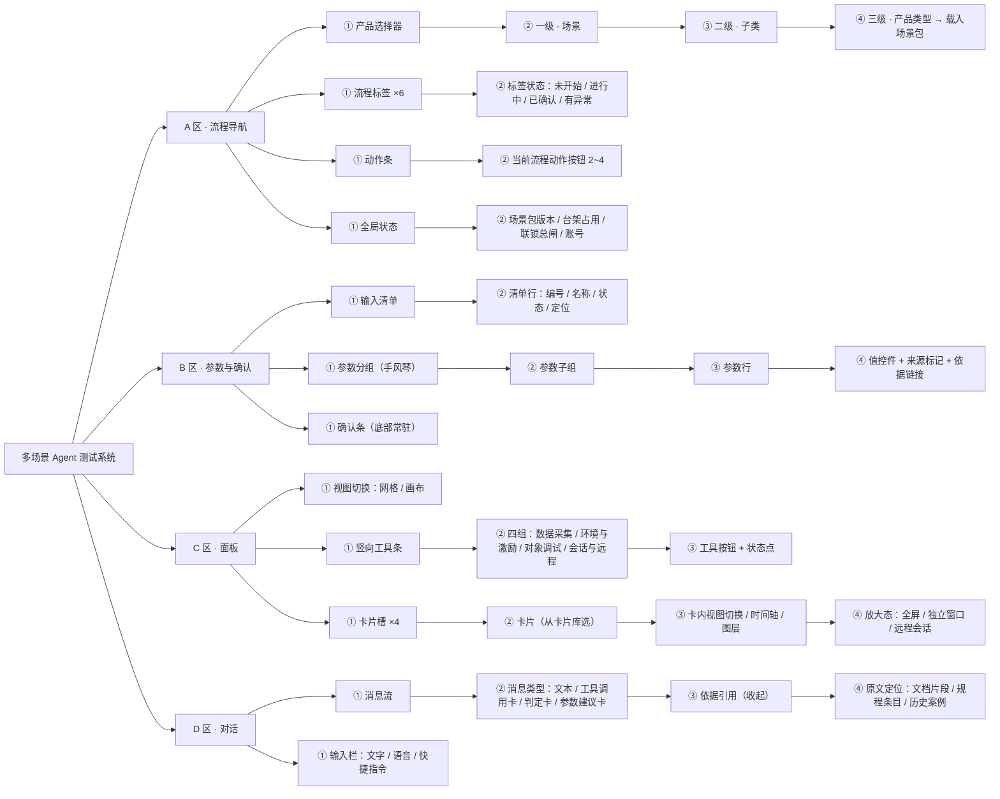
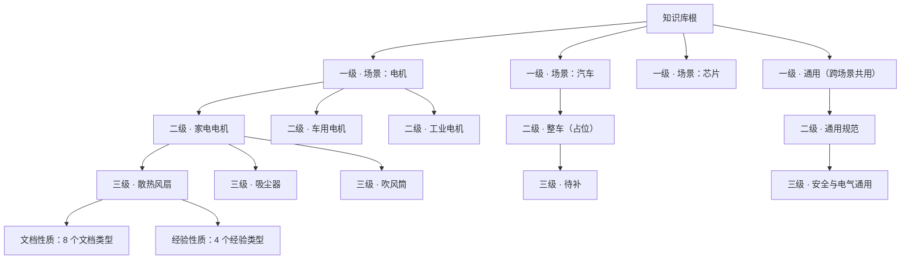
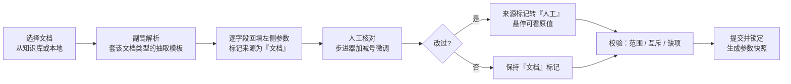
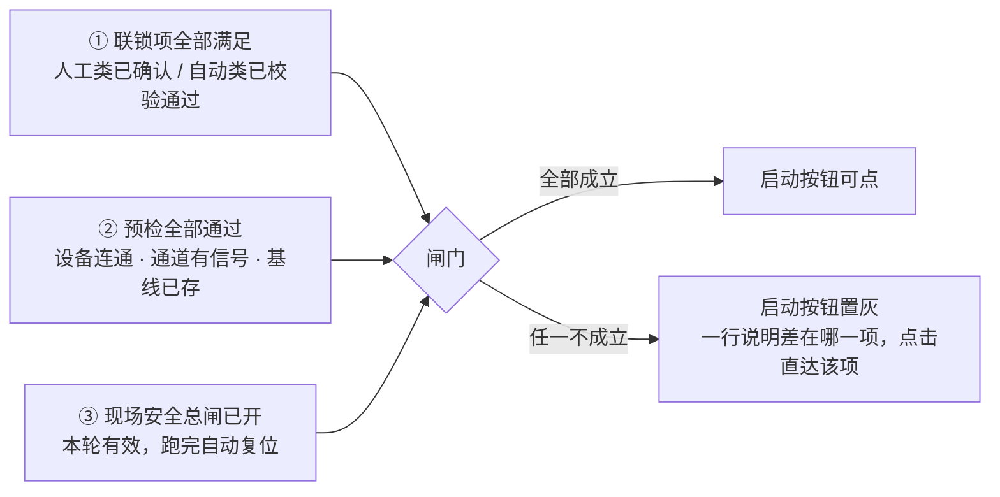
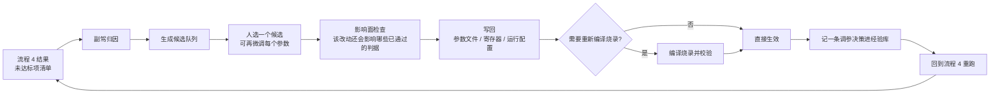
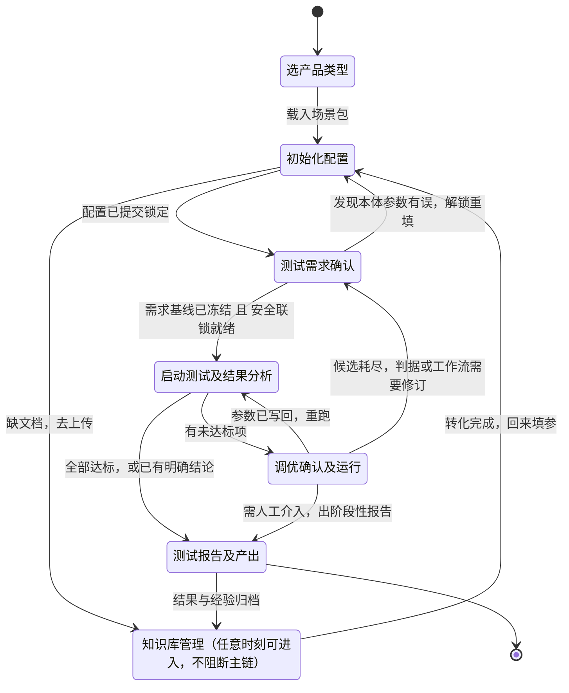
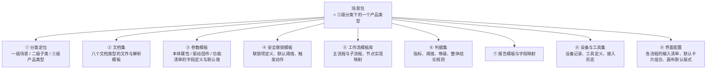

# 设计规格 · 信息架构与页面

**读者：前端与全栈实现者。** 本文件给的是照着能做出来的规格——布局尺寸、层级树、控件形态、每个流程页面上放什么。每个流程"在业务上到底在干什么"不在本文件，在同目录的 `02-业务逻辑说明-六个流程.md`。

---

## 0. 命名约定

**先把名字定下来，全文与代码统一用这套。**

| 对象 | 本文用名 | 英文 / 代码标识 | 说明 |
| --- | --- | --- | --- |
| 系统 | 多场景 Agent 测试系统 | `omnitest` | 对外产品名待拍板，候选见第 14 节 |
| 智能体 | 测试副驾 | `copilot` | 界面短名显示为"副驾"；不使用人格化昵称 |
| 顶部区 | A 区 · 流程导航 | `zone-nav` | 产品选择 + 六流程标签 + 动作条 |
| 左侧区 | B 区 · 参数与确认 | `zone-params` | 随流程变化的参数配置与确认 |
| 右上区 | C 区 · 面板 | `zone-panel` | 可切换的卡片网格 |
| 右下区 | D 区 · 对话 | `zone-chat` | 与测试副驾的文字与语音对话 |
| 场景包 | 场景包 | `scene-pack` | 一套让系统适配某个产品类型的完整配置资产，见第 12 节 |

**智能体命名的三个候选与推荐。**

| 候选 | 中文 | 理由 | 结论 |
| --- | --- | --- | --- |
| Test Copilot | 测试副驾 | 与"人主驾、机副驾"的产品定位一致；跨场景不带行业色彩；已被工程师群体广泛理解 | **推荐** |
| Atlas | 图析 | 短、易记，但与既有产品重名严重 | 备选 |
| ACE | 智测 | 缩写不自解释，需要额外解释成本 | 不推荐 |

---

## 1. 五条设计原则

**这五条是后面所有规格的依据，出现取舍时按这个顺序裁决。**

| 序号 | 原则 | 落地方式 | 违反时的表现 |
| --- | --- | --- | --- |
| 1 | 四块封顶 | 主界面永远只有 A/B/C/D 四个大块，不再增加第五块 | 页面出现浮动侧栏、底部状态条等第五类容器 |
| 2 | 层级不过四级 | 任一块内的信息层级最深到四级，第五级必须换承载方式（弹层、独立页、抽屉） | 左侧出现四层以上折叠 |
| 3 | 一屏一态 | 同一时刻界面只服务当前一个流程，切流程整屏换内容而非叠加 | 多个流程的参数同时可编辑 |
| 4 | 结论先行、依据可展开 | 任何判定先给一行结论，依据默认收起、一键展开到原文出处 | 判定与长篇推理混排 |
| 5 | 场景无关 | 界面代码里不出现任何行业专有词，所有标签、参数、判据来自场景包 | 代码里写死"极对数""FG2"等电机术语 |

---

## 2. 总布局

### 2.1 四块分区



### 2.2 栅格（基准 1600 × 1000）

| 区域 | 起点 x | 宽 | 起点 y | 高 | 备注 |
| --- | ---: | ---: | ---: | ---: | --- |
| 页面外边距 | 16 | — | 12 | — | 四周统一 |
| A 区 行1 | 0 | 1600 | 0 | 56 | 通栏，贴顶无外边距 |
| A 区 行2 | 0 | 1600 | 56 | 44 | 通栏 |
| A 区 行3 | 0 | 1600 | 100 | 40 | 通栏，底部 1px 分隔线 |
| B 区 | 16 | 384 | 152 | 836 | 内部纵向滚动 |
| C 区 | 416 | 1168 | 152 | 496 | 含右侧 56 宽竖向工具条；卡片区实宽 1112 |
| C 区 · 工具条 | 1528 | 56 | 152 | 496 | 竖排，四组之间用 1px 浅分隔线 |
| D 区 | 416 | 1168 | 660 | 328 | 输入栏固定在底部 |
| 块间距 | — | 16 | — | 12 | 横向 16、纵向 12 |

C 区单卡尺寸：宽 `(1112 - 12) / 2 = 550`，高 `(496 - 32 - 12) / 2 = 226`（其中 32 为面板顶部的视图切换条）。

### 2.3 响应式

**以 1600×1000 为基准向下退让，向上只放宽而不重排。**

| 断点 | B 区 | C 区 | D 区 | 说明 |
| --- | --- | --- | --- | --- |
| ≥ 1600 | 384 固定 | 2×2 卡片 | 固定高 328 | 基准态；宽度富余全部给 C/D |
| 1360 ~ 1599 | 320 固定 | 2×2 卡片，单卡最小宽 440 | 高 300 | 卡片内次要字段隐藏 |
| 1120 ~ 1359 | 收为可展开抽屉，默认收起，按钮常驻 A 区行3 左端 | 1×2 卡片竖排 | 高 300 | 参数编辑时抽屉遮罩 C/D |
| < 1120 | 抽屉 | 单卡 + 卡片切换标签 | 占满剩余 | 降级为"查看态"，不建议在此宽度做参数编辑 |

**高度小于 900 时：** A 区行3 合并进行2 右端（动作按钮改为紧凑图标按钮），C/D 按 6:4 分配剩余高度。

---

## 3. 视觉规范

### 3.1 与两张参考页面的关系

**参考页面有两张，一张是客户现在在用的 Copilot 页面（`_调研/ref-客户Copilot页面-用户提供-20260919.png`），一张是上一版内部示意（`../20260917-产品故事与分工v1.0/_示意图/mock-copilot主页.png`）。信息组织的逻辑照搬，视觉与比例全部重做。**

| 从客户现页面继承的逻辑 | 本版对应做法 | 本版的改动 |
| --- | --- | --- |
| 左栏是"本阶段要人填的清单"，每行带完成状态与一个行动按钮 | B 区顶部保留编号输入清单，每行状态 + 定位按钮 | 清单下方直接接可编辑的参数分组，不再跳二级页填写 |
| 右上是一块资源画布，图纸、设备照片、截图自由摆放并连线，点某张图打开对应内容 | C 区保留画布视图，资源卡可点开 | 增加网格视图作为默认，画布视图为可切换的第二视图；卡片内容标准化为卡片库条目 |
| 画布右侧一条竖向工具条，工具按用途分组 | C 区右侧保留竖向工具条，按用途分组 | 组名改为跨场景通用的四组，不再用行业词命名 |
| 右下是助手对话，带模型选择与语音 | D 区保留 | 助手改名，取消人格化昵称与"自动调试"总开关，改为逐动作确认 |
| 阶段分四组、每组下挂场景标签 | 改为顶部六个典型流程标签 | 阶段从两层压成一层，动作按钮上提到顶部动作条 |

| 与客户现页面的视觉差异 | 客户现页面 | 本版 |
| --- | --- | --- |
| 强调色 | 蓝紫渐变按钮，多色状态点 | 墨绿单主色 + 暗红单强调色，无渐变 |
| 圆角与投影 | 大圆角约 12，卡片带投影 | 圆角 4 与 6，常态无投影 |
| 分区 | 左右二分，左栏约占 45% | 顶部通栏 + 左 24% + 右上右下，左栏窄 |
| 卡片密度 | 画布卡片大小不一、自由摆放 | 网格视图下等尺寸定高卡，画布视图才自由摆放 |
| 字体 | 标题用大字重，装饰性序号 | 层级靠字号与颜色，不用装饰序号色块 |

### 3.2 与上一版内部示意的差异

**上一版是深色黑底 + 单一墨绿点缀的"控制台"观感；这一版换成浅色纸面 + 线条骨架的"工作台"观感。** 两版摆在一起必须一眼能分出不是同一个产品。

| 维度 | 上一版（峰岹 Debug Copilot 示意） | 本版 | 差异来[源] |
| --- | --- | --- | --- |
| 底色 | 近黑 | 纸白 `#FAFAF8`，面板纯白 | 主题反转 |
| 分区方式 | 三列等高卡片，深色卡面 | 四块，块间靠留白与 1px 细线分隔，卡面无阴影 | 从"填充分区"改为"线条分区" |
| 主体比例 | 中列独大，左右为窄边栏 | 右列独大，左列为参数栏，右列上下二分 | 面板与对话分离成两块 |
| 信息密度 | 中列长滚动流 | 卡片网格，每卡定高不滚动，超出进放大态 | 从"流"改为"格" |
| 圆角 | 8~12 圆角卡片 | 统一 4，按钮 4，卡片 6 | 更硬朗 |
| 强调色 | 绿色大面积填充（按钮、选中项、状态点） | 墨绿只用于描边与文字，填充仅限当前选中的单个元素 | 填充面积从约 15% 降到 5% 以下 |
| 字体 | 界面等宽混排明显 | 正文用系统无衬线，等宽仅用于文件名、宏名、数值 | 降低"终端感" |

### 3.3 色板

**双色相：墨绿承担全部骨架，暗红只标异常。不引入第三色相。**

| 角色 | 色值 | 用法 | 面积约束 |
| --- | --- | --- | --- |
| 页面底 | `#FAFAF8` | 全局背景 | — |
| 面板底 | `#FFFFFF` | B/C/D 块与卡片底 | — |
| 主色 · 墨绿 | `#2E5E45` | 描边、选中态、主按钮文字与边、进行中状态 | 填充 ≤ 5% |
| 主色浅底 | `#EAF2EC` | 当前选中的流程标签、当前卡片高亮底 | 全屏合计 ≤ 15% |
| 主色弱描边 | `#A8C5B5` | 次级控件描边、未选中标签描边 | — |
| 强调 · 暗红 | `#A6353A` | 不通过、超限、急停、联锁未满足 | 每屏 ≤ 3 处 |
| 强调浅底 | `#F6ECEC` | 异常行底纹 | 仅异常行 |
| 正文 | `#2C2C2C` | 主文字 | — |
| 次要文字 | `#555555` | 标签、单位、说明 | — |
| 弱文字 | `#9A9A9A` | 占位符、禁用、未执行 | — |
| 分隔线 | `#C8C5BD` | 块边界 | 1px |
| 浅分隔线 | `#E6E3DC` | 卡内行分隔 | 1px |

**状态语义只用三档**，不新增颜色：未执行用弱文字灰，进行中与通过用墨绿，不通过与风险用暗红。"待确认"用暗红描边加白底，不给新色相。

### 3.4 字体与控件尺寸

| 项 | 规格 |
| --- | --- |
| 正文字体 | 系统无衬线栈，中文优先思源黑体 / 微软雅黑 |
| 数值与标识符字体 | 等宽栈，仅用于文件名、宏名、参数值、通道号 |
| 字号 | 区标题 15 / 卡标题 14 / 正文 13 / 标签与单位 12 / 弱注 11 |
| 行高 | 正文 1.6，表格行 32 |
| 按钮高 | 主按钮 32，次按钮 28，图标按钮 28×28 |
| 输入框高 | 32；步进器整体 32，加减号各 28×28 |
| 卡片圆角 | 6；按钮与输入框圆角 4 |
| 阴影 | 常态无阴影；仅弹层与放大态用 `0 8px 24px rgba(44,44,44,.12)` |

---

## 4. 全局层级树

**四个大块各自的内部层级，最深到四级。** 这棵树是前端组件树的直接依据。



---

## 5. A 区 · 流程导航

### 5.1 产品选择器

**产品选择是整个系统的起点，选完才载入场景包，选之前其余三块为空态。**

三级级联下拉，一次点开一个面板，左中右三列并排选。

| 级别 | 名称 | 示例取值 | 规则 |
| --- | --- | --- | --- |
| 一级 | 场景 | 电机、汽车、芯片 | 顶层领域，由场景包目录枚举 |
| 二级 | 子类 | 家电电机、车用电机、工业电机 | 即使某场景下只有一个子类也必须显示，不做省略 |
| 三级 | 产品类型 | 散热风扇、吸尘器、吹风筒 | 选中即载入对应场景包 |

**不设第四级。** 具体型号、批次、样机编号属于"本次测试对象"，放在流程 2 初始化配置的参数里，不进分类树。

切换产品类型时：弹确认框提示当前流程未保存内容将丢失；确认后 B/C/D 三块整体重载。

### 5.2 六流程标签

一排六个等宽标签，通栏。每个标签显示序号、名称、状态圆点。

| 序号 | 流程名 | 代码标识 | 前置条件 |
| --- | --- | --- | --- |
| 1 | 知识库管理 | `kb` | 无，任何时刻可进入 |
| 2 | 初始化配置 | `init` | 已选产品类型 |
| 3 | 测试需求确认 | `req` | 流程 2 已确认 |
| 4 | 启动测试及结果分析 | `run` | 流程 3 已确认 且 安全联锁全绿 |
| 5 | 调优确认及运行 | `tune` | 流程 4 有一轮结果 |
| 6 | 测试报告及产出 | `report` | 流程 4 有至少一轮通过或明确结论 |

**标签不做强制锁死**，前置条件未满足时标签可点开查看，但该流程的执行类动作按钮置灰并给出一行原因。

### 5.3 动作条

**每个流程 2~4 个动作按钮，第一个为该流程的主动作，用墨绿描边实心文字；其余为次动作，用灰描边。** 破坏性动作（急停、回滚、删除）用暗红描边。

| 流程 | 主动作 | 次动作 |
| --- | --- | --- |
| 1 知识库管理 | 上传文档 | 新建分类、沉淀为经验、重建索引 |
| 2 初始化配置 | 读取文档自动填充 | 另存为参数模板、校验配置、提交并锁定 |
| 3 测试需求确认 | 选择工作流模板 | 导入标准文件、编辑工作流、确认需求基线 |
| 4 启动测试及结果分析 | 启动测试 | 预检自检、停止、急停 |
| 5 调优确认及运行 | 生成推荐参数 | 采纳并写回、回滚上一版、重跑测试 |
| 6 测试报告及产出 | 生成报告 | 选择模板、补全信息、导出并归档 |

### 5.4 全局状态位

右端从左到右：场景包名与版本、台架占用状态、安全联锁总闸、模型额度、账号。

**安全联锁总闸是一个常驻的两态指示**：全部满足显示墨绿"联锁 就绪"，任一未满足显示暗红"联锁 N 项未满足"，点击直达 C 区的安全联锁卡片放大态。

---

## 6. B 区 · 参数与确认

### 6.1 通用结构

**左侧永远是"这一步要人拍板的输入"，不是只读展示。** 结构固定为：输入清单 + 分组手风琴 + 底部确认条。

**输入清单在最上面，是本流程的目录与进度条合一。** 每行四个元素：编号、名称、状态、定位按钮。点定位按钮把下方手风琴滚到对应分组并展开。状态四态：未填为弱灰；已填为墨绿勾；异常为暗红，用于超范围或与文档冲突；不适用为灰，由场景包判定本产品类型不需要此项。清单条目由场景包定义，通常四到八条。

```
B 区
├─ 输入清单（定高，不随下方滚动）
│   ├─ 01 名称 · 状态 · 定位
│   └─ 02 …
├─ 分组 1（手风琴，默认展开第一组）
│   ├─ 子组 A
│   │   ├─ 参数行 · 值控件 · 来源标记 · 依据链接
│   │   └─ 参数行 …
│   └─ 子组 B
├─ 分组 2（默认收起，标题右侧显示"已填 8/12"）
└─ 确认条（常驻底部，不随滚动）
```

### 6.2 参数行规格

一行高 32，左侧标签占 40%，右侧控件占 60%。标签下方可挂 11px 弱注说明单位与取值范围。

| 控件类型 | 用在什么参数 | 交互 |
| --- | --- | --- |
| 步进器 | 数值型且有明确步长与上下限 | 中间输入框可直接键入；左右各一个加减号按钮，单击步进一档，长按连续步进；超出上下限时输入框描边转暗红并给一行提示，不自动截断 |
| 下拉 | 枚举型 | 选项来自场景包，带搜索 |
| 开关 | 二值 | — |
| 只读 | 由文档解析得出且不允许人工改 | 灰底，右侧给"来源"链接 |
| 文件引用 | 工程路径、头文件、原理图 | 显示文件名与状态，点击在 C 区打开对应卡片 |
| 多值表 | 宏清单、通道映射等成组参数 | 行内展开为小表格，最多显示 5 行，超出进放大态 |

**来源标记**是每个参数行右端的一个小徽标，三态：

| 标记 | 含义 | 样式 |
| --- | --- | --- |
| 文档 | 由上传文档自动解析填入，未被人改过 | 墨绿描边小标 |
| 人工 | 人工改过，与文档值不同 | 灰描边小标，悬停显示原值 |
| 建议 | 由测试副驾建议且已采纳 | 墨绿浅底小标，悬停显示建议理由 |

点标记展开"依据"浮层，给出文档名、页码或宏名、原文片段，并可跳到 C 区对应卡片定位。

### 6.3 确认条

底部常驻，含三件事：本组完成度、校验结果一行、确认按钮。

**确认是有状态的：** 确认后该分组转只读并显示确认人与"已锁定"，解锁需显式点"解除确认"并记一条审计。流程 4 的启动动作检查的就是流程 2/3 的确认状态与安全联锁状态。

---

## 7. C 区 · 面板

### 7.1 两种视图与一条工具条

**面板有两种视图，同一批卡片两种摆法，视图切换按钮在面板左上角。**

| 视图 | 摆法 | 适合 | 默认 |
| --- | --- | --- | --- |
| 网格视图 | 2×2 四个等尺寸卡槽，每槽定高不滚动 | 盯状态、并排对照数据 | 是 |
| 画布视图 | 卡片自由摆放、可改大小、可拉连线表达从属与信号走向；带缩放与复位 | 讲清楚"这次测的是哪块板、信号从哪走到哪"，以及把图纸与设备照片放在一起看 | 否 |

画布视图的连线只表达两种关系：从属（某张图是某个对象的一部分）与信号走向（从哪个端子到哪个通道）。连线不参与任何计算，是纯说明性的。画布布局随场景包下发一份默认版式，人改过之后按产品类型记住。

**面板右侧一条竖向工具条，按用途分四组**，组名跨场景通用，不出现行业专有词：

| 组 | 放什么工具 | 峰岹场景下的具体工具 |
| --- | --- | --- |
| 数据采集 | 取波形、取读数、拍照、录屏 | 示波器采集、深存储抓取、转速读取 |
| 环境与激励 | 控制被测对象所处的环境与施加的激励 | 程控电源调压、逆风风扇调速、温箱设定 |
| 对象调试 | 直接作用于被测对象内部的工具 | 参数写入、编译烧录、寄存器读写、串口交互 |
| 会话与远程 | 把单机设备或本地软件的会话拉过来 | 远程桌面、命令行会话、本地工程打开 |

每个工具在工具条上是一个图标按钮，右上角带状态点：在线为墨绿、离线为灰、故障为暗红。悬停给工具全名与最近一次调用结果，点击把该工具的卡片调到当前视图的焦点位。

### 7.2 卡片库

**每个卡槽可从卡片库里换任意一张卡。** 每个流程给一套默认卡片组合，人可自行更换并记住偏好。

| 类 | 卡片 | 代码标识 | 卡内主要内容 | 放大态行为 |
| --- | --- | --- | --- | --- |
| 产品与资产 | 产品示意图 | `product-view` | 产品外形图或三维示意，标注关键部位与被测点 | 全屏看图，可标注 |
| 产品与资产 | 原理图 | `schematic` | 电路图缩略，支持按页翻 | 全屏图纸浏览器，支持缩放与区域框选提问 |
| 产品与资产 | 工程与文件树 | `project-tree` | 本次测试对象的目录结构与关键文件状态 | 全屏树 + 文件预览 |
| 设备与连接 | 工具清单与状态 | `tools` | 系统可调用的工具逐条列出，含在线状态与最近一次调用 | 全屏列表，可单条测试连通性 |
| 设备与连接 | 台架实况 | `bench-live` | 台架摄像头画面或设备读数看板 | 全屏 |
| 设备与连接 | 单机设备会话 | `remote-device` | 必须在单机上跑的设备的连接卡，如示波器 | 拉起远程会话：内嵌远程桌面或新开窗口，见 7.3 |
| 设备与连接 | 安全联锁状态盘 | `interlock` | 逐条联锁项的满足状态 | 全屏，可逐条确认与填写确认人 |
| 过程与数据 | 工作流画布 | `workflow` | 本次要跑的步骤图，当前步高亮 | 全屏画布，可拖拽编辑 |
| 过程与数据 | 时序曲线 | `timeseries` | 实时或回放的多通道曲线 | 全屏，带游标、缩放、通道开关、导出 |
| 过程与数据 | 执行进度与日志 | `progress` | 当前第几步、第几轮、耗时、滚动日志 | 全屏日志，可搜索与筛级别 |
| 过程与数据 | 判定卡 | `verdict` | 判据逐条给通过与否及实测值 | 全屏判据表 |
| 知识与记录 | 知识库依据 | `evidence` | 当前结论引用了哪些文档与经验条目 | 全屏，跳原文 |
| 知识与记录 | 历史对比 | `history` | 同产品同工作流的历次结果并排 | 全屏对比表 + 叠加曲线 |
| 知识与记录 | 产物留档 | `artifacts` | 本轮产生的文件：波形、截图、参数快照、日志 | 全屏文件管理 |
| 知识与记录 | 报告预览 | `report-preview` | 报告成稿的分页预览 | 全屏预览，可逐段跳到对应数据 |

### 7.3 卡片通用规格

卡头 32px 高：卡名 + 右端三个图标按钮（换卡、刷新、放大）。卡体 210px 高，**定高不滚动**——内容超出时截断并在右下角给"展开查看"，点击进放大态。

卡片处于"当前流程正在用"时，卡头左侧加一个墨绿竖条；卡片数据过期超过阈值时，卡头右侧显示灰色时间戳。

### 7.4 单机设备的接入方式

**凡是只能在某台机器上跑的设备，界面不重写它的控制面板，而是把那台机器的会话拉过来。** 三种形态，按设备能力选：

| 形态 | 适用 | 实现要点 | 界面表现 |
| --- | --- | --- | --- |
| 数据拉取 | 设备侧已有可编程接口，只要数值与波形 | 设备侧常驻一个采集出口，网页只画图，不控设备 | 数据直接进 `timeseries` 与 `verdict` 卡 |
| 命令行会话 | 设备所在机器可远程登录，要跑脚本、取文件、查日志 | 网页端开一个终端组件，经服务端中转到那台机器的远程登录会话；不在浏览器里直连，凭据只存服务端 | `remote-device` 卡放大后即一个终端窗口，带常用命令快捷片 |
| 远程桌面内嵌 | 设备只有图形界面软件 | 卡片内嵌远程桌面画面，放大态可交互；需要那台机器常驻登录会话 | 卡内是实时画面缩略，放大后可操作 |
| 独立窗口跳转 | 需要完整原生软件能力 | 点击在新窗口拉起，网页侧只记录已跳转并接收回传产物 | 卡内只显示跳转入口与回传文件列表 |

**每台单机设备在场景包里登记为一条设备记录**，字段分三组：标识组含设备名与所在主机；接入组含接入形态、连接参数与凭据引用；能力组含可用工具清单与健康检查方式。工具条"会话与远程"组里的每个按钮对应一条设备记录。

峰岹场景里示波器同时用三种形态：数值与波形由设备侧采集出口拉回来画在 `timeseries` 卡上；需要跑深存储抓取脚本或取采集文件时，从 `remote-device` 卡开命令行会话登录台架机；需要人工调游标看原始界面时，从同一张卡切到远程桌面。台架机的登录地址、账号与密钥由场景包的设备记录提供，不写在前端。

---

## 8. D 区 · 对话

### 8.1 结构

```
D 区
├─ 消息流（可滚动，占高 260）
│   ├─ 文本消息
│   ├─ 工具调用卡（工具名 / 入参摘要 / 耗时 / 结果摘要 / 展开详情）
│   ├─ 判定卡（一行结论 + 判据表摘要 + 依据按钮）
│   └─ 参数建议卡（建议值 / 当前值 / 理由 / 采纳与忽略两个按钮）
└─ 输入栏（固定高 68）
    ├─ 快捷指令片（随流程变化，3~5 个）
    ├─ 文本输入（多行自适应，上限 4 行）
    └─ 语音按钮（按住说话 / 点击连续听写两种模式）
```

### 8.2 三类特殊消息卡

| 卡 | 必含字段 | 交互约定 |
| --- | --- | --- |
| 工具调用卡 | 工具名、目标对象、入参摘要、状态、耗时、结果一行 | 默认收起详情；失败时卡描边转暗红并给可重试按钮 |
| 判定卡 | 结论一词（通过 / 不通过 / 待定）、关键实测值、阈值、依据按钮 | 点依据在 C 区把 `evidence` 卡换上来并定位 |
| 参数建议卡 | 参数名、建议值、当前值、变化幅度、理由、来[源] | 采纳后 B 区对应参数行变为"建议"来源标记；忽略需选一个理由，该理由回流知识库 |

### 8.3 副驾在各流程的职责边界

**统一规则：副驾可以读、可以算、可以建议、可以写草稿；凡是会改变被测对象状态或落盘生效的动作，必须人点按钮。**

| 流程 | 副驾做什么 | 副驾可调工具 | 绝不自动做 |
| --- | --- | --- | --- |
| 1 知识库管理 | 解析文档、提分类建议、把对话片段整理成经验条目草稿 | 文档解析、切片、打标签、检索 | 直接删除已有条目 |
| 2 初始化配置 | 从文档抽参数并填入、解释每个参数含义、标出与文档不一致处 | 文档检索、参数解析、模板匹配 | 提交锁定 |
| 3 测试需求确认 | 从标准文档抽判据、推荐工作流模板、解释每个步骤 | 检索、工作流模板查询、判据生成 | 修改已确认的需求基线 |
| 4 启动测试及结果分析 | 预检、解读实时曲线、逐条对判据、定位异常段 | 设备读数、采集、曲线分析、判据评估 | 启动、停止、急停 |
| 5 调优确认及运行 | 从经验库与规程给候选参数、排序、说明每个候选的预期与风险 | 案例检索、参数推荐、影响面分析 | 写回参数、触发重跑 |
| 6 测试报告及产出 | 填模板、写结论段与异常说明、检查数据与结论是否自洽 | 模板填充、截图抓取、数据聚合、文本生成 | 导出与归档 |

---

## 9. 六个流程的页面规格

每个流程按同一模板给九项，分三组：**定位**（目的）、**界面**（左侧参数区、面板默认卡片、动作按钮、副驾职责）、**数据与落地**（输入、输出、峰岹散热风扇案例、待拍板）。

---

### 9.1 流程 1 · 知识库管理

**目的：把这套系统要用的全部知识收进来、分好类、转成后面五个流程能直接调用的形态。**

#### 9.1.1 两大类知识

| 类别 | 是什么 | 从哪来 | 后面怎么被用 |
| --- | --- | --- | --- |
| 文档性质 | 外部已有的文件：产品描述、驱动与固件、功能清单、原理图、标准与规范、测试规程、报告模板、历史报告 | 人工上传，或从工程目录批量导入 | 解析成结构化字段与切片，供流程 2 自动填参、流程 3 抽判据、流程 6 套模板 |
| 经验性质 | 在本系统里干活过程中沉淀下来的东西：问答、调参决策、失败案例、判据修正 | 六个流程里的对话与操作，一键"沉淀为经验" | 供流程 5 出推荐参数、供流程 4 解释异常、供副驾回答问题时引用 |

#### 9.1.2 三级分类体系

**三级固定，不设第四级。二级即使只有一个分类也照常显示，不做折叠省略。**



每个三级节点下固定挂两个抽屉：文档、经验。

#### 9.1.3 文档性质的八个类型

| 文档类型 | 典型文件 | 解析产物 | 被哪个流程调用 |
| --- | --- | --- | --- |
| 产品描述 | 规格书、铭牌、数据手册 | 产品本体参数表（键值对） | 流程 2 |
| 驱动与固件 | 工程目录、参数头文件、编译产物 | 工程结构树 + 可调宏清单（宏名、当前值、取值范围、注释） | 流程 2、流程 5 |
| 功能清单 | 功能列表表格 | 功能项列表（启用与否、依赖） | 流程 2、流程 3 |
| 原理图 | 电路图源文件与导出件 | 分页图像 + 关键器件与拓扑判读结果 | 流程 2 |
| 标准与规范 | 行业标准、企业标准、客户要求 | 判据条目（指标名、阈值、单位、适用条件） | 流程 3 |
| 测试规程 | 逐步操作说明 | 步骤序列 + 每步的红线约束 | 流程 3、流程 4 |
| 报告模板 | 表格模板、文档模板 | 模板字段映射表（单元格或占位符 → 数据源） | 流程 6 |
| 历史报告 | 过往已出的报告 | 结构化结果记录，进历史对比 | 流程 4 的历史对比、流程 6 |

#### 9.1.4 经验性质的四个类型与呈现方式

| 经验类型 | 一条记录长什么样 | 谁来产生 |
| --- | --- | --- |
| 问答 | 问题 + 回答 + 当时的上下文（产品、流程、参数快照） | 对话中一键沉淀 |
| 调参决策 | 现象 → 改了哪个参数 → 从什么值到什么值 → 结果 | 流程 5 采纳或忽略建议时自动生成草稿 |
| 失败案例 | 现象 + 判定不通过的依据 + 排查路径 + 最终原因 | 流程 4 出现不通过时提示沉淀 |
| 判据修正 | 原判据 + 改成什么 + 为什么改 + 影响范围 | 流程 3 修改判据时提示沉淀 |

**经验的三种呈现方式同时提供，同一批数据三个视图：**

| 视图 | 用途 | 关键元素 |
| --- | --- | --- |
| 标签树 | 按维度筛 | 四个筛选维度并列：场景与产品（来自三级体系）、流程（六个）、问题类型（启动、转速、噪声、保护、通信、其他）、结论（有效、无效、待验证） |
| 时间线 | 看一个项目是怎么一路调过来的 | 按测试对象聚合，一条竖线串起该对象上的全部经验条目，可与历史结果叠放 |
| 引用榜 | 找最有用的经验 | 按被引用次数与采纳率排序，显示"被引用 N 次、采纳 M 次"；引用计数由流程 4、5 的依据引用自动累加 |

#### 9.1.5 左侧参数区

| 层级 | 内容 |
| --- | --- |
| 一级分组 A · 分类定位 | 二级：场景 / 子类 / 产品类型三个下拉；当前节点的条目计数 |
| 一级分组 B · 上传与导入 | 二级：上传方式（单文件 / 批量 / 目录导入）；三级：目标分类、文档类型、是否覆盖同名、解析模板选择 |
| 一级分组 C · 转化流水线 | 二级：每个阶段一行开关与参数 —— 识别 / 抽取 / 切片 / 结构化 / 索引；三级：每阶段的可调项（如切片长度与重叠、抽取字段集、索引类型） |
| 一级分组 D · 检索与筛选 | 二级：关键词、四个筛选维度、时间范围、引用次数下限 |
| 确认条 | 显示本次待处理文件数与预计产物数，按钮"开始转化" |

#### 9.1.6 转化流水线

**上传只是第一步，文档必须被转化成后续流程能"取字段"的形态才算入库完成。** 五个阶段串行，每阶段可单独重跑。


每个文件在库里有一个状态：待处理 / 转化中 / 已入库 / 转化失败（给失败阶段与原因）/ 需人工校对（结构化置信度低于阈值时进此态，人工在放大态里逐字段核对）。

**开源工具选型留占位。** 识别与抽取、切片、结构化、索引四个阶段各用什么开源件，由另一路调研给结论后回填本节表格；本文件只固定接口形态——每阶段输入输出都是文件加 JSON，阶段之间不共享内存状态，便于替换实现。

| 阶段 | 接口约定 | 选型 |
| --- | --- | --- |
| 识别 | 输入原始文件 → 输出页图与元数据 JSON | 待回填 |
| 抽取 | 输入页图与原文件 → 输出带版面信息的文本与表格 JSON | 待回填 |
| 切片 | 输入文本 JSON → 输出切片数组 JSON | 待回填 |
| 结构化 | 输入切片 + 文档类型模板 → 输出该类型的结构化表 JSON | 待回填 |
| 索引 | 输入切片与结构化表 → 写入检索服务 | 待回填 |

#### 9.1.7 其余各项

| 项 | 内容 |
| --- | --- |
| 面板默认卡片 | `project-tree`（分类树与条目）、`evidence`（选中条目的原文预览）、`progress`（转化流水线进度与失败列表）、`history`（该分类下的入库与引用统计） |
| 动作按钮 | 上传文档（主）、新建分类、沉淀为经验、重建索引 |
| 副驾职责 | 判文档该归哪一类、抽结构化字段、给分类建议、把选中的对话片段整理成经验条目草稿；可调工具为文档解析、切片、打标签、检索 |
| 输入 | 各类原始文件；六个流程产生的对话与操作记录 |
| 输出 | 已分类已索引的文档条目；结构化表；经验条目；检索服务里的索引 |
| 峰岹散热风扇案例 | 一级选电机、二级家电电机、三级散热风扇。文档侧导入：FU6832 芯片数据手册、三套原理图（标准方案、VSP 调速方案、无二极管方案）、散热风扇 Keil 工程与 `Customer.h`、八份调试经验文档、报告模板 `Fortior_Motor_Checklist_公用模板_7.xlsm`、历史报告 `report.xlsm`。经验侧导入：一百零一次启动实验中带标注的九十八条作为失败案例种子 |
| 待拍板 | ① 经验条目是否需要审核后才可被检索引用，还是即时生效；② 同一文档在多个产品类型下复用时，是建软链接还是各存一份；③ 转化失败的文件是否保留原件在库内 |

---

### 9.2 流程 2 · 初始化配置

**目的：把"这次要测的是哪个具体东西、它本身是什么样、什么情况下绝对不许动"一次性说清楚并锁定。**

#### 9.2.1 左侧参数区层级

| 一级分组 | 二级子组 | 三级参数示例 | 四级 |
| --- | --- | --- | --- |
| A · 测试对象标识 | 基本信息 | 样机编号、批次、送测方、测试目的 | — |
| A | 关联工程 | 工程目录、版本标识 | 文件级引用 |
| B · 产品本体属性 | 电气 | 额定电压、额定电流、额定功率、母线电压范围 | 每项：值 + 单位 + 来[源] |
| B | 机械 | 外形尺寸、重量、安装方式、转动惯量 | 同上 |
| B | 结构常数 | 极对数、相数、绕组接法 | 同上 |
| B | 额定工况 | 额定转速、最高转速、堵转电流 | 同上 |
| C · 驱动与固件 | 工程路径 | 工程文件、编译入口、输出目录 | 文件引用控件 |
| C | 参数头文件 | 头文件路径、宏总数、已解析数 | — |
| C | 可调宏清单 | 多值表：宏名、当前值、默认值、取值范围、所属功能 | 行内展开 |
| C | 编译与烧录 | 编译器路径、烧录器型号、目标芯片 | — |
| D · 功能清单 | 功能项 | 逐条功能：启用与否、依赖的宏、是否纳入本次测试 | — |
| E · 安全联锁 | 人员与现场 | 人员离场确认、防护罩到位、急停按钮接线确认 | 每项：确认人 + 确认时间 |
| E | 电气量上限 | 母线电压上限、相电流上限、温度上限、转速上限 | 步进器 + 触发后动作 |
| E | 流程与基线 | 基线快照已保存、禁改文件清单、单次连续运行时长上限 | — |
| F · 设备与通道 | 设备连接 | 逐台设备：型号、地址、连接状态 | — |
| F | 通道映射 | 多值表：物理通道 → 信号名 → 量程 → 单位 | — |

#### 9.2.2 安全联锁

**给这个概念定名为"安全联锁"，英文 Safety Interlock，代码标识 `interlock`。** 它是一组"不满足就不许启动"的前置条件，不是普通参数。

| 类别 | 联锁项示例 | 检查方式 | 不满足时 |
| --- | --- | --- | --- |
| 人员与现场 | 人员已离开设备区、防护罩已到位、急停按钮已接入并自检通过 | 人工勾选并留确认人 | 启动按钮置灰 |
| 电气量上限 | 母线电压不超过设定值、相电流不超过设定值、温度不超过设定值 | 运行中持续监测 | 触发即按设定动作：停机 / 降额 / 仅告警 |
| 流程与基线 | 基线快照已保存、禁改文件未被改动、单次连续运行不超过设定时长 | 系统自动校验 | 启动按钮置灰并指出具体项 |

每条联锁项的数据结构分三组：**标识**含项名与类别；**判定**含判定方式（人工确认 / 阈值监测 / 系统校验）与阈值单位；**处置**含触发动作、是否可临时豁免、豁免需谁批准。**联锁模板随场景包下发**，人可在本次测试中收紧，放宽需要显式豁免并留记录。

#### 9.2.3 读取文档到呈现到调整的交互



#### 9.2.4 其余各项

| 项 | 内容 |
| --- | --- |
| 面板默认卡片 | `product-view`（产品示意图与被测点）、`schematic`（原理图）、`project-tree`（工程结构与关键文件）、`interlock`（安全联锁状态盘） |
| 动作按钮 | 读取文档自动填充（主）、另存为参数模板、校验配置、提交并锁定 |
| 副驾职责 | 解析文档填参、解释每个参数的含义与影响、指出文档之间互相矛盾的字段、按场景包模板提示缺项；可调工具为知识库检索、文档结构化查询、参数模板匹配、宏清单解析 |
| 输入 | 产品描述文档、驱动工程与参数头文件、功能清单、原理图、标准与规范中的限值部分、场景包自带的参数模板与联锁模板 |
| 输出 | 一份锁定的初始化配置快照（含全部参数、来源标记、确认人）；一份安全联锁清单实例；工程与设备的连接就绪状态 |
| 峰岹散热风扇案例 | 本体属性从 FU6832 数据手册与样机铭牌填入，极对数填 2，母线电压 24 V 档。驱动与固件指向散热风扇 Keil 工程 `FTC6804A.uvproj`，参数头文件 `Customer.h` 解析出约八百条宏，其中本次纳入可调清单的是启动电流、启动角度、电流环与速度环增益、载波频率与死区等约十四项。通道映射按台架接线填：CH1 接电气转速反馈 FG1、CH2 接机械转速反馈 FG2、CH3 接被测风扇驱动输出 PWM1、CH4 接逆风风扇驱动输出 PWM2。安全联锁填人员离场确认、母线电压上限 30 V、单次连续运行上限 30 分钟、`Customer.h` 基线快照已保存 |
| 待拍板 | ① 可调宏清单是人工圈定还是按场景包预置白名单；② 参数快照的版本管理放在系统内还是直接用代码版本库；③ 联锁豁免是否需要二级账号审批 |

---

### 9.3 流程 3 · 测试需求确认

**目的：把"这次要测到什么程度算合格"和"按什么步骤去测"定下来并冻结。**

#### 9.3.1 左侧参数区层级

| 一级分组 | 二级子组 | 三级参数示例 |
| --- | --- | --- |
| A · 需求来[源] | 来源文件 | 标准与规范文档选择、客户要求文档、上一版需求基线 |
| A | 适用范围 | 适用工况、环境条件、样本量 |
| B · 质量判据 | 判据条目（多值表） | 每行：指标名、方向（大于 / 小于 / 区间）、阈值、单位、容差、采样方式、判定时机 |
| B | 判据分级 | 每条判据的等级：致命 / 主要 / 次要；不同等级对应不同的整体结论规则 |
| B | 整体结论规则 | 全部致命通过且主要通过率不低于设定值 → 通过 |
| C · 工作流 | 模板选择 | 从模板库选一个工作流，显示步骤数与预计时长 |
| C | 步骤列表 | 每步：名称、类型、参数、超时、失败动作（继续 / 中止 / 跳转） |
| C | 循环与档位 | 重复次数、档位序列、档间等待 |
| D · 测试案例 | 案例选择 | 从案例库勾选本次要跑的案例，显示每个案例的历史通过率 |
| D | 历史成绩 | 只读：同产品同案例的最近若干次结果摘要 |

#### 9.3.2 工作流的可视化与可编辑

工作流在面板区的 `workflow` 卡里显示为有向图，放大态可编辑。**节点分四类，这四类是跨场景通用的**，具体节点的实现由场景包提供：

| 节点类 | 做什么 | 跨场景举例 |
| --- | --- | --- |
| 设置类 | 改变被测对象或环境的状态 | 写参数、设定电源电压、设定环境温度、加载工况 |
| 激励类 | 施加一次动作 | 启动、停止、加速、施加扰动、注入故障 |
| 采集类 | 取一段数据 | 采波形、读寄存器、拍照、记录传感器 |
| 判定类 | 对采到的数据下结论 | 比阈值、比波形特征、比历史基线、调模型判读 |

另有两个结构节点：子流程引用、循环容器。

**怎么做到不只服务电机：** 节点类型固定为上述四类加两个结构节点，节点的"实现"由场景包的设备驱动与工具集提供。换一个场景，工作流引擎、画布、执行器全不动，只换场景包里的节点实现清单与模板文件。峰岹归档的五十八个主工作流与九个子流程作为电机场景的模板库导入；汽车场景的模板库留占位，由另一路素材调研回填。

#### 9.3.3 其余各项

| 项 | 内容 |
| --- | --- |
| 面板默认卡片 | `workflow`（工作流画布）、`verdict`（判据表预览，此时只列不判）、`history`（历史成绩）、`evidence`（判据出自哪份标准的哪一条） |
| 动作按钮 | 选择工作流模板（主）、导入标准文件、编辑工作流、确认需求基线 |
| 副驾职责 | 从标准文档抽判据条目、按产品类型推荐工作流模板、解释每个步骤在干什么、指出判据与工作流对不上的地方（有判据但没有采集它的步骤，或有步骤但没有对应判据）；可调工具为知识库检索、判据抽取、工作流模板查询、历史结果查询 |
| 输入 | 标准与规范文档、客户要求、测试规程、工作流模板库、案例库与历史成绩 |
| 输出 | 一份冻结的需求基线（判据表 + 工作流实例 + 案例清单），带版本号；该基线是流程 4 的执行依据与流程 6 报告的评判依据 |
| 峰岹散热风扇案例 | 判据表填三条：电气转速反馈频率与机械转速反馈频率之比等于极对数 2、容差 ±0.05，等级致命；启动成功率不低于设定值，等级致命；稳态转速偏差不超过 5%，等级主要。工作流选启停回归模板，重复次数默认一百次，可在一到一千之间调；另可挂顺风重启模板，十二档从 500 毫秒到 6000 毫秒。案例库挂散热风扇启动实验数据集 |
| 待拍板 | ① 判据阈值是否要按具体型号重新标定，还是全产品类型共用一套；② 需求基线冻结后若要改，是发新版本还是允许原地改并记审计；③ 案例库与经验库是合并成一个还是分开 |

---

### 9.4 流程 4 · 启动测试及结果分析

**目的：在安全前提下真把测试跑起来，边跑边看，跑完逐条对判据给结论并定位异常。**

#### 9.4.1 控制参数为什么放在这里

**结论：产品本体属性放流程 2，控制与整定参数放流程 4。**

| 维度 | 本体属性（流程 2） | 控制与整定参数（流程 4） |
| --- | --- | --- |
| 是什么 | 被测对象客观就是那样的量 | 人为设定的、用来让被测对象按某种方式工作的量 |
| 会不会在一次测试里反复改 | 不会，改了就是换了个对象 | 会，流程 5 的整个工作就是改它们再重跑 |
| 改动的代价 | 改了意味着流程 2、3 全部要重做 | 改了只需重跑一轮 |
| 谁来定 | 由产品文档决定 | 由测试目标与调优过程决定 |
| 举例 | 额定电压、极对数、外形尺寸 | 目标转速、加速时间、环路增益、载波频率 |

把控制参数留在流程 2，会导致每调一次参数就要解锁一次初始化配置，破坏"配置一次锁定"的语义。因此流程 4 的左侧参数区第一组就是控制参数，且它是流程 4 与流程 5 之间来回传递的那份数据。

#### 9.4.2 左侧参数区层级

| 一级分组 | 二级子组 | 三级参数示例 |
| --- | --- | --- |
| A · 控制参数 | 目标设定 | 目标转速、目标电流、目标工况点 |
| A | 过程整定 | 加速时间、启动电流、启动角度、各环路增益 |
| A | 执行器设定 | 载波频率、死区时间、调制方式 |
| A | 参数来[源] | 只读一行：本组参数来自初始基线 / 第 N 轮调优采纳 / 人工 |
| B · 本轮运行设置 | 轮次 | 重复次数、档位序列、档间等待、单轮超时 |
| B | 采集设置 | 采样率、采集时长、触发方式、留档策略（全存 / 仅异常存 / 抽样存） |
| B | 失败处理 | 失败即停 / 失败继续记录 / 连续失败 N 次即停 |
| C · 安全确认闸门 | 联锁逐条确认 | 每条联锁项一行：状态、确认人、确认时间、豁免（需理由） |
| C | 预检结果 | 只读：设备连通、通道有信号、基线快照存在、被测对象初始状态正常 |
| C | 总闸 | 一个必须人工点的"我已确认现场安全"开关，带确认人；此开关每轮测试后自动复位 |

#### 9.4.3 安全确认闸门

**未通过闸门，启动按钮不可点。** 闸门是三件事同时成立：



**急停独立于闸门**，任何时刻可点，样式为暗红实心，点击后先发停机指令再记录当时的全部状态快照。

#### 9.4.4 运行中与运行后

| 阶段 | 界面表现 |
| --- | --- |
| 运行中 | B 区整体转只读并显示"运行中"条；C 区自动切到 `timeseries` + `progress` + `verdict` + `bench-live` 四卡；D 区副驾逐步播报当前步骤与实时判读；顶部动作条只留停止与急停 |
| 单轮结束 | `verdict` 卡逐条更新判据结果；异常轮次在 `progress` 卡上标暗红点，点击跳到该轮的波形区段 |
| 全部结束 | 出总体结论一行；C 区自动补上 `history` 卡做本次与历史的并排；D 区副驾给结果分析：哪几条不达标、异常出现在哪一段、可能的方向 |

#### 9.4.5 除启动之外还应有的功能

**这一节是对"帮想还需要什么"的回答，七项，按必要性排序。**

| 功能 | 做什么 | 为什么必要 |
| --- | --- | --- |
| 预检自检 | 启动前跑一遍设备连通、通道有信号、参数已写入、基线已存 | 避免跑了半小时才发现某个通道没接 |
| 干跑 | 不施加实际激励，只走一遍工作流逻辑，检查步骤、超时、判据是否配置正确 | 新建工作流后的第一道验证，零风险 |
| 录制留档 | 整轮的原始数据、截图、参数快照、日志打包成一个轮次产物 | 报告与复现的唯一依据；也是事后复查的凭证 |
| 与历史对比 | 同产品同工作流的历次结果并排，曲线可叠加 | 判断"这次是不是变差了"，单看本次数值看不出来 |
| 异常定位 | 在时序曲线上自动标出判据不满足的时间段，点击跳到该段并列出当时的全部通道值 | 从"不通过"到"哪里不通过"，这是结果分析的核心 |
| 断点续跑 | 长轮次中断后从第 N 轮继续，而不是从头 | 一百次启停的回归动辄很久，中断重来代价太大 |
| 台架占用与排队 | 显示当前谁在用台架，可排队并在轮到时通知 | 多人共用一套台架时的必需品 |

#### 9.4.6 其余各项

| 项 | 内容 |
| --- | --- |
| 面板默认卡片 | `timeseries`（实时曲线）、`progress`（进度与日志）、`verdict`（判定卡）、`interlock`（联锁状态盘）；运行结束后第四张自动换为 `history` |
| 动作按钮 | 启动测试（主）、预检自检、停止、急停 |
| 副驾职责 | 跑预检并解释失败项、运行中解读曲线并提前预警、结束后逐条对判据、定位异常段并给可能原因、提示把失败案例沉淀进经验库；可调工具为设备读数、采集、曲线特征分析、判据评估、历史结果查询、知识库检索。副驾不能点启动、停止、急停 |
| 输入 | 流程 2 的配置快照、流程 3 的需求基线、控制参数、本轮运行设置、安全联锁实例 |
| 输出 | 轮次产物包（原始数据、截图、参数快照、日志）、判定结果表、未达标项清单（直接喂给流程 5）、异常段标注 |
| 峰岹散热风扇案例 | 控制参数填目标转速与启动电流，启动电流在 0.1 到 20 安之间用加减号调，本轮取 6.0 安。本轮运行设置选一百次启停，采集设置把电气转速反馈与机械转速反馈两路波形全存。安全确认闸门要求母线电压上限已设、人员已离场、`Customer.h` 基线快照已存。跑完由判定卡逐条给：电气与机械转速频率比实测 2.01、阈值 2.00 ± 0.05，通过；启动成功率与稳态偏差另行给出。若某次启动失败，异常定位把该次的电流波形段标出来 |
| 待拍板 | ① 急停是软件发指令还是必须接硬件急停回路，两者是否都要；② 留档策略默认全存还是仅异常存，全存的数据量上限；③ 台架排队是先到先得还是按优先级 |

---

### 9.5 流程 5 · 调优确认及运行

**目的：把流程 4 的未达标项变成一组具体的参数改动建议，人确认后写回，再回到流程 4 重跑。**

#### 9.5.1 左侧参数区层级

| 一级分组 | 二级子组 | 三级参数示例 |
| --- | --- | --- |
| A · 未达标项 | 逐条列出 | 每条：判据名、目标值、实测值、差距、等级、出现轮次 |
| A | 归因 | 每条未达标项下挂副驾给的可能原因列表，每条原因带依据链接与置信度 |
| B · 候选参数队列 | 候选方案 | 每个候选：序号、涉及的参数改动（参数名、当前值、建议值）、预期效果、风险、来[源] |
| B | 排序与筛选 | 按预期效果排序 / 按风险排序；可只看某一类来[源] |
| C · 采纳与写回 | 选中方案的改动明细 | 逐条参数：当前值、建议值、用加减号可再微调 |
| C | 写回目标 | 写到哪：参数文件 / 设备寄存器 / 运行时配置；是否需要重新编译烧录 |
| C | 版本与回滚 | 本次改动的版本号、上一版本、一键回滚 |

#### 9.5.2 推荐参数从哪来

**三个来源并列，界面上每个候选都标明来源，不混为一谈。**

| 来[源] | 怎么产生 | 可信度标注 |
| --- | --- | --- |
| 经验库 | 检索相似情形下的历史调参决策，按相似度与历史采纳率排序 | 显示"相似案例 N 条，其中采纳 M 条" |
| 测试规程 | 规程里写死的固定候选序列，按顺序试 | 显示规程名与第几个候选 |
| 模型推断 | 副驾基于当前数据与参数影响关系推断 | 显示"模型建议"，并要求副驾给出推断依据 |

**候选耗尽的处理：** 三个来源的候选全部试过仍未达标时，队列末尾给一条"需人工介入"，附上已试过的全部组合与各自结果，供人工判断。

#### 9.5.3 采纳到重跑的闭环



**回滚有两层：** 参数回滚到上一版本，以及整体回滚到流程 4 开始前的基线快照。基线快照在流程 2 提交锁定时生成，任何时候可整体还原。

#### 9.5.4 其余各项

| 项 | 内容 |
| --- | --- |
| 面板默认卡片 | `verdict`（未达标项）、`history`（历次调参与结果的对照）、`evidence`（候选参数的依据）、`timeseries`（本轮与上一轮波形叠加） |
| 动作按钮 | 生成推荐参数（主）、采纳并写回、回滚上一版、重跑测试 |
| 副驾职责 | 归因、出候选并排序、说明每个候选改什么、为什么、预期效果与风险、做影响面检查、把采纳或忽略的决定整理成经验条目草稿；可调工具为经验库检索、规程查询、参数影响关系查询、历史结果对比、参数写回工具的只读预览。副驾不能直接写回，也不能触发重跑 |
| 输入 | 流程 4 的未达标项清单与轮次产物、经验库、测试规程、参数影响关系表 |
| 输出 | 一个采纳的参数改动版本（含改动明细、理由、影响面）、写回结果、一条调参决策经验、指向流程 4 的重跑指令 |
| 峰岹散热风扇案例 | 未达标项为启动成功率不足。候选队列从规程的固定候选序列取，逐个试启动电流与启动角度的组合，例如从启动电流 5.0 安配一个启动角度，试到 6.0 安配另一个角度时本轮合格。采纳后写回 `Customer.h` 中对应的宏，需要重新编译烧录，烧录完成后自动校验版本一致，再回流程 4 重跑一百次启停 |
| 待拍板 | ① 写回参数文件时是否强制走版本库提交，还是系统内部留快照即可；② 模型推断类候选是否允许在无历史案例时直接出现，还是必须至少有一条规程或案例支撑；③ 影响面检查做到什么粒度 |

---

### 9.6 流程 6 · 测试报告及产出

**目的：把前面五个流程产生的数据、判定与结论，按模板出成一份能交出去的报告，并把这次的结果与经验归档回知识库。**

#### 9.6.1 左侧参数区层级

| 一级分组 | 二级子组 | 三级参数示例 |
| --- | --- | --- |
| A · 模板选择 | 模板 | 从知识库的报告模板类里选；显示模板名、适用产品类型、字段数 |
| A | 字段映射 | 多值表：模板字段 → 数据源（哪个流程的哪个产物）→ 映射状态（已映射 / 缺数据 / 需人工填） |
| B · 信息确认 | 产品信息 | 从流程 2 带出，只读并可覆盖：样机编号、批次、型号 |
| B | 人员与单位 | 测试人、复核人、审批人、测试单位、委托方 |
| B | 环境信息 | 环境温度、湿度、供电、场地、所用设备与其校准状态 |
| B | 报告元信息 | 报告编号、版本、密级、语言 |
| C · 内容组装 | 章节开关 | 逐章节勾选是否纳入：概述、配置、判据、过程、结果、异常、结论、附录 |
| C | 数据与图 | 选哪些轮次进报告、每轮选哪些图、图的样式与标注 |
| C | 结论生成 | 结论段的生成方式：模板套话 / 副驾撰写 / 人工撰写；副驾撰写时给写作要求 |
| D · 导出与归档 | 导出 | 格式、文件名规则、输出位置 |
| D | 归档 | 归档到知识库的哪个分类、是否同时沉淀经验、是否进历史对比库 |

#### 9.6.2 自动填充的四类内容

| 类 | 来[源] | 填充方式 |
| --- | --- | --- |
| 字段值 | 流程 2 配置快照、流程 3 需求基线、流程 6 信息确认 | 按字段映射表直接填 |
| 数据表 | 流程 4 判定结果、各轮次汇总 | 按模板的表格区域批量写入 |
| 图 | 轮次产物里的波形图、截图、历史对比图 | 按位置占位符插图，图题与图注自动生成 |
| 结论文字 | 副驾依据判定结果与异常清单撰写 | 生成后必须人工过一遍才可导出，界面上用"待复核"标记 |

**一条硬约束：报告里出现的每个数值都必须能点回它的来源轮次与原始数据。** 报告预览卡上每个数值悬停显示来源，点击跳到对应产物。副驾撰写的结论段不得出现任何未在数据中出现过的数值。

#### 9.6.3 其余各项

| 项 | 内容 |
| --- | --- |
| 面板默认卡片 | `report-preview`（分页预览）、`artifacts`（本次全部产物）、`verdict`（判定结果）、`history`（历史报告对照） |
| 动作按钮 | 生成报告（主）、选择模板、补全信息、导出并归档 |
| 副驾职责 | 按映射表填模板、写结论段与异常说明、检查数据与结论是否自洽、指出模板里没填上的字段与缺的数据；可调工具为模板填充、截图抓取、数据聚合、文本生成、知识库写入的只读预览。副驾不能导出，也不能归档 |
| 输入 | 报告模板、字段映射表、流程 2 到 5 的全部产物、人员与环境信息 |
| 输出 | 报告成品文件、归档记录、回写知识库的历史报告条目与经验条目 |
| 峰岹散热风扇案例 | 模板选客户的检查表模板 `Fortior_Motor_Checklist_公用模板_7.xlsm`，字段映射参照已填充样例 `report.xlsm`。自动填充把一百次启停的成功率、最长启动耗时、保护是否触发填进对应单元格，并插入若干张波形截图。结论段由副驾按判定结果撰写，人工复核后导出，同时把本次结果归档回散热风扇分类下的历史报告 |
| 待拍板 | ① 报告导出格式定几种；② 结论段是否强制要求人工复核后才能导出，还是允许配置成直接导出；③ 归档回知识库是自动还是每次人工选分类 |

---

## 10. 六流程状态流转

**六个流程不是严格串行，知识库管理随时可进，流程 4 与 5 之间是一个闭环。**



**三条允许的回退路径**：流程 3 回流程 2（本体参数填错）、流程 5 回流程 3（判据或工作流本身需要修订）、任意流程回流程 1（缺文档或缺经验）。回退到流程 2 或 3 都会使已冻结的内容进入"需重新确认"状态，下游已产生的结果标记为"依据已变更"。

---

## 11. 通用性：靠场景包泛化

**界面、工作流引擎、执行器、报告引擎全部与行业无关；一切行业知识装在场景包里。** 换一个行业等于加一个场景包，不改一行界面代码。

### 11.1 场景包是什么

一个场景包对应三级分类树上的一个产品类型节点，装九样东西：



### 11.2 目录结构

```
scene-packs/
├─ registry.json                     # 全部场景包的索引：三级分类树 + 版本 + 启用状态
│
├─ motor.home-appliance.cooling-fan/  # 场景包标识 = 一级.二级.三级
│  ├─ pack.yaml                      # 元信息：名称、版本、依赖、作者、适用范围
│  ├─ taxonomy.yaml                  # 本包在三级分类树上的位置与显示名
│  │
│  ├─ docs/                          # ② 文档集
│  │  ├─ manifest.yaml               #    本产品类型需要哪些文档类型，哪些必需
│  │  ├─ extractors/                 #    每个文档类型的抽取模板
│  │  │  ├─ product-spec.yaml
│  │  │  ├─ firmware-macros.yaml
│  │  │  ├─ schematic.yaml
│  │  │  └─ standard.yaml
│  │  └─ seed/                       #    随包附带的种子文档（手册、规程）
│  │
│  ├─ params/                        # ③ 参数模板
│  │  ├─ product.yaml                #    本体属性字段定义：名、类型、单位、范围、步长、默认
│  │  ├─ firmware.yaml               #    驱动固件相关字段与可调宏白名单
│  │  ├─ features.yaml               #    功能清单
│  │  └─ control.yaml                #    控制与整定参数（供流程 4 用）
│  │
│  ├─ interlocks/                    # ④ 安全联锁模板
│  │  └─ default.yaml                #    联锁项：名、类别、判定方式、阈值、触发动作、可否豁免
│  │
│  ├─ workflows/                     # ⑤ 工作流模板库
│  │  ├─ index.yaml
│  │  ├─ main/                       #    主流程模板
│  │  ├─ sub/                        #    子流程模板
│  │  └─ node-impl.yaml              #    四类节点在本场景下的实现映射
│  │
│  ├─ criteria/                      # ⑥ 判据集
│  │  ├─ default.yaml                #    判据条目与等级
│  │  └─ verdict-rule.yaml           #    整体结论规则
│  │
│  ├─ report/                        # ⑦ 报告
│  │  ├─ templates/                  #    模板文件
│  │  └─ field-map.yaml              #    模板字段 → 数据源映射
│  │
│  ├─ devices/                       # ⑧ 设备与工具
│  │  ├─ devices.yaml                #    设备记录：名、主机、接入形态、连接参数、凭据引用
│  │  └─ tools.yaml                  #    工具定义：名、所属组、入参、返回、健康检查
│  │
│  ├─ ui/                            # ⑨ 界面配置
│  │  ├─ checklists.yaml             #    六个流程各自的输入清单
│  │  ├─ panel-presets.yaml          #    六个流程的默认卡片组合
│  │  └─ canvas-layout.json          #    画布视图默认版式
│  │
│  └─ cases/                         # 案例与历史（可选，也可只存索引指向知识库）
│     └─ index.yaml
│
├─ motor.home-appliance.vacuum/       # 第二个电机产品类型（占位）
├─ automotive.vehicle.tbd/            # 汽车场景包（占位，素材调研中）
└─ common.general.electrical-safety/  # 通用场景包：跨场景共用的联锁与规范
```

### 11.3 加一个新场景要做什么

| 步骤 | 做什么 | 谁做 | 是否要写代码 |
| --- | --- | --- | --- |
| 1 | 在分类树上定位：确定一级场景、二级子类、三级产品类型 | 业务方 | 否 |
| 2 | 收文档，按八个文档类型归类，写抽取模板 | 业务方 + 副驾辅助 | 否 |
| 3 | 写参数模板与安全联锁模板 | 业务方 | 否 |
| 4 | 搭工作流模板，把四类节点映射到本场景的具体实现 | 业务方 | 仅当需要新的节点实现时 |
| 5 | 写判据集与整体结论规则 | 业务方 | 否 |
| 6 | 配报告模板与字段映射 | 业务方 | 否 |
| 7 | 登记设备与工具 | 实施方 | 新设备驱动需要写 |
| 8 | 配界面：输入清单、默认卡片、画布版式 | 实施方 | 否 |

**只有两件事可能需要写代码：新的工作流节点实现、新的设备驱动。** 其余全是配置。峰岹散热风扇是第一个场景包，也是这套结构的验证样本；汽车是第二个，素材由另一路调研补齐后按同一结构落。

---

## 12. 前端实现建议

**本节只定形态与接口，具体选型由开源调研那一路回填。**

| 能力 | 形态要求 | 选型 |
| --- | --- | --- |
| 界面框架与组件 | 组件库需支持浅色主题深度定制、表格与表单密度可调 | 待回填 |
| 时序曲线 | 需支持多通道、百万点级、游标、区段标注、导出；实时追加与历史回放两种模式 | 待回填 |
| 工作流画布 | 需支持节点拖拽、连线、分组、子流程折叠、只读与可编辑两态 | 待回填 |
| 资源画布 | 需支持自由摆放、缩放平移、连线、图片与内嵌组件混排 | 待回填 |
| 图纸浏览 | 需支持大幅图纸缩放、分页、区域框选 | 待回填 |
| 终端组件 | 浏览器内终端，经服务端中转远程会话 | 待回填 |
| 远程桌面 | 浏览器内远程桌面客户端 | 待回填 |
| 报告预览 | 表格与文档模板的浏览器内预览 | 待回填 |
| 语音输入 | 按住说话与连续听写两种模式 | 待回填 |

**三条选型原则**：优先小而新的单一用途库，不引入庞大框架；每个能力只选一个库，不并存两套；所有库以适配层包一层，替换时不改业务代码。

---

## 13. 关键设计决定

**这一节把本文件里做过的、可能引起争议的决定集中列出，便于评审时逐条否决或确认。**

| 序号 | 决定 | 理由 | 如果否决会怎样 |
| --- | --- | --- | --- |
| 1 | 四块布局中把顶部导航独立成一块，而非并入左侧 | 产品选择与流程切换是全局动作，放左侧会与流程内参数混淆层级 | 顶部内容并入左侧，左侧需加宽到 480 以上，右侧面板被压缩 |
| 2 | 面板给网格与画布两种视图，默认网格 | 网格适合盯状态，画布适合讲清楚对象关系；参考页面只有画布，长时间盯状态不方便 | 只保留画布，需为每张卡定义固定位置以免布局漂移 |
| 3 | 控制与整定参数放流程 4，不放流程 2 | 控制参数在调优中反复改，放流程 2 会导致反复解锁初始化配置 | 流程 2 的"锁定"语义要改为可反复解锁 |
| 4 | 安全联锁定名为"安全联锁"，且是独立概念而非普通参数 | 它决定"能不能启动"，与普通参数的语义完全不同，必须在数据结构与界面上分开 | 联锁项混进普通参数，启动闸门的判定逻辑无处安放 |
| 5 | 知识库分文档与经验两大类，各自独立的数据结构与呈现 | 两者的产生方式、生命周期、检索方式都不同，合并会导致检索质量下降 | 需设计一套能同时容纳两类的统一结构，复杂度更高 |
| 6 | 经验给标签树、时间线、引用榜三个视图 | 三种不同的查找意图：按条件筛、看一个对象的全过程、找最有用的 | 只留标签树，历史脉络与有效性判断缺失 |
| 7 | 三级分类固定不设第四级，具体型号进流程 2 参数 | 型号会无限增长，进分类树会让树不可维护 | 分类树随型号膨胀 |
| 8 | 副驾可读可算可建议可写草稿，不可执行落盘与不可控设备 | 测试系统的动作有物理后果，必须人点 | 需要一套授权与回滚机制才能放开 |
| 9 | 工作流节点固定为四类加两个结构节点 | 这是让系统跨场景的关键抽象；节点类型开放会导致每个场景各写一套 | 场景包之间无法共享工作流引擎 |
| 10 | 单机设备给四种接入形态，凭据只存服务端 | 不同设备能力差异大，一种形态覆盖不了；浏览器直连远程会话不安全 | 需在浏览器侧管理凭据 |
| 11 | 报告里每个数值必须可点回原始来[源] | 报告是交付物，数字必须可追溯 | 报告与数据脱钩，事后无法复查 |
| 12 | 视觉上放弃第三色相，状态只用三档 | 克制配色是与上一版拉开距离的主要手段；三档足够表达未执行、进行与通过、异常 | 需引入琥珀等第四色，整体观感转向常见的仪表盘风格 |

---

## 14. 待拍板清单

**按影响面从大到小排。带※的是会影响架构、必须先定的。**

| 序号 | 事项 | 推荐 | 影响 |
| --- | --- | --- | --- |
| 1 ※ | 系统对外产品名 | 推荐"多场景 Agent 测试系统"，代号 OmniTest | 全部文档、代码命名空间 |
| 2 ※ | 智能体命名 | 推荐"测试副驾"，界面短名"副驾" | 界面文案、对话提示词 |
| 3 ※ | 汽车场景包的产品类型选哪个 | 待素材调研结论；建议选一个有公开标准、有可获取文档的品类 | 第二个场景包能否落地 |
| 4 ※ | 副驾的执行边界是否就按本文第 8.3 节 | 推荐按本文执行，落盘与控设备一律人点 | 安全模型、审计设计 |
| 5 ※ | 知识库转化流水线五个阶段的开源选型 | 待调研回填；接口形态已在 9.1.6 固定 | 后端实现 |
| 6 ※ | 前端九项能力的开源选型 | 待调研回填 | 前端实现 |
| 7 | 判据阈值是否按具体型号重新标定 | 推荐先用产品类型级的一套，型号级标定作为场景包的可选覆盖 | 判据数据结构要不要加一层 |
| 8 | 经验条目是否需要审核后才可被检索引用 | 推荐即时可检索、但引用时标注"未审核"，审核后去掉标注 | 经验库质量与流转速度的平衡 |
| 9 | 参数快照与写回是否强制走代码版本库 | 推荐系统内留快照为主，涉及源码文件的改动同时提交版本库 | 与既有工程习惯的衔接 |
| 10 | 急停是否必须接硬件回路 | 推荐软件急停为必需、硬件急停回路为强烈建议，场景包可声明为强制 | 现场部署要求 |
| 11 | 留档策略默认值与数据量上限 | 推荐默认全存，单轮超过设定体积时自动降为仅异常存并提示 | 存储规划 |
| 12 | 多人共用台架的排队规则 | 推荐先到先得加手动让出，优先级留作后续 | 并发模型 |
| 13 | 报告结论段是否强制人工复核 | 推荐强制，且不可配置关闭 | 交付物可信度 |
| 14 | 同一文档被多个产品类型复用时的存法 | 推荐存一份加引用，不复制 | 知识库存储模型 |
| 15 | 联锁豁免是否需要二级账号审批 | 推荐需要，且豁免记录进报告附录 | 账号与权限模型 |

---

**同目录文件：** 业务逻辑与术语见 `02-业务逻辑说明-六个流程.md`；用户原始要求见 `00-用户需求原话-20260919.md`；参考页面见 `_调研/ref-客户Copilot页面-用户提供-20260919.png`。
