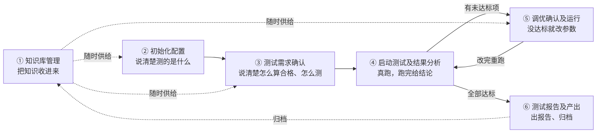
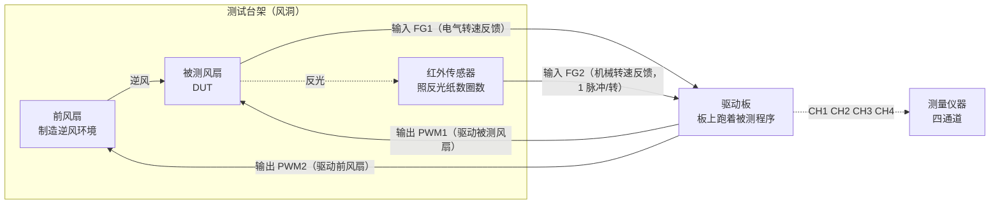
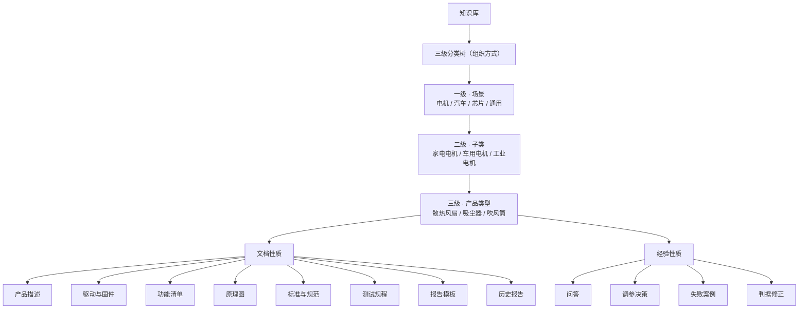
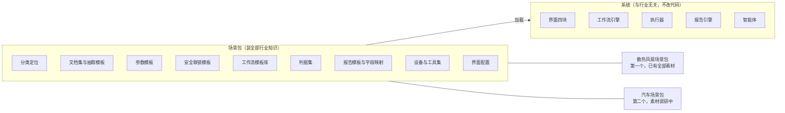

# 业务逻辑说明 · 六个流程

**读者：要实现这套系统、但不懂被测产品业务的开发者。** 本文件不讲页面怎么摆、不讲组件怎么写——那些在同目录的 `01-设计规格-信息架构与页面.md`。本文件只回答一件事：每个流程在现实里到底是什么活，为什么必须有它，它吃什么、吐什么，做对了什么样、做砸了什么样。

看不懂的词先跳过，末尾第六节有术语表，每个词都配了一句人话解释。

---

## 一、三分钟看懂：这个系统在替谁干什么活

### 1.1 现实中的场景

**现实是这样的：某个会转、会动、会发热的产品做出来了，得有人验证它到底行不行。**

这个人是测试工程师。他手上有三样东西：一台样机、一堆文档、一套测试台架。他要做的事是——照着标准和客户要求，把样机在台架上反复跑，跑的过程中用仪器盯着，跑完判断每一项指标是否达标；不达标就改参数再跑，改到达标为止；最后写一份报告交出去。

**这活现在有四个痛点：**

| 痛点 | 具体表现 |
| --- | --- |
| 知识散在人脑里 | 什么现象该改哪个参数，全靠老工程师的经验；人走了经验就没了 |
| 文档看不完 | 一个产品配的手册、规格书、原理图、标准动辄几百页，真正要用的就那十几个数字，但得人去翻 |
| 操作步骤长且易错 | 一轮完整测试几十步，漏一步或顺序错了，结果就不可信；出了事还可能烧板子伤人 |
| 报告靠手工拼 | 截图、导数据、填表格、写结论，重复劳动占掉大量时间 |

### 1.2 这套系统做什么

**把上面四件事交给一个能读文档、能调设备、能给建议的智能体，人只负责拍板。**

| 系统做的事 | 对应解掉的痛点 |
| --- | --- |
| 把文档转成机器能查的结构化数据，测试时自动填参数、自动抽判据 | 文档看不完 |
| 把每一步操作固化成工作流，由系统按顺序执行，人只确认关键节点 | 步骤长且易错 |
| 把每次调参的决策记下来，下次遇到相似情形直接给推荐 | 知识散在人脑里 |
| 把数据、截图、判定结果自动填进报告模板，智能体写结论段 | 报告靠手工拼 |

### 1.3 一个关键设定：不只测电机

**这套系统是按"任何会动的产品都能测"来设计的，电机只是第一个案例。**

对开发者而言，这意味着一条硬性约束：**代码里不允许出现任何行业专有词。** 界面上显示的所有参数名、判据名、步骤名，都是从配置文件读出来的，不是写死的。这些配置文件打包在一起叫"场景包"。要支持汽车，就加一个汽车场景包，不改前端代码。

具体到代码：`极对数`、`FG2`、`Customer.h` 这些词只应该出现在场景包的配置文件里和测试数据里，不应该出现在任何 `.ts` / `.py` 源文件的字符串常量中。

---

## 二、一条主线

**六个流程的关系：一条主链，一个闭环，一个随时可进的旁支。**

用一句话串起来：**先把知识准备好（①），说清楚测什么（②）和怎么算合格（③），然后真跑（④），不合格就改参数再跑（④⑤循环），最后出报告并把这次学到的存回去（⑥→①）。**

---

## 三、六个流程逐个说清楚

每个流程按同一个套路讲，分三组：**这活是什么**（现实中工程师在干什么、为什么要这一步）、**吃什么吐什么**（输入、输出）、**怎么算做对了**（成功长什么样、失败长什么样、峰岹的具体例子）。

---

### 3.1 流程 ① 知识库管理

#### 现实中工程师在干什么

**在翻资料，以及在积累"这类问题上次是怎么解决的"。**

一个测试工程师接到新产品，第一件事是要到一摞文件，大致三类：描述产品本身的（规格书、电路图、控制程序），规定怎么测的（行业标准、公司的测试规程），以及可参照的（以前同类产品的报告）。他得从里面找出测试要用的几十个数字和几十条规则。

另一半的活是隐性的：他脑子里存着大量"上次这个现象是改了那个参数解决的"。这部分从来没被写下来过。

#### 为什么要这一步

**不做这一步，后面五个流程全都得靠人现场翻文档。** 系统要能自动填参数、自动抽判据、自动给调参建议，前提是这些知识已经被转成机器能查的形态。

#### 输入什么

两类，性质完全不同：

| 类别 | 输入 | 谁产生的 |
| --- | --- | --- |
| 文档性质 | 产品描述、驱动程序与固件、功能清单、原理图、标准与规范、测试规程、报告模板、历史报告 | 外部给的，上传进来 |
| 经验性质 | 问答、调参决策、失败案例、判据修正 | 系统自己用起来之后产生的 |

#### 输出什么

- 一棵三级分类树（一级场景、二级子类、三级产品类型），每个产品类型下挂着属于它的文档和经验
- 每份文档的"结构化产物"：从文档里抽出来的参数表、判据表、步骤表、字段映射表
- 一个可检索的索引，后面五个流程都查它

**这里的关键词是"转化"：** 上传一个 PDF 只是把文件存进来，不算入库完成。必须经过五步流水线——识别、抽取、切片、结构化、索引——把 PDF 变成"产品额定电压 = 24，单位伏"这样的字段，才算真正可用。

#### 成功长什么样

一份规格书上传后，系统能回答"这个产品的额定电压是多少"，并且能指出这个答案出自第几页第几行。

#### 失败长什么样

| 失败形态 | 表现 |
| --- | --- |
| 转化失败 | 文件在库里状态是"转化失败"，标明卡在五步中的哪一步 |
| 抽错了 | 抽出来的值是错的，比如把"最高电压 30 V"抽成了额定电压。这种最危险——它会一路传到流程 ② 的参数里。所以结构化置信度低时必须转"需人工校对" |
| 经验没人沉淀 | 经验库一直是空的，流程 ⑤ 的推荐参数只能靠规程里写死的固定序列 |

#### 峰岹的具体例子

一级选"电机"，二级选"家电电机"，三级选"散热风扇"。往下挂：

| 文档类型 | 具体文件 |
| --- | --- |
| 产品描述 | `MCU-DS-14_FU6832_V2.1_20230621.pdf`，芯片数据手册，约 18 兆字节 |
| 驱动与固件 | 散热风扇控制程序工程 `FTC6804A.uvproj`，以及其中的参数头文件 `Customer.h`（约 41 千字节，含约八百条宏定义） |
| 原理图 | 三套方案的电路图，分别是标准方案、VSP 调速方案、无二极管方案 |
| 测试规程 | 八份调试经验文档，含《FU-AM-FOC 调试手册》《有感无感顺逆风启动培训》等 |
| 报告模板 | `Fortior_Motor_Checklist_公用模板_7.xlsm` |
| 历史报告 | 一份已填充好的样例 `report.xlsm` |

经验侧的种子：一批启动实验数据，共一百零一次尝试，其中九十八次带人工标注（标注内容是"这次为什么没启动起来"）。这九十八条直接进"失败案例"类型。

---

### 3.2 流程 ② 初始化配置

#### 现实中工程师在干什么

**在填一张表，回答"这次要测的到底是哪个东西、它本身是什么样"。**

他会打开规格书抄几个数字，打开工程目录确认程序在哪，看一眼电路图确认板子是哪个版本，然后检查一遍安全措施——护罩装了没、急停按钮接了没、电压上限设了没。

#### 为什么要这一步

两个原因：

1. **后面所有判断都依赖这些数字。** 举例：判断"转速对不对"需要知道这个产品的额定转速是多少；不知道额定值，实测值就没法判断。
2. **安全。** 被测产品会转、会发热、会带电。人站在旁边的时候绝不能启动。这些"绝对不能违背的前提"必须在开测前就登记好，并且在启动时被系统强制检查。

#### 输入什么

- 产品描述文档 → 抽出本体属性
- 驱动程序与固件工程 → 抽出工程结构与可调参数清单
- 功能清单 → 确认这次测哪些功能
- 原理图 → 确认板级配置
- 标准与规范里的限值部分 → 作为安全联锁的默认阈值
- 场景包自带的参数模板与联锁模板 → 决定这张表长什么样

#### 输出什么

**一份锁定的配置快照**，里面有三样东西：

| 内容 | 说明 |
| --- | --- |
| 产品本体属性 | 这个产品客观就是这样的量，比如额定电压、尺寸、内部结构参数 |
| 驱动与固件信息 | 程序在哪、哪些参数可以调、怎么编译怎么烧进去 |
| 安全联锁清单 | 一组"不满足就不许启动"的条件，每条都有判定方式和触发后的动作 |

"锁定"是有语义的：锁定之后这份配置变只读，要改必须显式解锁并留记录。这是为了保证后面跑出来的结果，能明确对应到某一份配置。

#### 什么叫"安全联锁"

**这是本项目给这个概念起的正式名字，英文 Safety Interlock。** 它不是普通参数，它是一组开关条件。三类：

| 类别 | 例子 | 怎么判 |
| --- | --- | --- |
| 人员与现场 | 人已经离开设备旁边、防护罩已装好、急停按钮已接线并自检通过 | 人工勾选，记确认人 |
| 电气量上限 | 供电电压不得超过某个值、电流不得超过某个值、温度不得超过某个值 | 运行中持续监测，超了就按设定动作 |
| 流程与基线 | 原始程序已备份、不该改的文件没被改、单次连续运行不超过设定时长 | 系统自动校验 |

对开发者最重要的一点：**联锁在数据结构上必须与普通参数分开。** 因为流程 ④ 的"能不能点启动"这个判断，只查联锁，不查普通参数。

#### "读取文档 → 呈现 → 加减号调整"是什么意思

这是这一步最核心的交互，三段：

1. 人选一份文档，智能体去解析，把能抽到的值自动填进表单，并在每个字段旁标一个"来自文档"的小标记
2. 人逐项核对。看到不对的，用字段左右两侧的减号和加号按钮微调，或直接输入
3. 人改过的字段，标记从"来自文档"变成"人工"，悬停能看到文档原来的值是多少

**为什么要用加减号而不只是输入框：** 这类参数大多有明确步长（比如电流按 0.1 安一档），工程师在现场是"往上试一档、再试一档"的调法，加减号比键盘输入更贴合这个动作，也不容易输错数量级。

#### 成功长什么样

表单填满，校验全绿，点"提交并锁定"，生成一份配置快照。安全联锁清单里每条都有明确状态。

#### 失败长什么样

| 失败形态 | 表现与后果 |
| --- | --- |
| 文档抽错了值 | 表单里是个错数字，人没核对出来。后果是整轮测试的判断基准都是错的 |
| 缺文档 | 某些字段填不上，系统提示去流程 ① 补文档 |
| 联锁没配全 | 流程 ④ 点不了启动，系统指出缺哪一条 |

#### 峰岹的具体例子

| 分组 | 填了什么 |
| --- | --- |
| 本体属性 | 供电电压档位 24 伏；内部结构参数"极对数"填 2 |
| 驱动与固件 | 工程指向 `FTC6804A.uvproj`；参数头文件 `Customer.h` 被解析出约八百条宏，其中本次纳入"可调"的约十四条，包括启动电流、启动角度、两组环路增益、载波频率、死区时间 |
| 通道映射 | 测量仪器四个通道分别接什么：通道一接电气转速反馈 FG1、通道二接机械转速反馈 FG2、通道三接被测风扇的驱动输出 PWM1、通道四接逆风风扇的驱动输出 PWM2 |
| 安全联锁 | 人员离场确认；供电电压上限 30 伏；单次连续运行上限 30 分钟；`Customer.h` 的原始备份已保存 |

---

### 3.3 流程 ③ 测试需求确认

#### 现实中工程师在干什么

**在回答两个问题：这次测到什么程度算合格，以及按什么顺序去测。**

第一个问题的答案来自标准文件和客户要求，通常是一堆"某某指标必须大于/小于某个值"。第二个问题的答案是一套操作步骤，行业里叫测试规程或测试流程。

#### 为什么要这一步

**因为"合格"不是自明的。** 同一台样机，按不同标准判，结论可能一个通过一个不通过。所以必须在开测之前把判据白纸黑字定下来并冻结——冻结之后再跑，结果才有意义。这也是为什么流程 ③ 的输出叫"需求基线"。

#### 输入什么

- 标准与规范文档、客户要求文档
- 测试规程文档
- 工作流模板库（场景包自带）
- 测试案例库与历史成绩

#### 输出什么

**一份冻结的需求基线**，三部分：

| 部分 | 内容 |
| --- | --- |
| 判据表 | 每条：指标名、方向（大于/小于/区间）、阈值、单位、容差、怎么测、什么时候判、等级 |
| 工作流实例 | 具体到这次要跑的步骤序列、循环次数、档位 |
| 案例清单 | 这次要跑哪几个测试案例 |

判据的"等级"是个重要概念：致命、主要、次要三档。整体结论规则由等级决定，比如"全部致命项通过、且主要项通过率不低于某值"才算整体通过。

#### 工作流是什么、为什么它能跨行业

**工作流就是一张步骤图，每个节点是一个动作，连线表示先后顺序。**

关键设计：节点只有四类，这四类是跨行业通用的。

| 节点类 | 干什么 | 测电机时 | 测汽车时 |
| --- | --- | --- | --- |
| 设置类 | 改变被测对象或环境的状态 | 写控制参数、设定供电电压 | 设定档位、设定路面条件 |
| 激励类 | 施加一次动作 | 启动、停止、加速 | 踩油门、打方向、制动 |
| 采集类 | 取一段数据 | 采波形、读转速 | 采加速度、采车速、录像 |
| 判定类 | 对采到的数据下结论 | 比转速阈值 | 比制动距离阈值 |

另有两个结构节点：引用一个子流程、循环容器。

**所以"换行业"这件事，在工作流层面只换两样东西：节点的具体实现（由场景包提供），和模板文件。引擎、画布、执行器都不动。**

#### 成功长什么样

判据表和工作流对得上——每条判据都有对应的采集步骤去取数据，每个采集步骤取回的数据都有判据去用。点"确认需求基线"，冻结，带版本号。

#### 失败长什么样

| 失败形态 | 表现 |
| --- | --- |
| 判据与工作流对不上 | 有判据但没有采它的步骤，或反过来。系统应该主动指出来 |
| 阈值抄错 | 从标准里抄阈值时抄错单位或数量级。后果是全部结论作废 |
| 基线没冻结就开跑 | 跑到一半改判据，前后结果不可比 |

#### 峰岹的具体例子

判据表填三条：

| 指标 | 阈值 | 等级 | 怎么来的 |
| --- | --- | --- | --- |
| 电气转速反馈频率 ÷ 机械转速反馈频率 | 等于 2，容差 ±0.05 | 致命 | 这个产品内部结构参数"极对数"是 2，物理上这个比值必然等于 2；不等于 2 说明转速测量或换相出了问题 |
| 启动成功率 | 不低于设定值 | 致命 | 来自客户要求 |
| 稳态转速偏差 | 不超过 5% | 主要 | 来自测试规程默认值 |

工作流选"启停回归"模板：重复启动停止一百次，每次记录是否成功启动、启动用了多长时间。次数可在一到一千之间调。另可挂"顺风重启"模板，十二个档位，从 500 毫秒到 6000 毫秒。

模板来源：峰岹归档的五十八个主工作流和九个子流程，作为电机场景的模板库导入。

---

### 3.4 流程 ④ 启动测试及结果分析

#### 现实中工程师在干什么

**在真的把产品跑起来，盯着仪器看，跑完对着判据一条条打勾。**

这是整个流程里唯一"真的碰硬件"的一步，也是唯一有物理风险的一步。

#### 为什么要这一步

不用解释——前面三步都是准备，这一步才是测试本身。

#### 为什么控制参数放在这里，而不是流程 ②

**这是本项目一个明确的设计决定。** 区分标准是：**这个量会不会在一次测试里反复改**。

| | 本体属性（放流程 ②） | 控制与整定参数（放流程 ④） |
| --- | --- | --- |
| 是什么 | 产品客观就是那样的量 | 人为设定的、让产品按某种方式工作的量 |
| 会反复改吗 | 不会。改了等于换了个产品 | 会。流程 ⑤ 的全部工作就是改它们 |
| 例子 | 额定电压、尺寸、极对数 | 目标转速、加速时间、环路增益、载波频率 |

如果把控制参数放流程 ②，那每调一次参数就要解锁一次初始化配置，"锁定"就失去意义了。

#### 什么是"安全确认闸门"

**一句话：三件事同时成立，启动按钮才能点。**

1. 流程 ② 登记的安全联锁全部满足——人工类的已经有人勾了并留了名，自动类的系统校验通过
2. 预检通过——设备连得上、通道上有信号、原始程序已备份、产品初始状态正常
3. 现场安全总闸已开——一个必须人当场点的开关，点了本轮有效，跑完自动复位

任一不成立，启动按钮是灰的，并给一行说明差在哪一条，点击直达那一条。

**急停不受闸门约束**，任何时候都能点。点了先发停机指令，再把当时全部状态存下来。

#### 输入什么

四样：流程 ② 的配置快照与安全联锁实例；流程 ③ 的需求基线；本次的控制参数；本轮运行设置，包括跑几次、每次多久、怎么采数据、失败了继续还是停。

#### 输出什么

| 产物 | 内容 |
| --- | --- |
| 轮次产物包 | 原始数据、截图、参数快照、日志，打包存档 |
| 判定结果表 | 每条判据的实测值、阈值、通过与否 |
| 未达标项清单 | 直接交给流程 ⑤ |
| 异常段标注 | 在时间轴上标出判据不满足的那几段，可点进去看当时所有通道的值 |

#### 除了"启动"还要有什么功能

这是产品设计上容易漏的部分，七项：

| 功能 | 一句话 |
| --- | --- |
| 预检自检 | 开跑前先查一遍设备和信号，免得跑半小时才发现某根线没接 |
| 干跑 | 不真施加激励，只走一遍流程逻辑，验证步骤和判据配对没配错，零风险 |
| 录制留档 | 整轮的数据、截图、参数、日志打成一个包，这是报告和复现的唯一依据 |
| 与历史对比 | 和上次、上上次的结果并排看。单看这次的数字看不出来是不是变差了 |
| 异常定位 | 从"不通过"精确到"哪一段不通过"，这是结果分析的核心价值 |
| 断点续跑 | 长轮次中断后从第 N 次继续，不用从头 |
| 台架占用与排队 | 多人共用一套设备时的必需品 |

#### 成功长什么样

一百次跑完，判定表全绿，总体结论"通过"，产物包完整，每个数字都能点回原始波形。

#### 失败长什么样

| 失败形态 | 表现与处理 |
| --- | --- |
| 某条判据不通过 | 这是正常的业务失败，不是系统错误。进流程 ⑤ 调参 |
| 中途设备掉线 | 本轮标记为无效，不计入统计，提示重连后续跑 |
| 触发保护 | 电压或电流超限，系统自动停机并记录触发时刻的全部数据 |
| 人误点启动但联锁没过 | 不应该发生——按钮本来就该是灰的。如果发生了说明闸门逻辑有漏洞，这是最严重的缺陷等级 |

#### 峰岹的具体例子

控制参数填目标转速和启动电流。启动电流的可调范围是 0.1 到 20 安，用加减号一档档调，本轮取 6.0 安。

运行设置选一百次启停，两路转速反馈波形全存。

安全闸门要求：供电电压上限已设为 30 伏、人员已离场、`Customer.h` 原始备份已存。

跑起来之后，面板上实时画四条曲线（两路转速反馈、两路驱动输出）。跑完判定卡逐条给：

- 电气转速反馈频率与机械转速反馈频率之比，实测 2.01，阈值 2.00 ± 0.05 → 通过
- 启动成功率、最长启动耗时 → 另行给出
- 稳态转速偏差 → 另行给出

若某几次启动失败，异常定位把那几次的电流波形段标成异常，点进去能看到失败瞬间四个通道各是什么值。

---

### 3.5 流程 ⑤ 调优确认及运行

#### 现实中工程师在干什么

**在想"这项没达标，该改哪个参数、改多少"，改完再跑一遍看有没有变好。**

这是最依赖经验的一步，也是最耗时间的一步——通常要来回好几轮。

#### 为什么要这一步

产品第一次跑就全部达标是少数情况。绝大多数时候测试的真正价值不在"判个通过不通过"，而在"帮助把产品调到达标"。

#### 输入什么

流程 ④ 的未达标项清单和轮次产物、经验库、测试规程、参数影响关系表。

#### 输出什么

| 产物 | 内容 |
| --- | --- |
| 参数改动版本 | 改了哪些参数、从什么值改到什么值、为什么改、会影响哪些已经通过的判据 |
| 写回结果 | 参数确实写进去了，必要时重新编译并烧录进产品，并校验版本一致 |
| 一条调参决策经验 | 这次的现象、改动、结果，存进经验库供以后检索 |
| 重跑指令 | 回到流程 ④ |

#### 推荐参数从哪来

三个来源并列，界面上分别标明，不混在一起：

| 来源 | 怎么来的 | 可信度怎么体现 |
| --- | --- | --- |
| 经验库 | 检索"以前遇到类似现象时改了什么"，按相似度和历史采纳率排序 | 显示"相似案例 N 条，其中被采纳 M 条" |
| 测试规程 | 规程里写死了一串固定候选，按顺序一个个试 | 显示规程名和这是第几个候选 |
| 模型推断 | 智能体根据当前数据和参数之间的影响关系推断 | 标"模型建议"，并要求给出推断依据 |

**候选试完还不达标怎么办：** 队列末尾给一条"需人工介入"，附上已经试过的全部组合和各自的结果，交给人判断。这比让系统无限试下去诚实得多。

#### 关键约束：智能体不能自己写回

**智能体可以算、可以建议、可以说明理由，但"把参数写进产品"这个动作必须人点按钮。** 原因是写回有物理后果——改错一个参数可能烧掉板子。

#### 回滚有两层

| 层 | 回到哪 |
| --- | --- |
| 参数回滚 | 回到上一个参数版本 |
| 基线回滚 | 回到流程 ② 提交锁定时生成的原始备份，整体还原 |

#### 成功长什么样

从未达标项出发，选了一个候选，改动明细清清楚楚，写回成功并校验通过，重跑后该项达标且没把别的项弄坏。这次决策自动存进了经验库。

#### 失败长什么样

| 失败形态 | 表现 |
| --- | --- |
| 改了这项、坏了那项 | 所以必须有"影响面检查"——采纳前告诉人这个改动还会影响哪些已通过的判据 |
| 候选耗尽 | 转"需人工介入" |
| 写回成功但没生效 | 比如需要重新编译烧录却跳过了这一步。所以写回后必须校验版本一致 |
| 改了但没记 | 经验库没长大，下次还得从头试 |

#### 峰岹的具体例子

未达标项是"启动成功率不足"。

候选队列从测试规程带的固定候选序列取，是一组"启动电流 + 启动角度"的组合，一个个试：某个组合下仍然起不来，换下一个；试到启动电流 6.0 安配某个启动角度时，一百次里的成功率达标。

采纳之后，改动写回 `Customer.h` 中对应的两条宏定义。因为改的是源码里的宏，必须重新编译并把程序烧进芯片，烧完系统自动校验版本一致，然后回流程 ④ 重跑一百次启停。

**开发者要注意的一个坑：** 写回 `Customer.h` 不是简单的文本替换。规程里有明确红线——只允许定位到 `#define` 那一行逐行改，不允许整段重写、不允许改文件编码、不允许用版本控制的强制回退命令去还原。这些红线必须在写回工具里硬编码为保护逻辑，不能指望智能体自觉。

---

### 3.6 流程 ⑥ 测试报告及产出

#### 现实中工程师在干什么

**在把前面所有的数据、图、结论，按公司或客户指定的模板拼成一份能交出去的文件。**

现状是纯手工，三段：先从软件里导数据和截图，再往表格模板里逐格贴、填表头、写结论段，最后导出存档。

#### 为什么要这一步

报告是这整件事的交付物。没有报告，前面五步的价值对外为零。

#### 输入什么

报告模板、字段映射表（模板的哪个位置该填哪个数据）、流程 ② 到 ⑤ 的全部产物、人员与环境信息。

#### 输出什么

报告成品文件、归档记录、回写知识库的历史报告条目和经验条目。

#### 自动填充的四类内容

| 类 | 来源 | 怎么填 |
| --- | --- | --- |
| 字段值 | 配置快照、需求基线、本步填的信息 | 按映射表直接填 |
| 数据表 | 判定结果、各轮汇总 | 批量写进模板的表格区域 |
| 图 | 产物包里的波形图、截图、历史对比图 | 按占位符插图，图题图注自动生成 |
| 结论文字 | 智能体依据判定结果和异常清单写 | 生成后标"待复核"，人工过一遍才能导出 |

#### 一条硬约束

**报告里出现的每一个数值，都必须能点回它的来源轮次和原始数据。** 智能体写的结论段里，不允许出现任何在数据中没出现过的数字。

这条约束在实现上意味着：报告的每个数据单元格都要带一个来源引用字段，不能只存最终值。

#### 成功长什么样

点一下"生成报告"，模板填满，图插好，结论段写好且人工复核通过，导出成文件，同时归档回知识库的历史报告分类。

#### 失败长什么样

| 失败形态 | 表现 |
| --- | --- |
| 字段映射缺 | 模板上有格子但没数据源。系统应该在生成前就列出缺哪些 |
| 结论与数据不符 | 智能体写"各项均达标"但判定表里有一项不通过。所以必须有自洽检查 |
| 图插错位置 | 模板占位符与实际图对不上 |
| 归档没做 | 这次的结果没进历史库，下次没法做历史对比 |

#### 峰岹的具体例子

模板选客户的检查表模板 `Fortior_Motor_Checklist_公用模板_7.xlsm`。字段映射参照已填充好的样例 `report.xlsm` 反推——即对照样例看每个格子里填的是什么数据，建一张映射表。

自动填充把一百次启停的成功率、最长启动耗时、保护是否触发填进对应单元格，并插入若干张波形截图。

结论段由智能体按判定结果撰写，人工复核后导出，同时归档回"电机 / 家电电机 / 散热风扇"分类下的历史报告。

---

## 四、把峰岹散热风扇案例从头走一遍

**这一节把六个流程串成一个连贯的故事，用来检验上面各节有没有理解错。**

被测对象是一个散热风扇。它由一块控制板驱动，板上是一颗电机控制芯片，芯片里跑着一段程序，程序的行为由一个头文件里的几百条参数决定。测试台架是一个风洞：前面一个风扇制造逆风，后面装被测风扇；被测风扇上贴了反光纸，一个红外传感器照着它数转了多少圈。

### 4.1 台架长什么样

**这里有个信号方向的坑，开发时极易搞反：** PWM1 和 PWM2 是板子往外输出的（板子驱动风扇转），FG1 和 FG2 是外面往板子输入的（风扇把自己的转速告诉板子）。板背丝印上四个标识挨着印在一起，看起来像同一类，实际方向相反。

### 4.2 一次完整的走法

| 流程 | 这次具体做了什么 |
| --- | --- |
| ① 知识库管理 | 把芯片数据手册、三套电路图、控制程序工程、八份调试经验文档、报告模板导进"电机 / 家电电机 / 散热风扇"分类；把九十八条带标注的启动失败记录导成失败案例 |
| ② 初始化配置 | 从数据手册抽出本体属性；从程序工程解析出约八百条参数，圈定约十四条为可调；填通道映射（CH1 接 FG1、CH2 接 FG2、CH3 接 PWM1、CH4 接 PWM2）；设安全联锁：人员离场、电压上限 30 伏、连续运行上限 30 分钟、程序原始备份已存。提交锁定 |
| ③ 测试需求确认 | 定三条判据：FG1 与 FG2 的频率比等于 2、容差 ±0.05（致命）；启动成功率不低于设定值（致命）；稳态转速偏差不超过 5%（主要）。工作流选"启停回归"模板，次数设为一百次。冻结基线 |
| ④ 启动测试（第一轮） | 控制参数里启动电流用加减号调到 6.0 安。安全闸门三项全绿，点启动。跑一百次，实时画四条曲线。跑完判定：频率比实测 2.01，通过；启动成功率未达标，不通过 |
| ⑤ 调优确认 | 未达标项是启动成功率。候选队列从规程的固定候选序列取，是一组"启动电流 + 启动角度"的组合。选第一个候选，影响面检查提示它可能影响稳态偏差。采纳，写回程序头文件对应的两条参数，重新编译并烧录，校验版本一致 |
| ④ 启动测试（第二轮） | 重跑一百次。启动成功率达标，稳态偏差仍在 5% 以内。三条判据全绿 |
| ⑥ 测试报告 | 选客户的检查表模板，自动填入成功率、最长启动耗时、保护触发情况，插入波形截图，智能体写结论段，人工复核，导出，归档 |
| ① 归档回知识库 | 本次的调参决策（现象、改了哪两个参数、结果）存进经验库；本次报告进历史报告；下次遇到同类现象，流程 ⑤ 的经验库来源就会命中这一条 |

**这一圈走完，系统比走之前多了一条经验。** 这是整套系统能越用越好的唯一机制。

---

## 五、知识库与场景包：两张结构图

### 5.1 知识库的两大类与三级分类

**两类的区别，一句话：文档是别人给的，经验是自己用出来的。**

| | 文档性质 | 经验性质 |
| --- | --- | --- |
| 从哪来 | 上传进来 | 六个流程里的对话与操作自动沉淀 |
| 会不会变 | 基本不变，换版本才更新 | 一直在长 |
| 怎么被用 | 解析成结构化字段，填参数、抽判据、套模板 | 被检索出来作为调参建议的依据 |
| 出问题的表现 | 抽错值 | 一直是空的，或者存了一堆没人引用的垃圾条目 |

### 5.2 场景包：换行业靠它

**对开发者的含义：** 你写的每一个组件都不该知道"这次测的是风扇还是汽车"。组件拿到的是配置，不是业务。判断标准很简单——把场景包从 A 换成 B，前端代码一行不改就能跑，就对了。

---

## 六、术语表

**按四类组织。缩写第一次出现给全称。**

### 6.1 测试对象与硬件

| 词 | 人话解释 |
| --- | --- |
| 被测对象 | 这次要测的那个东西。行业里也叫 DUT，全称 Device Under Test |
| 样机 | 送来测试的那一台具体的产品实物 |
| 台架 | 做测试用的那一套固定装置，把被测对象装上去、接上线、接上仪器 |
| 涵道 | 一段管状的风洞。前后各装一个风扇，前面那个吹出来的风就成了后面那个的逆风环境 |
| 驱动板 | 一块控制电路板，芯片装在上面，它负责让被测对象按指令动起来 |
| 逆风电机 | 台架上专门用来制造逆风的那个风扇，它不是被测对象 |
| 程控电源 | 一台能被程序控制输出电压电流的电源。测试中用它模拟不同供电条件 |
| 示波器 | 一台画信号波形的仪器。它能把电信号随时间的变化画成曲线 |
| 仿真器 / 烧录器 | 把程序写进芯片、以及在芯片运行时读它内部状态的那个盒子 |

### 6.2 信号与测量

| 词 | 全称 | 人话解释 |
| --- | --- | --- |
| PWM | Pulse Width Modulation，脉冲宽度调制 | 一种让电路输出"平均电压可调"的方波信号。方波占空比越大，电机转得越快。**方向：板子往外输出** |
| PWM1 / PWM2 | — | 峰岹台架上的两路输出：PWM1 驱动被测风扇，PWM2 驱动制造逆风的前风扇 |
| FG | Frequency Generator，转速反馈信号 | 一路方波，每转一定圈数就出一个脉冲。数脉冲频率就知道转速。**方向：外面往板子输入** |
| FG1 | — | 峰岹台架上的电气转速反馈，来自电机自身的换相信号 |
| FG2 | — | 峰岹台架上的机械转速反馈，来自红外传感器照风扇上反光纸得到，每转一圈出一个脉冲，是"真实转速" |
| 极对数 | — | 电机内部结构的一个常数。它决定了电气频率是机械频率的几倍。峰岹这个风扇的极对数是 2，所以 FG1 的频率必然是 FG2 的两倍——这个关系是天然的判据，不等于 2 就说明出问题了 |
| 通道 | — | 仪器上的一个输入口。四通道示波器就是能同时看四路信号。通道号常写作 CH1 到 CH4 |
| 采样率 | — | 仪器每秒钟测多少个点。点越密，能看清的细节越多，数据也越大 |
| 深存储 | 示波器的深存储模式 | 示波器一次能把很长一段波形按原始分辨率完整存下来，而不是只存屏幕上显示的那几百个点。做异常分析时必须用它，否则细节被抹掉 |
| 稳态 | — | 产品跑起来之后进入的平稳阶段，与之相对的是启动、加速这些变化中的阶段 |

### 6.3 软件与文件

| 词 | 人话解释 |
| --- | --- |
| 固件 | 烧在芯片里跑的那段程序。它不像手机应用那样能随时装卸，改一次要重新编译并烧录 |
| `Customer.h` | 峰岹这套控制程序里的参数头文件。它是一个 C 语言头文件，里面是约八百条 `#define` 宏定义，每条定义一个参数的值。调参数本质上就是改这个文件里的某几行 |
| 宏 / `#define` | C 语言里定义常量的写法。`#define IQ_START 60` 就是把启动电流这个参数定为某个值。**改它必须逐行定位着改，不能整段重写** |
| Keil 工程 / `.uvproj` | 一种嵌入式开发环境的工程文件。它记录了这个程序由哪些源文件组成、用什么编译选项。峰岹散热风扇的工程文件是 `FTC6804A.uvproj` |
| 编译烧录 | 把源代码变成芯片能执行的二进制（编译），再把二进制写进芯片（烧录）。改了 `Customer.h` 就必须重来一遍这两步，改动才会生效 |
| `.hex` | 编译产物，烧进芯片的那个二进制文件的一种常见格式 |
| `.wfw` | 峰岹客户测试软件的工作流文件扩展名。一个 `.wfw` 文件就是一条测试流程。格式规范目前没有公开文档，需要从现有文件反推或向客户索取（标为待核实） |
| `.pfd` | 峰岹存放电机参数辨识结果的文件扩展名。文件名里带电阻、电感、反电动势系数等参数标识。全称与二进制格式在现有资料中未找到说明（标为待核实） |
| 原理图 | 电路图。画的是板子上每个元件怎么连的。常见格式是设计软件的源文件加一份导出的 PDF |
| 基线 / 快照 | 某个时刻的完整状态存档。改参数之前先存一份基线，改坏了可以整体还原 |

### 6.4 流程与判定

| 词 | 人话解释 |
| --- | --- |
| 判据 | 一条"怎样算合格"的规则。格式是：某个指标 + 方向 + 阈值 + 容差。例如"频率比 = 2，容差 ±0.05" |
| 阈值 | 判据里那条线。超过或低于它就算不合格 |
| 容差 | 允许偏离阈值的范围。没有容差的判据在实际测量中几乎必然不通过，因为测量总有误差 |
| 需求基线 | 开测之前冻结下来的那份"判据 + 工作流 + 案例清单"。冻结之后再跑，结果才有意义 |
| 工作流 | 一条测试流程，由一串步骤组成，画出来是一张有向图 |
| 规程 | 一份写清楚"这类测试该怎么做、哪些线不能碰"的操作说明文档 |
| 回归 / 长跑 | 把同一件事重复很多次，看成功率。例如"启停回归一百次" |
| 启停测试 | 反复启动、停止被测对象，统计每次是否成功启动、用了多长时间 |
| 顺风重启 / 逆风启动 | 风扇已经在转的时候再让它启动。这比静止启动难，因为得先判断它当前转速和方向 |
| 稳态偏差 | 产品跑稳之后，实际值与目标值差多少，通常用百分比表示 |
| 调优 / 整定 | 调参数让产品达标的过程 |
| 安全联锁 | 本项目的正式术语。一组"不满足就绝对不许启动"的前提条件 |
| 场景包 | 本项目的正式术语。让系统适配某个产品类型所需的全套配置资产 |
| 轮次产物 | 跑一轮测试产生的全部东西打成的包：原始数据、截图、参数快照、日志 |

---

## 七、开发者最容易搞错的六件事

| 序号 | 容易错的地方 | 正确的理解 |
| --- | --- | --- |
| 1 | 把行业术语写进代码 | 界面上所有参数名、判据名、步骤名都从场景包读，代码里不出现"极对数""FG2"这类词 |
| 2 | 把安全联锁当成普通参数存 | 它是独立的数据结构。启动按钮的可用性只查它，不查别的参数 |
| 3 | 让智能体直接执行落盘或控设备的动作 | 智能体可读可算可建议可写草稿；写回参数、启动、停止、急停、导出、归档，一律人点按钮 |
| 4 | 信号方向搞反 | 驱动输出是板子往外发，转速反馈是外面往板子送。四个标识挨着印不代表同方向 |
| 5 | 改参数文件用整段替换 | 必须逐行定位 `#define` 改。整段重写、改文件编码、用版本控制的强制回退去还原，都是明确红线 |
| 6 | 报告里只存最终数值 | 每个数值必须带来源引用，能点回原始轮次和原始数据。这是交付物可信度的底线 |

---

## 八、本文件涉及的待拍板事项

**完整清单在 `01-设计规格-信息架构与页面.md` 第 14 节，这里只列与业务理解直接相关的五条。**

| 序号 | 事项 | 推荐 |
| --- | --- | --- |
| 1 | 智能体叫什么 | 推荐"测试副驾"，界面短名"副驾"；不使用人格化昵称 |
| 2 | 汽车场景包先做哪个产品类型 | 待素材调研结论；建议选有公开标准、文档可获取的品类 |
| 3 | 判据阈值是按产品类型给一套，还是每个具体型号单独标定 | 推荐产品类型级给一套，型号级标定作为场景包的可选覆盖 |
| 4 | 急停是否必须接硬件回路 | 推荐软件急停必需、硬件急停回路强烈建议，场景包可声明为强制 |
| 5 | 报告结论段是否强制人工复核后才能导出 | 推荐强制，不提供关闭选项 |

**另有两条需要向客户核实的事实，本文件中已标"待核实"：** 工作流文件 `.wfw` 的格式规范、电机参数文件 `.pfd` 的全称与二进制格式，现有资料中均无说明。

---

**同目录文件：** 页面与信息架构规格见 `01-设计规格-信息架构与页面.md`；用户原始要求见 `00-用户需求原话-20260919.md`；客户现页面参考见 `_调研/ref-客户Copilot页面-用户提供-20260919.png`。
