# 多场景 Agent 测试系统 · 页面原型与业务逻辑 v2.1

面向老板与对接同事。全文以图与前端页面截图为主，文字只写读图必需的注解。图注格式统一为「图 N｜看哪里｜说明什么」。

产品名 `OmniTest` 为占位待拍板；智能体统一称「测试副驾」，界面短名「副驾」。

| 版本 | 变更 |
| --- | --- |
| v1.0 | 首版。六流程各一屏，截图取自峰岹散热风扇单场景包 |
| v1.1 | 全部页面截图按评审后的版本重拍；新增汽车玻璃升降器场景包的三张页面截图与一张双包对照图；判据求值、卡槽换卡、闸门折叠、报告机型字段的改动写进正文与图注 |
| v2.1 | 视觉第二版整体重做后重拍全部页面截图，正文十五处引用换成 `final-` 系列；图注按第二版的顶栏 stepper、动作条、左栏分组、面板 hero 卡、右侧竖工具条、满宽副驾逐张重写；第二节补视觉规约来源与五条批评的对应做法；状态色用量一条结案 |

---

## 一、一句话定位

**这是一套可适应多种场景的、基于 Agent 的测试系统，跑在浏览器里，不装客户端；换一个行业只换一个场景包，系统侧代码不动。**

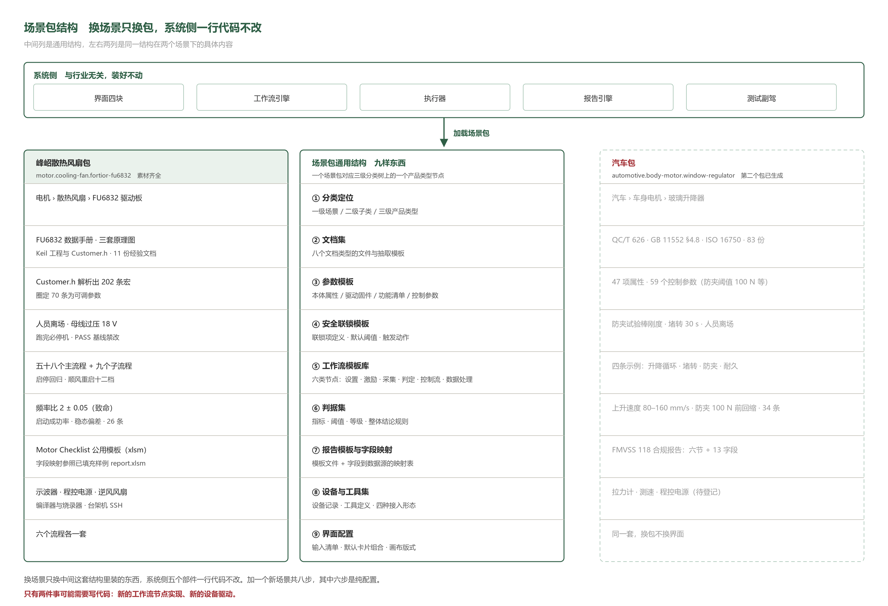

图 1｜看哪里：中间列是场景包的九样通用结构，左列是峰岹散热风扇包，右列是汽车玻璃升降器包，右列现在写的是这个包的真实内容——标准文档 83 份、本体属性 47 项、控制参数 59 个、判据 34 条、示例工作流 4 条，最后一行「同一套，换包不换界面」指界面配置两包共用｜说明什么：第二个包已经接入并能跑，换包不改代码。

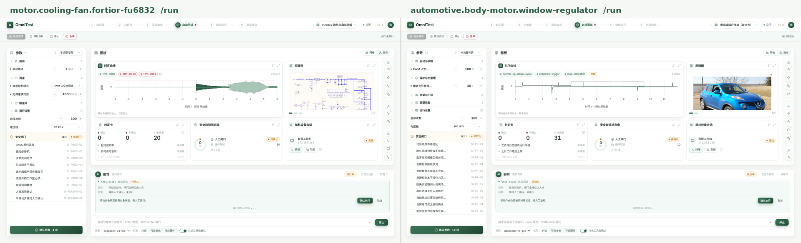

图 2｜看哪里：同一份前端代码加载两个包跑同一个流程「启动测试及结果分析」，左右两屏的顶栏六步、动作条四个按钮、面板六卡布局、右侧竖工具条、满宽副驾完全同构；差别全在包里——左边参数 4 项、安全闸门 0/9、判定未采集 20，右边参数 12 项、安全闸门 0/11、判定未采集 31，右边时序卡的三条曲线挂「合成」标记｜说明什么：换包只换数据与卡内内容，页面结构一行不改。

系统侧五个部件与行业无关：界面四块、工作流引擎、执行器、报告引擎、测试副驾。加一个新场景共八步，其中六步是纯配置，只有新工作流节点实现与新设备驱动这两件可能要写代码。

---

## 二、页面长什么样

**主界面永远只有四块：A 顶栏、B 左栏、C 右上面板、D 右下对话；每块内部最深到四级，第五级必须换弹层、抽屉或独立页承载。**

第二版视觉按「三级表面 + 图标 + 短标签 + 8pt 留白 + 16:9」整体重做，完整规约见 `~/agent-test-web/DESIGN.md`。层次不再靠给每个框描一样的边，而是靠白底主表面、浅绿次表面、只有分隔线的行级三档区分；每页只留一个横跨两格的主体卡。下表是上一版收到的五条批评与这一版对应的做法。

| 批评原话要点 | 这一版的做法 |
| --- | --- |
| 所有框都一样，分不清主次重点 | 三级表面分层，每页只有一张 hero 卡横跨两格、卡头图标反白实底，其余卡默认极淡阴影 |
| 几乎没有图标使用 | 顶栏六步、动作条按钮、左栏分组、卡头、右侧工具条、副驾按钮全部配图标，卡片图标在 `src/app/icons.ts` 登记 |
| 文字太多，好多地方几个关键词就够 | 标签一律不超过 6 字，全名与量程收进悬浮气泡，整句话只留在气泡与副驾对话里 |
| 排版缺留白 | 间距全部取 8pt 制，卡间 16、三块间距 24、外边距 32 |
| 比例与尺寸应为 16:9 | 基准画布 1920×1080，间距用 `clamp()` 随视口收缩，1600×900 与 1440×810 同版式不破版 |

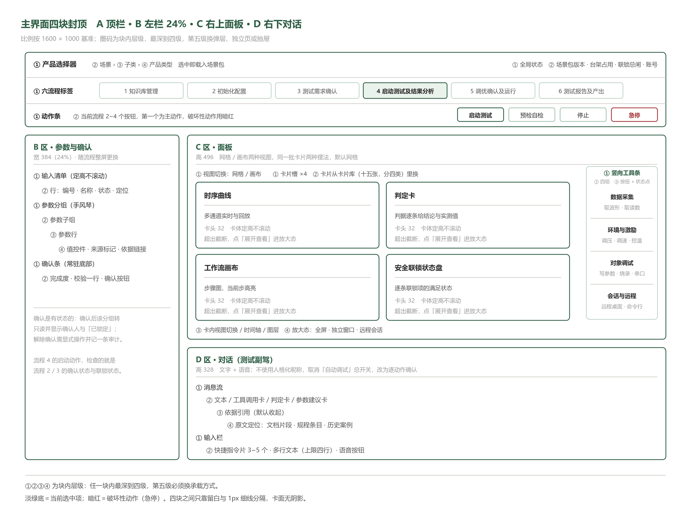

图 3｜看哪里：四块的大小比例（A 通栏、B 占 24%、右列上下二分），以及每块里 ①②③④ 的缩进层数｜说明什么：这就是前端的组件树层数，用来防止元素堆在一个块里。

图 4｜看哪里：顶栏六步 stepper 停在第 4 步、动作条四个按钮「启动测试 / 预检自检 / 停止 / 急停」与右端「闸门未放行」、左栏参数 4 项分四组且每行带圆形加减、左栏下部安全闸门 0/9 逐条列到 `SI-PERSON-02`、面板里横跨两格的时序曲线 hero 卡与右上原理图 1/3、第二行判定卡 0/0/20 与安全联锁状态盘 0/9 共 19 条与单机设备会话「离线」、面板右缘的竖排工具条、满宽副驾里的 `test_start` 待确认卡与「确认执行 / 取消」｜说明什么：四块各司其职——顶栏管去哪，左栏管填什么，右上管看什么，右下管问谁。面板固定 3 列 2 行六槽，首槽即主体；多出来的卡不挤进网格，从卡头换卡进来。顶栏右端常驻场景包、台架占用、联锁数与账号。

---

## 三、六个流程各一屏

**六个流程是一条主链加一个闭环加一个旁支：①→②→③→④→⑤→⑥ 是主链，⑤ 改完参数回 ④ 重跑是闭环，① 知识库随时可进、与其余五个双向。**

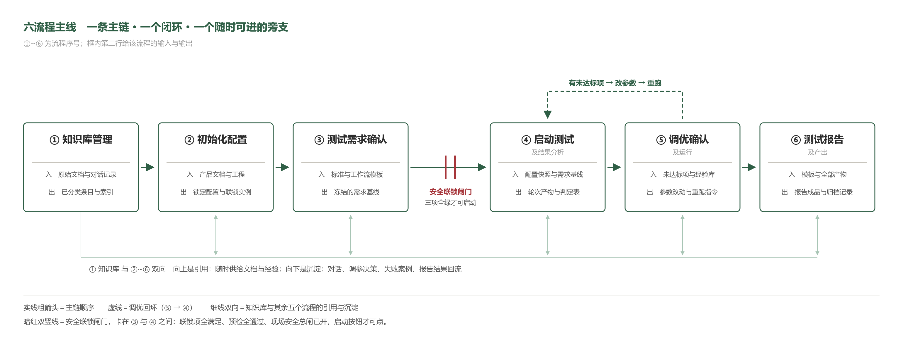

图 5｜看哪里：中间一排框里每框第二行的「入 / 出」，③ 与 ④ 之间那道暗红双竖线，以及底部的双向细线｜说明什么：暗红双竖线是安全联锁闸门，联锁项全满足、预检全通过、现场安全总闸已开，启动按钮才可点；底部细线表示知识库向上供给文档与经验、向下回收对话与失败案例。

六个流程在两个场景包下都跑通了，页面代码是同一份。下面每节先给峰岹散热风扇包的截图，再说一句汽车包在同一页面上是什么样。

### 3.1 知识库管理

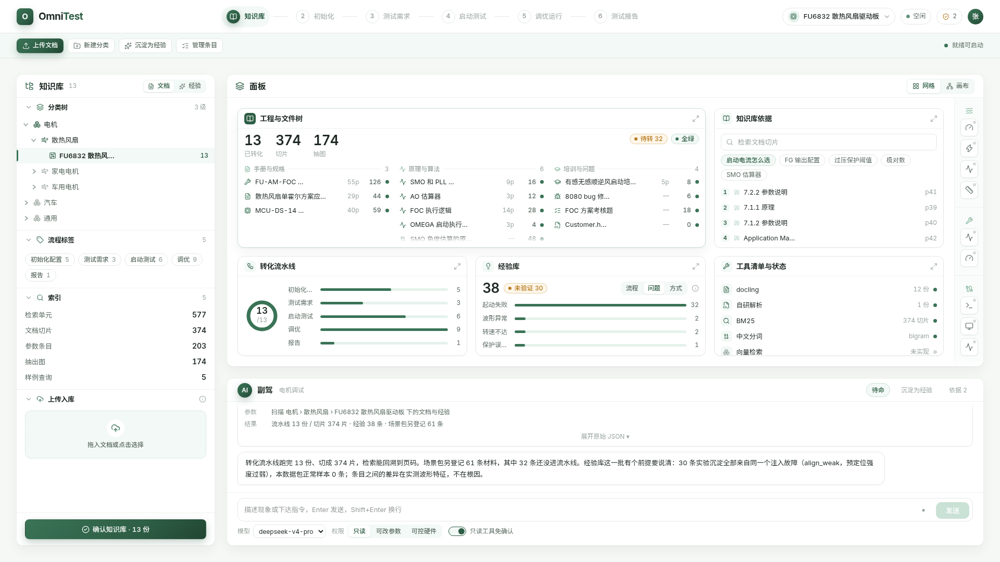

图 6｜看哪里：左栏三级分类树停在「FU6832 散热风扇驱动板 13」、其下流程标签 5 组与索引五行数字、底部拖放上传区；面板首槽「工程与文件树」的三个大数 13 / 374 / 174 与右上「待转 32」「全绿」，右上第二槽是知识库依据；第二行「转化流水线」环 13/13 与按流程分的五条进度、「经验库」38 条与「未验证 30」、「工具清单与状态」里向量检索一行标「未实现」｜说明什么：这一步把散落的文档与过去的经验收进一棵树，数字来自真跑的流水线——13 份文档全部转化，切成 374 片、抽出图 174 张，检索单元 577、参数条目 203、样例查询 5 条，命中带页码可点回原文。场景包另登记材料 61 条，其中 32 条还没进流水线，卡头「待转 32」就是它。经验 38 条里 30 条未验证，且都来自同一个注入故障，条目之间的差异在波形特征不在根因。副驾在这里只做扫描、分类建议与差异说明，删条目与改分类归属要人点。

汽车包同页面：分类树换成「汽车 › 车身电机 › 玻璃升降器」，登记材料 83 份，条目都带来源出处，流水线未跑。

### 3.2 初始化配置

图 7｜看哪里：左栏本体属性 29 项、右上角「占位 5」、七个分组从电机本体 7 项到转速信号 2 项、可调项带圆形加减；面板首槽是铺满卡面的产品示意图，右上第二槽「原理图」列出数据手册 17.2 MB、`Customer.h` 40 KB、原理图 ×3 共 88 KB 与「读取并填充」；第二行工程与文件树 61 个文件、安全联锁状态盘 12/19 分硬件 10 / 流程 7 / 人员 2、台架实况三台设备全部「未接入」｜说明什么：这一步只填产品自己的属性，不填这次要怎么跑。副驾一次读回 29 项，其中占位 5 处、不适用 0 项，回填结果标「建议」，源材料没给的标「待确认」，提交并锁定由人点。

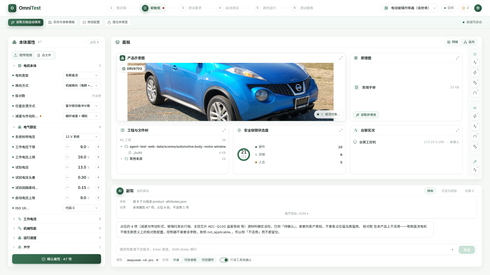

图 8｜看哪里：同一页面换成玻璃升降器包——左栏本体属性 47 项、占位 4、分组换成电机本体 5 项与电气额定 8 项等六组，极对数一行写「不适用」；面板首槽换成被测对象实车照片，第二槽原理图只剩一份 25 KB 数据手册；第二行工程与文件树指向 `automotive.body-motor.window-regulator`、安全联锁状态盘 21/21 分硬件 10 / 流程 6 / 人员 5｜说明什么：换包之后左栏分组、卡槽顺序、加减号控件全部沿用，只有内容换了。极对数标「不适用」而不是留空——有刷直流电机没有这个配置项，控制器也不需要该参数。

### 3.3 测试需求确认

图 9｜看哪里：左栏测试要求 26 条分十组，每条右侧是阈值药丸，底部一行「20/26 可自动求值」；面板首槽是工作流画布 hero，卡底写 `HV_StaticStart` 节点 14、连线 20、子流程 0；右上第二槽「工作流库」68 条 12 组，展开的「静止启动测试」组下五条各带档位标记；第二行判定卡 26/26 本轮纳入、可求值 20 / 人工判 6 / 待确认 7，知识库依据给出 `TR-START-01` 命中 2 处，历史对比启停实验包 101 次 PASS 67 FAIL 30｜说明什么：这一步把「测什么、怎么算合格」冻结成需求基线。卡上的 68 条 12 组是可加载的归档 `.wfw` 文件及其分组，副驾工具返回的 67 条 11 组是场景包登记数，两个口径并存不合并。6 条判据写不出布尔表达式，是排程规则与目视检查那一类。

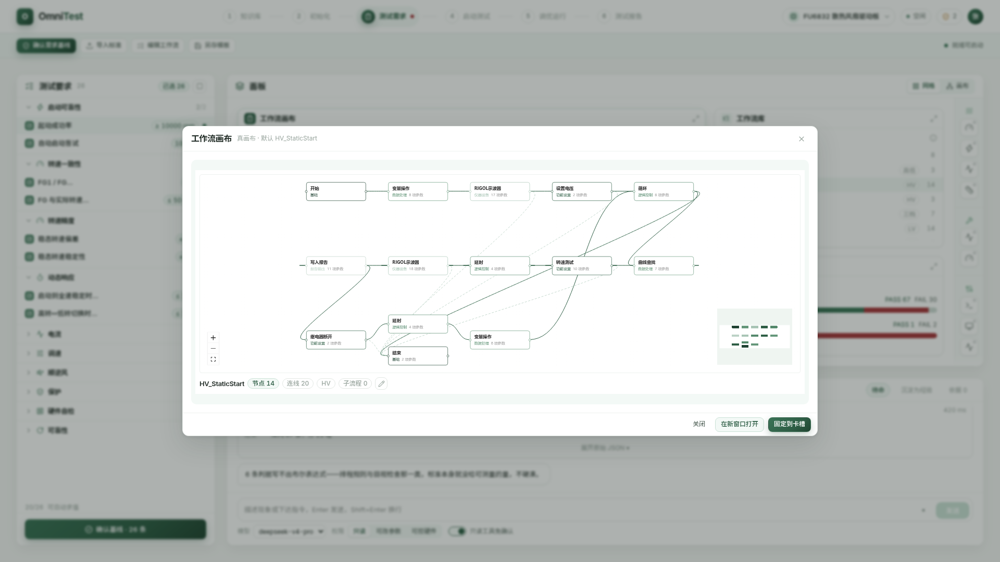

图 10｜看哪里：弹层标题右侧写「真画布 · 默认 `HV_StaticStart`」，图里每个节点是「节点名 + 所属工具组 + N 项参数」两行，右下角有缩略导航图，左下角是缩放与复位，底栏重复节点 14 / 连线 20 / 子流程 0 并带编辑按钮，弹层底部三个出口是关闭、在新窗口打开、固定到卡槽｜说明什么：卡片点开即进放大态，拓扑与参数计数来自客户归档的 `.wfw` 文件解析结果，不是画出来的示意；虚线是跨行回连，不是另一种语义。

### 3.4 启动测试及结果分析

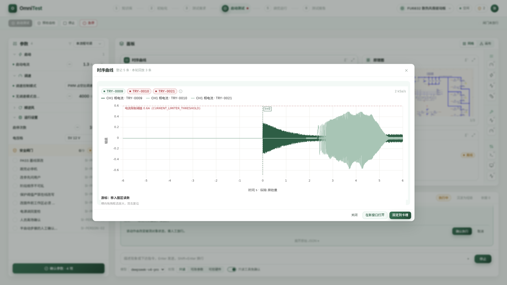

图 11｜看哪里：弹层标题右侧「登记 5 条 · 本轮回放 3 条」，图例是三条 CH1 相电流 `TRY-0009` / `TRY-0010` / `TRY-0021`，暗红虚线标注「电流限制阈值 0.6 A」并给出常量名，纵向虚线标 `t=0`，右上角写 2 kSa/s，纵轴从 -0.6 到 0.6、横轴 -6 到 6 秒，图下一行写游标与框选放大的用法｜说明什么：这一步真跑、真采、真判。该屏全貌见图 4——执行进度、判定卡逐条给结论与实测值、安全联锁状态盘逐条显示满足状态。副驾可以算曲线特征、逐条对判据，但启动、停止、急停三个动作必须人点，且须联锁全绿。

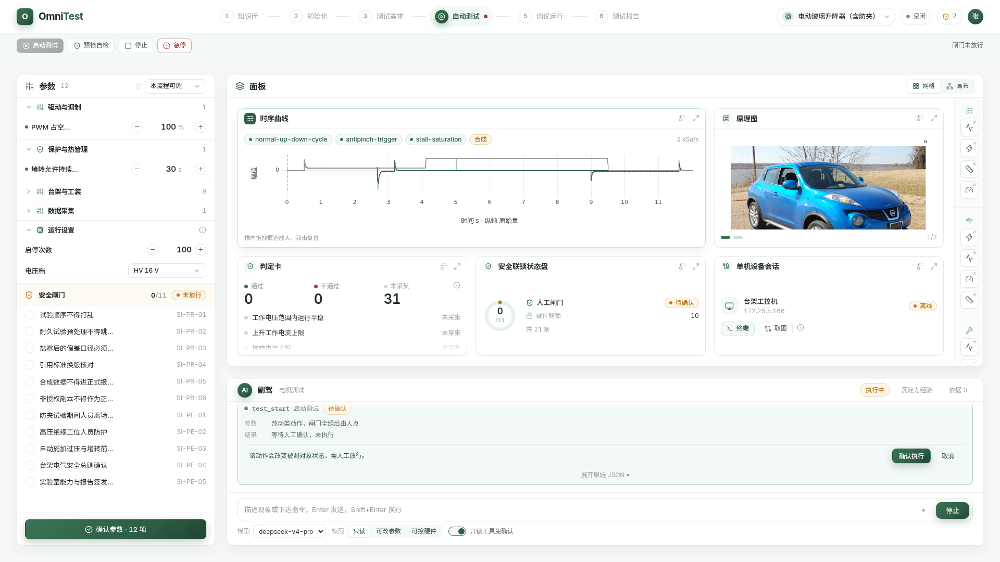

图 12｜看哪里：同一流程换汽车包——左栏参数 12 项分五组、安全闸门 0/11 逐条列到 `SI-PE-05`；面板时序卡的三条曲线名为 `normal-up-down-cycle`、`antipinch-trigger`、`stall-saturation`，右侧挂「合成」标记，横轴 0 到 11 秒；判定卡未采集 31，安全联锁状态盘 0/11 共 21 条｜说明什么：同一条执行链路在汽车包上跑通，判据全表 34 条里 31 条可自动求值；没有实测量的判据照样标「未采集」，不拿合成值顶真值。

### 3.5 调优确认及运行

图 13｜看哪里：左栏顶部三个大数「未达标 0 / 已通过 0 / 未采集 20」，其下「未达标项 0」是一块空状态，再下「推荐参数 6」逐条给「当前值 → 建议值」与幅度药丸，最底「未采集 20」列出每条缺几个实测量；面板首槽是三轮波形叠放的历史对比、右上角写 Δ峰值 0.29，第二槽「候选队列」6 条加 4 个空位、底部写「6/10 上限 10 · 耗尽转人工」；第二行知识库依据挂 `EXP-001` 等三条经验编号，判定卡 0/20，时序曲线卡给峰值 0.57、稳态 0.01、首响 2867 ms｜说明什么：判据改成真求值以后，本轮一条判不通过的也没有——20 条判据因为缺现场实测量根本判不了，既不算通过也不算不通过，不进调优推荐。副驾把候选排好队，采纳与写回都要人点，左栏底部按钮现在显示「确认采纳 · 0 项」。

汽车包同页面：来源换成三套法规条款与包内经验，未达标项一样因为缺实测量判不了。

### 3.6 测试报告及产出

图 14｜看哪里：左栏报告信息 0/10、右上角「待补 4」，模板卡写 `Fortior_Motor_Checklist_公用模板_7(1).xlsm` 11 分页 10 节，其下「上游带入 6」六行统一显示「由上游带入」、「本流程补全 4」四行是空输入框、最底导出格式二选一；面板首槽报告预览分表头、波形图位、判定表三栏，页脚写共 11 页、图位 106；第二槽产物留档给出波形 CSV 3 份 2.9 MB、波形截图 106 张待采集、判定 JSON 26 条待导出、报告文件未生成；第二行历史对比里上一批 101 次 66% 与本轮 26 条 0%，模板字段 0/10｜说明什么：这一步出交付物。机型一栏显示「由上游带入」，不再写死具体型号。硬规矩：报告里每个数值都必须能点回原始轮次与原始数据；结论段建议强制人工复核。

汽车包同页面：模板换成 FMVSS 118 合规报告的六节加 13 个字段，字段定位逻辑不变。

---

## 四、知识库怎么体现

**知识库按两个维度切：来源分文档与经验两大类，归属分场景、子类、产品类型三级，不设第四级。**

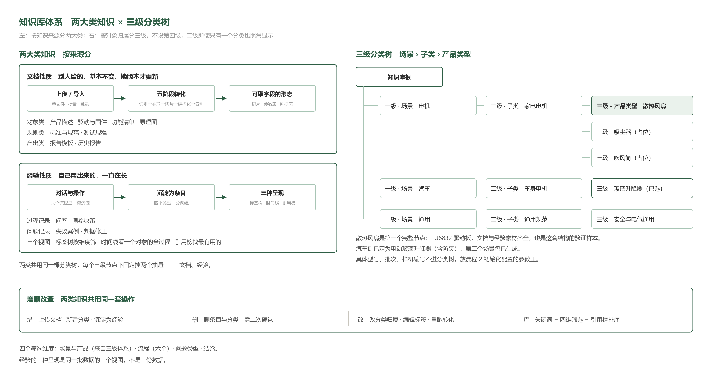

图 15｜看哪里：左半两大类各自的转化链路，右半三级树上绿底的「散热风扇」与暗红虚线的占位节点，底部是两类共用的一套增删改查｜说明什么：文档是别人给的、基本不变、换版本才更新；经验是自己用出来的、一直在长。具体型号、批次、样机编号不进分类树，放流程 2 的参数里。

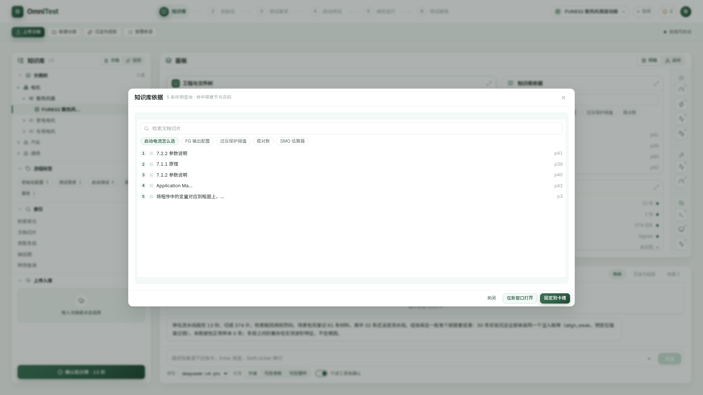

图 16｜看哪里：弹层标题右侧写「5 条样例查询 · 命中带章节与页码」，上方是检索框与五个预置问题药丸，下方五条命中各给章节号与页码，最末一条落在 p3｜说明什么：知识库不是一个单独的页面，而是贯穿六个流程的引用层。副驾说的每句结论旁都挂依据数，有几条就显示几条，点开即见出处；接不到原文的直接写接不到。该屏与图 6 是同一个流程的两个状态。

---

## 五、单机设备怎么进网页

**凡是只能在某台机器上跑的设备，界面不重写它的控制面板，而是把那台机器的会话拉过来；示波器这类走 SSH（Secure Shell，安全外壳协议）会话拉取。**

图 17｜看哪里：左列三台设备的连接状态、中间终端里台架机真实目录列表（51 个文件、857 MB）、底部说明私钥留在网关侧｜说明什么：浏览器只拿到 WebSocket 帧，不管理任何凭据；预置命令按钮让不熟命令行的人也能取文件、查日志。

图 18｜看哪里：右列截图卡里拉回的示波器实时画面，下方标注了回退来源文件｜说明什么：SSH 落在 Session 0 看不到桌面 GUI 窗口，取不到实时屏时自动回退为台架机上最近一张留档图，卡片下方明确标出来源，不冒充实时。

---

## 六、智能体在哪、边界是什么

**智能体不是漂在界面上的一个聊天框，它是服务端 DeepSeek Harness（DSH，DeepSeek 开源的 Agent 运行时）里的一条执行链；它可读可算可建议可写草稿，凡是会落盘生效或会动被测对象的动作，一律人点。**

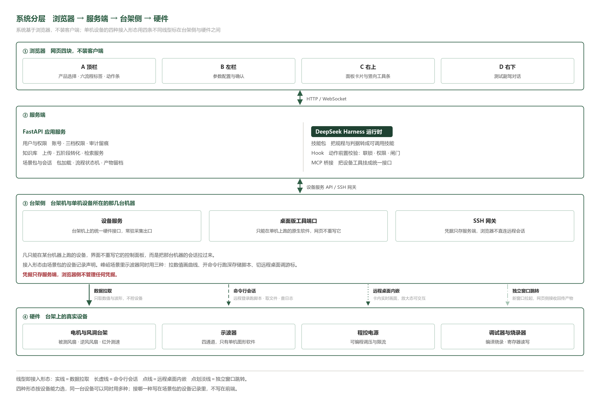

图 19｜看哪里：自上而下四条层带（浏览器 / 服务端 / 台架侧 / 硬件），以及台架侧到硬件之间四种不同线型｜说明什么：四种线型就是单机设备的四种接入形态——实线数据拉取、长虚线命令行会话、点线远程桌面内嵌、点划淡线独立窗口跳转。接哪一种写在场景包的设备记录里，不写在前端。

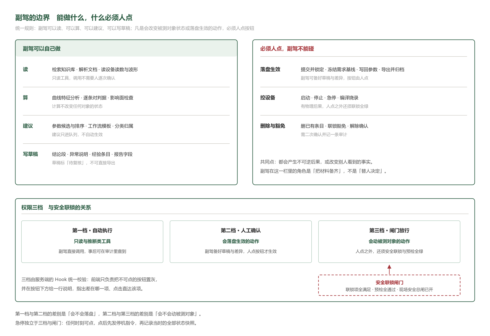

图 20｜看哪里：上半左右两栏的对照，下半权限三档的递进，以及暗红虚线框只卡在第三档｜说明什么：第一档与第二档的差别是会不会落盘，第二档与第三档的差别是会不会动被测对象。三档由服务端 Hook 统一校验，前端只负责把不可点的按钮置灰并说明差在哪一项。急停独立于三档与闸门，任何时刻可点。

图 21｜看哪里：从 `Skill` 加载规程，到依次调用电机启动、示波器采集、读转速三个工具，再到结论行 `fg1_over_fg2 = 2.0 → within 1.95–2.05 → pass`｜说明什么：模型在 DSH 里真的调了电机与示波器工具，不是演示动画。同一套装置上，一次「用 30 A 起动」的请求被安全 Hook 在调用前拦下——限值 20 A，硬件侧日志全空，说明是真拦截而非事后否决；模型把原因告知用户，并拒绝自行降流重试。

---

## 七、用了哪些现成的

**能用现成的就不自研，选小而新的单一用途库，每个能力只选一个，全部用适配层包一层。**

| 层 | 选型 | 版本 |
| --- | --- | --- |
| 界面框架 | Vite + React + TypeScript + Tailwind CSS | 分别为 8 / 19 / 6 / 4 |
| 界面组件库 | Mantine（`@mantine/core`，github.com/mantinedev/mantine，MIT） | 9.6.1 |
| 时序曲线 | uPlot（github.com/leeoniya/uPlot，MIT）加 `uplot-react` | 1.6.32 / 1.2.4 |
| 工作流画布 | React Flow（`@xyflow/react`，github.com/xyflow/xyflow，核心 MIT） | 12.11.6 |
| 图标 | Lucide（`lucide-react`，github.com/lucide-icons/lucide，ISC） | 随仓库锁定版本 |
| 网页终端 | WebSSH2（github.com/billchurch/webssh2，MIT），底层 xterm.js 加 ssh2 | 5.2.1 / 6.0.0 / 1.17.0 |
| 文档转化 | Docling（IBM 与 LF AI & Data，github.com/docling-project/docling，MIT） | 2.129.0 |
| 向量检索 | LanceDB（github.com/lancedb/lancedb，Apache-2.0） | 0.39.0 |
| Agent 运行时 | DeepSeek Harness（`@deepseek-ai/dsh`，github.com/deepseek-ai/deepseek-harness，MIT） | 0.1.5-rc.2 |
| 设备工具桥接 | MCP（Model Context Protocol，模型上下文协议）客户端 `@deepseek-ai/dsh-mcp-client` | 0.0.1-rc.1 |
| 技能积累包 | superpowers（github.com/obra/superpowers，MIT），补仪器控制与时序分析两套 | 随仓库主干 |

两项尚无结论：图纸浏览未做对比与许可核实；远程桌面有候选但判为超配，建议一期只留卡片位。一项必须自建：硬件输入输出层在 DSH 插件生态里七组关键词零命中，推荐写成标准 MCP Server 再桥接，不与任何一个 Agent 框架绑死。

---

## 八、开发者从哪开始

**仓库位置：`/mnt/f/Main/File/2_Projects/峰岹/40_工程/agent-test-web/`（前端壳与设计系统）；两个场景包在同级的 `agent-test-web-data/scenes/` 下，分别是 `motor.cooling-fan.fortior-fu6832` 与 `automotive.body-motor.window-regulator`。**

四份必读文档，前三份在本文件同目录：业务逻辑见 `02-业务逻辑说明-六个流程.md`，页面与信息架构规格见 `01-设计规格-信息架构与页面.md`，同事任务详单见 `04-同事实施任务详单-v2.0.md`；第四份是视觉规约 `agent-test-web/DESIGN.md`，改版式与加卡片之前先读它的第 3 节与第 6 节。

**先读这三句：**

1. 你写的每一个组件都不该知道这次测的是风扇还是汽车——组件拿到的是配置，不是业务；把场景包从 A 换成 B，前端代码一行不改还能跑，就对了，图 2 就是这件事的证据。
2. 安全联锁是独立的数据结构，不是普通参数——启动按钮的可用性只查它。
3. 副驾可读可算可建议可写草稿，六个动作一律人点：控设备的启动、停止、急停，落盘的写回参数、导出、归档。

---

## 九、待拍板

| 序号 | 事项 | 现状与建议 |
| --- | --- | --- |
| 1 | 系统对外产品名 | 代号 `OmniTest`，中文暂用「多场景 Agent 测试系统」，请拍板 |
| 2 | 智能体命名 | 建议「测试副驾」，界面短名「副驾」，不使用人格化昵称 |
| 3 | 汽车包本体数值可信度 | 47 项本体属性里待核实 182 处，数值来自公开征求意见稿与同类参考设计，不是定稿标准；页面已逐项标「待核实」，不拿它当真值用，是否采购正式标准请拍板 |
| 4 | 汽车包时序为合成 | 玻璃升降器包内 3 条时序全部是合成数据，页面与判定卡都挂「合成数据，非实测」标记；公开数据集只找到一条同类真实数据（F.A.I.R. 有刷直流电机故障开放数据集，10.5281/zenodo.4314249），仅登记未接入 |
| 5 | 状态色用量 | 已解决，留作记录。按 `agent-test-web/DESIGN.md` 第 8 节逐页核过，六页每屏状态色均不超过 5 处，暗红只留急停与回滚基线两类破坏性动作，等待放行、待补、待采集一律降为琥珀 |
| 6 | 集成测试的画布视图 | 建议第一阶段只做网格视图与单卡放大，画布视图的自由摆放与非结构化连线尚未实做原型验证 |
| 7 | 知识库联网层不可达 | 部分对口标准的平台以版权为由不公开全文，需采购；系统内该层暂标「待核实」，不填近似值 |
| 8 | 判据阈值待客户确认 | 起动成功率的合格阈值、单次连续运行时长上限，现有资料均无出处，需客户给数 |

---

**本文件的图**：手排图六张在 `_图/`，页面截图在 `03-截图/`。正文引用十五张，其中十二张是第二版视觉的 `final-` 系列，另三张是网页终端、远程取图、DSH 实跑，这三张拍的是后端能力不是页面版式，未随视觉改版重拍。`final-` 系列另有六张 1440×810 的同页面截图只作不破版的旁证，未嵌入正文；第一版视觉的截图全部保留在同一目录，文件名不带 `final-` 前缀，仅供比对，不再引用。两个场景包的数字可在 `agent-test-web-data/scenes/` 下逐条核对，每条数据自带 `_source` 字段指回原始文件与定位；知识库流水线的数字在 `agent-test-web/public/kb/` 下的 `documents/index.json`、`experience/index.json` 与 `search-samples.json`。
