# 多场景 Agent 测试系统 页面原型与业务逻辑 v3.0

**OmniTest（暂定名，待拍板）是一套可适应多种场景的、基于 Agent 的测试系统。跑在浏览器里，不装客户端；换一个行业只换一个场景包，系统侧代码不动。**

面向老板与团队同事。全文以截图与架构图为主，文字只写读图必需的注解。产品名 `OmniTest` 为占位待拍板；智能体统一称「助手」。

事实来源是同目录六份工作流报告 `07a-W1放行说明-接口清单.md` 至 `07f-W6收尾报告.md`。本文相对路径均以该目录为根，绝对路径见文末。

| 版本 | 变更 |
| --- | --- |
| v1.0 | 首版。六流程各一屏，峰岹散热风扇单场景包 |
| v1.1 | 截图重拍；新增汽车玻璃升降器场景包 |
| v2.1 | 视觉第二版整体重做，全部截图换成 `final-` 系列 |
| v3.0 | **第三轮结构性改版**：知识库从流程降为基础模块、C 区从卡片网格改为统一画板、B 区全面分层折叠、助手加预置动作按钮。2026-09-20 依 `07f-W6收尾报告.md` 校正全部状态描述与截图 |

---

## 一、18 条录音意见落地表

**第三轮依据 18 条录音意见（R-01 至 R-18）做了结构性改版，不是视觉微调。**

意见来源：2026-09-19 21:21 用户录音，17 分 17 秒，飞书妙记 `https://hcnd3xtushu0.feishu.cn/minutes/obcn48y5u7v97ch83g7e82ft`。逐字稿与编号见 `00b-用户录音意见原话-20260919-2121.md`。

| 意见 | 一句话 | 落地位置 | 对应截图（`03-截图/` 下） |
| --- | --- | --- | --- |
| R-01 | 知识库不该与 2–6 平级 | 知识库降为基础模块，不占流程序号 | `final-knowledge.png` |
| R-02 | 知识库比 2–6 更底层 | 顶栏右端常驻按钮进入独立页 `/knowledge`，按钮上显示真实条目数 | `final-knowledge.png` |
| R-03 | C 区要能整体滚轮缩放 | React Flow 画板，0.4x 至 2.5x，缩放条右下角、缩略导航图左下角 | `final-extra-canvas-zoom.png` |
| R-04 | 统一画板、仿物理连接、右侧可拖拽 | 两类边：物理连接标通道名、数据流走浅绿虚线；工具条可拖入画板建节点 | `final-init.png` |
| R-05 | 图五要改 | 架构图重画为五流程主线加底部知识库层带 | `_图/fig2_五流程主线与知识库层带.png` |
| R-06 | 知识库页不套统一版式 | 独立页版式：面包屑、三轴筛选、条目列表、详情栏，只保留 D 区助手 | `final-knowledge.png` |
| R-07 | 画布没有具体呈现 | 画板已落地，十一类节点全部注册并可渲染 | `final-init.png` |
| R-08 | 追问知识库分了几类 | 三轴正交分类已实装，见第二节 | `final-extra-kb-filter.png` |
| R-09 | 要求的知识分类没做 | 用途轴新增：产品说明书、测试需求、工艺三类 | `final-extra-kb-filter.png` |
| R-10 | 工艺、测试需求、产品说明书要有分类体系 | 186 条知识逐条落位到三轴，15 条待人工复核 | `final-extra-kb-filter.png` |
| R-11 | B 区要有内部滚动条 | B 区自身滚动、页面整体不滚动；滚动条配色与版式占位已生效，可见性未人眼验证 | `final-init.png` |
| R-12 | 初始化配置讲不清、信息堆一页 | 五个一级类、默认只展开第一类 | `final-init.png` |
| R-13 | 语言尚可 | 保持 | — |
| R-14 | 案例过于复杂、demo 故事不好讲 | 演示模式：参数 ≤12 项、判据 ≤6 条、故事线一条；顶栏加「演示 / 全量」分段控件，默认演示 | `final-run.png` |
| R-15 | 助手要有按钮、带 prompt 或 skill 执行 | 每条流程 5 枚预置动作按钮；知识库页 4 枚 | `final-extra-confirm.png`、`final-knowledge.png` |
| R-16 | 全篇平铺病，要分层级加折叠 | 三条硬规则通过：组内 ≤5 项、首屏元素 ≤18、展开态条目 ≤12 | `final-extra-collapse.png` |
| R-17 | 设备走 MCP 集成进 C 区，不单开 SSH 页 | 设备节点即 MCP 工具节点，SSH 只是后台链路；原先的单机设备独立卡已撤 | `final-extra-node-zoom.png` |
| R-18 | 等真前端页面验证 | 五个工作流页与知识库页均已产出截图 | 各页 `final-*.png` |

---

## 二、页面怎么用

**主线五个流程加一个知识库基础模块。主线从初始化配置走到测试报告，调优改完参数回启动测试重跑是闭环；知识库贯穿五个流程，任何时候可进。**

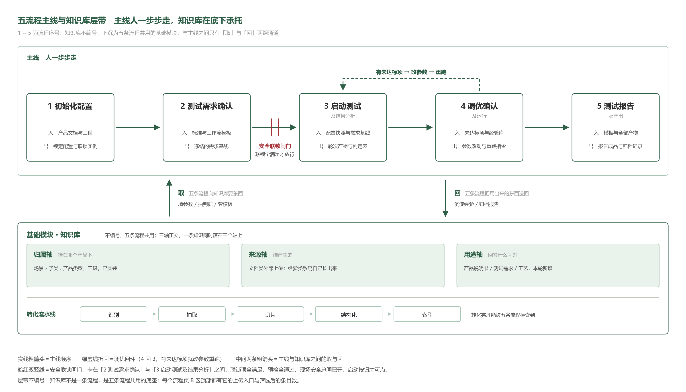

五流程主线从 1 初始化配置到 5 测试报告及产出。流程 2 到流程 3 之间有安全联锁闸门，联锁全满足才放行。流程 4 调优改完参数可回流程 3 重跑。底部知识库层带向上供给文档与经验，向下回收对话与失败案例。

顶栏右端常驻三件：带真实条目数的知识库按钮、场景包切换、「演示 / 全量」分段控件。

### 知识库基础模块

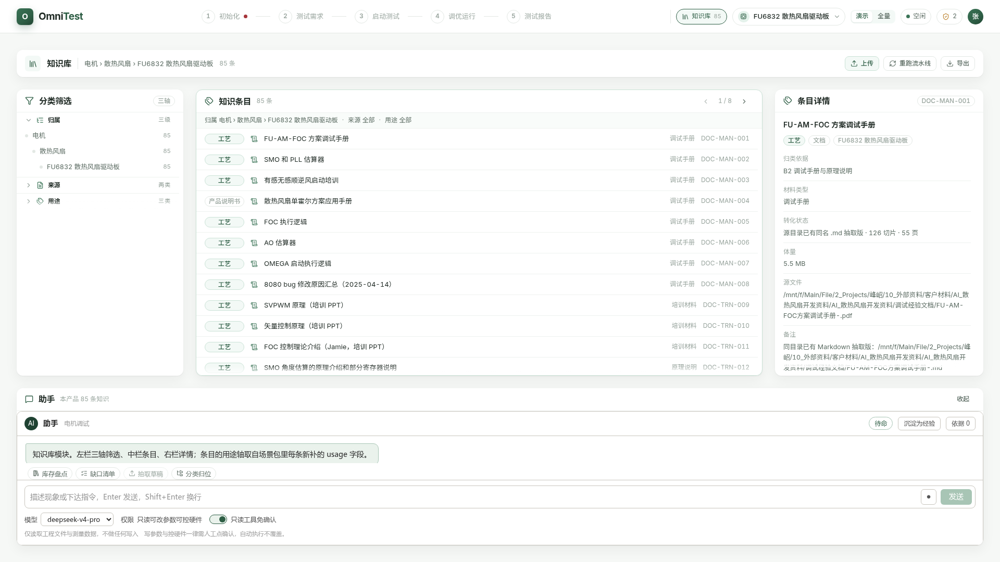

**知识库按三个轴正交分类，任一条知识同时落在三个轴上。** 归属轴分场景、子类、产品类型三级。来源轴分文档与经验两类。用途轴分产品说明书、测试需求、工艺三类。

散热风扇场景包 85 条知识，按用途轴分为产品说明书 8 条、测试需求 12 条、工艺 65 条。玻璃升降器场景包 101 条。两包合计 186 条，15 条待人工复核。顶栏知识库按钮显示的就是 85 与 101 这两个数，W6 之前它恒为 0。

知识库独立页不套流程页的四块版式：左栏三轴筛选与计数，中栏条目列表，右栏详情与出处，底部助手对话框加四枚按钮。顶栏不点亮流程步骤。

每个流程页 B 区顶部有「本流程可用知识」窄条，显示本流程调用的条数，点开是右侧抽屉。

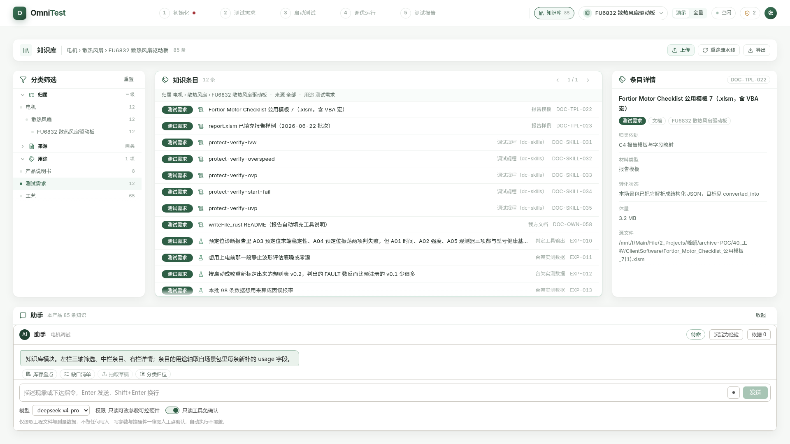

勾选用途轴的「测试需求」后，中栏列表收到 12 条、页码变 1/1，面包屑同步成「用途 测试需求」，归属轴三级计数一并重算成 12。

### 流程 1 · 初始化配置

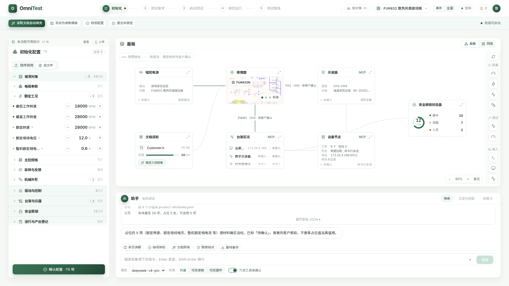

**这一步填产品自身属性，不填这次要怎么跑。** 左栏 B 区按五个一级类折叠：被测对象、驱动与控制、台架与仪器、安全联锁、运行与产出登记。默认只展开第一类「被测对象」，其余折叠，组头带计数与状态汇总。散热风扇包登记 29 项本体属性，其中占位 5 处，全页待确认条目合计 75 项。

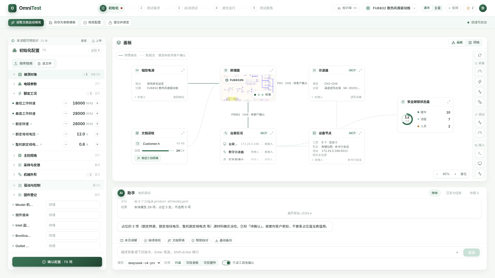

折叠态与展开态同屏。一级类「被测对象」展开到二级组「额定工况」的 5 个参数行，一级类「驱动与控制」展开到二级组「固件登记」的 5 个待填行，其余三个一级类保持折叠且组头带计数。

### 流程 2 · 测试需求确认

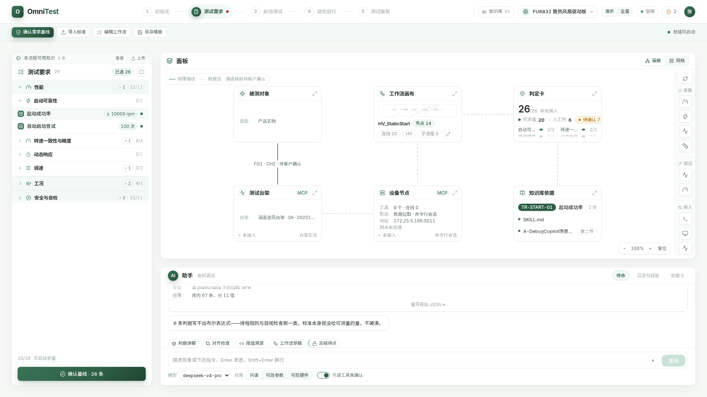

**这一步把「测什么、怎么算合格」冻结成需求基线。** 左栏三个一级类：性能、工况、安全与自检。散热风扇包 26 条判据，可自动求值 20 条、人工判 6 条。C 区默认画板，六个节点，其中「工作流画布」节点挂的是 `HV_StaticStart`，14 个节点、20 条连线。助手五枚按钮的图标已互不重样。

### 流程 3 · 启动测试及结果分析

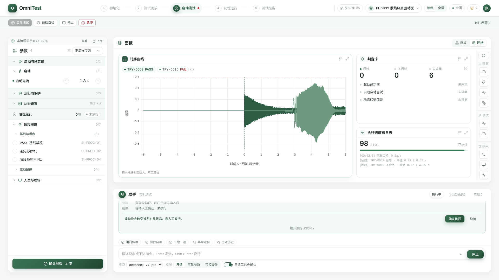

**这一步真跑、真采、真判。** 启动、停止、急停三个动作必须人点，且须联锁全绿。左栏参数按三个一级类折叠：启动与预定位、运行与保护、运行设置；安全闸门 9 项单列一段，当前 0/9、状态「未放行」。演示模式下时序回放两条，一条 `TRY-0009` 判 PASS，一条 `TRY-0010` 判 FAIL；判定卡列 6 条判据，全部未采集。全量模式下时序 3 条、判据 20 条。

C 区默认网格，只剩时序曲线、判定卡、执行进度与日志三张卡；原理图、安全联锁状态盘与单机设备会话三张已撤，也不再被回填。

### 流程 4 · 调优确认及运行

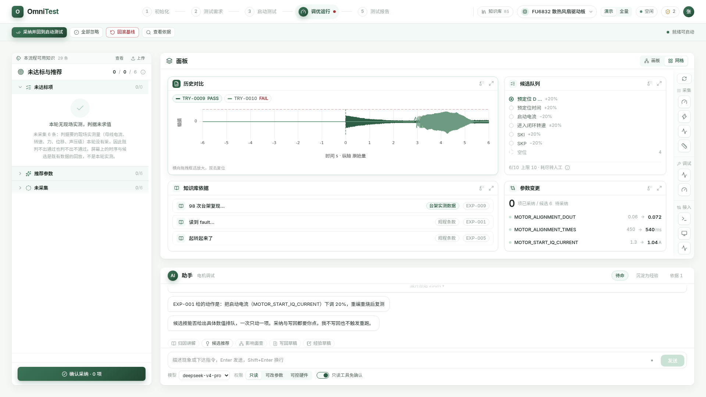

**本轮无现场实测，判据未求值，所以未达标 0、已通过 0、未采集 6。** 这句就是调优页左栏的空态原文。六条判据缺现场实测量，既判不出通过也判不出不通过，不进调优推荐；屏幕上的时序与候选是既有数据的回放，不是本轮实测。左栏只展开「未达标项」，推荐参数与未采集全折叠。C 区网格四张卡，hero 是历史对比。

### 流程 5 · 测试报告及产出

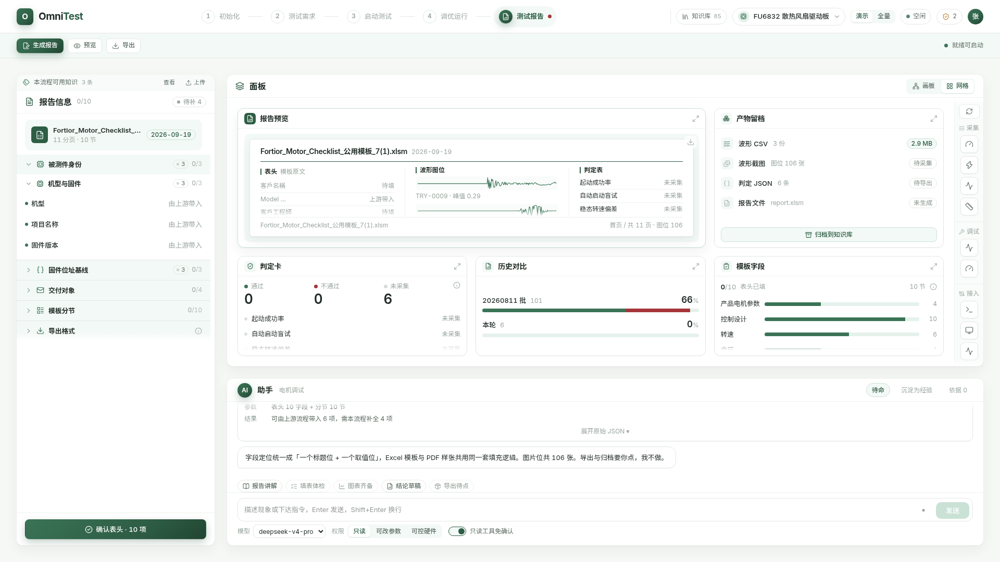

**这一步出交付物。** 报告表头十字段改三层：被测件身份 3 项展开，固件位址基线 3 项折叠，交付对象 4 项折叠。C 区网格五张卡，hero 是报告预览。报告里每个数值都必须能点回原始轮次与原始数据。

---

## 三、C 区统一画板与设备接入

**C 区从固定六槽卡片网格改为一块 React Flow 统一画板。外框尺寸与位置不变，画布内元素随滚轮整体缩放。**

技术选型 React Flow（`@xyflow/react`，仓库 github.com/xyflow/xyflow，MIT 协议，版本 12.11.6），工程已有依赖，不另引新库。

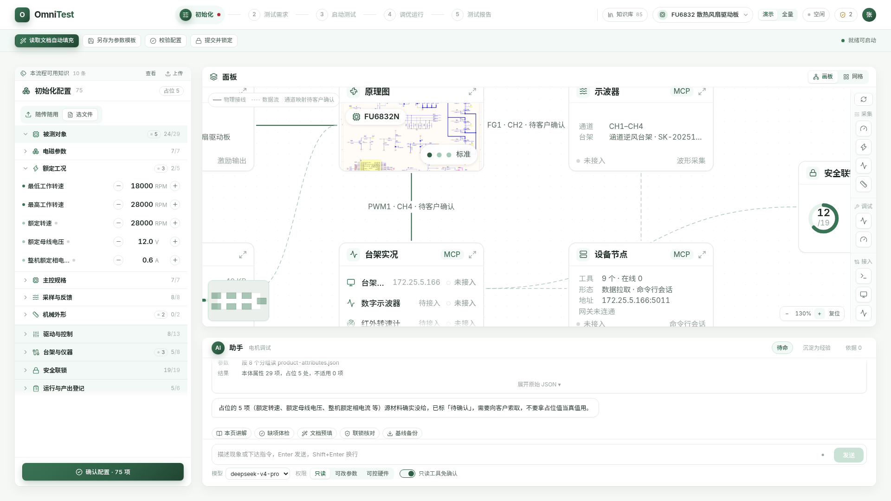

放大到 130%、内容超出视口时，C 区外框位置尺寸一个像素不变，只有内容在动。右下角是百分比、加减与复位按钮，左下角是缩略导航图，两个控件同屏不打架。缩放范围 0.4x 至 2.5x，以鼠标指针为锚点。

画板上的节点按三个能力域分成十一类：

- 被测与激励 3 类：电机、程控电源、原理图。
- 采集与呈现 3 类：示波器、曲线、判定。
- 编排与接入 5 类：工作流、联锁、知识、台架机、设备 MCP。

两类边：物理连接边上标通道名，如「FG1 · CH2 · 待客户确认」；数据流走浅绿虚线。右侧竖工具条按能力域分组，按钮可拖入画板，落点处生成对应节点。

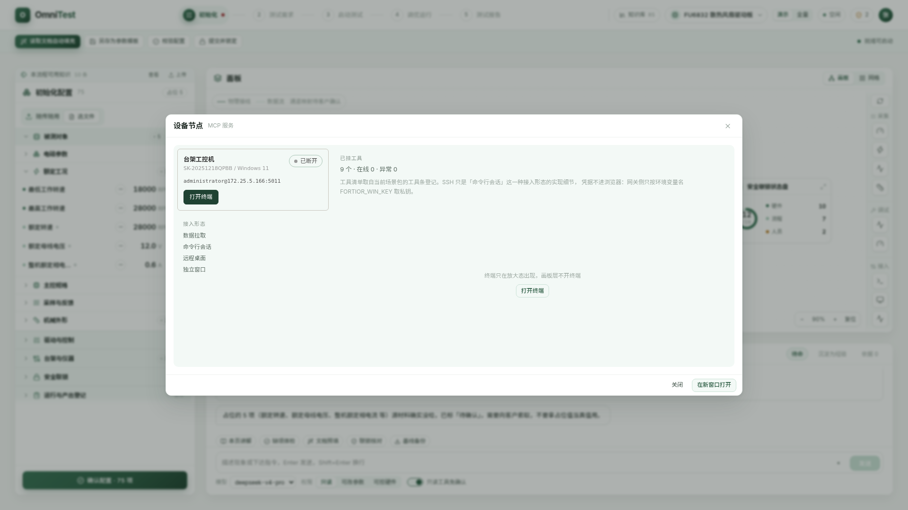

**设备不再单开 SSH 页面，也不再占一张独立卡槽，而是以 MCP 工具节点的形式落在画板上。** SSH 只是后台通信链路。节点上显示工具数、健康状态、接入形态与地址。双击或点放大按钮展开设备卡，终端只在放大态出现，画板层不开终端。散热风扇包的台架工控机主机名 `SK-20251218QPBB`、系统 Windows 11，登记工具 9 个、在线 0 个；接入形态四种：数据拉取、命令行会话、远程桌面、独立窗口。玻璃升降器包登记工具 13 个。

默认视图由场景包 `scene.json` 的 `default_view` 段读入，不写死在代码里：前两条流程默认画板，后三条默认网格；人切过之后按流程记住。

---

## 四、助手预置动作与红线口径

**助手对话框顶部加「预置动作」按钮组，按当前流程与场景包生成。点一枚等于注入一段预置 prompt 或 skill 并执行。**

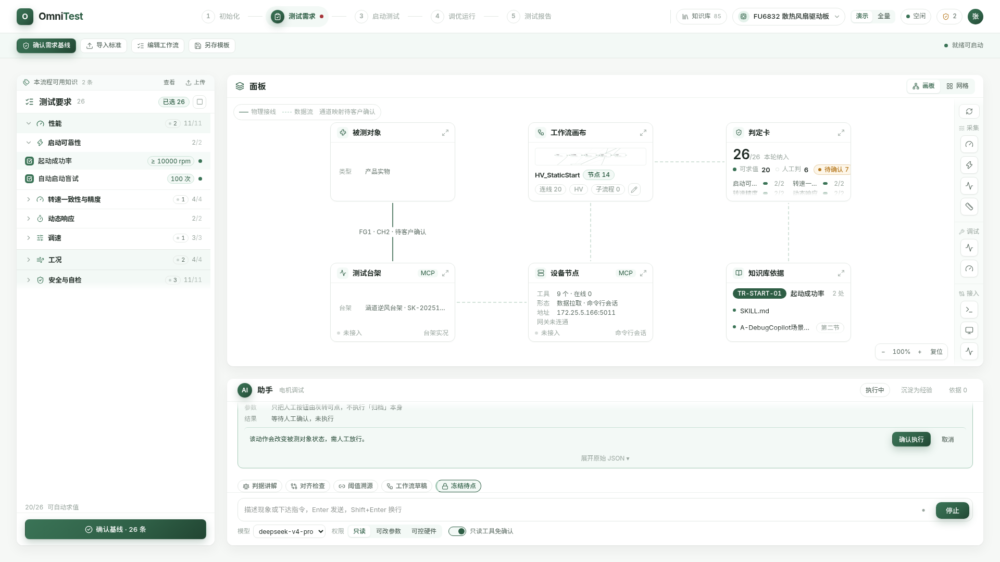

每条流程 5 枚按钮，知识库模块 4 枚，两个场景包各 29 枚。按钮分三类：

- explain 讲解类 7 枚：读取知识、解释原理，不落盘不动设备。
- prepare 准备类 18 枚：算参数、写草稿、排队列，结果落到面板但不生效。
- execute 执行类 4 枚：碰被测对象或不可逆操作，走人工确认闸门。

助手忙态只禁用执行类按钮，讲解类与准备类保持可点。上图是红线按钮「冻结待点」停在确认闸门的样子：结果写「等待人工确认，未执行」，同屏另外四枚按钮仍可点。

**红线口径不变：六个动作一律人点。** 碰被测对象的三个是启动、停止、急停，落盘不可逆的三个是写回参数、导出、归档。助手一次都不发这六个动作本身。碰红线的 4 枚 prepare 按钮做成「备好等人点」：收尾步骤只把 B 区的人工按钮点亮，动作由人在 B 区点。

按钮缺上下文字段时置灰，悬停提示说缺什么、去哪补。轮次产物存储与面板选中态都未实现，6 枚按钮因此长期置灰。

助手走演示态脚本化回放，不是真后端调用。收尾气泡与认不出的自由提问都写明「本轮是演示态」，不编回答。

---

## 五、两个场景包：同骨架换叶子

**散热风扇包（Fortior FU6832 散热风扇驱动板）与汽车玻璃升降器包共用同一套页面代码、同一套分层骨架，只有叶子节点的内容不同。**

| 维度 | 散热风扇 FU6832 | 玻璃升降器 |
| --- | --- | --- |
| 本体属性 | 29 项，占位 5 | 47 项，占位 4 |
| 判据 | 26 条，可自动求值 20 | 34 条，可自动求值 31 |
| 知识条目 | 85（文档 61 + 经验 24） | 101（文档 83 + 经验 18） |
| 预置动作 | 29 枚，全部可用 | 29 枚，4 枚执行类标「本场景不开放」 |
| 时序数据 | 实测回放 | 合成数据，页面标「合成数据，非实测」 |
| 台架设备 | 台架工控机，工具 9 个 | 合成数据回放，工具 13 个 |

分层骨架写在场景包 JSON 的 `group_tiers` 段，页面只认骨架不认叶子。两包的五个一级类名称完全相同，二级组标题与叶子全换。初始化配置页的「台架与仪器」，散热风扇包有实体台架接入行，玻璃升降器包只有仪器登记。

### 数字与出处对照

| 数字或口径 | 出处 |
| --- | --- |
| 知识条目 85 / 101 / 186、用途轴落位、15 条待复核 | `07b-W2完成报告.md` 第二节 |
| 台架工具数 9 与 13、设备节点字段 | `07c-W3完成报告.md` 第三节 |
| 流程 3 与流程 4 的判据数、时序条数、卡片数 | `07d-W4完成报告.md` 第三节 |
| 预置动作 5 枚 / 4 枚 / 29 枚与三类分布 | `07e-W5完成报告.md` 第二节 |
| 本体属性 29 与 47、判据 26 与 34 | v2.1 原文，已与场景包 JSON 核对一致 |
| 缩放条右下角、缩略导航图左下角 | `07f-W6收尾报告.md` 第一节第 1 条 |
| 忙态只禁执行类 | `07f-W6收尾报告.md` 第一节第 3 条 |
| 调优页空态文案 | `07f-W6收尾报告.md` 第一节第 7 条 |
| 顶栏条目数取真值、撤独立设备卡、网格不回填、知识库四枚按钮 | `07f-W6收尾报告.md` 第二节 |
| 两包 JSON 与工程 `public/` 逐字节一致 | `07f-W6收尾报告.md` 第四节 |

---

## 六、还没做与待拍板

逐条来自六份报告的「未完成项」与「仍需拍板」，W6 已收掉的不再列。

### 6.1 未完成

| 编号 | 事项 | 来源 | 说明 |
| --- | --- | --- | --- |
| G-01 | 现场判据未求值 | `07d-W4完成报告.md` 第七节第 2 项 | 20 条可求值判据的现场实测量一条都没采到，调优页因此无未达标项 |
| G-02 | 轮次产物存储未做 | `07e-W5完成报告.md` 第七节第 1 项 | `lastRun.artifacts` 与 `history.runs` 为 null |
| G-03 | 选中态未统一出口 | `07e-W5完成报告.md` 第七节第 2 项 | `selected_document`、`selected_fail_item`、`selected_candidate` 仍是局部 `useState`。它与 G-02 合计导致 6 枚助手按钮置灰 |
| G-04 | 15 条知识待人工复核 | `07b-W2完成报告.md` 第二节 | 三类原因：总表未收录的类型、跨边界、经验条目边界模糊。总数 15 取自 W2 表格逐包合计 |
| G-05 | skill 走演示态回放 | `07e-W5完成报告.md` 第七节第 4 项 | 接 DeepSeek Harness（DSH，DeepSeek 开源的 Agent 运行时）后同一枚按钮会发真调用 |
| G-06 | 9 处 skill 规程名称待核实 | `07e-W5完成报告.md` 第七节第 5 项 | 草案里标 `unverified` 的规程没去客户安装目录逐条打开原文确认 |
| G-07 | 全屏首屏元素 ≤55 未达标 | `07d-W4完成报告.md` 第四节 | 流程 3 为 87、流程 4 为 74，缺口在顶栏与助手区；W6 加的分段控件让顶栏又多 1 个元素 |
| G-08 | 画板节点坐标写在代码里 | `07c-W3完成报告.md` 第五节第 6 项 | 场景包 `scene.json` 已有 `default_view` 段但无 `canvas_layout` 段，节点坐标仍硬编码在 `model.ts` |
| G-09 | 滚动条只测得到、未见得着 | `07f-W6收尾报告.md` 第五节第 1 条 | 配色规则与 `scrollbar-gutter: stable` 已生效，版式占位可测（容器 `clientWidth` 由 380 降到 372）；但本机 headless Chrome 不把滚动条画进截图，「真人屏幕上看得见」尚无证据 |

### 6.2 待拍板

| 编号 | 事项 | 来源 |
| --- | --- | --- |
| D-01 | 系统对外产品名 | v2.1 第九节第 1 项 |
| D-02 | 滚动条要在真实浏览器里人眼复核一次，确认看得见 | `07f-W6收尾报告.md` 第七节第 1 项 |
| D-03 | 底部渐隐 `.fade-b` 用 sticky 伪元素替代了父级伪元素，是否改回字面做法 | `07f-W6收尾报告.md` 第七节第 2 项 |
| D-04 | 15 条待人工复核条目怎么归；其中 `DOC-OWN-058`、`DOC-REP-005`、`DOC-REP-006` 跨 B/C 边界必须人定 | `07f-W6收尾报告.md` 第七节第 3 项 |
| D-05 | 轮次产物存储与面板选中态上提是否进下一轮 | `07f-W6收尾报告.md` 第七节第 4 项 |
| D-06 | 首屏元素 ≤55 要不要继续压 | `07f-W6收尾报告.md` 第七节第 5 项 |
| D-07 | 已收：独立核验查出初始化页 8 处、报告页 6 处超「每屏 ≤5」，占位计数改中性灰后三页分别为 3、4、4 处 | `07g-独立核验报告.md` 第七节应修 3 |
| D-08 | 汽车包本体数值可信度与合成时序 | v2.1 第九节第 3、4 项 |

---

## 七、给同事的下一步

**实施任务详单在 `04-同事实施任务详单-v2.0.md`。** 六个工作流 W1 至 W6 全部完成，收尾包已把跨包请求单逐条落地、重出 22 张截图同步到 `03-截图/`。下一步看 6.2 的八条拍板。

截图落在 `03-截图/` 下，页面截图叫 `final-<页名>.png`，补充截图叫 `final-extra-<功能>.png`，1440 宽变体加 `-1440` 后缀。

本目录绝对路径：`/mnt/f/Main/File/2_Projects/峰岹/峰岹agent/09-实验室demo线/20260919-通用Agent测试系统v2.0/`。

---

## 版本说明

**2026-09-20 依 `07f-W6收尾报告.md` 校正。** 校正的是 v3.0 起草时尚未发生的事实，W6 第七节六条待拍板已并入第六节。

### 本次校正点

| 校正点 | 起草稿写的 | 现在的事实 |
| --- | --- | --- |
| 顶栏知识库条目数 | 恒为 0，列为未完成项 G-01 | 真实值，散热风扇 85、玻璃升降器 101 |
| 缩放条与缩略导航图 | 百分比与复位在左下角，位置待拍板 | 缩放条右下角、缩略导航图左下角，已定 |
| 助手忙态 | 未写 | 只禁执行类，讲解类与准备类保持可点 |
| 演示与全量切换 | 只有 `?mode=full` 参数 | 顶栏「演示 / 全量」分段控件，默认演示 |
| 单机设备独立卡 | 仍占一张卡槽 | `remote-device` 卡槽已撤，设备只在画板上 |
| 网格卡片数 | 未写，且被删卡会回填（G-10） | 流程 3 为 3 张、流程 4 为 4 张，回填已撤 |
| 知识库页助手 | 只保留对话框 | 对话框加四枚按钮：库存盘点、缺口清单、抽取草稿、分类归位 |
| 调优页左栏 | 只说未达标 0、已通过 0、未采集 6 | 补上空态原文「本轮无现场实测，判据未求值」 |
| B 区滚动条 | 直接算作已完成 | 配色与版式占位测得到，可见性未人眼验证，转入 G-09 与 D-02 |
| 折叠态截图图注 | 只有「被测对象」一个一级类展开 | 「被测对象」与「驱动与控制」两个一级类同屏展开 |

### v3.0 相对 v2.1 的变化清单

| 变化 | v2.1 | v3.0 |
| --- | --- | --- |
| 流程数 | 六个，知识库是第 1 步 | 五个主线流程 + 知识库基础模块 |
| 流程编号 | 1 知识库 … 6 报告 | 1 初始化配置 … 5 测试报告及产出 |
| 知识库位置 | 与 2–6 平级，套统一版式 | 基础模块，独立页版式，顶栏常驻按钮进入 |
| 知识分类 | 两维：归属、来源 | 三轴正交：归属、来源、用途 |
| C 区形态 | 固定 3×2 卡片网格，首槽即 hero | 统一画板 React Flow，网格降为备选 |
| 设备接入 | 独立 SSH 页面，外加一张独立卡槽 | MCP 工具节点落在画板上，SSH 只是后台链路 |
| B 区信息密度 | 平铺列举 | 分层折叠：一级类 → 二级组 → 三级子组，默认只展开第一类 |
| 案例复杂度 | 全量展示 | 演示模式与全量模式并存，顶栏分段控件切换，默认演示 |
| 助手能力 | 对话与示例 | 预置动作按钮，每流程 5 枚、知识库 4 枚，感知当前页面上下文 |
| 智能体名称 | 旧称沿用第二轮的驾驶隐喻叫法 | 助手 |
| 架构图 | `fig2_六流程主线.png` | `fig2_五流程主线与知识库层带.png` |

### 本轮引用的截图清单

全部已产出并逐张人眼复核，复核记录见 `07f-W6收尾报告.md` 第六节。

| 图位引用名 | 画的是什么 | 状态 |
| --- | --- | --- |
| `03-截图/final-knowledge.png` | 知识库独立页，顶栏 85、四枚助手按钮 | 已产出 2026-09-20 |
| `03-截图/final-init.png` | 流程 1 初始化配置，画板七节点 | 已产出 2026-09-20 |
| `03-截图/final-req.png` | 流程 2 测试需求确认，画板六节点 | 已产出 2026-09-20 |
| `03-截图/final-run.png` | 流程 3 启动测试及结果分析，网格三张卡 | 已产出 2026-09-20 |
| `03-截图/final-tune.png` | 流程 4 调优确认及运行，网格四张卡 | 已产出 2026-09-20 |
| `03-截图/final-report.png` | 流程 5 测试报告及产出，网格五张卡 | 已产出 2026-09-20 |
| `03-截图/final-extra-canvas-zoom.png` | 画板放大到 130% 的缩放态 | 已产出 2026-09-20 |
| `03-截图/final-extra-node-zoom.png` | 设备节点放大态与终端入口 | 已产出 2026-09-20 |
| `03-截图/final-extra-confirm.png` | 助手红线按钮的人工确认闸门 | 已产出 2026-09-20 |
| `03-截图/final-extra-kb-filter.png` | 知识库用途轴筛选到 12 条 | 已产出 2026-09-20 |
| `03-截图/final-extra-collapse.png` | B 区折叠态与展开态同屏 | 已产出 2026-09-20 |
| `_图/fig2_五流程主线与知识库层带.png` | 架构图 | 已产出 2026-09-19 |
