# 多场景 Agent 测试系统 页面原型与业务逻辑 v3.2

**OmniTest（暂定名，待拍板）是一套可适应多种场景的、基于 Agent 的测试系统。跑在浏览器里，不装客户端；换一个行业只换一个场景包，系统侧代码不动。**

面向老板与团队同事。全文以截图与架构图为主，文字只写读图必需的注解。产品名 `OmniTest` 为占位待拍板；智能体统一称「助手」。

事实来源是同目录六份工作流报告 `07a-W1放行说明-接口清单.md` 至 `07f-W6收尾报告.md`。本文相对路径均以该目录为根，绝对路径见文末。

| 版本 | 变更 |
| --- | --- |
| v1.0 | 首版。六流程各一屏，峰岹散热风扇单场景包 |
| v1.1 | 截图重拍；新增汽车玻璃升降器场景包 |
| v2.1 | 视觉第二版整体重做，全部截图换成 `final-` 系列 |
| v3.0 | **第三轮结构性改版**：知识库从流程降为基础模块、C 区从卡片网格改为统一画板、B 区全面分层折叠、助手加预置动作按钮。2026-09-20 依 `07f-W6收尾报告.md` 校正全部状态描述与截图 |
| v3.1 | 2026-09-20 补第二节流程 1 的「参数构成」小节，答复 R-12 原话前半「初始化配置本身包含哪些参数」；第六节加 6.3「第三轮独立复核」。截图与其余内容与 v3.0 相同 |
| v3.2 | 2026-09-20 三轮代码修复（视觉缺陷、首屏压缩、交互打通与设备桥）之后重拍全部截图，落到 `03-截图/v3.2/`；新增第五节「交互与红线闸门」；流程 3 判定结论、流程 4 未达标项、流程 5 判定汇总、设备节点读数按接线后的实际行为改写 |

---

## 一、18 条录音意见落地表

**第三轮依据 18 条录音意见（R-01 至 R-18）做了结构性改版，不是视觉微调。**

意见来源：2026-09-19 21:21 用户录音，17 分 17 秒，飞书妙记 `https://hcnd3xtushu0.feishu.cn/minutes/obcn48y5u7v97ch83g7e82ft`。逐字稿与编号见 `00b-用户录音意见原话-20260919-2121.md`。

| 意见 | 一句话 | 落地位置 | 对应截图（`03-截图/v3.2/` 下） |
| --- | --- | --- | --- |
| R-01 | 知识库不该与 2–6 平级 | 知识库降为基础模块，不占流程序号 | `final-knowledge.png` |
| R-02 | 知识库比 2–6 更底层 | 顶栏右端常驻按钮进入独立页 `/knowledge`，按钮上显示真实条目数 | `final-knowledge.png` |
| R-03 | C 区要能整体滚轮缩放 | React Flow 画板，0.4x 至 2.5x，缩放条与缩略导航图叠成一摞落在右下角 | `final-extra-canvas-zoom.png` |
| R-04 | 统一画板、仿物理连接、右侧可拖拽 | 两类边：物理连接标通道名、数据流走浅绿虚线；工具条可拖入画板建节点 | `final-init.png` |
| R-05 | 图五要改 | 架构图重画为五流程主线加底部知识库层带 | `_图/fig2_五流程主线与知识库层带.png` |
| R-06 | 知识库页不套统一版式 | 独立页版式：面包屑、三轴筛选、条目列表、详情栏，只保留 D 区助手 | `final-knowledge.png` |
| R-07 | 画布没有具体呈现 | 画板已落地，十一类节点全部注册并可渲染 | `final-init.png` |
| R-08 | 追问知识库分了几类 | 三轴正交分类已实装，见第二节 | `final-extra-kb-filter.png` |
| R-09 | 要求的知识分类没做 | 用途轴新增：产品说明书、测试需求、工艺三类 | `final-extra-kb-filter.png` |
| R-10 | 工艺、测试需求、产品说明书要有分类体系 | 186 条知识逐条落位到三轴，15 条待人工复核 | `final-extra-kb-filter.png` |
| R-11 | B 区要有内部滚动条 | B 区自身滚动、页面整体不滚动；滚动条配色与版式占位已生效，可见性未人眼验证 | `final-init.png` |
| R-12 | 初始化配置讲不清、信息堆一页 | 五个一级类、默认只展开第一类 | `final-init.png` |
| R-13 | 语言尚可 | 保持 | — |
| R-14 | 案例过于复杂、demo 故事不好讲 | 演示模式收窄数据，再压首屏：流程 3 的 B、C 两区由 52 个元素压到 35，流程 4 由 61 压到 41 | `final-run.png` |
| R-15 | 助手要有按钮、带 prompt 或 skill 执行 | 每条流程 5 枚预置动作按钮；知识库页 4 枚 | `final-extra-confirm.png`、`final-knowledge.png` |
| R-16 | 全篇平铺病，要分层级加折叠 | 三条硬规则通过：组内 ≤5 项、首屏元素 ≤18、展开态条目 ≤12 | `final-extra-collapse.png` |
| R-17 | 设备走 MCP 集成进 C 区，不单开 SSH 页 | 设备节点即 MCP 工具节点，SSH 只是后台链路；原先的单机设备独立卡已撤 | `final-extra-node-zoom.png` |
| R-18 | 等真前端页面验证 | 五个工作流页与知识库页均已产出截图 | 各页 `final-*.png` |

---

## 二、页面怎么用

**主线五个流程加一个知识库基础模块。主线从初始化配置走到测试报告，调优改完参数回启动测试重跑是闭环；知识库贯穿五个流程，任何时候可进。**

五流程主线从 1 初始化配置到 5 测试报告及产出。流程 2 到流程 3 之间有安全联锁闸门，联锁全满足才放行。流程 4 调优改完参数可回流程 3 重跑。底部知识库层带向上供给文档与经验，向下回收对话与失败案例。

顶栏右端常驻三件：带真实条目数的知识库按钮、场景包切换、「演示 / 全量」分段控件。

### 知识库基础模块

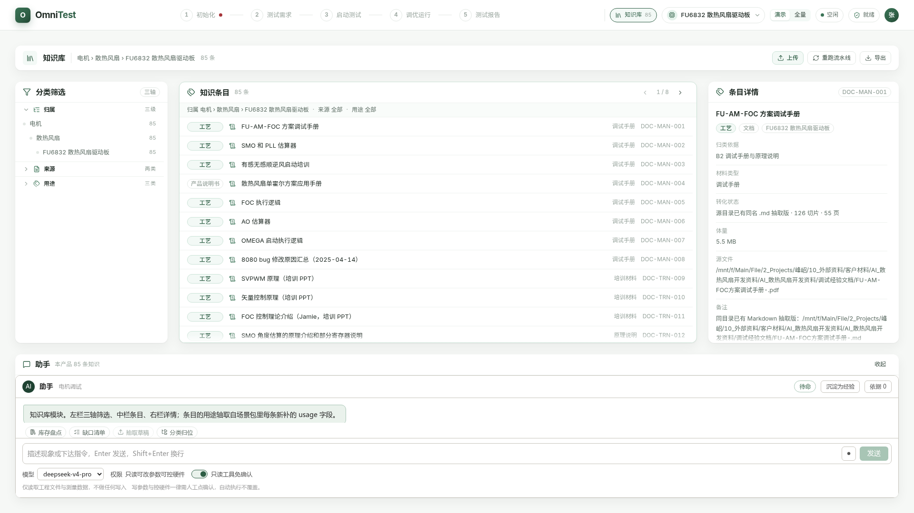

**知识库按三个轴正交分类，任一条知识同时落在三个轴上。** 归属轴分场景、子类、产品类型三级。来源轴分文档与经验两类。用途轴分产品说明书、测试需求、工艺三类。

散热风扇场景包 85 条知识，按用途轴分为产品说明书 8 条、测试需求 12 条、工艺 65 条。玻璃升降器场景包 101 条。两包合计 186 条，15 条待人工复核。顶栏知识库按钮显示的就是 85 与 101 这两个数，W6 之前它恒为 0。

知识库独立页不套流程页的四块版式：左栏三轴筛选与计数，中栏条目列表，右栏详情与出处，底部助手对话框加四枚按钮。顶栏不点亮流程步骤。

每个流程页 B 区顶部有「本流程可用知识」窄条，显示本流程调用的条数，点开是右侧抽屉。

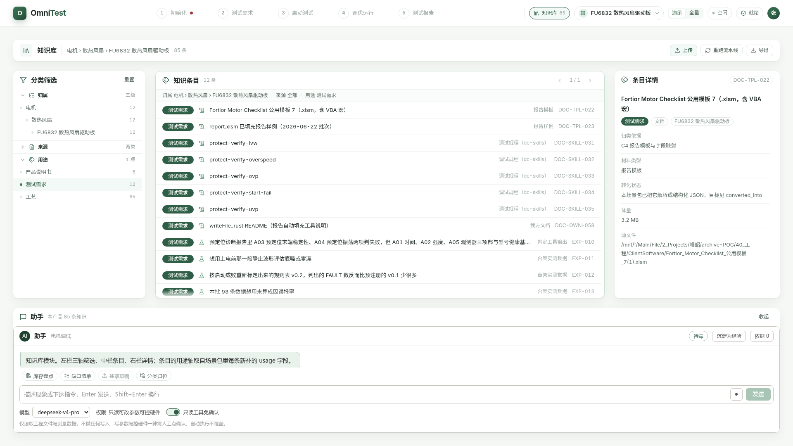

勾选用途轴的「测试需求」后，中栏列表收到 12 条、页码变 1/1，面包屑同步成「用途 测试需求」，归属轴三级计数一并重算成 12。

### 流程 1 · 初始化配置

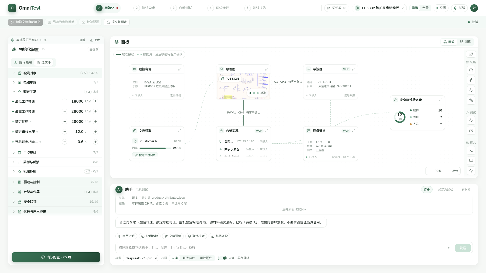

**这一步填产品自身属性，不填这次要怎么跑。** 左栏 B 区按五个一级类折叠：被测对象、驱动与控制、台架与仪器、安全联锁、运行与产出登记。默认只展开第一类「被测对象」，其余折叠，组头带计数与状态汇总。散热风扇包登记 29 项本体属性，其中占位 5 处，全页待确认条目合计 75 项。

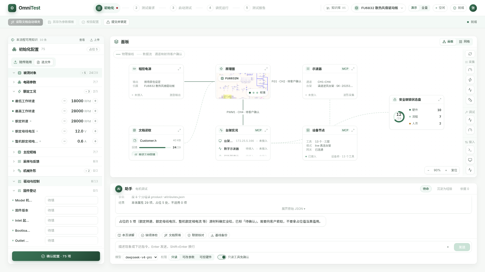

折叠态与展开态同屏。一级类「被测对象」展开到二级组「额定工况」的 5 个参数行，一级类「驱动与控制」展开到二级组「固件登记」的 5 个待填行，其余三个一级类保持折叠且组头带计数。

#### 参数构成

**这一屏要填的东西，按「这条参数回答什么问题」切成五个一级类，彼此正交，一条参数只归一类。** 五类合计 18 个二级组、75 个叶子参数。

- 第一类被测对象，回答被测的东西客观是什么样。属客观量，只核对不发明。
- 第二类驱动与控制，回答固件当前配成什么样。属基线快照，锁定后只读。
- 第三类台架与仪器，回答信号从哪走到哪、谁来量。属接线与量程，须现场确认。
- 第四类安全联锁，回答什么条件下绝对不许启动。属红线，数据结构与普通参数分离，因为放行闸门只查联锁、不查普通参数。
- 第五类运行与产出登记，回答这一轮叫什么、交给谁。属标识与绑定，直接带入流程 5 的报告表头。

散热风扇场景包的分布见下表。「谁填」分三态：人指工程师手工拍板，助手指从文档解析后给建议、由人核对，场景包指随场景包下发、本流程不改。

| 一级类 | 二级组数 | 参数数 | 主要来源 | 谁填 |
| --- | --- | --- | --- | --- |
| 一 被测对象 | 5 | 29 | 客户固件头文件 `Customer.h`，加 FU6832 芯片数据手册 `MCU-DS-14_FU6832_V2.1_20230621.pdf` | 助手解析、人核对；主控规格一组只读 |
| 二 驱动与控制 | 3 | 13 | 客户固件头文件 `Customer.h`，加客户已填报告样例 `report.xlsm` | 人 |
| 三 台架与仪器 | 3 | 8 | 我方实验室台架的接线文档与实测记录 | 场景包下发，人现场核对 |
| 四 安全联锁 | 4 | 19 | 客户保护头文件 `Protect.h`，加客户软件的 dc-skills 调试规程 | 只读，不得在线改写 |
| 五 运行与产出登记 | 3 | 6 | 客户已填报告样例 `report.xlsm` | 人 |
| 合计 | 18 | 75 | — | — |

来源构成分五档：出自客户方材料的 60 个，占八成；出自我方台架的 7 个；出自内部取证文档的 2 个；为让前端有刻度而编的示例值 3 个；源材料确实没给、字段留空的 3 个。后两档不得当作客户确认值或判定阈值。

完整参数树在 `06-第三轮改版/06b-初始化配置参数树与B区密度规则.md` 第一节，逐个叶子给出单位、默认值、范围、来源文件与行号，并列出本场景的四项缺口与三处不一致。其中 PWM 载波频率默认值 25 kHz 与单次连续运行上限 30 分钟两项，该文第四节已列为待客户核实的拍板项。

**B 区分组与参数树一一对应。** 前端 `src/features/flow-init/panel.tsx` 渲染的五个一级类与上表同名同序，18 个二级组逐一对应，骨架读自场景包 JSON 的 `group_tiers` 段，不写死在代码里。差异只在标题用词：文档写「电机电磁参数」「台架设备接入」，页面为省横向空间缩成「电磁参数」「台架接入」，指的是同一组。

### 流程 2 · 测试需求确认

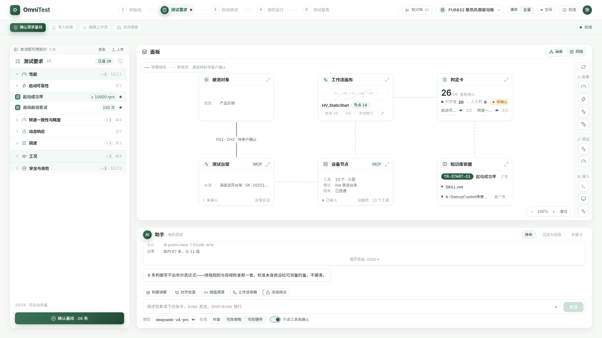

**这一步把「测什么、怎么算合格」冻结成需求基线。** 左栏三个一级类：性能、工况、安全与自检。散热风扇包 26 条判据，可自动求值 20 条、人工判 6 条。C 区默认画板，六个节点，其中「工作流画布」节点挂的是 `HV_StaticStart`，14 个节点、20 条连线。助手五枚按钮的图标已互不重样。

### 流程 3 · 启动测试及结果分析

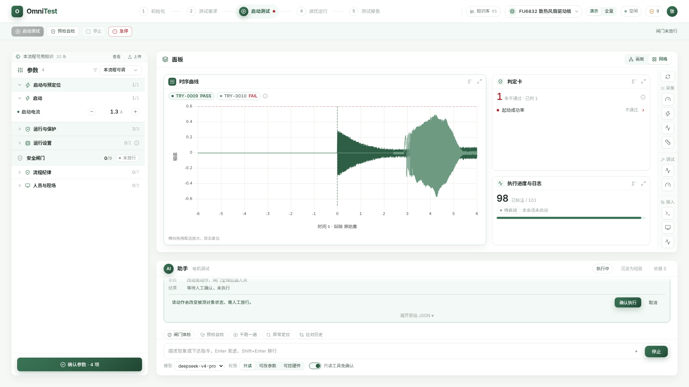

**这一步真跑、真采、真判。** 启动、停止、急停三个动作必须人点，且须闸门全绿。左栏参数按三个一级类折叠：启动与预定位、运行与保护、运行设置；安全闸门 9 项单列一段，演示模式下默认收成组头，截图里是未勾的 0/9、状态「未放行」。时序回放两条，一条 `TRY-0009` 判 PASS，一条 `TRY-0010` 判 FAIL。

判定卡演示模式下收成一行「1 条不通过 · 已判 1」，只列有结论的那一行——起动成功率，判据编号 `TR-START-01`，判不通过；分项计数、短路求值的说明与实测量出处都退进悬停提示。全量模式下时序 3 条、判据 20 条、闸门逐条展开。判不通过这一结论怎么来的，见第五节。

C 区默认网格，只剩时序曲线、判定卡、执行进度与日志三张卡；原理图、安全联锁状态盘与单机设备会话三张已撤，也不再被回填。

### 流程 4 · 调优确认及运行

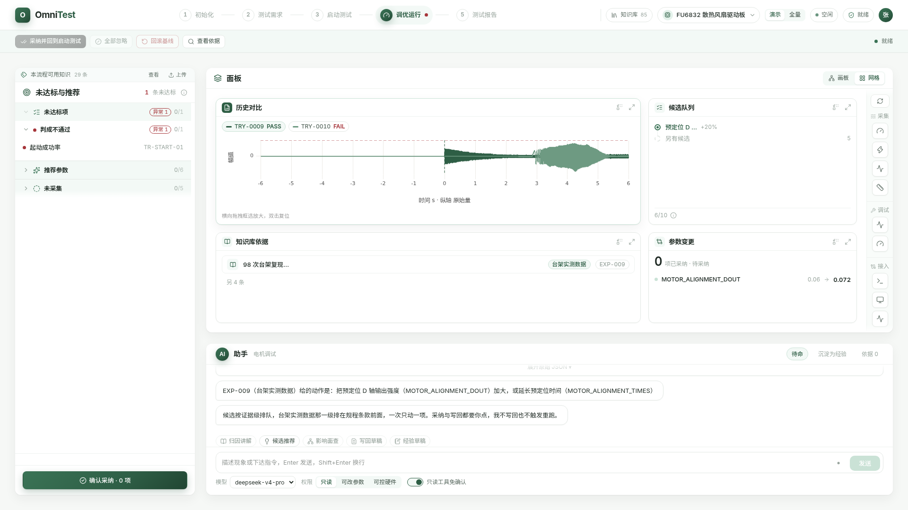

**流程 3 判出一条不通过，流程 4 左栏就落进一条未达标项，因果链接上了。** 左栏栏头演示模式下只报「1 条未达标」，已通过与未采集两个数退进悬停提示与折叠组；未达标的那条是起动成功率 `TR-START-01`。

候选队列首屏只铺当前这一条——预定位 D 轴输出强度（参数标识 `MOTOR_ALIGNMENT_DOUT`）由 0.06 调到 0.072，依据知识库经验条目 `EXP-009`，证据级是台架实测数据——其余收成一行「另有候选 5」；知识库依据同样只留证据级最高的那一条，其余收成「另 4 条」。左栏的推荐参数与未采集两组默认折叠。C 区网格四张卡，hero 是历史对比。屏幕上的时序与候选是既有数据的回放，不是本轮实测。

### 流程 5 · 测试报告及产出

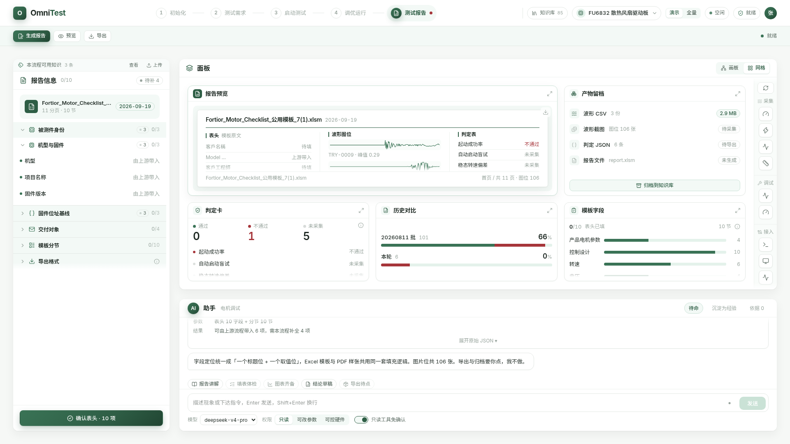

**这一步出交付物。** 报告表头十字段改三层：被测件身份 3 项展开，固件位址基线 3 项折叠，交付对象 4 项折叠。C 区网格五张卡，hero 是报告预览。报告里每个数值都必须能点回原始轮次与原始数据。

报告页的判定汇总与流程 3 同源，现在同为通过 0、不通过 1、未采集 5，两页不再互相打架。

---

## 三、C 区统一画板与设备接入

**C 区从固定六槽卡片网格改为一块 React Flow 统一画板。外框尺寸与位置不变，画布内元素随滚轮整体缩放。**

技术选型 React Flow（`@xyflow/react`，仓库 github.com/xyflow/xyflow，MIT 协议，版本 12.11.6），工程已有依赖，不另引新库。

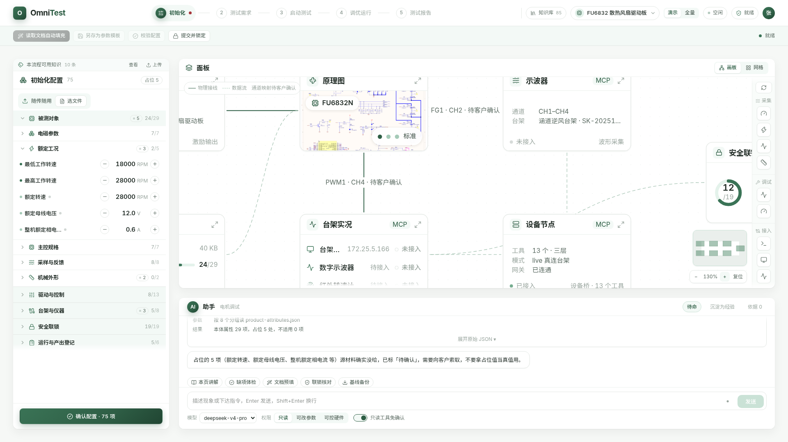

放大到 130%、内容超出视口时，C 区外框位置尺寸一个像素不变，只有内容在动。右下角是百分比、加减与复位按钮，缩略导航图叠在它正上方，两个控件同屏不打架。缩放范围 0.4x 至 2.5x，以鼠标指针为锚点。

缩略导航图原先挂在左下角，会压住「文档读取」节点，第四轮的视觉修复把它挪到右下角并给缩放条让出 54 像素，实测缩放条中心横坐标 1731、缩略导航图中心 1754。

画板上的节点按三个能力域分成十一类：

- 被测与激励 3 类：电机、程控电源、原理图。
- 采集与呈现 3 类：示波器、曲线、判定。
- 编排与接入 5 类：工作流、联锁、知识、台架机、设备 MCP。

两类边：物理连接边上标通道名，如「FG1 · CH2 · 待客户确认」；数据流走浅绿虚线。右侧竖工具条按能力域分组，按钮可拖入画板，落点处生成对应节点。

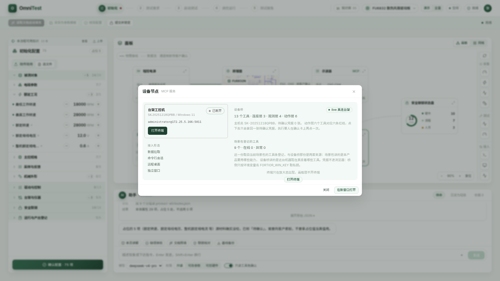

**设备不再单开 SSH 页面，也不再占一张独立卡槽，而是以 MCP 工具节点的形式落在画板上。** SSH 只是后台通信链路。双击或点放大按钮展开设备卡，终端只在放大态出现，画板层不开终端。散热风扇包的台架工控机主机名 `SK-20251218QPBB`、系统 Windows 11；接入形态四种：数据拉取、命令行会话、远程桌面、独立窗口。

第四轮之后，节点上三行事实改成工具、模式、网关，地址退进悬停提示（节点高度只放得下三行）。这三行读的是设备桥的实时返回：截图里是工具 13 个分三层、模式 `live` 真连台架、网关已连通。**场景包自己登记的 9 个工具是另一套口径**：场景包讲的是本产品要用哪些能力，设备桥讲的是这台机器现在真挂着哪些工具，放大态里两套并列摆出，不混成一个数。玻璃升降器包登记工具 13 个。桥不可达时节点显示「网关 未连通」，成因写在悬停提示里，见第五节。

默认视图由场景包 `scene.json` 的 `default_view` 段读入，不写死在代码里：前两条流程默认画板，后三条默认网格；人切过之后按流程记住。

---

## 四、助手预置动作与红线口径

**助手对话框顶部加「预置动作」按钮组，按当前流程与场景包生成。点一枚等于注入一段预置 prompt 或 skill 并执行。**

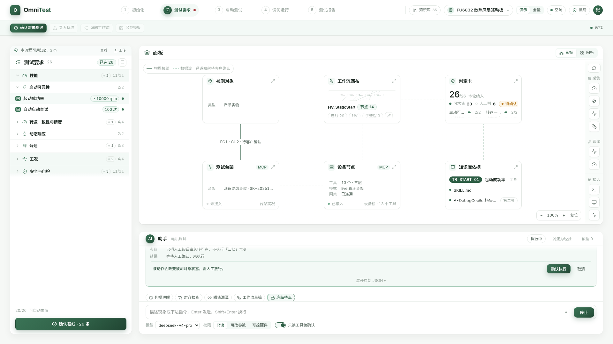

每条流程 5 枚按钮，知识库模块 4 枚，两个场景包各 29 枚。按钮分三类：

- explain 讲解类 7 枚：读取知识、解释原理，不落盘不动设备。
- prepare 准备类 18 枚：算参数、写草稿、排队列，结果落到面板但不生效。
- execute 执行类 4 枚：碰被测对象或不可逆操作，走人工确认闸门。

助手忙态只禁用执行类按钮，讲解类与准备类保持可点。上图是红线按钮「冻结待点」停在确认闸门的样子：结果写「等待人工确认，未执行」，同屏另外四枚按钮仍可点。

**红线口径不变：六个动作一律人点。** 碰被测对象的三个是启动、停止、急停，落盘不可逆的三个是写回参数、导出、归档。助手一次都不发这六个动作本身。碰红线的 4 枚 prepare 按钮做成「备好等人点」：收尾步骤只把 B 区的人工按钮点亮，动作由人在 B 区点。

按钮缺上下文字段时置灰，悬停提示说缺什么、去哪补。轮次产物存储与面板选中态都未实现，6 枚按钮因此长期置灰。

助手走演示态脚本化回放，不是真后端调用。收尾气泡与认不出的自由提问都写明「本轮是演示态」，不编回答。

---

## 五、交互与红线闸门

**第四轮把原型上「看得见点不动」的四处接上了：顶栏动作条、左栏底部确认按钮、判定卡未达标行、画板设备节点。整条主线现在可以从勾闸门一路点到导出，六个红线动作每一个都必须人点确认，凭据由设备桥签发。**

这里说的设备桥，是本机的设备 MCP 服务 `~/lab/spike-device-mcp`（启动脚本 `run-bridge.sh`，监听 `127.0.0.1:8031`）。它把台架工控机 `SK-20251218QPBB` 上的能力按三层挂出来：连接层 3 个、观测层 4 个、动作层 6 个，合计 13 个工具。改动清单见前端工程的 `~/agent-test-web/CHANGELOG-wire-20260920.md`，配置与接口说明见同工程 `README.md` 第 10 节「交互与设备桥」。

### 一条主线点到底

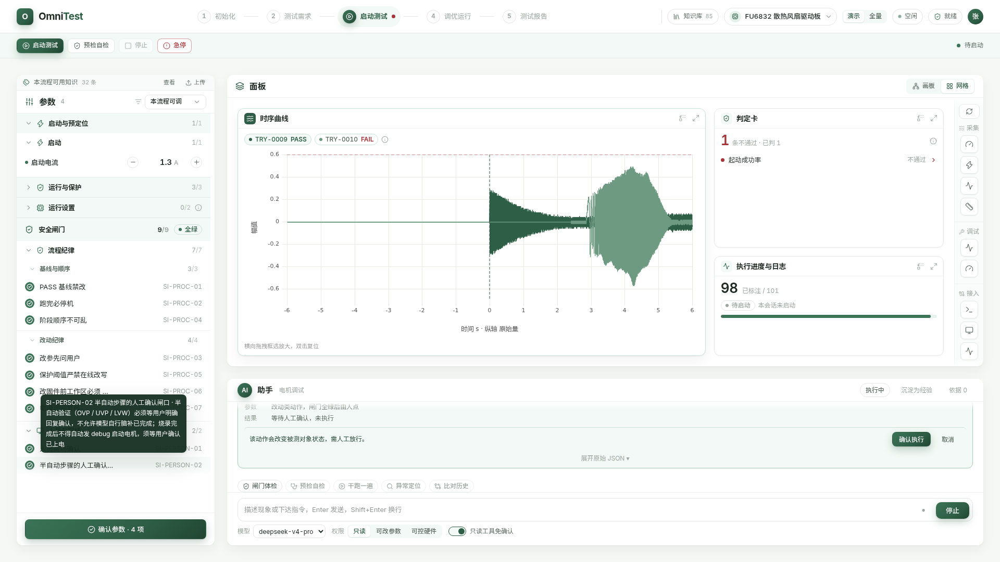

安全闸门由 0/9 勾到 9/9，状态徽标由「未放行」转「全绿」，顶栏「启动测试」随之由置灰转亮，右端状态转「待启动」。九条分两组：流程纪律 7 条、人员与现场 2 条，差一条就不放行，按钮的悬停提示写明还差哪几条。图里左栏那枚浮层是走查逐条勾闸门时停在 `SI-PERSON-02` 上留下的，写的是这条闸门的原文。

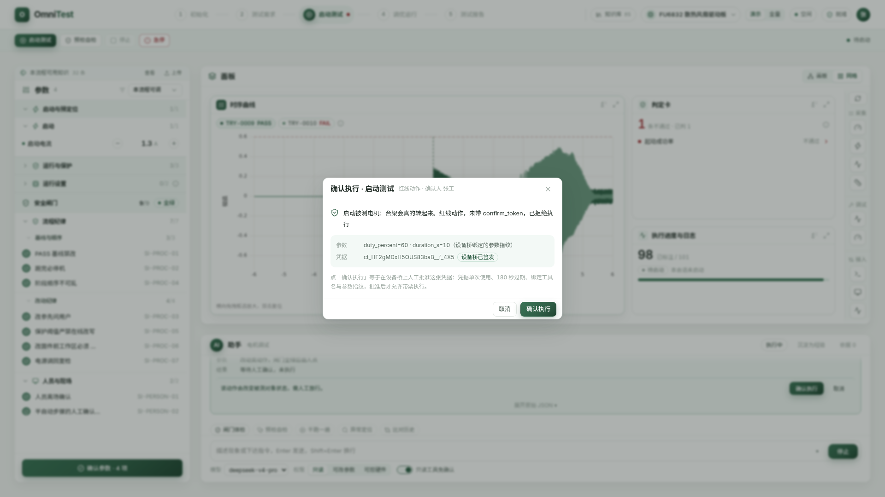

确认卡上摆四样东西：动作全名与物理后果（「启动被测电机：台架会真的转起来」）；参数 `duty_percent=60 · duration_s=10`，与凭据绑成参数指纹；凭据串 `ct_…`，标「设备桥已签发」；卡底那句说明凭据的四道约束——单次使用、180 秒过期、绑工具名、绑参数指纹。

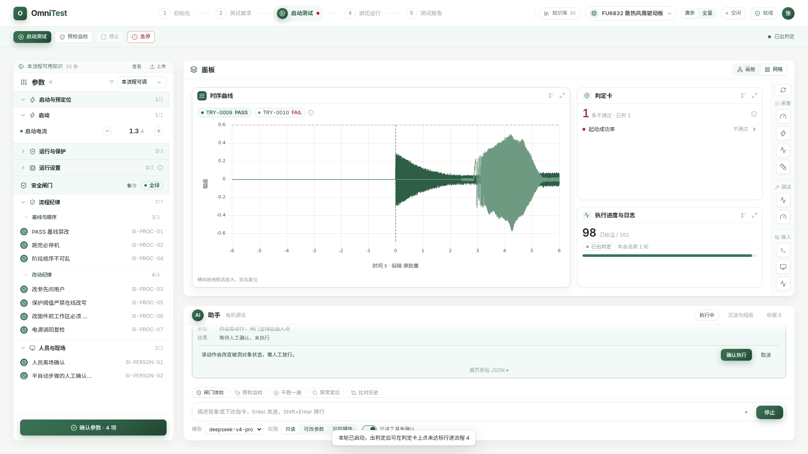

判定卡求的是已有实测量，不等本轮跑完，所以未启动时卡面就写着「1 条不通过 · 已判 1」；运行期间它改摆进度，跑完回到这张结论卡，执行进度卡随之改记「本会话第 1 轮」。不通过的是起动成功率（判据编号 `TR-START-01`），该行行尾带一枚右向箭头，可点。运行中途被停止或急停就停在那一态，不出新判定。

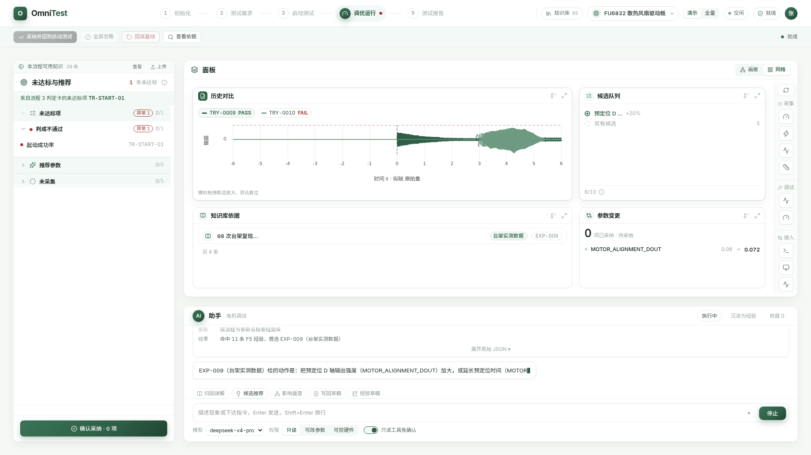

点那一行，地址转到 `/tune`，流程 4 左栏顶部出现横幅「来自流程 3 判定卡的未达标项 TR-START-01」。候选队列首位是预定位 D 轴输出强度（`MOTOR_ALIGNMENT_DOUT`）0.06 → 0.072，依据经验条目 `EXP-009`，排在第一是因为它的证据级是台架实测数据。其余状态的判定行不可点：没有可跟进的结论却给点击反馈是假的。

走查脚本 `~/agent-test-web/scripts/walk-wire.mjs` 把这条主线走满十二步：设备桥节点在线 → 闸门未满启动置灰 → 逐条勾满 → 启动转亮 → 弹确认卡 → 运行中 → 出判定 → 未达标行跳流程 4 → 勾选候选 → 采纳走写回参数确认卡 → 回到流程 3 → 生成报告 → 导出走确认卡。2026-09-20 在设备桥在线（`mode: live`）下跑完，十二步全部 PASS，退出码 0。

### 判定为什么能判出一条不通过

起动成功率这一条的判据是三个子句的合取：通过次数等于要求次数、保护标志字为 0、FG2 机械转速最小值高于下限。后两个量本轮确实没采到。但第一个子句已经能算：2026-08-11 启动故障 98 次实验（数据包目录 `/mnt/f/Main/File/2_Projects/峰岹/峰岹agent/数据/20260811_启动故障98次实验与30例对照数据包/`，分析报告 `分析报告-预定位太弱判定-20260812.md`）里尝试 101 次、已标注 98 次、通过 67 次，67 不等于要求的 100，这一子句为假。合取式里有一项为假，整条就是假，另两个量补齐也翻不过来。

这不是拿别的数顶替，也不是把「未采集」改写成确定值：已算的子句全为真而仍有子句缺量时，整条照旧落「未采集」。判定卡把这件事写在悬停提示里，并注明 67/98 是既有批次的标注结果、不是本轮现场重采。没有登记这一段批次统计的场景包——合成的汽车玻璃升降器包就没有——一个数都不给，该判据仍落「未采集」。

### 闸口在设备桥里，前端骗不过去

接了设备桥时，红线动作走三段式：

1. 前端不带 `confirm_token` 调一次桥上的工具，桥拒绝执行，回一张 pending 凭据，带提示语与参数预览；
2. 人在确认卡上点「确认执行」，前端调桥的批准接口 `POST /confirmations/{token}/approve`，带确认人署名；
3. 前端带同一张票、同一组参数重调，才真执行。

凭据的四道约束只在桥里实现一次，前端不另起一套。批准函数在前端只有一个合法调用点，就是确认卡上那颗按钮；助手侧的两个模块只能把动作排进队列，调不到批准。走查跑完去查桥的凭据台账：启动与写回参数两张记 `consumed`，`approved_by` 留着确认人；走查里点了取消的那张导出记 `rejected`；另有几张没人管的停在 `pending`，其中一张已过期。三段式的每一段都真发生过。

### 桥离线时，以及仍然点不动的五颗按钮

设备桥不可达时，画板设备节点显示「网关 未连通」，悬停提示按成因分三句写：缺令牌 `VITE_BRIDGE_TOKEN`、桥地址不可达（附该起哪个脚本、该改哪个变量）、令牌与桥侧的 `BRIDGE_TOKEN` 不一致。C 区工具条下半截退回一枚离线占位，桥工具 0 个。此时红线动作跳过第 1、3 段，只驱动页面回放，**确认卡照弹**，并在卡上写明本次不向台架下发任何控制命令——红线口径不因为桥没起就松掉。离线态取证图是 `03-截图/v3.2/offline-0-device-node.png` 与 `03-截图/v3.2/offline-0-device-node-tip.png`。

附一条环境坑：设备桥的跨域白名单默认只放行 `http://localhost:5173` 与 `http://localhost:3080`。用 `npm run preview` 的 4173 或 4199 端口、或者用 `127.0.0.1:5173` 打开页面，浏览器会直接拦掉请求，页面上不报任何错，只显示「未连通」。本版截图因此固定用 `npm run dev` 的 5173。

流程 1 与流程 2 顶栏那五颗按钮——读取文档自动填充、另存为参数模板、校验配置、导入标准、编辑工作流——本轮仍然置灰。它们要的是文档解析与模板落盘，属服务端能力；本轮的范围是把已有能力接上，没有去补后端。现在它们统一置灰并给出理由，悬停提示写「该动作在当前原型里未接后端」：让按钮看着可点、点了没反应，比明摆着置灰更糟。同组里「提交并锁定」与「确认需求基线」是纯前端的确认动作，已经接上。

---

## 六、两个场景包：同骨架换叶子

**散热风扇包（Fortior FU6832 散热风扇驱动板）与汽车玻璃升降器包共用同一套页面代码、同一套分层骨架，只有叶子节点的内容不同。**

| 维度 | 散热风扇 FU6832 | 玻璃升降器 |
| --- | --- | --- |
| 本体属性 | 29 项，占位 5 | 47 项，占位 4 |
| 判据 | 26 条，可自动求值 20 | 34 条，可自动求值 31 |
| 知识条目 | 85（文档 61 + 经验 24） | 101（文档 83 + 经验 18） |
| 预置动作 | 29 枚，全部可用 | 29 枚，4 枚执行类标「本场景不开放」 |
| 时序数据 | 实测回放 | 合成数据，页面标「合成数据，非实测」 |
| 台架设备 | 台架工控机，场景包登记 9 个工具；设备桥在线时节点读到 13 个 | 合成数据回放，场景包登记 13 个工具 |

分层骨架写在场景包 JSON 的 `group_tiers` 段，页面只认骨架不认叶子。两包的五个一级类名称完全相同，二级组标题与叶子全换。初始化配置页的「台架与仪器」，散热风扇包有实体台架接入行，玻璃升降器包只有仪器登记。

### 数字与出处对照

| 数字或口径 | 出处 |
| --- | --- |
| 知识条目 85 / 101 / 186、用途轴落位、15 条待复核 | `07b-W2完成报告.md` 第二节 |
| 台架工具数 9 与 13、设备节点字段 | `07c-W3完成报告.md` 第三节 |
| 流程 3 与流程 4 的判据数、时序条数、卡片数 | `07d-W4完成报告.md` 第三节 |
| 预置动作 5 枚 / 4 枚 / 29 枚与三类分布 | `07e-W5完成报告.md` 第二节 |
| 本体属性 29 与 47、判据 26 与 34 | v2.1 原文，已与场景包 JSON 核对一致 |
| 缩放条与缩略导航图都在右下角 | `07f-W6收尾报告.md` 第一节第 1 条（定右下角）、`CHANGELOG-fix-visual-20260920.md` 第 4 条（导航图由左下角挪到右下角） |
| 忙态只禁执行类 | `07f-W6收尾报告.md` 第一节第 3 条 |
| 调优页空态文案 | `07f-W6收尾报告.md` 第一节第 7 条 |
| 顶栏条目数取真值、撤独立设备卡、网格不回填、知识库四枚按钮 | `07f-W6收尾报告.md` 第二节 |
| 两包 JSON 与工程 `public/` 逐字节一致 | `07f-W6收尾报告.md` 第四节 |

---

## 七、还没做与待拍板

逐条来自六份报告的「未完成项」与「仍需拍板」，W6 已收掉的不再列。

### 7.1 未完成

| 编号 | 事项 | 来源 | 说明 |
| --- | --- | --- | --- |
| G-01 | 现场实测量仍然缺 | `07d-W4完成报告.md` 第七节第 2 项、`CHANGELOG-fix-r14-20260920.md` 第一节 | 本轮仍没做现场采集。起动成功率能判不通过，靠的是 2026-08-11 那批 98 次实验的既有标注；保护标志字与 FG2 转速最小值两个量仍缺，演示模式下另外 5 条判据照旧落「未采集」 |
| G-02 | 轮次产物存储未做 | `07e-W5完成报告.md` 第七节第 1 项 | `lastRun.artifacts` 与 `history.runs` 为 null |
| G-03 | 选中态未统一出口 | `07e-W5完成报告.md` 第七节第 2 项 | `selected_document`、`selected_fail_item`、`selected_candidate` 仍是局部 `useState`。它与 G-02 合计导致 6 枚助手按钮置灰 |
| G-04 | 15 条知识待人工复核 | `07b-W2完成报告.md` 第二节 | 三类原因：总表未收录的类型、跨边界、经验条目边界模糊。总数 15 取自 W2 表格逐包合计 |
| G-05 | skill 走演示态回放 | `07e-W5完成报告.md` 第七节第 4 项 | 接 DeepSeek Harness（DSH，DeepSeek 开源的 Agent 运行时）后同一枚按钮会发真调用 |
| G-06 | 9 处 skill 规程名称待核实 | `07e-W5完成报告.md` 第七节第 5 项 | 草案里标 `unverified` 的规程没去客户安装目录逐条打开原文确认 |
| G-07 | 全屏首屏元素 ≤55 分两套口径 | `07d-W4完成报告.md` 第四节、`CHANGELOG-fix-r14-20260920.md` 第二节与第四节 | 按「只数 B、C 两区」的口径，流程 3 为 35、流程 4 为 41，已在 55 以内；按「含顶栏与助手区外壳」的口径为 94 与 91，仍未达标。外壳那 48 个元素不在本轮改版包的文件所有权内，两套口径哪一套算数待拍板，见 D-06 |
| G-08 | 画板节点坐标写在代码里 | `07c-W3完成报告.md` 第五节第 6 项 | 场景包 `scene.json` 已有 `default_view` 段但无 `canvas_layout` 段，节点坐标仍硬编码在 `model.ts` |
| G-09 | 滚动条只测得到、未见得着 | `07f-W6收尾报告.md` 第五节第 1 条 | 配色规则与 `scrollbar-gutter: stable` 已生效，版式占位可测（容器 `clientWidth` 由 380 降到 372）；但本机 headless Chrome 不把滚动条画进截图，「真人屏幕上看得见」尚无证据 |

### 7.2 待拍板

| 编号 | 事项 | 来源 |
| --- | --- | --- |
| D-01 | 系统对外产品名 | v2.1 第九节第 1 项 |
| D-02 | 滚动条要在真实浏览器里人眼复核一次，确认看得见 | `07f-W6收尾报告.md` 第七节第 1 项 |
| D-03 | 底部渐隐 `.fade-b` 用 sticky 伪元素替代了父级伪元素，是否改回字面做法 | `07f-W6收尾报告.md` 第七节第 2 项 |
| D-04 | 15 条待人工复核条目怎么归；其中 `DOC-OWN-058`、`DOC-REP-005`、`DOC-REP-006` 跨 B/C 边界必须人定 | `07f-W6收尾报告.md` 第七节第 3 项 |
| D-05 | 轮次产物存储与面板选中态上提是否进下一轮 | `07f-W6收尾报告.md` 第七节第 4 项 |
| D-06 | 首屏元素 ≤55 按哪套口径数（只数 B、C 两区，还是含顶栏与助手区外壳），以及要不要继续压 | `07f-W6收尾报告.md` 第七节第 5 项、`CHANGELOG-fix-r14-20260920.md` 第四节第 1 条 |
| D-07 | 已收：独立核验查出初始化页 8 处、报告页 6 处超「每屏 ≤5」，占位计数改中性灰后三页分别为 3、4、4 处 | `07g-独立核验报告.md` 第七节应修 3 |
| D-08 | 汽车包本体数值可信度与合成时序 | v2.1 第九节第 3、4 项 |

### 7.3 独立复核与本轮修复状态

第三轮落码之后做过两次互相独立的复核，都不是原作者自审。一次核飞书发布件与本地文件是否逐字节一致，一次在干净上下文里重跑构建、重截 32 张图并与出图批做像素级差分，结论是出图之后源码未再改动、当前代码即本文截图所示。记录见 `05-交接文档-给接手模型-v1.2.md` 第 12.7 节与 `03-截图/CHANGES-v2.1-to-v3.0.md` 第 11 节。

两次复核对 18 条录音意见逐条判定，条数与另一会话出具的 `07g-独立核验报告.md` 完全一致：**已解决 13 条、部分解决 3 条、未解决 0 条、无需动作 2 条。** 无需动作的两条是 R-13 语言评价与 R-18 等页面验证，一条是正面评价、一条是程序性意见。两份复核对「部分」点名的条目有两处不同，`07g` 点 R-10 知识分类体系，代码侧复核点 R-12 参数说明；本文采用代码侧复核的口径，R-10 的 15 条待人工复核条目另走 G-04 与 D-04 两条记录。

| 编号 | 缺的是什么 | 本版处置 |
| --- | --- | --- |
| R-11 B 区要有内部滚动条 | 配色与版式占位在代码里已生效，但 32 张截图一张都拍不到滚动条本体 | 待真人在真实浏览器里看一眼并留证，见 G-09 与 D-02 |
| R-12 初始化配置包含哪些参数 | 前端折叠已做，原话前半问的是文字说明，前端答不了 | 本版已补，见第二节流程 1 的「参数构成」小节 |
| R-14 demo 案例过于复杂 | 演示与全量开关已加、演示态数据已收窄，本轮又压了一遍首屏 | B、C 两区 35 / 41 已达标，含顶栏与助手区外壳的 94 / 91 未达标，两套口径待拍板，见 G-07 与 D-06 |

上一版人眼复检记录在 `03-截图/CHANGES-v2.1-to-v3.0.md` 第 13 节的 5 个视觉缺陷，本轮修掉 4 个：截图脚本静默失败出了一张名不副实的图、画板节点底部内容硬切、知识库右栏「备注」末行与卡片下边界叠压、画板缩放态下缩略导航图压住「文档读取」节点。剩下 1 处是测试报告页「判定卡」与「模板字段」的底部收尾——它不是画板节点，而是该页走网格视图时由 `src/features/flow-report/panel.tsx` 渲染的网格卡片，不在那一轮的文件所有权内，本轮未改；实测该处本来就挂着遮罩渐隐，不是硬切。修复记录见 `~/agent-test-web/CHANGELOG-fix-visual-20260920.md`。

---

## 八、给同事的下一步

**实施任务详单在 `04-同事实施任务详单-v3.1.md`。** v2.0 写于第二轮，它的四条前提——六个流程、知识库占流程序号 1、C 区固定卡片网格、设备单开网页 SSH 页面——在第三轮之后全部不再成立，那份文件只作留档，不要拿它开工。六个工作流 W1 至 W6 全部完成，收尾包已把跨包请求单逐条落地、重出 22 张截图同步到 `03-截图/`。下一步看 7.2 的八条拍板。

本版截图落在 `03-截图/v3.2/` 下，共 37 张，根目录下 v3.0 那一批原样保留不动。页面截图叫 `final-<页名>.png`，补充截图叫 `final-extra-<功能>.png`，1440 宽变体加 `-1440` 后缀；交互走查截图叫 `online-<步号>-<内容>.png`，设备桥离线态叫 `offline-…`。

本目录绝对路径：`/mnt/f/Main/File/2_Projects/峰岹/峰岹agent/09-实验室demo线/20260919-通用Agent测试系统v2.0/`。

---

## 版本说明

本节分两段：先是 v3.1 依 `07f-W6收尾报告.md` 做的那批校正，校正的是 v3.0 起草时尚未发生的事实，W6 第七节六条待拍板已并入第七节；再是 v3.2 依三份修复记录改写的六处新事实。三份修复记录是 `~/agent-test-web/CHANGELOG-fix-visual-20260920.md`（视觉缺陷）、`~/agent-test-web/CHANGELOG-fix-r14-20260920.md`（首屏压缩与判定短路求值）、`~/agent-test-web/CHANGELOG-wire-20260920.md`（交互打通与设备桥）。

### v3.1 的校正点

| 校正点 | 起草稿写的 | 现在的事实 |
| --- | --- | --- |
| 顶栏知识库条目数 | 恒为 0，列为未完成项 G-01 | 真实值，散热风扇 85、玻璃升降器 101 |
| 缩放条与缩略导航图 | 百分比与复位在左下角，位置待拍板 | 缩放条右下角（v3.2 起缩略导航图也挪到右下角，叠在缩放条正上方） |
| 助手忙态 | 未写 | 只禁执行类，讲解类与准备类保持可点 |
| 演示与全量切换 | 只有 `?mode=full` 参数 | 顶栏「演示 / 全量」分段控件，默认演示 |
| 单机设备独立卡 | 仍占一张卡槽 | `remote-device` 卡槽已撤，设备只在画板上 |
| 网格卡片数 | 未写，且被删卡会回填（G-10） | 流程 3 为 3 张、流程 4 为 4 张，回填已撤 |
| 知识库页助手 | 只保留对话框 | 对话框加四枚按钮：库存盘点、缺口清单、抽取草稿、分类归位 |
| 调优页左栏 | 只说未达标 0、已通过 0、未采集 6 | 补上空态原文「本轮无现场实测，判据未求值」 |
| B 区滚动条 | 直接算作已完成 | 配色与版式占位测得到，可见性未人眼验证，转入 G-09 与 D-02 |
| 折叠态截图图注 | 只有「被测对象」一个一级类展开 | 「被测对象」与「驱动与控制」两个一级类同屏展开 |

### v3.2 的新事实

三轮代码修复之后，下面六处的事实变了，正文已逐处改写。

| 处 | v3.1 写的 | 现在的事实 |
| --- | --- | --- |
| 流程 3 判定 | 判定卡列 6 条判据，全部未采集 | 起动成功率判不通过，卡面收成「1 条不通过 · 已判 1」 |
| 流程 4 左栏 | 未达标 0、已通过 0、未采集 6 | 1 条未达标（`TR-START-01`），演示模式栏头只报这一个数 |
| 流程 5 判定汇总 | 未写 | 与流程 3 同源，通过 0、不通过 1、未采集 5 |
| 顶栏与左栏动作按钮 | 未写行为 | 按动作行为表接上，置灰与理由现算；流程 1、2 的五颗仍置灰并写明理由 |
| 设备节点 | 登记工具 9 个、在线 0 个 | 读设备桥：13 个工具分三层、模式 `live`、网关已连通；场景包登记的 9 个另算一套 |
| 首屏元素数 | 流程 3 为 87、流程 4 为 74 | 两套口径：B、C 两区 35 / 41，含外壳 94 / 91 |

### v3.0 相对 v2.1 的变化清单

| 变化 | v2.1 | v3.0 |
| --- | --- | --- |
| 流程数 | 六个，知识库是第 1 步 | 五个主线流程 + 知识库基础模块 |
| 流程编号 | 1 知识库 … 6 报告 | 1 初始化配置 … 5 测试报告及产出 |
| 知识库位置 | 与 2–6 平级，套统一版式 | 基础模块，独立页版式，顶栏常驻按钮进入 |
| 知识分类 | 两维：归属、来源 | 三轴正交：归属、来源、用途 |
| C 区形态 | 固定 3×2 卡片网格，首槽即 hero | 统一画板 React Flow，网格降为备选 |
| 设备接入 | 独立 SSH 页面，外加一张独立卡槽 | MCP 工具节点落在画板上，SSH 只是后台链路 |
| B 区信息密度 | 平铺列举 | 分层折叠：一级类 → 二级组 → 三级子组，默认只展开第一类 |
| 案例复杂度 | 全量展示 | 演示模式与全量模式并存，顶栏分段控件切换，默认演示 |
| 助手能力 | 对话与示例 | 预置动作按钮，每流程 5 枚、知识库 4 枚，感知当前页面上下文 |
| 智能体名称 | 旧称沿用第二轮的驾驶隐喻叫法 | 助手 |
| 架构图 | `fig2_六流程主线.png` | `fig2_五流程主线与知识库层带.png` |

### 本轮引用的截图清单

本版 37 张由 2026-09-20 三轮代码修复之后重拍。下表 18 个图位连同离线态那张提示图已逐张人眼复检，未见破版、裁切或占位图；未引用的 1440 宽变体与走查其余步骤的图只核到文件存在，没有逐张看过。采集命令与门禁结果见文末。

| 图位引用名 | 画的是什么 | 状态 |
| --- | --- | --- |
| `03-截图/v3.2/final-knowledge.png` | 知识库独立页，顶栏 85、四枚助手按钮 | 已产出 2026-09-20 |
| `03-截图/v3.2/final-init.png` | 流程 1 初始化配置，画板七节点 | 已产出 2026-09-20 |
| `03-截图/v3.2/final-req.png` | 流程 2 测试需求确认，画板六节点 | 已产出 2026-09-20 |
| `03-截图/v3.2/final-run.png` | 流程 3 启动测试及结果分析，网格三张卡 | 已产出 2026-09-20 |
| `03-截图/v3.2/final-tune.png` | 流程 4 调优确认及运行，网格四张卡 | 已产出 2026-09-20 |
| `03-截图/v3.2/final-report.png` | 流程 5 测试报告及产出，网格五张卡 | 已产出 2026-09-20 |
| `03-截图/v3.2/final-extra-canvas-zoom.png` | 画板放大到 130% 的缩放态 | 已产出 2026-09-20 |
| `03-截图/v3.2/final-extra-node-zoom.png` | 设备节点放大态与终端入口 | 已产出 2026-09-20 |
| `03-截图/v3.2/final-extra-confirm.png` | 助手红线按钮的人工确认闸门 | 已产出 2026-09-20 |
| `03-截图/v3.2/final-extra-kb-filter.png` | 知识库用途轴筛选到 12 条 | 已产出 2026-09-20 |
| `03-截图/v3.2/final-extra-collapse.png` | B 区折叠态与展开态同屏 | 已产出 2026-09-20 |
| `03-截图/v3.2/online-2-gate-green.png` | 安全闸门 9/9 全绿，启动测试转可点 | 已产出 2026-09-20 |
| `03-截图/v3.2/online-4-redline-confirm.png` | 红线确认卡，凭据由设备桥签发 | 已产出 2026-09-20 |
| `03-截图/v3.2/online-5-verdict.png` | 运行结束出判定，起动成功率不通过 | 已产出 2026-09-20 |
| `03-截图/v3.2/online-6-tune-focus.png` | 未达标行跳流程 4，左栏带来源横幅 | 已产出 2026-09-20 |
| `03-截图/v3.2/offline-0-device-node.png` | 设备桥离线：节点「网关 未连通」 | 已产出 2026-09-20 |
| `03-截图/v3.2/offline-0-device-node-tip.png` | 同上，悬停提示写明成因与该起哪个脚本 | 已产出 2026-09-20 |
| `_图/fig2_五流程主线与知识库层带.png` | 架构图 | 已产出 2026-09-19 |

目录里另有 26 张本次一并重拍但正文未引的图：五个流程页与知识库页的 1440 宽变体 6 张、放大态 3 张、汽车玻璃升降器包 2 张，以及走查里其余 9 步与设备节点两态的 15 张。

采集方式：设备桥 `~/lab/spike-device-mcp/run-bridge.sh` 在 `127.0.0.1:8031` 监听且已连上台架（`mode: live`），前端 `npm run dev` 于 `http://localhost:5173`，依次跑
`OUTDIR=shots6 node scripts/shootfinal.mjs`（17 张）、`OUTDIR=shots6 node scripts/shootextra.mjs`（5 张）、
`node scripts/walk-wire.mjs`（13 张在线态，脚本写死落 `shots5/` 后复制过来），三个脚本退出码均为 0，前两个各自打印「全部动作成功，无静默失败」，走查十二步全部 PASS。另 2 张离线态由同一份代码在当天的接线轮里以 `VITE_DEVICE_BRIDGE_URL` 指向空端口 8039 拍得，一并归入本目录。
