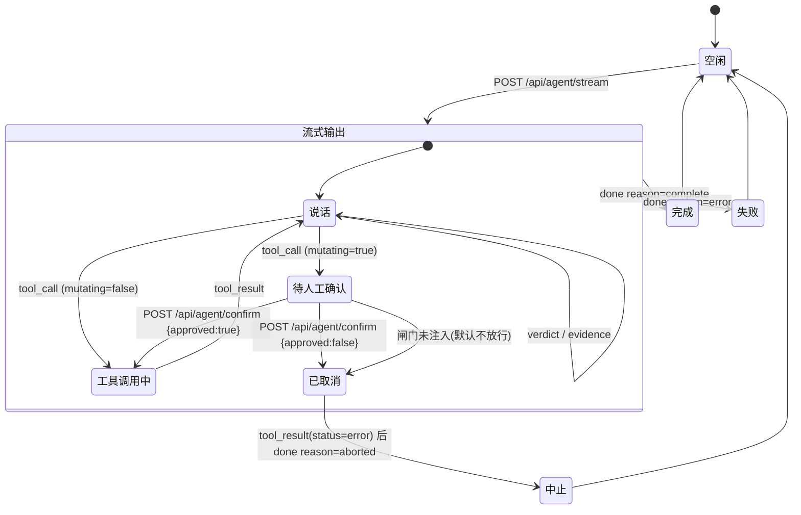
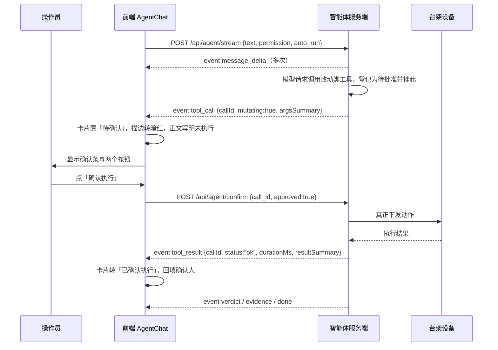
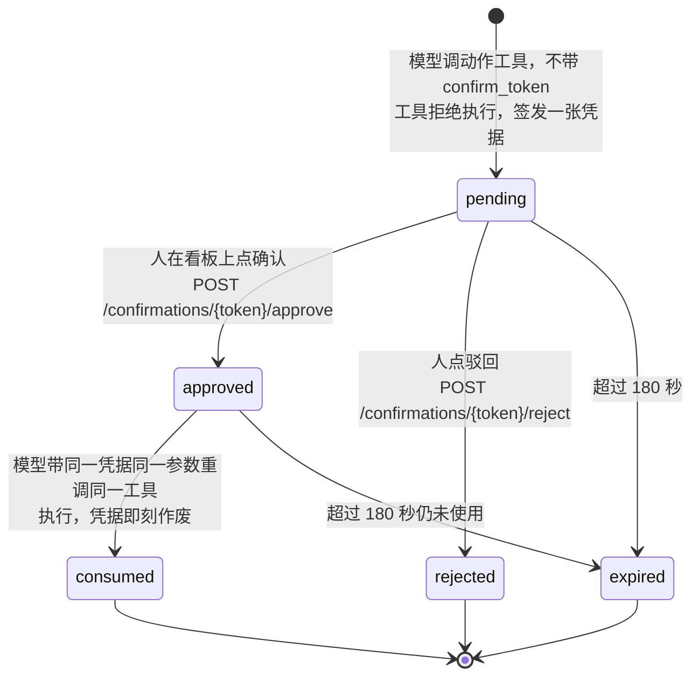

# 开发接口契约 v1.1 · 多场景 Agent 测试系统

本文从原型代码反推，给出前端已经在调、或已经写死了调用形状的全部服务端接口。写给要把原型接成真系统的开发，不写给评审。

## 代码快照时刻

**本文引用的全部代码、行号、字段值、统计数字，一律以下列快照为准。**

| 项 | 值 |
| --- | --- |
| 核对时刻 | 2026-09-20 09:34 CST |
| 前端原型最后落盘 | `c/src` 下最新文件时间戳 **2026-09-20 09:28** |
| 版本控制 | Gitee 私有仓 `https://gitee.com/zhangjy-george/agent-test-system`，本地工作副本 `[源] 40_工程/agent-test-system`（目录 `web/`、`components/`、`data/`、`docs/`、`dsh-plugins/`、`kb-pipeline/`），前端原型对应其中的 `web/` |
| 已入库的最新提交 | `f5d318d`，2026-09-20 凌晨的第三轮结构性改版 |
| **尚未入库的部分** | **本文引用的是 `[源] zzz/agent-test-web` 这份工作区，今天白天的三轮修复（接线、R-14 案例简化、视觉缺陷）尚未同步提交进该仓**，所以本文只能记快照时刻，不能给提交号。同步提交后请把本行换成对应的提交号 |
| 设备桥 | `c/components/spike-device-mcp`，最后落盘 2026-09-19 23:30 |
| SSH 网关 | `c/components/webssh`，本轮未改动 |

**一条硬约束：演示或开发交接前一天，必须重跑一遍本文第 6.1 节的统计命令与第 1.2 节的接口实测，核对本文与当日代码是否仍然一致。** 原型工程在 v1.0 出稿后的 28 分钟内被改过八个文件，v1.0 正是因此整节失效。本文不假设自己会长期成立。

v1.1 相对 v1.0 的修订范围：按 `08a08c-审稿意见.md` 的 34 条意见逐条处置，处置表在文末第 7 节。改动集中在六处——第 1.1.2 与 3.4 两节改写为"已落地"的实现描述、新增第 1.2 节的桥客户端落地说明、域 C 四份样例全部从真实文件重取、第 6.1 节全部数字重数、新增第 6.8 节的环境变量与跨域约束表。

三条成文纪律：

- **接口不编造。** 凡代码里有调用点的，给真实路径、真实字段、真实样例；代码里没有的，一律写成「原型未实现，建议形态」并在小节标题上标出，开发可以改，但要知道自己改的是建议不是既成事实。
- **样例取自真实产物。** JSON 样例来自 `[源] spike-device-mcp/evidence` 下的取证文件、`c/public/` 下的场景包与知识库产物，以及前端源码里的脚本化回放常量，不是手写示意。
- **调用点给文件与行号。** 每条接口给出 `绝对路径:行号`，开发可直接跳过去看上下文。

涉及的五个工程，首次出现给全路径：

| 代号 | 全路径 | 角色 |
| --- | --- | --- |
| 前端原型 | `[源] zzz/agent-test-web` | 唯一的界面工程，所有调用点都在它的 `src/` 下 |
| 助手组件工程 | `c/components/agent-chat` | 助手对话组件的独立开发工程，SSE 协议的出处 |
| 设备 MCP 桥 | `c/components/spike-device-mcp` | 把台架设备包成 MCP 工具，再用 HTTP 桥暴露给画布 |
| SSH 网关 | `c/components/webssh` | 浏览器到台架工控机的 SSH 通道与截图回退 |
| 知识库流水线 | `c/components/kb-pipeline` | 离线转化与检索，只产出静态文件，不起服务 |

---

## 0. 一页总览

接口按四个域分组。每域一句话交代它解决什么问题，和当前的实现状态。

**三态按 2026-09-20 09:28 的代码快照逐条重判过一遍**，与 v1.0 的差异写在表下。

| 域 | 一句话 | 接口条数 | 真实 | 脚本回放 | 未实现 |
| --- | --- | --- | --- | --- | --- |
| A 助手对话 | 助手的一轮问答：流式正文、工具调用、判定、依据，外加改动类动作的人工放行 | 4 | 1 | 2 | 1 |
| B 设备与台架 | 台架工控机与示波器的观测、动作与命令行会话，红线动作在这一域闸住 | 14 | 14 | 0 | 0 |
| C 知识库 | 文档索引、经验条目、分类体系与检索命中 | 5 | 4 | 0 | 1 |
| D 场景包与运行产物 | 换产品即换一整包静态数据；跑完一轮该产出什么 | 7 | 6 | 0 | 1 |
| 合计 | — | **30** | **25** | **2** | **3** |

**v1.1 相对 v1.0 的两处计数变动**：

| 变动 | 原因 |
| --- | --- |
| 域 B 由 13 条增为 14 条 | v1.0 漏登了 SSH 网关的 `GET /health`（`[源] gateway/server.js:117`），v1.1 补为第 1.2.10 节。桥 8 条加网关 6 条 |
| 域 A 的两条「脚本回放」状态不变，但含义变了 | `POST /api/agent/confirm` 的服务端仍不存在，判定不改；但前端已把确认转发到设备桥，见第 1.1.2 节与第 3.4 节 |

**「接了吗」与「三态」是两件事，别混。** 三态说的是**服务端有没有**，不是前端接没接。域 B 全部 14 条服务端都真实存在且跑通过；前端在 v1.0 出稿后已接上桥的六条，但 `GET /confirmations`、`GET /confirmations/{token}` 与网关的 `GET /health` 三条前端仍无封装，这不影响它们的「真实」判定。

另有一个非 HTTP 的接口面：设备 MCP 服务 `device-bench` 的 **13 个工具**，分连接层、观测层、动作层三层，见第 1.2.9 节。它与域 B 的桥接口是同一份业务逻辑的两个面，不重复计数。

三种状态的准确含义：

- **真实**：服务端代码已存在且跑通过，请求响应形状以代码为准。静态 JSON 与 CSV 也算真实接口——它们由 Web 服务器直接吐出，换成动态接口时路径和响应体应当保持不变。
- **脚本回放**：前端有完整的调用与解析代码，但当前应用里挂的是本地脚本化适配器，一个字节都没发到网络上。开发要做的是把服务端补齐，前端解析层不用动。
- **未实现**：代码里只有占位、恒为 `null` 的字段或离线命令行工具，没有任何 HTTP 调用点。本文给建议形态。

另有一个与上述三态正交的概念，别混：设备 MCP 的每个返回都带 `mode` 字段，取值 `live` 或 `mock`。`mock` 指后端连不上台架时的降级合成数据，与接口本身是否真实无关，见第 1.2.9 节的信封约定。

---

## 1. 接口逐条

### 1.1 域 A · 助手对话

这一域只有四条，但它是整个系统的主干：界面上的每一段助手正文、每一张工具卡、每一张判定卡，都由第 1.1.1 条的事件流驱动。

#### 1.1.1 POST /api/agent/stream —— 一轮对话的 SSE 事件流

**当前状态：脚本回放。** 前端的 SSE 解析代码已写完并在用（`dshAdapter`），但应用里挂的适配器是本地脚本 `makeAdapter`，没有真实请求发出。服务端要做的就是这一条。

**前端调用点**

| 位置 | 说明 |
| --- | --- |
| `[源] agent-chat/api.ts:365` | 发起请求 |
| `[源] agent-chat/api.ts:389-415` | SSE 分帧与解析，按空行切分，只认 `data:` 行 |
| `[源] copilot/index.tsx:73` | 应用当前挂的是脚本适配器，换真后端时把这一行换成 `dshAdapter` |
| `[源] knowledge/KnowledgeModule.tsx:365-366` | 知识库模块页那一块对话的挂载点 |

**请求**

```http
POST /api/agent/stream
Content-Type: application/json
```

```json
{
  "text": "跑一次预检，然后回放本批 CH1 波形并对判据",
  "model": "deepseek-v4-pro",
  "permission": "readonly",
  "auto_run": true,
  "session_id": "shell-motor.cooling-fan.fortior-fu6832-run"
}
```

**请求字段表**

| 字段 | 类型 | 必填 | 含义 | 来[源] |
| --- | --- | --- | --- | --- |
| `text` | string | 是 | 本轮用户输入的原文 | 输入框，或预置动作按钮的 `prompt` 字段 |
| `model` | string | 是 | 模型标识，四个候选见 `[源] agent-chat/types.ts:13-18` | 顶栏模型选择器 |
| `permission` | string | 是 | 权限档位，三值 `readonly` / `params` / `hardware` | 输入区档位选择器 |
| `auto_run` | boolean | 是 | 是否自动执行只读类工具。它不覆盖改动类动作 | 输入区开关 |
| `session_id` | string | 否 | 会话标识，由服务端维护上下文 | 前端当前拼成 `shell-{sceneId}-{flow}`，见 `[源] copilot/context.ts:135` |

权限档位三值的准确含义，抄自 `[源] agent-chat/types.ts:7-11`：

| 值 | 显示 | 含义 |
| --- | --- | --- |
| `readonly` | 只读 | 仅读取工程文件与测量数据，不做任何写入 |
| `params` | 可改参数 | 允许修改标定参数与配置项，不驱动硬件 |
| `hardware` | 可控硬件 | 允许启停电机、切换负载、控制仪器 |

服务端要注意：**前端不做任何权限拦截**，档位原样下发给模型的工具策略，拦截责任全在服务端。这条写在 `[源] agent-chat/api.ts:355-357` 的注释里。

**响应**

`Content-Type: text/event-stream`。一条消息一个事件，`event` 名与 `data.type` 保持一致，便于原生 `EventSource` 按名监听。六类事件的全文见第 2 节。一段真实的帧序列：

```
event: message_delta
data: {"type":"message_delta","messageId":"m1-1","delta":"先看工程里的"}

event: tool_call
data: {"type":"tool_call","callId":"tc-1","name":"read_file","title":"读取工程文件","args":{"path":"MotorApp/Inc/Customer.h","symbols":["STARTUP_RAMP_MS","CURR_LIMIT","RATED_CURRENT_A"]},"argsSummary":"读取 MotorApp/Inc/Customer.h 的 3 个启动相关宏"}

event: tool_result
data: {"type":"tool_result","callId":"tc-1","status":"ok","durationMs":612,"resultSummary":"STARTUP_RAMP_MS=160，CURR_LIMIT=0x01F4，RATED_CURRENT_A=1.50","result":{"path":"MotorApp/Inc/Customer.h","macros":{"STARTUP_RAMP_MS":160,"CURR_LIMIT":"0x01F4","STARTUP_ILIM":"0x0190","RATED_CURRENT_A":1.5},"lines":[148,151,153]}}

event: verdict
data: {"type":"verdict","verdict":{"id":"vd-1","title":"空载启动电流峰值","pass":true,"expression":"I_peak ≤ 1.5 × I_rated","measurements":[{"label":"实测峰值 I_peak","value":"1.87","unit":"A"}],"conclusion":"峰值 1.87 A 为额定的 1.25 倍，低于 1.5 倍限值，判定合格。","evidenceIds":["ev-proc-1","ev-case-1","ev-doc-1"]}}

event: done
data: {"type":"done","reason":"complete"}
```

**样例出处与两处偏差，逐条说清**：

| 帧 | 真实出处 | 与上面样例的出入 |
| --- | --- | --- |
| `message_delta` / `tool_call` / `tool_result` / `done` | `api.ts:165-279` 的函数 `playScript()` 函数体 | `messageId` 的真实形状是 `m-assist-${seg}`（`api.ts:171` 生成），即 `m-assist-1`。上面样例写的 `m1-1` 来自另一个文件 `[源] copilot/adapter.ts:45`，对着 `api.ts` 找不到 |
| `verdict` | 常量 `MOCK_VERDICT`，`api.ts:141-154` | 真实常量的 `measurements` 有 **4 条**，上面样例只列 1 条。另三条是额定电流 1.50 A、倍率 1.25×、限值 1.50× |

其余字段——`expression`、峰值 1.87、三项 `evidenceIds`、`tool_call` 的全部参数、`tool_result` 的宏值与 `lines:[148,151,153]`——逐字属实。

**这处偏差要紧在哪**：第 2.1 节专门用一整段讲「工具卡片之后继续说话时必须换一个 `messageId`」，而上面这份样例里的 `messageId` 形状取自另一个适配器。服务端照 `m1-1` 这个形状实现没有错，但读者想回代码里核对时会找不到，**以 `api.ts:171` 的 `m-assist-${seg}` 为准**。

**错误码**

| 情形 | 前端行为 | 代码位置 |
| --- | --- | --- |
| HTTP 非 2xx，或响应无 body | 立刻产出 `done{reason:"error", message:"HTTP <状态码>"}`，本轮结束 | `api.ts:377-380` |
| 某一帧 JSON 解析失败 | 丢弃该帧，**不中断流** | `api.ts:411-413` |
| 流中途断开 | 读到 `done` 为止；读完 reader 后前端补发 `done{reason:"complete"}` | `api.ts:416` |

最后一条是已知的粗糙处：流异常断开时前端会报成正常完成。服务端务必在出错时主动推一条 `done{reason:"error"}`，不要靠断流表达失败。

**开发要做什么**

1. 实现这条 SSE 端点，把后端智能体的原生事件转成六类事件。映射表写在 `[源] agent-chat/api.ts:340-353`，服务端照此对齐即可。
2. `argsSummary` 与 `resultSummary` 由**服务端**生成，前端不做参数渲染逻辑。这是刻意的分工，别把摘要拼装推回前端。
3. 判定事件要补 `expression` 与 `measurements` 两个字段——模型的判定工具原生返回里没有它们。
4. 依据事件的 `kind` 由检索库路由决定：规程库出 `procedure`，案例库出 `case`，资料库出 `document`。

#### 1.1.2 POST /api/agent/confirm —— 改动类动作的放行回执

**当前状态：脚本回放，且助手侧的确认已经先接到了设备桥。**

这一条在 v1.0 出稿后被改过，改动方向正是 v1.0 第 3.4 节建议的收口方向，开发接手前必须先读这一段，不要另起一套。

**已落地的事实**（2026-09-20 09:28 快照）：

| 事实 | 代码位置 | 说明 |
| --- | --- | --- |
| 助手确认已转发桥的批准接口 | `[源] agent-chat/api.ts:427` | `await approveConfirmation(token, CONFIRM_ACTOR, call.title ?? call.name)`，前置条件是 `if (ok && token)`，`ok` 来自人点确认弹窗 |
| 批准函数本体只写了一遍 | `[源] remote/bridge.ts:157-162` | `POST ${BRIDGE_URL}/confirmations/{token}/approve`，请求体 `{operator, note}` |
| 弹窗丢工具名与参数摘要的缺口已修 | `api.ts:382` 附近 | v1.0 记的「传 `{callId, name: '', argsSummary: ''}` 空串」已不成立，变更记录在 `c/CHANGELOG-wire-20260920.md` |

**服务端仍然要做的**：`POST /api/agent/confirm` 这条 HTTP 端点本身**依然不存在**，前端当前是在浏览器里直接调桥的 `approve`，绕过了助手服务端。这只在演示形态下成立——真接后端时，凭据不应经浏览器中转，而应由助手服务端持有桥的 token 并代为转发。所以这一条的状态仍然是「脚本回放」，但收口方向已由前端先行验证过一遍。

**前端调用点**：`[源] agent-chat/api.ts:383`

**请求**

```json
{ "call_id": "tc-2", "approved": true }
```

| 字段 | 类型 | 必填 | 含义 | 来[源] |
| --- | --- | --- | --- | --- |
| `call_id` | string | 是 | 要放行或取消的那次工具调用标识，即 `tool_call.callId` | 事件流 |
| `approved` | boolean | 是 | `true` 放行，`false` 取消 | 工具卡片上的两个按钮 |
| `actor` | string | 否 | 确认人署名，写进留痕 | 注释 `api.ts:360` 提到该字段；当前发送体里**没有**它，见下 |

**代码与注释不一致，以代码为准。** `api.ts:360` 的协议注释写的是 `{call_id, approved, actor}` 三字段，但 `api.ts:386` 真正发出去的只有两个字段，`actor` 没带。前端组件里确实持有确认人（`AgentChat` 的 `operator` 属性），只是没接到这个请求体上。建议服务端把 `actor` 设成可选并要求前端补上——审计留痕缺了确认人没有意义。

**这条接口的一个设计缺口。** `api.ts:382` 调 `requestConfirm` 时传的是 `{callId, name: '', argsSummary: ''}`——工具名与参数摘要传的是空串。走脚本适配器时这两个字段是有值的（`[源] copilot/adapter.ts:65`），走真后端反而丢了。结果是确认弹窗上拿不到「你正在确认的是哪个工具、什么参数」。接真后端前必须修：从已经收到的那条 `tool_call` 事件里取 `name` 与 `argsSummary` 带进去。

**错误码建议**：`404` 未知 `call_id`；`409` 该调用已被确认、已取消或已超时。原型未定义，按第 3 节设备桥的那套口径对齐即可。

**开发要做什么**：收到放行后继续推该 `callId` 的 `tool_result`；收到取消则推一条 `status: "error"` 的 `tool_result`，`result` 形如 `{"cancelled": true, "reason": "not_confirmed"}`，再推 `done{reason:"aborted"}`。这个形状是前端脚本适配器已经在用的，见 `[源] copilot/adapter.ts:68-77`。

#### 1.1.3 GET /scenes/{sceneId}/copilot-actions.json —— 预置动作按钮定义

**当前状态：真实**（静态文件）。两个场景包目录下都有这份文件。

**前端调用点**：`[源] copilot/actions.ts:82`

**响应结构**

```json
{
  "schema": "copilot-actions/v1",
  "version": "1.0",
  "flows": {
    "run": {
      "label": "启动测试及结果分析",
      "buttons": [
        {
          "id": "run.precheck",
          "label": "启动前体检",
          "icon": "check",
          "type": "prepare",
          "source": "customer",
          "skill_ref": "dc-skills/precheck",
          "skill_verify": "verified",
          "prompt": "跑一次预检，逐条报安全联锁的当前状态。",
          "operation": ["status 读台架状态", "逐条核对联锁项"],
          "touches_redline": false,
          "redline_action": null,
          "degraded_to": null,
          "confirm_required": false,
          "echo": "过一遍启动前的联锁条件，不动硬件。",
          "success_feedback": "结论写在气泡里，不改动任何数据。",
          "context_requires": ["/flow/id", "/zoneB/interlocks"]
        }
      ]
    }
  }
}
```

**字段表**（释义与约束出自 `[源] copilot/actions.ts:19-43`）

| 字段 | 类型 | 必填 | 含义 | 来[源] |
| --- | --- | --- | --- | --- |
| `id` | string | 是 | 按钮标识，惯例是 `{scope}.{短名}` | 场景包 |
| `label` | string | 是 | 按钮显示名 | 场景包 |
| `icon` | string | 是 | 图标名，取值域是前端 `[源] app/icons.ts` 的 `COPILOT_ACTION_ICON_NAMES` | 场景包 |
| `type` | string | 是 | 三值 `explain` 讲解 / `prepare` 备料 / `execute` 执行 | 场景包 |
| `source` | string | 是 | 二值 `customer` 客户规程 / `ours` 我方规程 | 场景包 |
| `skill_ref` | string | 是 | 这枚按钮落在哪条规程上 | 场景包 |
| `skill_verify` | string | 是 | 二值 `verified` / `unverified`，规程是否核过 | 场景包 |
| `prompt` | string | 是 | 点按钮时替用户发出的那句话，**必须与回放认领时逐字相等** | 场景包 |
| `operation` | string[] | 是 | 执行段逐条发什么工具调用。写法是「工具名 中文说明」或纯中文说明 | 场景包，解析见 `actionScripts.ts:30-34` |
| `touches_redline` | boolean | 是 | 是否触碰六个红线动作 | 场景包 |
| `redline_action` | string \| null | 是 | 触碰哪一个，六值之一或 `null` | 场景包 |
| `degraded_to` | string \| null | 是 | 触碰红线时降级成什么，当前只有 `prepare_and_wait` | 场景包 |
| `confirm_required` | boolean | 是 | 是否走人工确认闸门 | 场景包 |
| `echo` | string | 是 | 点下之后先回显的那句话，讲清将要做什么 | 场景包 |
| `success_feedback` | string | 是 | 执行完的收尾话术 | 场景包 |
| `context_requires` | string[] | 是 | 依赖的上下文字段，值是上下文包的 JSON 指针；缺任一项按钮置灰 | 场景包 |
| `available` | boolean | 否 | 本场景是否开放，缺省视为开放 | 场景包 |
| `unavailable_reason` | string | 否 | 不开放的理由 | 场景包 |

**错误处理**：文件缺失、HTTP 非 2xx、解析失败或缺 `flows` 字段，一律退回内置兜底骨架 `FALLBACK`（`actions.ts:149-192`），每条流程给三枚与场景无关的通用按钮。不报错、不阻塞页面。

**开发要做什么**：这份文件由场景包作者维护，服务端只需原样静态托管。若日后改成动态接口，`context_requires` 里的 JSON 指针取值域必须与前端 `Envelope` 结构同步，见第 1.1.4 节。

#### 1.1.4 上下文包上送 —— 原型未实现，建议形态

**当前状态：未实现。** 前端已经把上下文包**算出来了**，但只用于本地按钮置灰，一个字节都没上送。

**证据**：`[源] copilot/context.ts:88` 的 `buildEnvelope()` 构造出完整的 `Envelope` 对象；`context.ts:237` 的 `missingContext()` 拿它判断按钮该不该灰；`[源] copilot/held.ts:15` 把它存进模块级变量供回放脚本读取。第 1.1.1 节的请求体里没有任何一个字段装它。

**建议形态**：在 `POST /api/agent/stream` 的请求体里加一个 `context` 字段，值就是 `Envelope`。版本号 `envelope_version` 已经在结构里，加字段发新版本。

`Envelope` 的十段结构，按职责分三类：

**会话与产品身份三段**

| 段 | 内容 | 代码位置 |
| --- | --- | --- |
| `session` | 会话标识、操作员、起始时刻、本轮对话一句话摘要 | `context.ts:134-139` |
| `product` | 场景标识、三级分类路径与名称、产品名 | `context.ts:140-145` |
| `flow` | 当前流程标识与显示名、当前步骤、各流程确认态 | `context.ts:146-151` |

**界面现场三段**

| 段 | 内容 | 代码位置 |
| --- | --- | --- |
| `zoneB` | 左栏表单：分组、**人改过的参数 diff**、缺项、占位项、联锁、判据、控制参数、固件工程、报告模板 | `context.ts:152-183` |
| `zoneC` | 画布：视图模式、选中节点、工作流节点与模板、设备清单、台架占用状态 | `context.ts:184-200` |
| `kb` | 知识库索引摘要、转化状态图例、经验统计 | `context.ts:204-217` |

**运行结果与策略三段，外加动作段**

| 段 | 内容 | 代码位置 |
| --- | --- | --- |
| `lastRun` | 上一轮的判据状态、缺哪些实测量、预检结论 | `context.ts:107-129` |
| `history` | 历史轮次索引。**当前恒为 `null`**，轮次存储未实现 | `context.ts:203` |
| `policy` | 权限档位、自动执行开关、六个红线动作名 | `context.ts:218-222` |
| `action` | 点按钮时才填：按钮标识、类型、是否已确认。手打消息时为 `null` | `context.ts:24`、`context.ts:262` |

两条必须传达给服务端的纪律，抄自 `context.ts:16-19`：

1. **只装真取得到的东西。** 取不到的字段写 `null`，不拿别处的数顶上。依赖该字段的按钮据此置灰。当前 `lastRun.artifacts`、`history`、`zoneB.selected_document`、`zoneB.selected_fail_item`、`zoneB.selected_candidate` 五项恒为 `null`，都是真实缺口不是疏漏。
2. **参数只送人改过的那几项 diff，不送全量。** 场景包的控制参数有七十余项，整包塞进每一轮请求既无意义也读不动。diff 的算法在 `context.ts:79-86`。

---

### 1.2 域 B · 设备与台架

这一域有两套服务端，职责不重叠，别合并：

| 服务 | 默认端口 | 职责 | 前端接了吗 |
| --- | --- | --- | --- |
| 设备 MCP 桥 `device-bench bridge` | 8031 | 把 13 个 MCP 工具暴露成画布节点能直接 `fetch` 的 JSON，并持有人工批准接口 | **接了**，客户端整份收在 `src/features/remote/bridge.ts` 一个文件里，见下 |
| SSH 网关 `webssh gateway` | 8022 | 浏览器到台架工控机的交互式 SSH 会话 | 接了（`/health` 一条除外），见 1.2.10 到 1.2.14 |

##### 桥客户端已落地，开发不要另起一套

v1.0 在这里写的是「前端一行都没接」，并据此在第 3.4 节开了一整套收口方案。**那个判断在 v1.0 出稿后的 10 到 12 分钟内就被代码推翻了**，v1.1 按 2026-09-20 09:28 的快照重写这一段。

前端桥客户端的全部事实：

| 项 | 事实 | 位置 |
| --- | --- | --- |
| 客户端文件 | 全部桥调用收在一个文件里，共 250 行 | `[源] remote/bridge.ts` |
| 基址与令牌 | `BRIDGE_URL` 取 `VITE_DEVICE_BRIDGE_URL`，缺省 `http://127.0.0.1:8031`；`BRIDGE_TOKEN` 取 `VITE_BRIDGE_TOKEN`，缺省空串且**不导出** | `bridge.ts:21-22` |
| 六条封装 | 见下表 | `bridge.ts:131-169` |
| 统一请求头 | `{'content-type': 'application/json', 'x-bridge-token': BRIDGE_TOKEN}` | `bridge.ts:27-30` |
| 错误处理 | `if (!res.ok) throw new Error(\`${res.status} ${await res.text()}\`)`，**抛错不返回 null** | `bridge.ts:32-35` |
| 超时 | **一处都没有**。全文无 `AbortController`、无 `signal`、无 `timeout` | 实测零命中 |
| 轮询 | `useBridgeDevice(id='bench')` 首次取 `/devices`，之后每 5000 ms 调一次 `/devices/{id}/status` | `bridge.ts:201-250` |

六条封装逐条：

| # | 函数 | 方法与路径 | 请求体 | 鉴权头 |
| --- | --- | --- | --- | --- |
| 1 | `bridgeHealth` | `GET /health` | 无 | **不带**（该端点本就免鉴权） |
| 2 | `listBridgeDevices` | `GET /devices` | 无 | 带 |
| 3 | `bridgeDeviceStatus(id)` | `GET /devices/{id}/status` | 无 | 带 |
| 4 | `callBridgeTool(deviceId, name, args)` | `POST /devices/{deviceId}/tools/{name}` | `{"arguments": args}` | 带 |
| 5 | `approveConfirmation(token, operator, note?)` | `POST /confirmations/{token}/approve` | `{operator, note}` | 带 |
| 6 | `rejectConfirmation(token, reason)` | `POST /confirmations/{token}/reject` | `{reason}` | 带 |

第 1.2.5 与 1.2.6 两条查询接口（`GET /confirmations`、`GET /confirmations/{token}`）桥上有、前端**没有**封装——前端从不列举凭据，它只处理自己刚申请到的那一张。做审计视图时才需要补。

**红线动作的行为表也已经落地**，在 `[源] redline/flowActions.ts:32-39` 的 `BRIDGE_CALL` 常量里，六个红线动作与桥工具一一对应：

| 红线动作 | 桥工具名 | 页面下发的参数 |
| --- | --- | --- |
| `start` | `start` | `{duty_percent: 60, duration_s: 10}` |
| `stop` | `stop` | `{}` |
| `estop` | `estop` | `{reason: '页面急停按钮'}` |
| `write_param` | `write_param` | `{key: 'ALIGN_CURRENT', value: 0.6}` |
| `export` | `export` | `{run_id: 'demo-run', fmt: 'xlsm'}` |
| `archive` | `archive` | `{run_id: 'demo-run', note: '页面归档按钮'}` |

表里没有「是否需确认」这一列，因为**凡进此表的动作一律弹确认卡，无例外分支**（`flowActions.ts:45-92` 的 `useRedlineGate`）。桥离线或动作不在表内时仍然弹卡，只是 `confirmToken` 为 `null`，卡上写明「设备桥未接入，本次只驱动页面回放，不向台架下发任何控制命令」。**红线口径不因为桥没起就松掉**，这一条是整套机制的根。

确认卡组件是 `[源] redline/RedlineConfirm.tsx`，全局单例挂在 `[源] app/Shell.tsx:41`，五条流程共用一张。

**一处与代码注释不符的事实，开发别被注释误导**：`bridge.ts:15-16` 与 `:154-155` 的注释写「`approveConfirmation` 的唯一调用点是 `useAppStore.ts` 的 `approveRedline`」，实测有两处——`[源] state/useAppStore.ts:312` 与 `[源] agent-chat/api.ts:427`。后者的前置条件同样是人点确认弹窗，红线纪律没有破，但「唯一」这个词不成立。接后端时应当把助手那条也收进 store，恢复单一入口。

**鉴权与跨域**。桥的全部接口（`/health` 除外）都要带鉴权头 `x-bridge-token`，值来自服务端环境变量 `BRIDGE_TOKEN`；未设置该变量时桥拒绝启动（`[源] spike-device-mcp/bridge.py:28-32`）。跨域白名单与两项请求头白名单的完整实测值见第 6.8 节，那里一并给出前端四个环境变量的配置表。

#### 1.2.1 GET /health —— 桥存活探测

**当前状态：真实。** 唯一不需要鉴权的接口。

**响应**

```json
{ "ok": true, "ts": 1789831805.47, "server": "device-bench" }
```

**代码位置**：`[源] spike-device-mcp/bridge.py:74-76`（原文件行号，下同）

#### 1.2.2 GET /devices —— 设备清单与分层工具菜单

**当前状态：真实。** 画布拿这一份就能把设备节点画出来。

**响应样例**（截自真实取证文件 `[源] evidence/01-devices.json`）。**本样例做过三处节选，已逐处标出**：`status` 对象省去 `name`、`model`、`kind`、`target` 四个与外层同名的字段；`tool_groups` 只展示 `connection` 一层里的 `connect` 一个工具，真文件三层共 13 个；`input_schema` 省去 `title` 字段。

```json
{
  "devices": [
    {
      "id": "bench",
      "name": "峰岹台架工控机",
      "model": "SK-20251218QPBB / Windows 11",
      "kind": "host",
      "via": null,
      "tags": ["ssh", "windows", "session0"],
      "transport": "mcp:device-bench",
      "backend": "ssh",
      "target": "administrator@172.25.5.166:5011",
      "status": {
        "mode": "live",
        "ts": 1789831805.4777622,
        "device_id": "bench",
        "status": "ok",
        "pending_confirmations": 0,
        "pending_tokens": [],
        "connected": true,
        "hostname": "SK-20251218QPBB",
        "connected_at": 1789831805.3624957,
        "uptime_s": 0.1,
        "last_error": null,
        "key_env": "FORTIOR_WIN_KEY",
        "key_present": true
      },
      "tool_groups": {
        "_节选说明": "真文件三层：connection 3 个、observation 4 个、action 6 个，共 13 个；此处只抄第一层的第一个",
        "connection": [
          {
            "name": "connect",
            "title": "连接台架",
            "description": "通过 SSH 连接峰岹台架工控机。连不上时降级为 mock 并在返回里标明原因。",
            "layer": "连接层",
            "guarded": false,
            "human_gate": null,
            "risk": null,
            "input_schema": { "type": "object", "properties": { "force_mock": { "type": "boolean", "default": false } } }
          }
        ]
      }
    }
  ],
  "guarded_actions": {
    "start": "启动被测电机：台架会真的转起来",
    "stop": "停止被测电机",
    "estop": "急停：立即切断驱动输出",
    "write_param": "把参数写回驱动板：改变被测对象的行为",
    "export": "导出本轮产物：落盘成对外交付文件",
    "archive": "归档本轮结果：写入不可随意回退的存档"
  },
  "server": { "name": "device-bench", "version": "0.1.0", "tool_count": 13 }
}
```

**字段表**

| 字段 | 类型 | 必填 | 含义 | 来[源] |
| --- | --- | --- | --- | --- |
| `devices[].id` | string | 是 | 设备标识，当前两台：`bench` 工控机、`scope` 示波器 | `[源] device_bench/config.py:31-56` |
| `devices[].kind` | string | 是 | 二值 `host` 宿主机 / `instrument` 仪器 | 同上 |
| `devices[].via` | string \| null | 是 | 仪器类不直连，经此宿主机中转。示波器的值是 `"bench"` | 同上 |
| `devices[].transport` | string | 是 | 固定 `mcp:device-bench`，说明这台设备经 MCP 暴露 | `bridge.py:106` |
| `devices[].target` | string | 是 | 连接目标，形如 `user@host:port` | `bridge.py:108` |
| `devices[].status` | object | 是 | 内嵌一次 `status` 工具的返回。仪器类只回 `mode` 与 `via` 两字段 | `bridge.py:109` |
| `devices[].tool_groups` | object | 是 | 按 `meta.group` 分组的工具菜单。**只有宿主机带**，仪器类为空对象 | `bridge.py:110` |
| `guarded_actions` | object | 是 | 六个红线动作及其给人看的一句话说明 | `[源] device_bench/confirm.py:26-33` |
| `server.tool_count` | number | 是 | 工具总数，当前 13 | `bridge.py:114` |

工具条目里那四个 `meta` 字段是画节点时要用的：`layer` 三值（连接层 / 观测层 / 动作层）、`guarded` 是否红线、`human_gate` 闸门类型（红线动作填 `confirm_token`）、`risk` 一句话风险说明。

**错误码**：`401` 鉴权失败，响应体 `{"detail": "bad token"}`。

**开发要做什么**：把画布的设备节点接到这一条。当前节点显示的工具数取自场景包的工具条登记（`[源] remote/device.ts:42-49`），不是设备真实挂载的工具，应当换成这条接口的 `tool_groups`。

#### 1.2.3 GET /devices/{device_id}/status —— 单台设备状态与待确认队列

**当前状态：真实。**

**响应样例**（截自 `[源] evidence/03-status-live.json`，`device_id` 与 `pending` 两字段由桥补上）。**本样例省去 `name`、`model`、`kind`、`target`、`connected_at` 五个字段**，它们与第 1.2.2 节外层设备对象重复。

```json
{
  "mode": "live",
  "ts": 1789831805.4955885,
  "device_id": "bench",
  "status": "ok",
  "pending_confirmations": 0,
  "pending_tokens": [],
  "connected": true,
  "hostname": "SK-20251218QPBB",
  "uptime_s": 0.1,
  "last_error": null,
  "key_env": "FORTIOR_WIN_KEY",
  "key_present": true,
  "pending": []
}
```

| 字段 | 类型 | 必填 | 含义 | 来[源] |
| --- | --- | --- | --- | --- |
| `mode` | string | 是 | 二值 `live` / `mock`。`mock` 时数据是合成的，不得当实测上报 | `device_bench/server.py:49-56` |
| `connected` | boolean | 是 | SSH 会话是否已建立 | 后端快照 |
| `hostname` | string \| null | 是 | 远端主机名，`live` 模式下取自远端 `hostname` 命令 | 同上 |
| `key_present` | boolean | 是 | **私钥路径这个环境变量是否已设置且非空**，不 `stat` 文件、不校验可读。实现是 `bool(self.device.key_path)`。私钥本体永不进响应，只报环境变量名与这个布尔值 | `device_bench/backend.py:78`，`key_path` 定义在 `config.py:23-28` |
| `pending` | array | 是 | 当前处于 `pending` 态的确认凭据全量，字段同第 1.2.5 节 | `bridge.py:124` |
| `pending_confirmations` | number | 是 | 待确认条数，与 `pending` 数组长度一致 | `server.py:118` |

**错误码**：`404` 未知设备，响应体 `{"detail": "未知设备 <id>"}`；`401` 鉴权失败。

#### 1.2.4 POST /devices/{device_id}/tools/{name} —— 调一个 MCP 工具

**当前状态：真实。** 这是桥上最重要的一条：13 个工具全部经它调用。

**请求**

```json
{ "arguments": { "duty_percent": 60.0, "duration_s": 30.0 } }
```

`arguments` 是工具自己的入参对象，各工具的入参 schema 在第 1.2.2 节响应的 `input_schema` 字段里，不在本文重复。请求体整体可省略，省略时按空对象处理（`bridge.py:139`）。

**响应**：工具的原始返回，永远带 `mode` / `ts` / `device_id` 三字段的统一信封。三种典型响应：

观测类成功（截自 `[源] evidence/04-read_fg-live.json`）。**真文件 `samples` 数组有三条，此处只抄第一条**，另两条形状相同、`i` 递增：

```json
{
  "mode": "live",
  "ts": 1789831807.0397806,
  "device_id": "bench",
  "status": "ok",
  "samples": [
    {
      "i": 0,
      "fg1_hz": null,
      "fg2_hz": null,
      "raw": "FG2=9.9E37 FG1=9.9E37",
      "elapsed_ms": 177,
      "note": "示波器返回 9.9E37（VISA 无有效测量哨兵值）：电机未转或探头未接，不是通信故障"
    }
  ],
  "rpm_mean": null,
  "motor_spinning": false
}
```

红线动作未带凭据被拒（截自 `evidence/08-start-no-token-REFUSED.json`）：

```json
{
  "status": "confirmation_required",
  "executed": false,
  "reason": "红线动作，未带 confirm_token，已拒绝执行",
  "how_to_proceed": "把下面这张凭据交给人：前端在 C 区看板弹出确认条，人点确认后调桥的 POST /confirmations/{token}/approve，再带着同一个 confirm_token 和同一组参数重调本工具。",
  "confirm_token": "ct_g7G7Wx8fkFo9hDgLrLD8M4xE",
  "tool": "start",
  "state": "pending",
  "prompt": "启动被测电机：台架会真的转起来",
  "args_preview": { "duty_percent": 60.0, "duration_s": 30.0 },
  "created_at": 1789831809.417886,
  "expires_at": 1789831989.417886,
  "seconds_left": 180.0,
  "approved_by": null,
  "rejected_reason": null
}
```

红线动作带已批准凭据执行成功（截自 `evidence/11-start-approved-EXECUTED.json`）：

```json
{
  "mode": "live",
  "ts": 1789831809.4795458,
  "device_id": "bench",
  "status": "ok",
  "executed": true,
  "tool": "start",
  "args": { "duty_percent": 60.0, "duration_s": 30.0 },
  "dispatch": "spike 阶段不真发控制命令；落地时这里下发 hid_preset_speed_test 工作流",
  "approved_token": "ct_g7G7Wx8fkFo9hDgLrLD8M4xE"
}
```

**响应里的状态判别，按三字段读，别只看 HTTP 状态码**

| 判别 | 含义 | 前端该做什么 |
| --- | --- | --- |
| `status == "ok"` 且 `executed == true` | 动作已执行 | 回填工具卡为成功 |
| `status == "confirmation_required"` | 红线动作缺凭据，已签发一张 `pending` 凭据 | 弹确认条，走第 3 节流程 |
| `status == "confirmation_invalid"` | 凭据不合格，四道约束之一没过，`reason` 说明是哪一道 | 回填工具卡为失败，把 `reason` 原样显示 |
| `status == "error"` | 工具内部报错，由桥在 `_call` 里补上 | 回填工具卡为失败 |

关键点：**上述四种情况 HTTP 状态码都是 200。** 拒绝执行不是 HTTP 层面的错误，是业务层面的正常结果，别用状态码判。

**错误码**（这才是 HTTP 层的）：`404` 未知设备或未知工具；`401` 鉴权失败。

**开发要做什么**：把画布设备节点的工具调用接到这一条。另外注意 `dispatch` 字段——当前六个动作全是 spike 阶段的空转，不真发控制命令、不真写寄存器，字面写在每个动作的返回里。落地时这里要接真实工作流下发。

#### 1.2.5 GET /confirmations —— 待确认凭据列表

**当前状态：真实。**

**查询参数**：`include_done`，布尔，缺省 `false`。为 `false` 时只返回 `pending` 态；为 `true` 时把 `approved` / `consumed` / `rejected` / `expired` 也带上。

**响应**（截自 `evidence/16-confirmations-audit-trail.json`，按 `created_at` 倒序）。**真文件有三条凭据，此处抄首尾两条**；被略去的中间那条是 `ct_PVQKOnLrA-Quvo7u0xme_dDd`（工具 `write_param`、状态 `approved`），它是唯一处于 `approved` 态的样本，正好演示 `include_done` 语义，做审计视图时值得打开原文件看一眼。

```json
{
  "confirmations": [
    {
      "confirm_token": "ct_cQ3M4jQJn73oTyoj21Jgl2G6",
      "tool": "estop",
      "state": "pending",
      "prompt": "急停：立即切断驱动输出",
      "args_preview": { "reason": "演示" },
      "created_at": 1789831809.562496,
      "expires_at": 1789831989.562496,
      "seconds_left": 180.0,
      "approved_by": null,
      "rejected_reason": null
    },
    {
      "confirm_token": "ct_g7G7Wx8fkFo9hDgLrLD8M4xE",
      "tool": "start",
      "state": "consumed",
      "prompt": "启动被测电机：台架会真的转起来",
      "args_preview": { "duty_percent": 60.0, "duration_s": 30.0 },
      "created_at": 1789831809.417886,
      "expires_at": 1789831989.417886,
      "seconds_left": 179.8,
      "approved_by": "张工（spike 取证）",
      "rejected_reason": null
    }
  ]
}
```

**字段表**（出自 `[源] device_bench/confirm.py:53-65`）

| 字段 | 类型 | 必填 | 含义 | 来[源] |
| --- | --- | --- | --- | --- |
| `confirm_token` | string | 是 | 凭据本体，形如 `ct_` 加 24 位随机串 | `confirm.py:91` |
| `tool` | string | 是 | 这张凭据绑定的工具名 | 签发时记下 |
| `state` | string | 是 | 五值 `pending` / `approved` / `consumed` / `rejected` / `expired` | `confirm.py:67-72` |
| `prompt` | string | 是 | 给人看的一句话，说明这个动作会造成什么 | `confirm.py:26-33` |
| `args_preview` | object | 是 | 参数预览，已剔除 `confirm_token` 自身 | `confirm.py:94` |
| `expires_at` | number | 是 | 过期时刻，Unix 秒。签发即 180 秒后 | `confirm.py:35`、`confirm.py:97` |
| `seconds_left` | number | 是 | 剩余秒数，服务端现算 | `confirm.py:62` |
| `approved_by` | string \| null | 是 | 批准人。未批准为 `null` | `confirm.py:112` |
| `rejected_reason` | string \| null | 是 | 驳回理由。未驳回为 `null` | `confirm.py:121` |

响应里**不含** `args_digest` 与 `history` 两个内部字段。前者是参数指纹（sha256 前 16 位），后者是留痕事件列表，都只在服务端内部用。若要做审计视图，需要服务端补一条接口把 `history` 吐出来。

#### 1.2.6 GET /confirmations/{token} —— 单张凭据详情

**当前状态：真实。** 响应体就是第 1.2.5 节数组里的一个元素。

**错误码**：`404` 未知凭据。**响应体按实测原样抄录**：`{"detail":"'未知 confirm_token：ct_nope'"}`——`detail` 的值外面**多一层单引号**。成因是 `bridge.py:162` 与 `:172` 用 `str(exc)` 转 `KeyError`，Python 的 `str(KeyError(...))` 自带引号。同一页的 `{"detail":"未知设备 nope"}` 因为直接构造 `HTTPException`，没有这个问题。**前端若按去掉引号的形状做字符串匹配会漏判。**

**用途**：确认条上的倒计时。凭据只活 180 秒，前端要么本地倒计时，要么轮询这一条。建议本地倒计时加一次到点校验，别每秒轮询。

#### 1.2.7 POST /confirmations/{token}/approve —— 人工批准

**当前状态：真实。** **这是整套红线机制唯一的放行入口，且刻意只挂在桥的 HTTP 面上，不做成 MCP 工具——模型能调到的东西里没有任何一个能把凭据从 `pending` 推到 `approved`，所以模型无法自批。** 理由写在 `[源] device_bench/confirm.py:12-14`。

**请求**

```json
{ "operator": "张工", "note": "已目视确认台架无人" }
```

| 字段 | 类型 | 必填 | 含义 |
| --- | --- | --- | --- |
| `operator` | string | 是 | 批准人。空串或纯空白会被拒，写进留痕 |
| `note` | string | 否 | 备注，缺省空串。**当前服务端接收但未写入留痕**，见下 |

**已知缺口**：`bridge.py:170` 只把 `body.operator` 传给 `REGISTRY.approve`，`note` 收下就丢了。要留痕必须改服务端。

**响应**：批准后的凭据，`state` 转 `approved`，`approved_by` 回填。样例见 `evidence/10-approve-by-human.json`。

**错误码**

| 码 | 情形 | 响应体 |
| --- | --- | --- |
| `404` | 未知凭据 | `{"detail":"'未知 confirm_token：ct_nope'"}`，值外多一层单引号，成因见第 1.2.6 节 |
| `409` | 凭据当前状态不是 `pending`（已批准、已核销、已驳回、已过期） | `{"detail": "凭据当前状态为 <状态>，不能批准"}` |
| `409` | 未写批准人 | `{"detail": "必须写明批准人"}` |
| `401` | 鉴权失败 | `{"detail": "bad token"}` |

#### 1.2.8 POST /confirmations/{token}/reject —— 人工驳回

**当前状态：真实。**

**请求**：`{ "reason": "台架旁还有人" }`。`reason` 可选，缺省记为「未给理由」（`confirm.py:121`）。

**响应**：驳回后的凭据，`state` 转 `rejected`。

**错误码**：`404` 未知凭据。注意驳回**不检查当前状态**——已核销的凭据也能被驳回，`state` 会被改写。这是服务端的一处松口，若要收严需在 `confirm.py:117` 加状态校验。

#### 1.2.9 MCP 工具面 · device-bench 的 13 个工具

**当前状态：真实。** 与第 1.2.4 节是同一份业务逻辑的两个面：桥在同一进程里持有 MCP 服务对象，所有调用都走 `MCPServer.call_tool`，**所以红线闸口不可能被桥绕过**（`[源] spike-device-mcp/bridge.py:1-8`）。

工具按三层分，`meta.layer` 字段标明：

**连接层，3 个**

| 工具 | 入参 | 作用 |
| --- | --- | --- |
| `connect` | `force_mock` 布尔，缺省假 | 建立或重建到台架的 SSH 会话。连不上时降级 mock 并在返回标明原因 |
| `status` | 无 | 连接状态、模式、主机名、在线时长、最近一次错误、待确认凭据数 |
| `disconnect` | 无 | 关闭 SSH 会话 |

**观测层，4 个**

| 工具 | 入参 | 作用 |
| --- | --- | --- |
| `read_fg` | `samples` 1 到 10、`interval_s` 秒 | 读 FG1 电气转速方波与 FG2 红外机械转速的频率，换算转速与二者比值 |
| `read_pwm` | `channel` 整数，缺省 4 | 读 PWM 驱动输出通道 |
| `capture_scope` | 见 `input_schema` | 示波器深存储取数 |
| `tail_log` | `lines` 缺省 40、`date` 可选 | 读台架机上客户软件的日志尾部 |

**动作层，6 个，全部是红线**

`start` 启动、`stop` 停止、`estop` 急停、`write_param` 写回参数、`export` 导出、`archive` 归档。每个都带一个可选入参 `confirm_token`，没有它一律拒绝执行。约束见第 3 节。

**统一返回信封**（`[源] device_bench/server.py:49-56`）：每个工具的返回必带 `mode`、`ts`、`device_id` 三字段。`mode` 为 `mock` 时额外带一个 `mock_warning` 字段，原文是「合成数据，非台架实测，不得作为测试结论的证据」。**前端必须把这句话透出到界面上**，不能把 mock 数据渲染得和实测一模一样。

两条给开发的提醒：

- 观测层的 `9.9E37` 不是故障。那是 VISA 读不到有效测量时示波器返回的哨兵值，服务端已经把它翻成 `null` 并在 `note` 里写明「电机未转或探头未接，不是通信故障」。前端别把 `null` 渲染成 0，也别报错。
- 软件急停不替代物理急停回路。这条写在 `estop` 工具的 `meta.note` 里，界面上提到急停时应当同样标明。

#### 1.2.10 GET /health —— SSH 网关存活探测

**当前状态：真实。** 网关五条接口里唯一被 v1.0 漏登的一条，补在这里。

**代码位置**：`[源] gateway/server.js:117`

**鉴权**：不需要。与桥的 `/health`（第 1.2.1 节）同一约定，存活探测不挂鉴权，否则 token 配错时分不清是服务没起还是令牌不对。

**前端调用点**：**没有**。前端当前靠 `GET /probe/{id}`（第 1.2.12 节）间接判断网关活没活，代价是每探一次就新建一条完整 SSH 连接。

**开发要做什么**：把设备节点的「网关是否可达」这一判断改成先探 `/health`，探通了再探 `probe`。两级探测能把「网关没起」与「网关起了但 SSH 不通」区分开，当前界面上这两种情形显示的都是「网关未连通」。

#### 1.2.11 GET /devices —— SSH 网关的设备清单

**当前状态：真实。** 注意路径与第 1.2.2 节**同名但不同服务**：这条在 8022 网关上，响应是一个裸数组，不是对象。

**前端调用点**：`[源] remote/api.ts:27`

**鉴权**：请求头 `x-gateway-token`，值来自前端环境变量 `VITE_GATEWAY_TOKEN`；服务端的对应变量是 `GATEWAY_TOKEN`，未设置时网关拒绝启动。

**响应**

```json
[
  {
    "id": "bench",
    "name": "台架工控机",
    "model": "SK-20251218QPBB / Windows 11",
    "kind": "host",
    "host": "172.25.5.166",
    "port": 5011,
    "user": "administrator",
    "keyRef": "FORTIOR_WIN_KEY",
    "via": null,
    "presets": [
      { "label": "主机名", "cmd": "hostname" },
      { "label": "取图目录", "cmd": "dir C:\\fc_pull" }
    ]
  }
]
```

| 字段 | 类型 | 必填 | 含义 | 来[源] |
| --- | --- | --- | --- | --- |
| `keyRef` | string | 是 | **环境变量名，不是私钥本体**。网关按这个名字去环境里取私钥文件路径 | `[源] gateway/server.js:85-91` |
| `via` | string \| null | 是 | 仪器类设备经此宿主机中转 | `server.js:93-98` |
| `presets` | array | 是 | 终端里的预置命令按钮 | 网关的 `devices.json` |

**错误码**：`401` 鉴权失败，`{"error": "bad token"}`。

**注意**：前端当前**没有调这一条**取设备，而是在 `[源] remote/device.ts:22-36` 里硬编码了一份 `BENCH_DEVICE` 常量。`listDevices()` 函数写好了但无调用点。这是个待收口的重复登记。

#### 1.2.12 GET /probe/{id} —— 存活探测

**当前状态：真实。** 前端每次挂载设备节点都会探一次。

**前端调用点**：`[源] remote/api.ts:30`，钩子在 `[源] remote/device.ts:52-64`

**响应**

```json
{ "online": true, "hostname": "SK-20251218QPBB" }
```

失败时：

```json
{ "online": false, "error": "设备要求的私钥环境变量 FORTIOR_WIN_KEY 未设置" }
```

**错误码**：探测失败**不用 HTTP 错误码**，一律 200 加 `online: false`。这是刻意的——网关没起时前端落到「未接入」，不报错、不阻塞画板（`device.ts:51`）。

**实现代价提醒**：这条接口每次都新建一条完整 SSH 连接、跑一条 `hostname`、再断开（`server.js:128-138`）。不要做成高频轮询。

#### 1.2.13 POST /remote/screenshot —— 台架机画面

**当前状态：真实，但走的是回退路径。**

**前端调用点**：`[源] remote/api.ts:33`

**请求**：`{ "deviceId": "bench" }`。缺省 `bench`。

**响应**

```json
{
  "deviceId": "bench",
  "mode": "fallback-file:C:\\fc_pull\\shot_20260919_1030.bmp",
  "takenAt": "2026-09-19T10:31:02.514Z",
  "dataUrl": "data:image/bmp;base64,Qk0..."
}
```

| 字段 | 类型 | 必填 | 含义 | 来[源] |
| --- | --- | --- | --- | --- |
| `mode` | string | 是 | 三种形态：`live-screen` 实时截屏、`fallback-file:<路径>` 台架机上最近一张留档图、`unknown` | `server.js:158`，类型注释在 `[源] remote/types.ts:32` |
| `takenAt` | string | 是 | ISO 8601 时刻 | `server.js:165` |
| `dataUrl` | string | 是 | 图像的 data URI。MIME 按 `mode` 里的扩展名判，`.bmp` / `.jpg` / 其余按 PNG | `server.js:163-165` |

**为什么拿不到实时画面**：SSH 登录落在 Windows 的会话 0，桌面图形在会话 1，两者隔离。现在读的是台架机 `C:\fc_pull` 下最近一张留档图。**`mode` 字段必须透到界面上**，不能让人把一张几分钟前的留档图当成实时画面。

**错误码**：`502` 远端未返回图像，响应体 `{"error": "<原因>"}`。

#### 1.2.14 WS /ws?device={id}&token={token} —— 交互式 SSH 终端

**当前状态：真实。**

**前端调用点**：地址拼装在 `[源] remote/api.ts:23-24`，连接与收发在 `[源] remote/RemoteTerminal.tsx:91`

**鉴权走查询参数**，不走请求头——WebSocket 的浏览器 API 不支持自定义头。这是个已知的安全弱点：令牌会进服务器访问日志。

**上行帧，两种**

| 帧 | 形状 | 何时发 | 代码位置 |
| --- | --- | --- | --- |
| 键盘输入 | `{"type":"input","data":"ls\r"}` | 用户敲键 | `RemoteTerminal.tsx:95-96` |
| 窗口尺寸 | `{"type":"resize","cols":120,"rows":30}` | 容器尺寸变化 | `RemoteTerminal.tsx:99-100` |

**下行帧，两种**

| 帧 | 形状 | 前端行为 | 代码位置 |
| --- | --- | --- | --- |
| 终端输出 | `{"type":"data","data":"<含 ANSI 转义的原始字节>"}` | 直接写进 xterm | `RemoteTerminal.tsx:60-64` |
| 状态变更 | `{"type":"status","state":"connected","detail":"administrator@172.25.5.166:5011"}` | 更新连接徽章；`error` 时另在终端里红字打印 `detail` | `RemoteTerminal.tsx:66-72` |

`state` 五值：`idle` / `connecting` / `connected` / `closed` / `error`（`[源] remote/types.ts:28`）。

**关闭码**：`4401` 鉴权失败，关闭前会先发一条 `status{state:"error"}`（`server.js:182-184`）。

**前端的一处要点**：出错后 `onclose` 紧随而至，前端刻意不把「失败」覆盖成中性的「已断开」（`RemoteTerminal.tsx:105-107`）。服务端改造时别指望前端靠关闭码区分，请照旧先发 `status` 帧再关。

---

### 1.3 域 C · 知识库

四条静态索引加一条未实现的检索。当前全部知识库数据由离线流水线预生成，前端只读文件。

#### 1.3.1 GET /kb/documents/index.json —— 文档转化索引

**当前状态：真实**（静态文件）。

**前端调用点**：`[源] scene/kb.ts:167`，另有 `[源] knowledge/data.ts:192` 也读同一份

**响应结构**（类型定义在 `[源] scene/kb.ts:42-55`）

**以下样例逐字取自 `./kb/documents/index.json`（15546 字节，2026-09-20 09:34 核对）。`documents` 数组真实长度 13，此处只抄第 0 条，其余以 `…` 标出省略。**

```json
{
  "taxonomy": { "l1": "motor", "l2": "cooling-fan", "l3": "fortior-fu6832" },
  "process_tags_vocab": ["…"],
  "summary": {
    "documents": 13,
    "converted_ok": 13,
    "failed": 0,
    "total_chunks": 374,
    "total_figures": 174,
    "by_doc_type": {
      "原理与寄存器说明": 1,
      "原理文档": 5,
      "培训材料": 1,
      "应用手册": 1,
      "源码参数配置": 1,
      "考核题库": 1,
      "芯片数据手册": 1,
      "调试手册": 1,
      "问题汇总": 1
    },
    "by_process_tag": {
      "初始化配置": 5,
      "测试需求": 3,
      "启动测试": 6,
      "调优": 9,
      "报告": 1
    }
  },
  "documents": [
    {
      "doc_id": "foc-debug-manual",
      "title": "FU-AM-FOC 方案调试手册",
      "doc_type": "调试手册",
      "knowledge_class": "文档性质",
      "taxonomy": { "l1": "motor", "l2": "cooling-fan", "l3": "fortior-fu6832" },
      "process_tags": ["初始化配置", "启动测试", "调优"],
      "format": "pdf",
      "pages": 55,
      "page_limit": null,
      "tables": 9,
      "chunks": 126,
      "figures": 20,
      "entities": {
        "parameters": 23,
        "parameters_matching_customer_h": 9,
        "registers": 2,
        "thresholds": 16,
        "units": 11,
        "procedure_steps": 13
      },
      "convert_status": "ok",
      "converter": "docling",
      "sha256": "d46cf11807a4c0b6514c5c285379283bc0f2c0c72255e77f2afbcf9a479d8fc0",
      "bytes": 5792231,
      "source_path": "[源] manuals/FU-AM-FOC方案调试手册-.pdf",
      "note": null,
      "artifacts": ["source.json", "content.md", "chunks.jsonl", "entities.json", "figures/"]
    }
  ]
}
```

**三处最容易定错类型的字段，开发注意**：

| 字段 | 值域实况 | 定错的后果 |
| --- | --- | --- |
| `doc_type` | **中文枚举**，九值：原理与寄存器说明、原理文档、培训材料、应用手册、源码参数配置、考核题库、芯片数据手册、调试手册、问题汇总 | 定成 `manual` / `datasheet` 一类英文枚举会全表对不上 |
| `knowledge_class` | 当前全库只出现一个值「文档性质」 | 它不是「规程 / 案例 / 资料」那套三分 |
| `process_tags` 与 `by_process_tag` 的键 | **无 `F1`～`F6` 前缀**，五值：初始化配置、测试需求、启动测试、调优、报告 | 带前缀匹配会全部落空 |

`entities` 的键是六个中文语义的英文复数名，不是 `param` / `register` 这种单数简写。

**字段表**（只列易误解的几个，全量见类型定义 `kb.ts:17-40`）

| 字段 | 类型 | 必填 | 含义 | 来[源] |
| --- | --- | --- | --- | --- |
| `taxonomy` | object | 是 | 这套产物挂在哪个三级节点下。**前端拿它做归属判定**，拼成 `l1.l2.l3` 与 `sceneId` 比，不等就不套用 | `kb.ts:144-148` |
| `process_tags` | string[] | 是 | 这份文档用在哪几条流程上，值形如 `F4 启动测试` | 流水线 `config/registry.json` |
| `convert_status` | string | 是 | 转化状态，`ok` / `failed` / `ocr` 一类 | 流水线 |
| `chunks` | number | 是 | 切片数。与 `artifacts` 里的 `chunks.jsonl` 对应 | 流水线 |
| `artifacts` | string[] | 是 | 该文档目录下有哪些产物文件 | 流水线 |

**错误处理**：任一份取不到就为 `null`，由调用方回落到场景包的 `documents.json`（`kb.ts:162`）。整套知识库产物是**可选的**。

**开发要做什么**：这套产物与场景包的 `documents.json` 是两路，`doc_id` 与标题对不齐，界面上分开呈现，**不要硬把两张表并成一张**。理由写在 `kb.ts:6-14`：场景包登记的是「这个产品下有哪些材料」共 61 条含未转化的，流水线登记的是「哪些材料真的过了转化」共 13 份。

#### 1.3.2 GET /kb/experience/index.json —— 经验条目

**当前状态：真实**（静态文件）。

**前端调用点**：`[源] scene/kb.ts:168`

**响应结构**（类型定义在 `kb.ts:87-120`）

**以下样例逐字取自 `./kb/experience/index.json`（88939 字节，2026-09-20 09:34 核对）。`entries` 数组真实长度 38，此处只抄第 0 条。**

```json
{
  "taxonomy": { "l1": "motor", "l2": "cooling-fan", "l3": "fortior-fu6832" },
  "summary": {
    "total": 38,
    "by_capture_mode": { "实验沉淀": 30, "规程沉淀": 8, "对话沉淀": 0 },
    "by_fault_type": {
      "保护误触发": 1,
      "波形异常": 2,
      "设备连接": 1,
      "起动失败": 32,
      "转速不达": 2
    }
  },
  "caveats": [
    "30 条实验沉淀全部来自同一个注入故障（align_weak，预定位强度过弱），本数据包正常样本 0 条；条目之间的差异在实测波形特征，不在根因。",
    "实验沉淀的 result.status 一律为『未验证』：数据包只采了故障态，未回灌修复值复测。",
    "8 条规程沉淀是客户软件随装规程的约定动作，不是我方实测结论。",
    "对话沉淀为 0：本轮没有可引用的真实对话记录，字段模板见 taxonomy.json。"
  ],
  "entries": [
    {
      "id": "EXP-RUN-CF-L-0001",
      "title": "CF-L-0001：静止启动未起转，预定位强度过弱",
      "capture_mode": "实验沉淀",
      "phenomenon": {
        "text": "现场人员确认未进入持续稳定旋转；示波器 CH1 相电流上可见预定位段，但末端仍有较强动态、未观察到充分稳定。",
        "measured": {
          "align_duration_s": 0.1397,
          "align_mean_a": 0.199945,
          "align_n_stage": 2.0,
          "start_env_decay_ratio": 0.043478,
          "v_absmax_a": 0.4916,
          "fs_hz": 10000.0,
          "window_coverage": "PARTIAL"
        },
        "failed_detectors": ["预定位强度", "预定位末端稳定性", "预定位振荡"]
      },
      "root_cause": {
        "fault_id": "ALIGN_DOUT_LOW",
        "label": "预定位强度过弱",
        "stage": "mcAlign",
        "rationale": "DOUT显著偏低会降低静止定向力矩。",
        "independent_sources": ["motor_profile", "operator_observation", "parameter"]
      },
      "action": {
        "parameter": "MOTOR_ALIGNMENT_DOUT",
        "direction": "increase",
        "current_value": 0.01,
        "target_baseline": 0.1,
        "step": "按 0.01 量级小步增加；接近振荡边界时减半步长",
        "verified_range": { "minimum": 0.08, "maximum": 0.12 }
      },
      "result": {
        "status": "未验证",
        "note": "本数据包只采集了故障态，没有把修复值回灌重测；修复方向来自型号健康基线对比，不是实测闭环结果。"
      },
      "confidence": 0.85,
      "source": {
        "attempt_path": "01_实验原始数据/batch_20260811_113726_010/attempts/TRY-0002",
        "waveform": "01_实验原始数据/batch_20260811_113726_010/attempts/TRY-0002/capture/CH1_原始波形.csv",
        "diagnosis_report": "02_30例工具增强结果/cases/CF-L-0001/tool_output/diagnosis_report.md",
        "package": "数据/20260811_启动故障98次实验与30例对照数据包"
      },
      "tags": {
        "scenario": "motor",
        "product": "fortior-fu6832",
        "process": "启动测试",
        "parameters": ["MOTOR_ALIGNMENT_DOUT"],
        "fault_type": "起动失败"
      },
      "time": "2026-08-11"
    }
  ]
}
```

**必须照办的一条**：`caveats` 字段说明这批经验成立到什么程度、有哪些不能当结论用的地方，**必须在界面上显示**。这条写在 `kb.ts:117`。当前四条 caveats 中有三条是在承认数据的局限（单一注入故障、未回灌复测、对话沉淀为零），把它们藏起来，这批经验就会被误读成已验证结论。

**开发最容易定错的两处**：

- `by_fault_type` 的键用的是「**起**动失败」，不是「启动失败」。全库 32 条挂在这个键下，按「启动失败」匹配一条都取不到。
- `action.direction` 是**英文**枚举（`increase` / `decrease` / `set` / `both`，取值域见第 1.3.3 节的 `capture_template`），不是中文的「增大 / 减小」。而同一份文件里的 `tags.process`、`tags.fault_type`、`result.status`、`capture_mode` 四个字段又都是中文。中英混用是产物现状，不要统一，照抄。

`tags` 三个维度各取且只取一个值：`process` 所属流程、`fault_type` 问题类型、`capture_mode` 沉淀方式（`kb.ts:105`）。`tags` 另有 `scenario`、`product`、`parameters` 三个字段，不属于分类维度。

#### 1.3.3 GET /kb/experience/taxonomy.json —— 经验分类体系

**当前状态：真实**（静态文件）。

**前端调用点**：`[源] scene/kb.ts:170`

**响应结构**（类型定义在 `kb.ts:122-134`）

**以下样例逐字取自 `./kb/experience/taxonomy.json`（7421 字节，2026-09-20 09:34 核对）。顶层四个键：`taxonomy`、`design_note`、`dimensions`、`capture_template`。`dimensions` 三项的第一项是 `process`，不是 `capture_mode`；此处抄第一项全文，另两项只抄骨架。**

```json
{
  "taxonomy": { "l1": "motor", "l2": "cooling-fan", "l3": "fortior-fu6832" },
  "design_note": "三个维度彼此正交：所属流程回答『在哪用』，问题类型回答『治什么』，沉淀方式回答『怎么来的、可信到什么程度』。一条经验在每个维度上取且只取一个值。",
  "dimensions": [
    {
      "key": "process",
      "name": "所属流程",
      "question": "这条经验在测试系统的哪一个流程里被用到？",
      "note": "与系统顶部的六个典型流程一一对应，是经验检索的主入口。",
      "values": [
        { "code": "kb-manage", "label": "知识库管理", "desc": "文档与经验本身的组织、上传、转化、增删改查。" },
        { "code": "init-config", "label": "初始化配置", "desc": "产品选型、本体属性、驱动与保护红线的配置。" },
        { "code": "req-confirm", "label": "测试需求确认", "desc": "测试标准、质量要求、工作流编排的确认。" },
        { "code": "run-test", "label": "启动测试及结果分析", "desc": "实际跑测试、采数据、判定结果。" },
        { "code": "tune", "label": "调优确认及运行", "desc": "针对未达标项给推荐参数并复测。" },
        { "code": "report", "label": "测试报告及产出", "desc": "模板、信息确认、成稿。" }
      ]
    },
    { "key": "fault_type", "name": "问题类型", "question": "…", "note": "按现象归类，不按根因归类——现场先看到的是现象。", "values": ["…六值：start-fail / speed-short / protect-trip / waveform-abn / param-oob / device-link"] },
    { "key": "capture_mode", "name": "沉淀方式", "question": "…", "note": "三种方式的证据强度递减顺序：实验沉淀 > 规程沉淀 > 对话沉淀。", "values": ["…三值：experiment / sop / dialogue，每项另带 evidence_required 数组"] }
  ],
  "capture_template": { "description": "…", "fields": ["…20 条字段定义"], "review_rule": "…" }
}
```

**三处开发必须知道的事实**：

1. `values[].code` 是**英文标识**（`init-config`、`start-fail`、`experiment` 一类），`label` 才是中文显示名。而第 1.3.2 节经验条目里 `tags.process` 与 `capture_mode` 两个字段存的是**中文 label**，不是 code。两边不同构，落库时要做一次映射，不要直接相等比较。
2. `capture_mode` 三值带 `evidence_required` 数组，规定该来源必须提供哪几个证据字段。实验沉淀要 `attempt_path`、`waveform`、`diagnosis_report` 三项；规程沉淀要 `sop_file`、`sop_section`；对话沉淀要 `session_id`、`message_range`、`confirmed_by`。**这是判定一条经验可不可信的机器可校验依据，落库接口应当强制校验。**
3. 第四个顶层键 `capture_template` 是「从对话一键沉淀为经验」的字段模板，20 条字段各给 `field` / `type` / `fill` 三项，另有一条 `review_rule`：同一 `(product, parameter, fault_type)` 下已有 `confirmed` 条目时，新草稿并入该条目的 `occurrences` 而不是另起一条。

**用途**：沉淀经验表单的下拉取值域。助手的「沉淀为经验」表单产出 `ExperienceDraft`（`[源] agent-chat/types.ts:91-98`，五个字段加标签），落库时标签的取值域应当来自这份文件的 `dimensions`，字段结构应当照 `capture_template` 定，不要另立一套。

#### 1.3.4 GET /kb/search-samples.json —— 示例检索结果

**当前状态：真实**（静态文件）。**这是一份预生成的样例，不是检索接口。**

**前端调用点**：`[源] scene/kb.ts:169`

**以下样例逐字取自 `./kb/search-samples.json`（22405 字节，2026-09-20 09:34 核对）。`samples` 数组真实长度 5，`samples[0].results` 真实长度 5，此处各抄第一条，其余以 `…` 标出。**

```json
{
  "engine": "rank_bm25.BM25Okapi",
  "tokenizer": "ASCII 词元（含下划线拆分）+ 中文 unigram/bigram，无分词模型，离线",
  "corpus": { "documents": 13, "units": 577, "chunks": 374, "params": 203 },
  "vector_search": "接口预留未实现（scripts/04_search.py 的 VectorIndex）",
  "samples": [
    {
      "query": "启动电流怎么选",
      "k": 5,
      "hits": 5,
      "hit_docs": ["foc-debug-manual", "foc-exec-logic"],
      "pages_cited": [3, 39, 40, 41, 42],
      "results": [
        {
          "rank": 1,
          "score": 19.6978,
          "kind": "chunk",
          "doc_id": "foc-debug-manual",
          "doc_title": "FU-AM-FOC 方案调试手册",
          "chunk_id": "foc-debug-manual#c0083",
          "heading_path": ["7.2.2 参数说明"],
          "page": 41,
          "source_path": "[源] manuals/FU-AM-FOC方案调试手册-.pdf",
          "snippet": "7.2.2 参数说明 启动电流, 参数调试.参数范围 = 小于运行 最大电流. 启动电流, 参数调试.具体作用 1. 启动电流的大小由实际负载来决定，风机 = 调试时，可在安全条件下用手抓住负载，感觉 到有稳定力矩输出即可； 2. 启动电流增大，启动力矩会增大，过大容 易启动过冲或者噪音；过小启动力矩不够，启 动容易失败或不能启动。…"
        },
        { "rank": 2, "score": 17.0483, "chunk_id": "foc-debug-manual#c0075", "heading_path": ["7.1.1 原理"], "page": 39 },
        { "…": "另 3 条，rank 3 至 5，末条 doc_id 为 foc-exec-logic" }
      ]
    },
    { "…": "另 4 条查询样例" }
  ]
}
```

**两处易踩的形状问题**：

- `heading_path` 在真实产物里**常常只有一级**，值形如 `["7.2.2 参数说明"]`，不是「章 → 节」两级路径。有些切片的 `heading_path` 甚至是 `["Application Manual Application Manual"]` 这种页眉误识别结果。前端不要假设它至少两级，也不要拿它直接当面包屑显示。
- `score` 的量级是十几到二十，不是个位数。做相关度条形图时按 0–25 而不是 0–10 定标尺。

**命中条目的字段表**（类型定义在 `kb.ts:57-68`，生成逻辑在 `[源] scripts/04_search.py:95-101`）

| 字段 | 类型 | 必填 | 含义 | 来[源] |
| --- | --- | --- | --- | --- |
| `rank` | number | 是 | 名次，从 1 起 | 检索引擎 |
| `score` | number | 是 | BM25 得分，保留四位小数。得分不大于 0 的命中会被丢弃 | 同上 |
| `kind` | string | 是 | 二值 `chunk` 文档切片 / `param` 参数条目 | 同上 |
| `doc_id` | string | 是 | 文档标识，对得上第 1.3.1 节的 `documents[].doc_id` | 同上 |
| `chunk_id` | string | 是 | 切片标识，形如 `<doc_id>#c0043`；参数条目形如 `<doc_id>#m0007` | `04_search.py:62`、`04_search.py:71` |
| `heading_path` | string[] | 是 | 该切片在文档里的标题路径 | 同上 |
| `page` | number \| null | 是 | 原文页码，可点回段落。参数条目为 `null` | 同上 |
| `snippet` | string | 是 | 正文摘录，**截断到 420 字符** | `04_search.py:100` |

#### 1.3.5 POST /api/kb/search —— 原型未实现，建议形态

**当前状态：未实现。** 现有的只是一个离线命令行检索器，没有任何 HTTP 面。

**证据**：检索器是 `[源] scripts/04_search.py:78` 的 `KnowledgeSearch` 类，方法签名 `search(self, query: str, k: int = 5) -> list[dict]`。它在 `04_search.py:118` 的 `main()` 里被批量调用一次，把五条示例查询的结果写成第 1.3.4 节那份静态文件，然后进程就结束了。命令行用法在 `04_search.py:146-150`。向量检索是个显式占位，`04_search.py:105-113` 的 `VectorIndex` 两个方法都 `raise NotImplementedError`，注释写着「本轮不实现，只固定调用契约」。

**建议形态**：把 `KnowledgeSearch` 包成一个进程常驻的服务，端点如下。

```http
POST /api/kb/search
Content-Type: application/json
```

```json
{ "query": "启动电流怎么选", "k": 5, "scene_id": "motor.cooling-fan.fortior-fu6832" }
```

响应直接复用第 1.3.4 节 `samples[]` 里一个元素的形状——`query` / `k` / `hits` / `hit_docs` / `pages_cited` / `results`。这样前端已有的 `KbSample` 与 `KbHit` 类型一行都不用改。

三条建议约束：

1. **`k` 设上限**，建议 20。当前离线版没有上限。
2. **`scene_id` 参与归属校验**，不匹配就返回空命中，别跨产品套用。这条与第 1.3.1 节 `taxonomy` 的判定口径一致。
3. **语料加载是进程启动时一次性做完的**（`04_search.py:80-83` 构造函数里读全量并建 BM25 索引），别做成每次请求重建。当前语料 577 个检索单元，规模小，常驻内存没有压力。

---

### 1.4 域 D · 场景包与运行产物

换产品就是换一整包静态数据。这一域的六条真实接口全是静态文件，服务端当前只是 Web 服务器；第七条是整个系统最大的一处空白。

#### 1.4.1 GET /scenes/index.json —— 产品三级级联目录

**当前状态：真实**（静态文件）。

**前端调用点**：`[源] data/loadScene.ts:531`，另有 `[源] knowledge/data.ts:191`

**响应**（真实文件头部，取自 `./scenes/index.json`）

```json
{
  "schema": "agent-test-web/scenes-index@1",
  "note": "产品三级级联目录。第三级挂 sceneId 的节点才有场景包；没有 sceneId 的是占位节点，切过去只换标题不换数据。新增场景包时在这里加一行，前端不用改代码。",
  "generated_at": "2026-09-19",
  "default": "motor.cooling-fan.fortior-fu6832",
  "catalog": [
    {
      "id": "motor",
      "label": "电机",
      "children": [
        {
          "id": "cooling-fan",
          "label": "散热风扇",
          "children": [
            { "id": "fortior-fu6832", "label": "FU6832 散热风扇驱动板", "sceneId": "motor.cooling-fan.fortior-fu6832" }
          ]
        }
      ]
    }
  ]
}
```

| 字段 | 类型 | 必填 | 含义 | 来[源] |
| --- | --- | --- | --- | --- |
| `default` | string | 否 | 默认打开哪个场景包。缺省时前端退回内置常量 | `loadScene.ts:535` |
| `catalog[].children[].children[].sceneId` | string | 否 | **只有第三级挂了它才有场景包**。没挂的是占位节点，切过去只换标题不换数据 | 文件自述 |

**错误处理**：取不到、`catalog` 非数组或为空，一律退回内置最小目录 `FALLBACK_CATALOG`（`loadScene.ts:503-521`），只含一个默认场景。

**前端还有一条入口**：URL 查询参数 `?scene=<sceneId>` 直接指定开哪个场景包，给截图脚本与分享链接用（`[源] state/useAppStore.ts:291-297`）。目录里没有该标识时忽略参数，走 `default`。

#### 1.4.2 GET /scenes/{sceneId}/{十份 JSON} —— 场景包本体

**当前状态：真实**（静态文件）。

**前端调用点**：`[源] scene/pack.ts:370`，文件清单常量在 `pack.ts:355-366`

十份文件，按职责分三组：

**产品与参数，3 份**

| 文件 | 作用 | 散热风扇包 | 玻璃升降器包 |
| --- | --- | --- | --- |
| `scene.json` | 场景三级分类、入口与包元信息 | — | — |
| `product-attributes.json` | 产品本体属性，流程 2 左栏数据[源] | 29 项 | 47 项 |
| `control-parameters.json` | 控制参数，流程 4 左栏，带最小值最大值步长 | 70 项 | 59 项 |

**测试与安全，3 份**

| 文件 | 作用 | 散热风扇包 | 玻璃升降器包 |
| --- | --- | --- | --- |
| `safety-interlocks.json` | 安全联锁条目，启动按钮只查它 | 19 条 | 21 条 |
| `test-requirements.json` | 判据，含可求值表达式与变量来[源] | 26 条 | 34 条 |
| `workflows.json` | 工作流索引 | 67 条，源自客户 `.wfw` | 4 条，包内自建示例 |

**数据与知识，4 份**

| 文件 | 作用 | 散热风扇包 | 玻璃升降器包 |
| --- | --- | --- | --- |
| `datasets.json` | 时序数据登记 | 5 条 | 3 条，全部合成 |
| `documents.json` | 文档登记 | 61 条 | 83 条 |
| `experience.json` | 经验条目 | 24 条 | 18 条 |
| `report-template.json` | 报告模板结构 | 10 节 | 9 节 |

条数取自 `05-交接文档-给接手模型-v1.2.md` 第 5.1 节。

**加载纪律**（`pack.ts:368-376`）：十份用 `Promise.all` 并发取，`cache: 'force-cache'`。任一份取不到返回 `null`，整包按缺失处理，前端回落到内置演示数据 `MOCK_SCENE`（`loadScene.ts:38`）。**取数失败不抛异常、不阻塞渲染。**

**归一化**：两个场景包同构但不同型，八处字段级差异在加载时由 `normalize()` 一次性抹平（`pack.ts` 第 545 行起），界面层只认归一化后的一套字段。差异清单见 `05-交接文档-给接手模型-v1.2.md` 第 5.3 节。服务端若要改成动态接口，**必须在服务端做完归一化再吐**，或者保持两包各自的原始形状让前端继续归一——两者选一，别半归一。

**一条本文档要补登的事实**：场景包目录下实际有**十一份** JSON，第十一份是第 1.1.3 节的 `copilot-actions.json`。它由另一条代码路径读取（`actions.ts:82`），不在 `pack.ts` 的 `FILES` 常量里，所以历来的「十个 JSON」这个说法漏了它。两个场景包目录下都有这份文件，已核。

#### 1.4.3 GET /scenes/{sceneId}/assets/workflows/{文件名}.json —— 包内工作流模型

**当前状态：真实**（静态文件）。**只有玻璃升降器包走这条**。

**前端调用点**：`[源] scene/workflows.ts:119`

**响应结构**：画布的统一内部模型，四段。

```json
{
  "nodes": [
    { "id": "n1", "type": "start", "label": "开始", "group": "设置", "params": {}, "position": { "x": 0, "y": 0 } }
  ],
  "edges": [
    { "id": "e1", "source": "n1", "target": "n2", "sourceHandle": "out", "targetHandle": "in" }
  ],
  "meta": { "id": "wf-001", "name": "上电自检", "tags": [], "category": "设置", "formatVersion": "1.0.0" },
  "variables": []
}
```

| 字段 | 类型 | 必填 | 含义 | 来[源] |
| --- | --- | --- | --- | --- |
| `nodes[].group` | string | 是 | 本包自定义的中文抽象分组，六类。**不是画布的分组枚举成员** | 场景包 |
| `nodes[].position` | object \| null | 否 | 坐标。**包内示例全是 (0,0) 等于没给**，前端据此交给自动布局 | `workflows.ts:135-136` |
| `edges[].sourceHandle` | string | 否 | 分支语义挂在连接柄上，不在边本身 | 场景包 |

**分组处理的一条纪律**（`workflows.ts:34-42`）：包自己声明的分组**原样注册**进画布的分组表，分组名照包自己写的显示，只借用同色相的明度档做配色。**不能把它映射成另一个包的分组标识**，那样会把「开始」节点标成「数据处理」，是错的标签。包没声明分组的，落回按节点类型查表；还查不到就是 `unknown` 显示「未识别」，照常渲染。

#### 1.4.4 GET /scenes/{sceneId}/assets/waveforms/{文件名}.csv —— 包内时序数据

**当前状态：真实**（静态文件）。

**前端调用点**：地址拼装在 `[源] waveforms/index.ts:152`，解析在 `[源] timeseries/loadCsv.ts:127`

**响应**：逗号分隔值文本，首行是列名。列的语义登记在场景包 `datasets.json` 里，**前端不对列名与物理量做任何假设**。真实的一条登记（截自 `./scenes/motor.cooling-fan.fortior-fu6832/datasets.json`）：

```json
{
  "id": "faithful_norm1200",
  "name": "faithful_norm1200 忠实降采样 1200 点时序",
  "mode": "registered_only",
  "file_path": "测试数据_20260701/faithful_norm1200.csv",
  "file_size_bytes": 38959,
  "columns": [
    { "key": "time_s", "name": "时间（秒，0 为上电时刻）" },
    { "key": "ch1_current_V", "name": "CH1 相电流（列名沿用示波器通道命名，物理量是电流）" },
    { "key": "ch2_fg1_V", "name": "CH2 FG1 电气转速反馈" },
    { "key": "ch3_fg2_V", "name": "CH3 FG2 红外机械转速（1 脉冲/转）" },
    { "key": "ch4_pwm1_V", "name": "CH4 PWM1 驱动输出" }
  ],
  "note": "1200 点降采样复现产物，用于核对客户软件的 1200 点显示口径。文件为百 MB 级，本场景包只登记路径不复制。"
}
```

| 字段 | 类型 | 必填 | 含义 | 来[源] |
| --- | --- | --- | --- | --- |
| `mode` | string | 是 | 二值。`into_pack` 文件已复制进包可直接取；`registered_only` **只登记路径不复制，取不到文件** | 场景包 |
| `columns[].key` | string | 是 | 对应 CSV 里的列名 | 场景包 |
| `columns[].name` | string | 是 | 中文释义。注意列名沿用示波器通道命名，物理量要看这里 | 场景包 |

**前端只取 `mode` 含 `into_pack` 的那些**（`[源] waveforms/index.ts:120`）。`registered_only` 的登记只上清单不出图。

**解析行为**（`loadCsv.ts:118` 起）四条：剥掉 UTF-8 字节顺序标记；探测前 200 行判断哪些列是数值列，非数值列丢弃并登记在 `droppedColumns` 里；数值列不足两列就抛错；超过 50 万点时在 Web Worker 里做最大最小值抽稀，目标 4000 点，主线程不阻塞。

**错误码**：HTTP 非 2xx 抛 `加载 <url> 失败：HTTP <状态码>`；空文件、无数据行、找不到数值型时间列各自抛中文错误。

#### 1.4.5 GET /data/workflows.json —— 客户 `.wfw` 工作流索引

**当前状态：真实**（静态文件）。**只有散热风扇包走这条**。

**前端调用点**：`[源] lib/workflowStore.ts:26`，调用方在 `[源] scene/workflows.ts:92`（传 `baseUrl: '/data'`）

**响应**

```json
{
  "generatedAt": "2026-09-18T12:00:00Z",
  "count": 68,
  "workflows": [
    { "id": "wfw-0001", "name": "12V 空载启动", "group": "启动测试", "voltage": "12V", "file": "启动测试/12V空载启动.wfw", "nodeCount": 23, "edgeCount": 26 }
  ]
}
```

索引由 `[源] scripts/buildIndex.mjs` 预生成。

**错误码**：HTTP 非 2xx 抛 `读取工作流索引失败：HTTP <状态码>`。这条**会抛异常**，与场景包那条静默回落的口径不同。

#### 1.4.6 GET /data/wfw/{相对路径} —— 单份 `.wfw` 文件

**当前状态：真实**（静态文件）。

**前端调用点**：`[源] lib/workflowStore.ts:43`

**路径编码**：文件路径里有中文与空格，前端**逐段** `encodeURIComponent` 再拼（`workflowStore.ts:42`）。服务端要按这个口径解码，别整串编码。

**响应**：二进制或明文的 `.wfw` 原始内容，由前端 `parseWfwAsync` 解析成画布模型，结果带内存缓存。

**错误码**：HTTP 非 2xx 抛 `读取 <工作流名> 失败：HTTP <状态码>`。

**四个解析坑**，服务端改造时别踩（出自 `[源] workflow/README.md`，经 `05-交接文档-给接手模型-v1.2.md` 第 7.4 节转述）：客户文件里 68 个中有 67 个的名称字段是占位值，展示名要从文件名派生；分支语义挂在连接柄上；子流程节点内嵌整份子工作流，单节点可达 50 KB；存在枚举外的节点类型，解析器不假设类型封闭。

#### 1.4.7 运行产物的读写 —— 原型未实现，建议形态

**当前状态：未实现。这是整个系统最大的一处空白。**

七份流程间产物的 JSON Schema 已经写完，在 `01-设计规格-信息架构与页面.md` 第 15 节，正文第 1257 行到 1853 行。但**没有任何一条读写接口，也没有任何存储**。

**证据，三处恒为 `null`**：

| 位置 | 字段 | 注释原文 |
| --- | --- | --- |
| `[源] copilot/context.ts:122` | `lastRun.artifacts` | 「轮次产物存储，尚未实现，如实写 null」 |
| `[源] copilot/context.ts:203` | `history` | 「轮次产物与历史轮次尚无存储，第一版为 null」 |
| `[源] copilot/context.ts:110-112` | `lastRun.run_id`、`finished_at` | 同上，另有 `overall: "invalid"` 并注明「本轮没有现场实测量，判定不成立，不是『不通过』」 |

前端已经为这个缺口做好了降级：依赖这些字段的预置按钮会置灰，悬停提示直接说去哪补（`context.ts:245-256`），比如「本轮产物包（轮次产物存储尚未实现，跑完一轮后才会有）」「历史轮次索引（轮次存储尚未实现，至少跑过两轮才能比）」。

**建议形态**：七份产物各配一组读写端点，路径按产物标识组织。

```http
POST   /api/runs                          创建一轮，返回 run_id
GET    /api/runs?scene_id=&limit=         历史轮次索引，填 Envelope 的 history.runs
GET    /api/runs/{run_id}                 一轮的全部产物
PUT    /api/runs/{run_id}/{artifact_kind} 写入一份产物
GET    /api/runs/{run_id}/{artifact_kind} 读一份产物
```

`artifact_kind` 取七值。**产生方与消费方一律用流程标识，不用序号**——`04-同事实施任务详单-v3.0.md` 第 319 行已给出这条纪律，v1.0 照抄了 `05-交接文档-给接手模型-v1.2.md` 第 5.4 节的六流程序号，与 08c 的五流程基准正面冲突，v1.1 改过来。

五个流程标识与页面的对应关系，先立在这里：

| 标识 | 路由 | 页面名 |
| --- | --- | --- |
| `init` | `/init` | 流程 1 初始化配置 |
| `req` | `/requirements` | 流程 2 测试需求确认 |
| `run` | `/run` | 流程 3 启动测试及结果分析 |
| `tune` | `/tune` | 流程 4 调优确认及运行 |
| `report` | `/report` | 流程 5 测试报告及产出 |

七份产物的收发关系：

| 产物 | `schema` 标识 | 谁产生 | 谁消费 |
| --- | --- | --- | --- |
| 配置快照 | `config-snapshot/v1` | `init` | `tune`、`report` |
| 需求基线 | `requirement-baseline/v1` | `req` | `tune`、`report` |
| 轮次产物包 | `run-artifact/v1` | `run` | `tune`、`report` |
| 判定结果表 | `verdict-table/v1` | `run` | `tune`、`report` |
| 未达标项清单 | `gap-list/v1` | `run` | `tune` |
| 参数改动版本 | `param-change/v1` | `tune` | `run` |
| 报告实例 | `report-instance/v1` | `report` | 归档回 `init` |

**与 05 v1.2 第 5.4 节旧表的换算**：该节按六流程编号写，其「流程 2」即本表的 `init`、「流程 3」即 `req`、「流程 4」即 `run`、「流程 5」即 `tune`、「流程 6」即 `report`。读旧表时整体减一。同一问题还命中 `08b-场景包契约/README-场景包契约-v1.0.md` 第 29 行的 `F1` 至 `F6` 写法，那份也要一并改。

三条贯穿规则必须照办：每份产物带 `schema` 字段并写死版本号，加字段发新版本；引用另一份产物一律用标识不内嵌副本，唯一例外是配置快照里的参数值，为的是让快照自包含；模型或助手生成的内容必须带可区分人填与机器填的字段。字段名一律下划线命名，与场景包 JSON 保持一致，不转驼峰。

---

## 2. SSE 六事件协议全文与状态机

### 2.1 六类事件

协议定义在 `[源] agent-chat/api.ts:12-67`。服务端以 `text/event-stream` 推送，一条消息一个事件，`event` 名与 `data.type` 保持一致。

#### message_delta —— 助手正文增量

```json
{ "type": "message_delta", "messageId": "m1-3", "delta": "斜坡时间 160 ms " }
```

| 字段 | 类型 | 必填 | 含义 |
| --- | --- | --- | --- |
| `messageId` | string | 是 | 气泡标识。该标识首次出现时前端新建气泡，之后把 `delta` 追加进去 |
| `delta` | string | 是 | 正文增量片段 |

**服务端最容易犯的错**：工具卡片之后继续说话时**必须换一个 `messageId`**，否则新文字会追加回前一个气泡，读起来像工具卡插在了一句话中间。前端脚本适配器的做法是每段叙述递增一个序号（`[源] copilot/adapter.ts:44-45`），另外还给标识加了轮次前缀 `t{轮次}-`，避免第二轮的正文追加进第一轮的同名气泡（`adapter.ts:32-40`）。**多轮会话时服务端必须保证 `messageId` 与 `callId` 逐轮唯一。**

#### tool_call —— 工具开始调用

```json
{
  "type": "tool_call",
  "callId": "tc-2",
  "name": "motor_start",
  "title": "启动电机",
  "args": { "mode": "no_load", "target_rpm": 3000, "ramp_ms": 160 },
  "argsSummary": "空载启动至 3000 rpm，斜坡 160 ms",
  "mutating": true
}
```

| 字段 | 类型 | 必填 | 含义 |
| --- | --- | --- | --- |
| `callId` | string | 是 | 本次调用标识，`tool_result` 靠它回填同一张卡片 |
| `name` | string | 是 | 工具名 |
| `title` | string | 否 | 工具中文显示名 |
| `args` | object | 是 | 调用参数原始对象，前端做可展开的原始 JSON 展示 |
| `argsSummary` | string | 是 | 一行讲清这次调了什么。**由服务端生成**，前端不做参数渲染 |
| `mutating` | boolean | 否 | 改动类动作。**为真时前端必须先要人确认再放行** |

#### tool_result —— 工具返回

```json
{
  "type": "tool_result",
  "callId": "tc-2",
  "status": "ok",
  "durationMs": 2140,
  "resultSummary": "启动成功，1.8 s 后转速稳定在 2982 rpm（偏差 −0.6%）",
  "result": { "started": true, "settle_ms": 1804, "steady_rpm": 2982, "rpm_ripple_pct": 0.9, "fg1_hz": 99.4 }
}
```

| 字段 | 类型 | 必填 | 含义 |
| --- | --- | --- | --- |
| `callId` | string | 是 | 回填哪张卡片 |
| `status` | string | 是 | 二值 `ok` / `error` |
| `durationMs` | number | 是 | 耗时毫秒 |
| `resultSummary` | string | 是 | 一行讲清拿到了什么。**由服务端生成** |
| `result` | any | 是 | 结果原始 JSON |

#### verdict —— 判定结论

```json
{
  "type": "verdict",
  "verdict": {
    "id": "vd-1",
    "title": "空载启动电流峰值",
    "pass": true,
    "expression": "I_peak ≤ 1.5 × I_rated",
    "measurements": [
      { "label": "实测峰值 I_peak", "value": "1.87", "unit": "A" },
      { "label": "额定电流 I_rated", "value": "1.50", "unit": "A" }
    ],
    "conclusion": "峰值 1.87 A 为额定的 1.25 倍，低于 1.5 倍限值，判定合格。",
    "evidenceIds": ["ev-proc-1", "ev-case-1", "ev-doc-1"]
  }
}
```

| 字段 | 类型 | 必填 | 含义 |
| --- | --- | --- | --- |
| `id` | string | 是 | 判定标识 |
| `title` | string | 是 | 判定项名称 |
| `pass` | boolean | 是 | 通过与否。真用主色墨绿，假用暗红 |
| `expression` | string | 是 | 判据表达式 |
| `measurements` | array | 是 | 实测值列表，每项 `label` / `value` / 可选 `unit`，`value` 是字符串 |
| `conclusion` | string | 是 | 一句话结论 |
| `evidenceIds` | string[] | 是 | 关联的依据条目标识 |

**「未采集」不是「不通过」，但有一条例外。** 判据求值规则在 `[源] flow-run/evaluate.ts`。默认口径是：只要有一个现场实测量取不到值，整条判「未采集」并列出缺哪几个，不拿别的数顶替、不给结论；未采集的项既不算通过也不算不通过（`evaluate.ts:192`）。

**唯一的例外是合取式短路**（`evaluate.ts:171-192`）。判据按合取拆成子句后，凡某个子句所需的变量**已经全部采到**且算出来为假，整条直接判 `fail` 并打 `partial: true`，不再等缺项补齐。依据是布尔代数：真 ∧ 未知 = 未知，但假 ∧ 任何 = 假。此时 `note` 字段会写明补齐也翻不过来，原文形如：

> 按已采到的量判：「pass_count === required_pass」不成立，这一条就是不通过。还缺 fault_flag、fg2_rpm_min_observed，但合取式里已有一项为假，补齐也翻不过来。

子句求值抛异常时（`evaluate.ts:189-191`）吞掉异常回落「未采集」，不编结论。

**服务端产出判定事件时必须遵守同一口径**：缺数时不要推 `pass: false`，但也不要把「已经能判假」的情形也推成未采集——那会让流程 3 永远判不出不通过，流程 4 的调优页就没有输入。这条例外是 2026-09-20 加进来的，变更记录在 `c/CHANGELOG-fix-r14-20260920.md`。

#### evidence —— 依据条目

```json
{
  "type": "evidence",
  "items": [
    {
      "id": "ev-proc-1",
      "kind": "procedure",
      "title": "直流无刷电机启动测试规程 · 4.3 启动电流限值",
      "excerpt": "空载启动过程中，母线电流峰值不得超过额定电流的 1.5 倍；若超出，应先检查启动斜坡时间与开环电流限幅设置，再判定为不合格。",
      "source": "《电机驱动芯片调试规程》Fortior-DBG-STD-002 Rev.C",
      "locator": "第 12 页 · 条 4.3",
      "href": "#/doc/Fortior-DBG-STD-002#p12"
    }
  ]
}
```

| 字段 | 类型 | 必填 | 含义 |
| --- | --- | --- | --- |
| `id` | string | 是 | 条目标识。**可多次推送，前端按标识去重后并入依据池** |
| `kind` | string | 是 | 三值 `procedure` 规程条目 / `case` 相似案例 / `document` 资料段落 |
| `title` | string | 是 | 条目标题 |
| `excerpt` | string | 是 | 正文摘录 |
| `source` | string | 是 | 来源文件或规程名称。**给全名，便于独立定位**（类型定义 `types.ts:76` 明写这条） |
| `locator` | string | 是 | 页码或条目号 |
| `href` | string | 否 | 查看原文的目标地址。**缺省则按钮禁用** |

#### done —— 本轮结束

```json
{ "type": "done", "reason": "aborted", "message": "用户取消了启动" }
```

| 字段 | 类型 | 必填 | 含义 |
| --- | --- | --- | --- |
| `reason` | string | 是 | 三值 `complete` 正常完成 / `aborted` 被用户中止 / `error` 出错 |
| `message` | string | 否 | 出错或中止的说明 |

### 2.2 一轮会话的状态机



三处要点：

1. **`verdict` 与 `evidence` 不改变状态**，它们只是往界面上追加卡片与依据池条目，可以出现在流式输出的任何位置，也可以多次出现。
2. **`待人工确认` 是唯一会无限期停住的状态**，只有人点按钮才会离开。服务端应当自己设超时，超时后主动推 `tool_result{status:"error"}` 加 `done{reason:"aborted"}`，别把会话挂死。
3. **闸门未注入时按「不放行」处理**，绝不默认执行。这条在前端两处适配器里都写死了（`[源] agent-chat/api.ts:177-181`、`[源] copilot/adapter.ts:63-67`），服务端也应当采同一默认值。

### 2.3 人工确认闸门的时序



取消路径：人点「取消」时前端发 `approved: false`，服务端推一条 `tool_result{status:"error", result:{cancelled:true, reason:"not_confirmed"}}`，再推 `done{reason:"aborted"}`，本轮到此为止。

一条容易被忽略的边界：**输入区的「开启自动执行」开关只覆盖只读类工具，不覆盖改动类动作。** 输入区下方常驻一行提示说明这一点。服务端别把 `auto_run: true` 理解成可以跳过确认闸门。

---

## 3. 红线动作的批准流程

六个红线动作——启动、停止、急停、写回参数、导出、归档——只能人点。模型可以把这六个动作做成工具，因为模型需要知道它们存在、需要能提出请求，但**工具自身不执行，除非拿到一张经人工批准过的一次性凭据**。

设计意图写在 `[源] device_bench/confirm.py:1-14`。

### 3.1 三段式流程



**批准接口只挂在桥的 HTTP 面上，不做成 MCP 工具。模型能调到的东西里没有任何一个能把凭据从 `pending` 推到 `approved`，所以模型无法自批。** 这是整套机制的根。

### 3.2 confirm_token 的四道约束

核销逻辑在 `[源] device_bench/confirm.py:125-142` 的 `redeem()` 方法，四道约束逐一检查，任何一道不过就抛错，工具据此拒绝执行。

| # | 约束 | 实现 | 不过时的 `reason` 原文 | 取证文件 |
| --- | --- | --- | --- | --- |
| 1 | **单次** | 核销即把状态改成 `consumed`，同一张凭据不能用第二次 | `confirm_token 状态为 consumed，拒绝执行` | `evidence/12-start-replay-REFUSED.json` |
| 2 | **180 秒** | `expires_at = created_at + 180`，`effective_state()` 每次现算，过期即 `expired` | `confirm_token 状态为 expired，拒绝执行` | 常数在 `confirm.py:35` |
| 3 | **绑工具名** | 签发时记下工具名，核销时比对 | `confirm_token 是为 start 批的，不能用于 stop` | `confirm.py:136-137` |
| 4 | **绑参数指纹** | 参数按键排序序列化后取 sha256 前 16 位，核销时重算比对 | `参数与批准时不一致，拒绝执行；请重新申请确认` | `evidence/14-write_param-args-tampered-REFUSED.json` |

另有两道前置检查，在四道约束之前：凭据不存在时报 `confirm_token 不存在或已被清理`；凭据仍是 `pending` 时报 `该 confirm_token 尚未经人工批准，拒绝执行`（`confirm.py:129-133`）。第二条堵的是「模型自己编一张凭据带上」这条路。

**参数指纹的算法**（`confirm.py:75-78`）：`json.dumps(args, sort_keys=True, ensure_ascii=False, default=str)` 后取 sha256 十六进制的前 16 位。`confirm_token` 自身不进指纹计算（签发时在 `confirm.py:94` 剔除，核销时在 `server.py:60` 剔除）。**批准的是「这一组参数」，换了参数就得重新确认**——改个占空比就必须重新走一遍人工确认，这是刻意的。

### 3.3 凭据生命周期的两个清理动作

| 动作 | 时机 | 实现 |
| --- | --- | --- |
| 过期判定 | 每次读状态时现算，不改存储 | `confirm.py:67-72` |
| 物理清除 | 签发新凭据或列举时顺带扫一遍，删掉创建超过 1 小时的 | `confirm.py:164-167` |

所以一张 3 分钟前过期的凭据仍然查得到、`state` 显示 `expired`；一张 2 小时前的凭据会彻底查不到，报「不存在或已被清理」。做审计视图时要注意这个一小时窗口。

### 3.4 确认机制的收口状态，已落地的部分与仍缺的部分

v1.0 在这里写的是「存在两套互不相通的确认机制」并开了一套建议方案。**v1.1 改写为现状描述：建议方案已在前端落地，服务端那一半仍然空着。**

#### 3.4.1 已落地的三段式

页面侧当前走的就是桥的凭据闸门，三段式完整跑通过一遍（走查记录在 `c/CHANGELOG-wire-20260920.md`，环境是桥已 SSH 上台架、`mode: live`、`hostname: SK-20251218QPBB`）：

1. 前端**不带** `confirm_token` 调一次桥的工具，桥拒绝执行（`executed: false`），回一张 `pending` 凭据，带 `prompt` 与 `args_preview`；
2. 人在确认卡上点「确认执行」，前端调 `POST /confirmations/{token}/approve`，带确认人署名；
3. 前端带同一张票、同一组参数重调同一工具，这才真执行。

走查跑完后核对过桥的凭据台账（`GET /confirmations?include_done=true`），`start` 与 `write_param` 两张为 `consumed`、`export` 那张为 `rejected`——闸口确实在桥里，不是前端装样子。

#### 3.4.2 仍然缺的一半

| 缺口 | 现状 | 后果 |
| --- | --- | --- |
| 助手服务端不存在 | `POST /api/agent/confirm` 这条端点没有任何实现，前端当前在浏览器里直接调桥的 `approve` | 桥的 token 经 `VITE_BRIDGE_TOKEN` 进了浏览器包，**任何能打开页面的人都能拿到它**。演示形态下可接受，真部署前必须改掉 |
| 批准入口不唯一 | `approveConfirmation` 有两个调用点（`useAppStore.ts:312`、`agent-chat/api.ts:427`） | 两处都由人点触发，纪律未破，但「只在一处实现」这条自述已不准确 |
| `note` 不入留痕 | `bridge.py:170` 只把 `operator` 传给 `REGISTRY.approve` | 备注收下就丢，见第 1.2.7 节 |
| 凭据只在内存 | 桥一重启全部丢失 | 演示结束前必须导出审计，见 08c 第 5.2 节 |

#### 3.4.3 接后端时该怎么改

一句话：**把浏览器从凭据通路上摘掉。** 当模型请求的是六个红线动作之一时，顺序改成这样。

1. 助手服务端调 MCP 工具，拿到 `status: "confirmation_required"` 与一张 `confirm_token`。
2. 服务端把 `confirm_token`、`prompt`、`args_preview`、`seconds_left` 塞进 `tool_call` 事件，建议加一个可选字段 `confirm` 承载，前端据此渲染确认条与倒计时。
3. 人点确认后前端调 `/api/agent/confirm`，请求体带 `call_id`、`approved`、`actor`，**不带桥的 token**。
4. 助手服务端持有桥的 token，转调 `approve`，再带着凭据重调工具。

改完之后 `VITE_BRIDGE_TOKEN` 就可以从前端环境变量里删掉。红线的四道约束仍然只在桥里实现一次，助手与页面都只是它的界面。

---

## 4. 换场景包的不变性

「换一个产品，界面一行代码不用改」是这套系统的核心主张。落到接口层，就是要分清哪些接口的响应随场景变、哪些不变。

### 4.1 带 sceneId 的接口，共 5 条

这些接口的路径里含 `{sceneId}`，换场景就换一整份响应。

| 接口 | 节 | 换场景时变什么 |
| --- | --- | --- |
| `GET /scenes/{sceneId}/{十份 JSON}` | 1.4.2 | 全变：产品属性、控制参数、联锁、判据、工作流索引、时序登记、文档、经验、报告模板 |
| `GET /scenes/{sceneId}/copilot-actions.json` | 1.1.3 | 只变四个内容层字段：`source`、`skill_ref`、`prompt`、`operation`。结构层与编排层跨场景不变 |
| `GET /scenes/{sceneId}/assets/workflows/*.json` | 1.4.3 | 全变，且**未必存在**——只有包内自建工作流的场景包走这条 |
| `GET /scenes/{sceneId}/assets/waveforms/*.csv` | 1.4.4 | 全变，列名与物理量由同包 `datasets.json` 定义 |
| `POST /api/kb/search`（建议形态） | 1.3.5 | 请求体带 `scene_id` 做归属校验，不匹配返回空命中 |

### 4.2 与场景无关的接口，共 4 组

| 组 | 接口 | 为什么与场景无关 |
| --- | --- | --- |
| 助手对话 | `POST /api/agent/stream`、`POST /api/agent/confirm` | 协议是六类事件，与产品知识无关。场景信息经上下文包与会话标识传递，不进路径 |
| 设备与台架 | 桥的 8 条、网关的 6 条 | 设备是物理实体，一台台架可以跑任何产品。设备清单在服务端配置里，不在场景包里 |
| 工作流仓库 | `GET /data/workflows.json`、`GET /data/wfw/{路径}` | 客户 `.wfw` 仓库是全局的，由场景包的 `workflows.json` 按名称挑出自己用的那些 |
| 产品目录 | `GET /scenes/index.json` | 它本身就是场景的索引，是切换的起点 |

### 4.3 半变的一条：知识库索引

`GET /kb/documents/index.json` 等四条知识库接口的**路径里没有 sceneId**，但响应里带 `taxonomy` 三级字段，前端拿它拼成 `l1.l2.l3` 与当前 `sceneId` 比对，不等就整套不套用（`[源] scene/kb.ts:144-148`）。

这是当前的权宜之计：知识库流水线一次只产一套产物，挂在一个产品下。**多产品并存时这条必须改**，两个方向二选一：

1. 路径改成 `/kb/{sceneId}/documents/index.json`，与场景包同构；
2. 保持单一路径，响应里按 `taxonomy` 分片，前端自己挑。

建议走第一条，与场景包的组织方式对齐，前端的归属判定逻辑可以整段删掉。

### 4.4 换场景时前端做什么

三个动作，服务端要知道以便配合：

1. **整包重读**，不做增量。`selectProduct()` 在切换时把参数改动、触碰标记、流程确认态全部清空，再并发重读十份 JSON（`[源] state/useAppStore.ts:274-280`）。
2. **预置动作重新登记**。按钮定义按 `sceneId` 缓存，切换时整份重读重登记（`[源] copilot/actions.ts:74-93`、`[源] copilot/index.tsx:33-44`）。
3. **回放脚本不用改**。五条流程加知识库模块的脚本里，数值、路径、条目名全部从当前场景包现取，脚本本身不带任何产品知识（`[源] copilot/scripts.ts:6-12`）。这条纪律接了真后端之后依然成立：**助手嘴里的每一个数都得能指回场景包，指不回的宁可不说。**

---

## 5. 与交接文档第 5 节的差异表

对照对象是同目录下的 `05-交接文档-给接手模型-v1.2.md` 第 5 节「数据契约」。该节讲的是数据形状，本文讲的是接口形状，大部分内容互补而非冲突。下表只列**不一致**与**该节未覆盖但开发必须知道**的条目。冲突处一律以代码为准。

| # | 条目 | 交接文档 v1.2 第 5 节的说法 | 代码里的事实 | 处置 |
| --- | --- | --- | --- | --- |
| 1 | 场景包文件数 | 第 5.1 节：「各十个 JSON 加 README.md、_build/、assets/」，表格列十行 | 目录下实有**十一份** JSON。第十一份是 `copilot-actions.json`，由 `[源] copilot/actions.ts:82` 读取，两个场景包目录下均已核实存在 | 以代码为准。本文第 1.4.2 节末尾补登，接口清单里单列为第 1.1.3 节 |
| 2 | 知识库产物的前端可见范围 | 第 5.5 节列五类产物，含 `documents/<doc-id>/source.json`、`content.md`、`chunks.jsonl`、`entities.json`、`figures/` 与 `customer-h-fu6832/params.json` | 前端只读**四份 JSON 索引**：`documents/index.json`、`experience/index.json`、`experience/taxonomy.json`、`search-samples.json`（`[源] scene/kb.ts:167-170`）。站点目录 `public/kb/` 刻意排除了大图与 `content.md`、`source.json`，理由写在 `kb.ts:4-6` | 两者都对，讲的是两件事：流水线产出五类，前端只消费四份索引。本文第 1.3 节只登记前端真正读的四条，另三类是服务端侧资产 |
| 3 | 七份流程间产物 | 第 5.4 节给出七份产物的 `$id`、产生方、消费方与 Schema 行号，语气是既有契约 | **一份都没落地。** 没有存储、没有读写接口，上下文包里 `lastRun.artifacts` 与 `history` 恒为 `null`（`[源] copilot/context.ts:122`、`context.ts:203`） | 本文第 1.4.7 节标为「原型未实现，建议形态」，并给出建议端点。Schema 本身可直接沿用 |
| 4 | 端口归属 | 第 4.2 节端口表六行：5173、4173、8022、3080、5011、8011 | **第 4.2 节那张表**漏了 8031，设备 MCP 桥的默认端口（该文第 982、985 行另有两处提到 8031 与 8032，所以准确说法是端口表漏登、全文未漏）（`[源] spike-device-mcp/bridge.py:189`）。该桥有 8 条 REST 接口与 13 个 MCP 工具，是红线闸门的落点 | 本文第 1.2 节补齐。建议回填进交接文档的端口表 |
| 5 | MCP 服务端的成熟度 | 第 7.3 节：「三个 MCP 服务端全是桩实现」，指电机、示波器、报告三个，出处是 `c/components/dsh-plugins` | 那是另一套。`c/components/spike-device-mcp` 的 `device-bench` 是第四套，13 个工具，`[源] evidence/03-status-live.json` 显示已真连过台架（`mode: "live"`、`connected: true`、`hostname: "SK-20251218QPBB"`） | 两套 MCP 不是一回事。观测层已真连；动作层六个是 spike 空转，返回里的 `dispatch` 字段字面写着「不真发控制命令」。本文第 1.2.9 节标明 |
| 6 | 助手确认闸门的落点 | 第 5 节未涉及；第 7.4 节只说「接 DSH 的那条适配器预留未联通」——DSH 指 `c/components/dsh-plugins` 下那套并行的 MCP 服务端实现，与本文第 1.2 节的 `device-bench` 不是一回事，见第 6.7 节第 1 条 | 存在**两套互不相通的确认机制**：助手侧的 `/api/agent/confirm` 只有 `call_id` 与 `approved`，无凭据、无超时、无留痕；设备桥侧有完整的四道约束 | 本文第 3.4 节给出收口方案：助手侧做成桥的转发，不另起一套凭据 |
| 7 | 判定的「未采集」口径 | 第 5.2 节讲得很完整：缺实测量就判「未采集」，既不算通过也不算不通过 | 代码一致，无冲突 | 本文第 2.1 节把这条口径复述给服务端——**产出 SSE 判定事件时缺数不要推 `pass: false`** |

另有三处交接文档第 5 节未覆盖、但开发第一天就会撞上的接口级事实，列在这里备查：

1. **静默回落与抛异常两套错误口径并存。** 场景包、知识库、预置动作三类静态取数一律静默回落到兜底数据，不抛异常不阻塞渲染；工作流索引与 `.wfw` 文件取数则直接抛中文错误（`[源] lib/workflowStore.ts:27`、`workflowStore.ts:44`）。改造服务端时别指望前端统一处理错误。
2. **桥的业务拒绝不用 HTTP 错误码。** 红线动作被拒时 HTTP 状态码是 200，判别要看响应体的 `status` 字段。详见第 1.2.4 节。
3. **`mode` 字段是贯穿全域的诚实标记。** 设备 MCP 的每个返回带 `mode`（`live` / `mock`），截图接口带 `mode`（实时 / 回退文件），场景包的 `caps` 带 `syntheticData` 与 `syntheticBanner`。这三处都要求界面明标数据来源，不能把合成数据、回退留档图、真实实测渲染成同一个样子。

---

## 6. 搜索范围报告

按可核验性要求，逐条交代搜了什么、在哪搜的、哪些查了没结果。

### 6.1 前端原型 `[源] zzz/agent-test-web`

**全部数字于 2026-09-20 09:34 重数一遍**，v1.0 这一节的四项统计全部作废。工程规模：`src/` 下 `.ts` 与 `.tsx` 共 **114 个文件、21399 行**。

| 关键词 | 实测命中 | v1.0 写的 | 去向 |
| --- | --- | --- | --- |
| `fetch(` | **20 处** | 11 处 | 见下方分域表 |
| `WebSocket` | **9 处** | 5 处 | 其中 3 处是注释，6 处是实际使用，全在 `features/remote/` 下 |
| `import.meta.env` | **4 处** | 2 处 | 四个 `VITE_` 变量，见第 6.8 节 |
| `8031` | **6 处**，分布在 4 个文件 | 零命中 | 桥已接入，见第 1.2 节导语 |
| `bridge` | **65 处**，分布在 8 个文件 | 零命中 | 同上 |
| `confirmations` | **7 处**，分布在 5 个文件 | 零命中 | 同上 |
| `EventSource` | 1 处，仅注释提及 | 同 | 协议为便于原生监听而对齐 `event` 名，实际用 `fetch` 加手工分帧 |
| `/api/` | 2 处，均在 `features/agent-chat/api.ts` | 同 | 第 1.1.1、1.1.2 节 |

`fetch(` 的 20 处按域分组，逐条给出位置：

| 域 | 处数 | 位置 |
| --- | --- | --- |
| A 助手对话 | 3 | `features/agent-chat/api.ts:378`、`:394`；`features/copilot/actions.ts:82` |
| B 设备与台架 | 9 | `features/remote/bridge.ts:132`、`:135`、`:138`、`:147`、`:158`、`:165`；`features/remote/api.ts:27`、`:30`、`:33` |
| C 知识库 | 2 | `features/scene/kb.ts:152`；`features/knowledge/data.ts:160` |
| D 场景包与产物 | 6 | `features/scene/pack.ts:370`；`features/scene/workflows.ts:119`；`data/loadScene.ts:531`；`features/timeseries/loadCsv.ts:127`；`features/workflow/lib/workflowStore.ts:26`、`:43` |

三个词的文件分布：`8031` 在 `remote/bridge.ts`、`remote/api.ts`、`app/ToolRail.tsx`、`remote/DeviceMcpNode.tsx` 四个文件；`bridge` 在前述四个加 `redline/flowActions.ts`、`state/useAppStore.ts`、`canvas/nodeKinds.tsx`、`agent-chat/api.ts` 共八个；`confirmations` 在 `redline/flowActions.ts`、`redline/RedlineConfirm.tsx`、`state/useAppStore.ts`、`remote/bridge.ts`、`remote/DeviceMcpNode.tsx` 五个。

逐文件精读的调用点与数据层，按工程结构分四组：

| 组 | 文件 |
| --- | --- |
| 助手 | `features/agent-chat/api.ts`、`features/agent-chat/types.ts`、`features/copilot/` 下全部 12 个文件 |
| 设备与红线 | `features/remote/` 下全部 10 个文件（含新增的 `bridge.ts`）、`features/redline/` 下全部 3 个文件 |
| 数据层 | `features/scene/pack.ts`、`features/scene/kb.ts`、`features/scene/workflows.ts`、`features/knowledge/data.ts`、`features/timeseries/loadCsv.ts`、`features/waveforms/index.ts`、`features/workflow/lib/workflowStore.ts`、`data/loadScene.ts`、`data/flows.ts` |
| 壳与状态 | `state/useAppStore.ts`、`app/TopBar.tsx`、`app/Shell.tsx`、`app/ToolRail.tsx`、`vite.config.ts` |

站点静态目录 `public/` 共 **145 个文件**，全量列举分三组：

| 组 | 内容 |
| --- | --- |
| 场景包 | `scenes/index.json`，加两个场景包目录（`motor.cooling-fan.fortior-fu6832`、`automotive.body-motor.window-regulator`）各 11 份 JSON、1 份 `README.md` 与 `assets/` 子目录 |
| 知识库 | `kb/` 下 `search-samples.json`、`README.md`、`documents/index.json`、`experience/index.json`、`experience/taxonomy.json` 五份，另加 12 个文档子目录的 `chunks.jsonl` 与 `entities.json` |
| 工作流与波形 | `data/` 下的 CSV 与 `wfw/` 目录 |

**查了没结果的三项**（v1.0 第一项已作废）：`vite.config.ts` 无任何代理配置，说明开发期不靠代理转发，前端直连各服务；全工程无 GraphQL、无 tRPC、无 OpenAPI 规范文件；桥客户端 `bridge.ts` 全文无 `AbortController`、`signal`、`timeout`，六条请求一律无超时。

v1.0 写「工程根目录无任何 `.env` 文件」——**该结论已作废**。当前根目录有 `.env` 与 `.env.example` 两份，`.env` 已被 `.gitignore` 排除，内容见第 6.8 节。

### 6.2 设备 MCP 桥 `c/components/spike-device-mcp`

全量精读：`bridge.py` 191 行、`device_bench/confirm.py` 170 行、`device_bench/config.py` 69 行；`device_bench/server.py` 534 行读了工具定义与动作层全部，观测层的 `capture_scope`、`tail_log` 两个工具只读了装饰器与签名，未读实现体；`device_bench/backend.py` 209 行未逐行读，只取了它与信封的接口。

取证目录 `evidence/` 下实有 24 个文件：编号取证 **22 份**（`00-versions.txt` 加 `01` 至 `21`）另加 `bridge.log`、`mcp-http.log` 两份运行日志。22 份编号取证全部列举，其中 9 份精读并直接引用为本文样例，按用途分三组：

| 组 | 文件 |
| --- | --- |
| 设备与观测 | `01-devices.json`、`03-status-live.json`、`04-read_fg-live.json` |
| 红线四道约束 | `08-start-no-token-REFUSED.json`、`11-start-approved-EXECUTED.json`、`12-start-replay-REFUSED.json`、`14-write_param-args-tampered-REFUSED.json` |
| 人工批准与审计 | `10-approve-by-human.json`、`16-confirmations-audit-trail.json` |

未读的 13 份是 mock 模式与 MCP 客户端连通性取证，不影响接口形状。两份运行日志 `bridge.log` 与 `mcp-http.log` 只在 08c 第 5.1 节作为留档产物被引用，本文未读其内容。

`src/` 目录为空。`mcp_client_check.py` 与三个 `run-*.sh` 未读。

### 6.3 助手后端 `c/components/agent-chat`

`README.md` 全文精读，132 行，是 SSE 六事件协议字段表与集成步骤的权威出处。`src/features/agent-chat/` 目录与前端原型里那一份**逐字相同**（`api.ts` 的行号完全对得上），确认是同一份代码的两个副本，未重复精读。

**查了没结果**：该工程**没有任何服务端代码**——`src/` 下只有 React 组件，没有 Python、没有 FastAPI、没有 `/api/agent/stream` 的任何实现。README 第六节第 5 条把这件事说得很直白：「后端按第三节协议实现 `/api/agent/stream` 与 `/api/agent/confirm`」。这是第 1.1.1、1.1.2 两节标「脚本回放」的依据。

### 6.4 知识库流水线 `c/components/kb-pipeline`

`README.md` 全文精读。`scripts/04_search.py` 精读第 60 行到第 150 行，即语料装载、`KnowledgeSearch` 类、`VectorIndex` 占位与 `main()`。其余六个脚本只看了 README 里的一句话职责，未读实现。

产物侧核对：`./kb/search-samples.json` 的 `corpus` 字段实测为 `{"documents": 13, "units": 577, "chunks": 374, "params": 203}`，与交接文档第 5.5 节「语料 577 个检索单元」一致，已核。

**查了没结果**：全工程零命中 `FastAPI`、`@app`、`flask` 等服务端框架关键词。检索器只有命令行入口，这是第 1.3.5 节标「原型未实现」的依据。

### 6.5 SSH 网关 `c/components/webssh`

`gateway/server.js` 精读第 1 行到第 60 行与第 100 行到第 182 行，覆盖全部路由、鉴权、WebSocket 握手与帧协议。`gateway/devices.json` 未读文件本体，字段形状从 `server.js:119-125` 的序列化代码反推。`src/` 下的前端部分未读——它与原型工程的 `features/remote/` 是同源代码。

### 6.6 交接文档

`05-交接文档-给接手模型-v1.2.md` 精读第 4.2、4.3、5.1 到 5.5、7.3、7.4 七节，另全文扫了一遍章节标题定位。其余章节未读。

### 6.7 未覆盖的范围，明说

三处与接口相关、但本次未展开的地方：

1. **`c/components/dsh-plugins`** 未读。交接文档第 7.3 节说它下面有三个桩实现的 MCP 服务端，分别对应电机、示波器与报告，与本文第 1.2 节的 `device-bench` 是并行的两套。要判断最终采哪套，需要另做一轮对比。
2. **`[源] lab/spike-canvas`、`c/components/timeseries`、`c/components/workflow`** 三个组件工程未读。它们的代码已经被复制进前端原型的 `features/` 下，本文的接口是从原型里那份读的；组件工程自身若另有取数接口，本文未覆盖。
3. **`01-设计规格-信息架构与页面.md` 第 15 节的七份产物 JSON Schema** 未逐字段读，第 1.4.7 节只引用了交接文档第 5.4 节转写的产物名、标识与收发关系。开发实现那组接口前应当直接读原文第 1257 行到 1853 行。

### 6.8 环境变量与跨域约束

这一节是 v1.1 新增的。前端根目录在 v1.0 出稿后新增了 `.env.example`，跨域白名单在演示中真正拦过请求，两件事都得写进契约。

#### 6.8.1 前端环境变量，共四个

模板在 `c/.env.example`，复制成 `.env` 再改。**改完必须重启 `npm run dev`，Vite 不热加载环境变量。**

| 变量 | 模板默认值 | 谁在用 | 代码位置 | 不配会怎样 |
| --- | --- | --- | --- | --- |
| `VITE_DEVICE_BRIDGE_URL` | `http://127.0.0.1:8031` | 设备桥基址。画布设备节点的状态、分层工具菜单、红线动作凭据都走它 | `src/features/remote/bridge.ts:21` | 回落到同一个默认值，等于没配 |
| `VITE_BRIDGE_TOKEN` | 空 | 设备桥鉴权，进 `x-bridge-token` 头 | `src/features/remote/bridge.ts:22` | 所有请求被 `401`，设备节点显示「网关未连通」，tooltip 指名缺这一项 |
| `VITE_GATEWAY_URL` | `http://localhost:8022` | SSH 网关基址。第四轮起只剩设备节点放大态那个 xterm 终端一个用途 | `src/features/remote/api.ts:13` | 同上，回落默认值 |
| `VITE_GATEWAY_TOKEN` | 空 | SSH 网关鉴权，进 `x-gateway-token` 头 | `src/features/remote/api.ts:14` | 终端连不上，其余一切照常 |

两条安全纪律，写在模板文件自己的注释里：

1. **只有 `VITE_` 前缀的变量会进浏览器包**，所以这里不能放任何私钥本体。私钥只以「环境变量名」的形式出现在服务端配置里。
2. `VITE_BRIDGE_TOKEN` 是当前形态的一处已知弱点——它进了浏览器包，任何能打开页面的人都拿得到。真部署前按第 3.4.3 节把批准通路改走助手服务端，这个变量就可以删掉。

#### 6.8.2 设备桥的服务端变量，共九个

模板在 `[源] spike-device-mcp/.env.example`，按用途分三组。

| 组 | 变量 | 模板值 | 说明 |
| --- | --- | --- | --- |
| 台架连接 | `FORTIOR_WIN_KEY` | `[源] .ssh/fortior_win` | **私钥文件路径，不是私钥本体**。留空时桥降级 mock |
| | `BENCH_HOST` | `172.25.5.166` | 台架工控机地址 |
| | `BENCH_PORT` | `5011` | 路由器把外部 5011 转发到该机的 22 端口 |
| | `BENCH_USER` | `administrator` | 登录用户 |
| | `BENCH_SSH_TIMEOUT` | `12` | 建连超时秒数 |
| | `BENCH_EXEC_TIMEOUT` | `60` | 单条命令执行超时秒数 |
| HTTP 桥 | `BRIDGE_PORT` | `8031` | 监听端口 |
| | `BRIDGE_TOKEN` | `change-me-to-a-long-random-string` | 共享鉴权令牌。**留空则桥拒绝启动**，`bridge.py:28-32` |
| MCP 传输 | `MCP_HTTP_PORT` | `8032` | streamable-http 传输端口，可选 |

模板里没有、但代码读的还有一个：`BRIDGE_CORS_ORIGIN`，见下。

#### 6.8.3 跨域白名单，这一条真的拦过请求

桥的 CORS 配置在 `[源] spike-device-mcp/bridge.py:35-41`，实测原文：

```python
app.add_middleware(
    CORSMiddleware,
    allow_origins=[o for o in os.environ.get(
        "BRIDGE_CORS_ORIGIN", "http://localhost:5173,http://localhost:3080").split(",") if o],
    allow_headers=["content-type", "x-bridge-token"],
    allow_methods=["GET", "POST", "OPTIONS"],
)
```

| 项 | 实测值 |
| --- | --- |
| `allow_origins` 默认 | `http://localhost:5173` 与 `http://localhost:3080` **两个来源，仅此两个** |
| `allow_methods` | `GET`、`POST`、`OPTIONS` |
| `allow_headers` | `content-type`、`x-bridge-token` |
| `allow_credentials` | 未显式设置，走 FastAPI 默认值 `False` |
| 覆盖方式 | 环境变量 `BRIDGE_CORS_ORIGIN`，逗号分隔 |

**这条约束的实际杀伤力**：前端跑在 `npm run preview` 的 4173 或 4199 端口时，浏览器直接拦掉所有桥请求，**页面上看不到任何错误**，只会显示「未连通」，控制台里也只有一条被浏览器吞掉的 CORS 报错。要联设备桥就必须用 `npm run dev` 的 5173，或者去桥那侧把端口加进 `BRIDGE_CORS_ORIGIN`。这一点在 `c/CHANGELOG-wire-20260920.md` 里被记为接入时踩的两个坑之一。

SSH 网关那一侧的做法完全不同，不要类推：`[源] gateway/server.js:104-106` 是手工 `setHeader`，`Access-Control-Allow-Origin` 默认为通配符 `*`（可被 `GATEWAY_CORS_ORIGIN` 覆盖），放行头是 `content-type,x-gateway-token`，放行方法是 `GET,POST,OPTIONS`。桥是白名单制，网关是默认全放行。

#### 6.8.4 桥什么时候返 `mock`

`status.mode` 三值 `live` / `mock` / `unknown`，判定逻辑在 `[源] device_bench/backend.py`：

| 值 | 触发条件 | 代码位置 |
| --- | --- | --- |
| `unknown` | 还没尝试连过。注释原文：「没连过就是 unknown，不假装自己是 mock」 | `backend.py:44` |
| `mock` | 私钥路径为空，或 SSH 连接抛异常 | `backend.py:93-95`（空路径）、`:118-119`（连接失败），两处都走 `_degrade()`，`:121-132` |
| `live` | SSH 连接成功 | `backend.py:112` |

**没有任何强制 mock 的环境变量开关。** 全仓 `grep -rn "FORCE_MOCK\|MOCK_ONLY"` 零命中。唯一的强制入口是函数参数 `force_mock: bool = False`（`backend.py:83`），由调用方在请求层面显式传 `true` 触发——即第 1.2.2 节 `connect` 工具 `input_schema` 里那个 `force_mock` 字段。**换句话说，想让桥跑在 mock 上，要么把 `FORTIOR_WIN_KEY` 清空，要么每次调用都显式传 `force_mock: true`，没有第三条路。**

---

## 7. 审稿意见处置表

审稿意见原件：`docs/20260919-通用Agent测试系统v2.0/08a08c-审稿意见.md`，共 34 条（阻断 7、主要 14、次要 13），其中针对本文的 19 条列在下表，针对 `08c-部署联调与演示SOP-v1.1.md` 的 15 条在那份文档的同名章节。

处置结果分三档：**已改**指本文已按意见修订；**已改，且结论与审稿不同**指按当前代码重核后发现审稿的事实判断本身需要修正，本文按实测写，并在末列说明差异；**不改**指经核实意见不成立或不适用，理由写在末列。

### 7.1 阻断级 4 条

| 编号 | 意见 | 处置 | 落点与说明 |
| --- | --- | --- | --- |
| 阻-1 | 「前端未接设备桥」与代码相反，第 3.4 节收口方案已被实现 | 已改 | 第 1.2 节导语整段重写为「桥客户端已落地」，列出 `bridge.ts` 六条封装、`BRIDGE_CALL` 六条映射、确认卡挂载点；第 3.4 节改写为「已落地的三段式 / 仍缺的一半 / 接后端时该怎么改」三段；第 6.1 节三词命中数改为实测值 |
| 阻-6 | 域 C 四条接口的 JSON 样例大面积不是真实产物 | 已改 | 第 1.3.1 至 1.3.4 节四份样例全部用 `python3 -c "import json;…"` 从 `./kb/` 下的真实文件重取，节选处逐处标注省略范围，并各补一段「开发最容易定错的字段」 |
| 阻-7 | 流程编号双轨，与 08c 的五流程基准冲突 | 已改 | 第 1.4.7 节七份产物表的「谁产生／谁消费」两列改用流程标识 `init`／`req`／`run`／`tune`／`report`，表上加五流程对照表、表下加与 05 v1.2 旧表的换算说明；第 4.4 节「六条流程」改为「五条流程加知识库模块」 |
| 阻-5 | 形态二在演示机上会静默连上真台架 | 不适用本文 | 该条针对 08c 第 1.2 节，已在 `08c-部署联调与演示SOP-v1.1.md` 处置。本文第 6.8.4 节补了桥返 `mock` 的完整判定逻辑与「没有强制 mock 开关」这一事实，供 08c 引用 |

阻-2、阻-3、阻-4 三条全部针对 08c，见那份文档。

### 7.2 主要级 9 条

| 编号 | 意见 | 处置 | 落点与说明 |
| --- | --- | --- | --- |
| 主-1 | SSH 网关 `server.js` 五处行号整体偏 +38 至 +39 | 已改 | 五处统一修正：`81-85`→`119-125`、`89-99`→`128-138`、`119`→`158`、`123-126`→`163-165`、`143-146`→`182-184`；第 6.5 节「字段形状从 `server.js:81-85` 反推」同步改为 `119-125` |
| 主-2 | 前端四处行号指向完全不同的内容 | 已改，且范围扩大 | 审稿点的四处已改（`useAppStore.ts:192-196`→`291-297`、`:175-180`→`274-280`、`RemoteTerminal.tsx` 上下行帧两处对调并修正）。另实测发现审稿未点的四处：`remote/api.ts` 的 `listDevices`／`probeDevice`／`takeScreenshot`／`gatewayWsUrl` 四个调用点行号全部偏移，一并改为 27／30／33／23-24 |
| 主-3 | 第 6.1 节统计数字四项全错 | 已改，且结论与审稿不同 | 第 6.1 节全部重数。`fetch(` 实测 **20 处**（审稿写 14 处，其时尚未计入 `bridge.ts` 的 6 处与 `remote/api.ts` 的行号变动）；`WebSocket` 9 处、`import.meta.env` 4 处、`src/` 下 114 文件 21399 行（审稿写 110 文件 20090 行，取的是 09:14 快照）。四项差异均因代码在 09:14 之后仍有改动 |
| 主-4 | 第 1.1.1 节事件样例出处与内容都失准 | 已改 | 出处由「`api.ts:186-278` 的脚本化回放常量」改为分帧列表：叙事帧出自 `playScript()`（`api.ts:165-279`），`verdict` 出自常量 `MOCK_VERDICT`（`api.ts:141-154`）。另明写 `messageId` 真实形状是 `m-assist-${seg}`、`measurements` 真实有 4 条 |
| 主-5 | 404 响应体与实测不符，多一层单引号 | 已改 | 第 1.2.6 与 1.2.7 两处按实测原样改为 `{"detail":"'未知 confirm_token：ct_nope'"}`，并写明成因是 `bridge.py:162/172` 的 `str(exc)` 转 `KeyError`，以及「前端按去掉引号的形状做字符串匹配会漏判」 |
| 主-6 | 「未采集」口径有一条例外未写 | 已改 | 第 2.1 节 `verdict` 小节补写合取式短路例外（`evaluate.ts:171-192`），抄出 `note` 原文，并说明不写这条例外会让流程 3 永远判不出不通过、流程 4 没有输入 |
| 主-7 | 域 B 接口计数与逐条列举对不上，网关 `GET /health` 无小节 | 已改 | 新增第 1.2.10 节「GET /health —— SSH 网关存活探测」，原 1.2.10 至 1.2.13 顺延为 1.2.11 至 1.2.14；第 0 节总览域 B 由 13 条改为 14 条、合计由 29 改为 30；第 4.2 节「网关的 5 条」改为「网关的 6 条」 |
| 主-8 | 四份取证样例有未标注的静默删减 | 已改 | 四处逐处补标：`01-devices.json` 标出三处节选并在 JSON 内插 `_节选说明` 键；`03-status-live.json` 标出省去的五字段；`04-read_fg-live.json` 标出真文件三条只抄一条；`16-confirmations-audit-trail.json` 标出被略去的中间那条凭据的 token 与状态，并说明它正是演示 `include_done` 语义的样本 |
| 主-9 至 主-14 | 均针对 08c | 不适用本文 | 见 `08c-部署联调与演示SOP-v1.1.md` 第七节 |

### 7.3 次要级 6 条

| 编号 | 意见 | 处置 | 落点与说明 |
| --- | --- | --- | --- |
| 次-1 | `key_present` 释义不准 | 已改 | 第 1.2.3 节字段表改为「私钥路径这个环境变量是否已设置且非空，不 `stat` 文件、不校验可读」，来源列补 `backend.py:78` 的 `bool(self.device.key_path)` |
| 次-2 | evidence 份数口径未说明 | 已改 | 第 6.2 节改为「实有 24 个文件：编号取证 22 份另加两份运行日志」，并说明两份日志在 08c 第 5.1 节被作为留档产物引用 |
| 次-3 | 多处小幅行号偏差 | 已改 | 六处逐处修正：`KnowledgeModule.tsx:355`→`365-366`、`context.ts:121`→`122`、`04_search.py:80-82`→`80-83`、`04_search.py:72`→`71`、agent-chat README 131 行→132 行。`pack.ts:370` 一处保留——该行确为单次 `fetch` 的位置，本文引的就是调用点而非并发处 |
| 次-4 | 对交接文档端口表的指控表述偏窄 | 已改 | 第 5 节第 4 条改为「第 4.2 节那张表漏了 8031……该文第 982、985 行另有两处提到，所以准确说法是端口表漏登、全文未漏」 |
| 次-5 | 把代码里的待修缺陷当事实复述 | 已改 | 第 4.4 节第 3 条「六条流程的脚本」改为「五条流程加知识库模块的脚本」。该缺陷已收进 `04-同事实施任务详单-v3.1.md` 第 69 行缺陷单 V-6 |
| 次-6 | 甩代号，`DSH` 首现无全称 | 已改 | 第 5 节第 6 条首现处补一句「DSH 指 `c/components/dsh-plugins` 下那套并行的 MCP 服务端实现，与本文第 1.2 节的 `device-bench` 不是一回事」，并指向第 6.7 节 |
| 次-13 | 写作规则四类问题 | 已改 | R1 同级并列超五项：第 6.1 节逐文件精读清单改为按「助手／设备与红线／数据层／壳与状态」四组的表格，`public/` 清单改为按「场景包／知识库／工作流与波形」三组的表格，第 6.2 节 9 份取证文件改为按「设备与观测／红线四道约束／人工批准与审计」三组的表格。R3 括号塞举例：第 6.7 节「三个桩实现的 MCP 服务端（电机、示波器、报告）」改为「分别对应电机、示波器与报告」 |

次-7 至 次-12 六条均针对 08c，见那份文档。

### 7.4 实测与审稿意见不一致之处

三条，逐条给出证据。本文按实测写，不按审稿写。

| # | 审稿的说法 | 实测（2026-09-20 09:28 快照） | 证据 |
| --- | --- | --- | --- |
| 1 | 主-3 称 `fetch(` 实测 14 处 | **20 处** | `grep -rn "fetch(" src/` 逐条计数。审稿取的是 09:14 快照，`bridge.ts` 当时只有部分封装落盘；另 `remote/api.ts` 的三处在 09:28 快照里行号已变为 27／30／33 |
| 2 | 主-3 称 `src/` 下 110 个文件、20090 行 | **114 个文件、21399 行** | `find src -name "*.ts" -o -name "*.tsx" \| wc -l` 与 `wc -l` 合计。差额来自 09:14 之后落盘的 `redline/` 三个文件与 `walk-wire` 配套改动 |
| 3 | 阻-1 称「`requestRedline` 在 `src/` 下无任何调用点、`RedlineConfirm` 未被任何组件挂载，挂载正在进行中」 | **挂载已完成** | `RedlineConfirm` 挂在 `[源] app/Shell.tsx:41`，全局单例；`requestRedline` 由 `redline/flowActions.ts:45-92` 的 `useRedlineGate` 调用，五流程动作条经 `TopBar.tsx:236` 的 `onClick={b.onClick}` 接入 |

另有一条审稿未及、但本文核出的事实：`bridge.ts:15-16` 与 `:154-155` 的注释自称 `approveConfirmation` 只有一个调用点，实测有两处（`useAppStore.ts:312` 与 `agent-chat/api.ts:427`）。两处都由人点触发，红线纪律未破，但注释需要改。已写进第 1.2 节导语末段。
