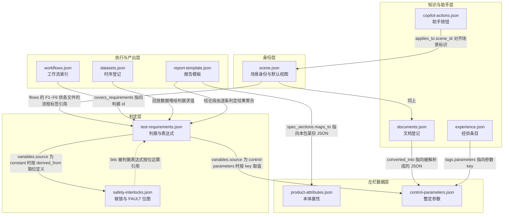

# 场景包契约 v1.1

适用系统：通用 Agent 测试系统 v2.0 网页原型（前端工程 `[源] zzz/agent-test-web`）。

本目录把「换行业只换一个场景包」这句话固化成可执行的契约：十二份 JSON Schema、一个两阶段校验脚本、一个最小骨架包。契约从两个实物场景包归纳而来，不是凭空设计的。

## 变更记录

| 版本 | 日期 | 改了什么 |
|---|---|---|
| v1.1 | 2026-09-20 | 按独立审稿意见（`docs/20260919-通用Agent测试系统v2.0/08b-审稿意见.md`，阻断 1 条、主要 9 条、次要 8 条）修订：报告模板定位字段进机读契约、四条红线全部机读化、`validate.py` 补第二阶段九组跨文件与业务检查、README 补齐十一个未写字段、目录登记表外置。处置逐条见第 13 节 |
| v1.0 | 2026-09-20 | 首版：12 份 Schema、结构校验脚本、最小骨架包 |

| 产物 | 路径 | 干什么 |
|---|---|---|
| 本文件 | `[源] 08b-场景包契约/README-场景包契约-v1.1.md` | 契约的人读版：文件职责、字段规则、红线、换包步骤 |
| Schema | 同目录 `schema/*.schema.json`（12 份） | 契约的机读版，JSON Schema draft 2020-12 |
| 校验脚本 | 同目录 `validate.py` | 两阶段校验任一场景包目录：先逐文件结构，再跨文件与业务 |
| 目录登记表 | 同目录 `packs.json` | `validate.py --all` 要校验哪几个包，路径不再写死在脚本里 |
| 最小骨架包 | 同目录 `examples/minimal-scene/`（11 份 JSON 加 `assets/` 三份占位资产） | 新建场景包的起手模板，也是 `validate.py` 的回归样本 |

归纳所依据的两个实物包：

- 散热风扇包 `[源] scenes/motor.cooling-fan.fortior-fu6832`（峰岹 FU6832 散热风扇驱动板，数据源自客户真实工程）。
- 玻璃升降器包 `[源] scenes/automotive.body-motor.window-regulator`（汽车电动玻璃升降器总成含防夹，数据源自公开标准、法规与参考设计）。

下文凡说「包一」指散热风扇包，「包二」指玻璃升降器包，首次之后不再重复全名。

---

## 1. 场景包是什么

一个场景包是一个目录，目录名就是场景标识，形如 `motor.cooling-fan.fortior-fu6832`。它把「一个产品类型在六条业务流程里要用到的全部结构化数据」装在一起，让前端 `fetch` 就能直接用，不写任何产品名词进代码。

它的边界有三条：

**装什么。** 六条流程各自需要的数据底座，按消费方分三组：

| 组 | 装的是 |
|---|---|
| 被测对象 | 本体属性、控制整定参数 |
| 判定与执行 | 安全联锁、测试判据、工作流索引、可回放时序数据登记 |
| 知识与产出 | 文档登记、经验条目、报告模板结构、助手预置按钮 |

六条流程的编号与名称：

| 编号 | 名称 |
|---|---|
| F1 | 知识库管理 |
| F2 | 初始化配置 |
| F3 | 测试需求确认 |
| F4 | 启动测试及结果分析 |
| F5 | 调优确认及运行 |
| F6 | 测试报告及产出 |

**不装什么。** 界面版式、卡片实现、画布节点渲染、判据求值器、按钮点击后的编排逻辑，这五样都在前端代码里，跨场景不变。场景包只下发数据与少量版式开关，目前的版式开关只有 C 区默认视图一项。

**装在哪。** 源目录是 `c-data/scenes<场景标识>/`；前端内置副本在 `./scenes/<场景标识>/`，另有一份目录索引 `./scenes/index.json` 驱动三级级联选择器。两处是同一份内容的两个落点，改了源目录要同步内置副本。

一个完整场景包目录的构成：

```
<场景标识>/
  README.md              包自己的字段说明与计数对账底稿（人读，不参与加载）
  *.json                 十一份数据文件，见第 2 节
  assets/                图片、波形 CSV、工作流本体，被 JSON 按路径引用
  _build/                生成脚本与自检脚本，不随前端发布
```

---

## 2. 十一份 JSON 各自的职责

按「谁消费它」分三组。

### 2.1 结构骨架组：定义界面左栏与身份

| 文件 | 职责 | 主要消费方 | 包一条数 | 包二条数 |
|---|---|---|---|---:|---:|
| `scene.json` | 场景身份：三级分类、产品一句话、C 区默认视图、图片清单、六流程清单 | 全局，顶栏与场景切换 | 1 张图 | 2 张图 |
| `product-attributes.json` | 产品**本体**属性，回答「被测件是什么」 | F2 初始化配置左栏 | 29 项 | 47 项 |
| `control-parameters.json` | **控制整定**参数，回答「怎么调」，带最小值最大值步长 | F5 调优、F4 启动测试左栏 | 70 项 | 59 项 |

本体与整定分两份文件，是这套契约里最容易被新人合并掉的一条。分开的理由：本体属性在一轮测试里不变，整定参数每轮都可能改并要回写固件，两者的编辑权限、来源标记与回写路径都不同。

### 2.2 业务内容组：定义判什么、怎么跑、判完出什么

| 文件 | 职责 | 主要消费方 | 包一条数 | 包二条数 |
|---|---|---|---:|---:|
| `safety-interlocks.json` | 安全联锁条目与 FAULT 位图，启动按钮只查它 | F2 确认、F4 放行闸口 | 19 条 | 21 条 |
| `test-requirements.json` | 测试项与合格判据，含可求值表达式与变量来[源] | F3 确认、F4 判定 | 26 条 | 34 条 |
| `workflows.json` | 工作流索引，本体在 `assets/workflows/` 或客户 `.wfw` 里 | F3 选型、F4 执行 | 67 条 | 4 条 |
| `datasets.json` | 可回放时序数据登记 | F4 曲线回放与判定 | 5 条 | 3 条 |
| `report-template.json` | 报告模板结构与字段映射 | F6 报告产出 | 10 节 | 9 节 |

### 2.3 知识与助手组：定义检索什么、助手能点什么

| 文件 | 职责 | 主要消费方 | 包一条数 | 包二条数 |
|---|---|---|---:|---:|
| `documents.json` | 文档登记与转化状态 | F1 知识库（文档一路） | 61 条 | 83 条 |
| `experience.json` | 经验条目与证据档位 | F1 知识库（经验一路）、F4/F5 检索命中 | 24 条 | 18 条 |
| `copilot-actions.json` | 助手（D 区）预置按钮定义 | 五条流程 + 知识库模块的按钮排 | 29 枚 | 29 枚 |

`copilot-actions.json` 是第三轮改版后加的第十一份，它与前十份的加载路径不同：前十份由 `[源] scene/pack.ts` 的 `loadPack()` 一次性并发取回，`copilot-actions.json` 由 `[源] copilot/actions.ts` 的 `loadActions()` 单独取。前十份任何一份缺失，整包加载判失败回落；`copilot-actions.json` 缺失只退回该文件末尾的通用兜底骨架，不影响其余功能。包一的 `_build/selfcheck.py` 只检前十份，也是这个原因——包二没有自己的 `selfcheck.py`，见第 9.3 节。

### 2.4 引用关系



图中实线是硬引用（一端改了另一端必须跟着改），虚线是按位引用（`test-requirements.json` 的判据表达式里直接写 `fault_flags & FAULT_XXX`，常量值来自 `safety-interlocks.json` 的 `fault_bitmap.bits`）。

`scene.json` 不被任何文件按字段引用，但它是唯一的身份源：其余十份的 `scene_id`（`copilot-actions.json` 是 `applies_to.scene_id`）都必须等于它的 `id`，而它的 `id` 又必须等于目录名。这三处一致是 `validate.py` 的 X2 检查。

---

## 3. 必填与可选怎么定的

判定口径只有一条：**两个实物包都有的字段算必填，只有一个包有的算可选。** 这条口径是机械执行的，不掺主观判断，好处是契约不会比现实更严；代价是有些「应该必填但包二恰好没写」的字段被划成了可选，下文第 3.5 节点名。

### 3.1 十一份文件共有的包元字段（除 `scene.json` 与 `copilot-actions.json` 外全必填）

| 字段 | 说明 |
|---|---|
| `schema` | 文件契约标识，取值固定，见第 7 节 |
| `scene_id` | 场景三级标识，与 `scene.json` 的 `id` 和目录名逐字相同 |
| `generated_by` | 产出这份文件的脚本相对路径 |
| `generated_at` | 生成日期，`YYYY-MM-DD` |
| `belongs_to_flow` | 这份文件主要服务哪条流程，人读用，不参与逻辑 |

`scene.json` 用 `id` 代替 `scene_id`，也没有 `belongs_to_flow`，因为它服务全流程。`copilot-actions.json` 走另一套包元字段：`version`、`title`、`applies_to`、`_field_docs`、`_derived_from`。

`belongs_to_flow` 的取值不要求整串以流程标签开头，但句中必须至少出现一个合法的 `F1`~`F6` 标签。两个实物包都写成整句，例如「F2 初始化配置（呈现与确认）+ F4 启动测试及结果分析（不确认不允许运行）」。schema 里这一条叫 `flowMention`，与流程标签数组用的 `flowLabel` 是两个约束，区别见第 4.4 节。

### 3.2 另外十一个必填字段

这十一个字段是 schema 的 `required`，v1.0 的 README 一个字没提，照 README 从零手写的包必然挂。按各自解决什么问题分五类。

**第一类 · 驱动演示模式（1 个）**

`demo_profile`，必填于 `control-parameters.json`、`safety-interlocks.json`、`test-requirements.json`、`datasets.json` 四份文件。单独一节说明，见第 3.3 节。

**第二类 · 知识三轴的第二根轴（1 个）**

| 字段 | 在哪 | 是什么 |
|---|---|---|
| `usage_class` | `documents.json` 的 `documents[]`、`experience.json` 的 `experiences[]`，均必填 | 材料的来源类别标签，与 `usage` 用途轴正交。形如「A2 应用方案与用户手册」「D1 实验沉淀」：字母段是来源大类，数字段是类内序号，后面跟中文名。前端 `[源] knowledge/data.ts` 只把它当展示字符串透传，不参与分类与过滤，所以新场景可以自定义字母段，但同一个包里要自洽 |

**第三类 · 工作流索引的六个索引位（6 个）**

`workflows.json` 的这六个字段全是必填，它们一起回答「这条工作流在哪、长什么样、是谁的」。

| 字段 | 层级 | 是什么 |
|---|---|---|
| `source_roots` | 顶层，字符串数组 | 扫描工作流本体的根目录绝对路径清单。包一指向客户 `.wfw` 工程目录，包二指向包内 `assets/workflows/`。它让「这些工作流是从哪扫出来的」可独立复核 |
| `notes` | 顶层，字符串数组 | 这份索引的口径说明，一条一句。例如包一写清了子流程为什么单列一组 |
| `metadata_name` | `workflows[]` | 工作流本体文件内部 metadata 里记的名字。与 `name` 分开写，是因为两者经常对不上：`name` 是人给的显示名，`metadata_name` 是文件里实际存的那个，对不上说明文件被改过名 |
| `tags` | `workflows[]`，字符串数组 | 检索标签，形如 `scene:motor.cooling-fan.fortior-fu6832`。冒号前是标签域、冒号后是取值 |
| `gzip` | `workflows[]`，布尔 | 工作流本体文件是不是 gzip 压缩过。前端 `parseWfw` 按它决定要不要先解压 |
| `purpose_derived` | `workflows[]`，布尔 | `purpose` 那句话是人写的还是脚本从节点序列推出来的。`true` 表示推导产物，引用时要说明这不是原作者的原话 |

**第四类 · 口径说明字段（2 个）**

这两个字段是写给读 JSON 原文的人看的，前端不读，但必填，理由是它们把「这份数据该怎么理解」钉在数据里，不依赖 README 的上下文。

| 字段 | 在哪 | 写什么 |
|---|---|---|
| `schema_note` | `experience.json` 顶层 | 一条经验由哪几段构成。两包都写成「每条 = 问题现象 symptom / 原因 cause / 调整动作 action / 结果 result / 标签 tags / 证据档位 evidence_level / 来[源] _source」 |
| `criterion_expression_note` | `test-requirements.json` 顶层 | `evaluable` / `criterion` / `variables` / `criterion_text` 四个配套字段的口径：谁是机读的、谁是人读的、什么时候为 null |

**第五类 · 左栏分组骨架（1 个）**

`group_tiers` 必填于 `product-attributes.json`、`control-parameters.json`、`safety-interlocks.json`、`test-requirements.json`、`report-template.json` 五份文件，是左栏折叠树的骨架。两种形状：

| 形状 | 用在哪 | 层级 |
|---|---|---|
| 三层 `memberTier` | product-attributes、control-parameters、test-requirements | 一级 tier → 二级 group → 三级 subgroup |
| 两层 `itemTier` | safety-interlocks、report-template | 一级 tier → 二级 group |

两层点名的东西不一样，这是最容易写错的一处：

- `groups[].members` 点的是**本文件的分组名**，取值必须落在同文件的 `groups` 清单里（`test-requirements.json` 是 `categories`）。
- `subgroups[].items` 与两层形状的 `groups[].items` 点的才是**条目的 `key` 或 `id`**。

两处都只放标识，不放条目本体。点名了不存在的分组或条目，左栏该组就渲染不出东西，前端不报错，所以 `validate.py` 的 X4 检查专门查这一条。

### 3.3 `demo_profile`：演示模式的驱动数据

`demo_profile` 不是装饰字段，它是顶栏「演示 / 全量」开关的数据来源。链路是三段：

1. 顶栏开关在 `[源] app/TopBar.tsx` 第 173 行，切的是全局的演示模式标志位。
2. `[源] shared/tiers.ts` 第 157 到 172 行的 `demoList()` 与 `demoFilter()` 读这个标志位，按 `demo_profile` 点名的标识过滤条目。
3. 过滤结果决定左栏在演示模式下亮哪几条参数、判据、联锁、时序。

四份文件各自点名什么：

| 文件 | `demo_profile` 里的键 | 点的是 |
|---|---|---|
| `control-parameters.json` | `groups`、`parameters` | 分组名（须在本文件 `groups` 里）、参数 `key` |
| `safety-interlocks.json` | `interlocks` | 联锁 `id` |
| `test-requirements.json` | `requirements` | 判据 `id` |
| `datasets.json` | `datasets` | 时序 `id` |

四份都还有一个 `note`，一句话说明这条演示主线想演什么。

**换包必换，而且必须逐条核对。** 点名了不存在的标识不会报错：`tiers.ts` 第 172 行有一句「过滤结果为空就退回全量」的兜底，所以写错的后果是演示模式静默失效，现场看到的是「这个包内容怎么这么多」，排查要翻到前端归一化层。`validate.py` 的 X4 检查就是为堵这个口子加的。

### 3.4 每条数据都必须带 `_source`

条目级对象一律必填 `_source`。条目级对象按所在文件分三类：

| 类 | 是哪些 |
|---|---|
| 左栏数据 | 一条本体属性、一条整定参数 |
| 判定与执行 | 一条联锁、一条判据、一条工作流、一条时序 |
| 知识 | 一份文档、一条经验 |

它的形状是：

```json
"_source": { "file": "<绝对路径>", "locator": "<在该材料内的定位>" }
```

多份材料互证时写成数组。`file` 一律绝对路径，不得写相对路径或只写文件名。这条是为了让任何人拿到一份 JSON 就能独立定位回原始材料，不依赖场景包 README 的上下文。v1.1 起 `common.schema.json` 的 `sourceRef.file` 带 `"pattern": "^/"`，相对路径会直接校验失败，不再只写在 `description` 里靠人自觉。

`locator` 给的是在该材料内的定位，五种写法任选其一：行号、单元格地址、PDF 页码、JSON 字段路径、小节标题。

### 3.5 已知偏宽的地方

按「两包共有」口径划出来的必填与可选，有两处需要单独交代。

**已经补上机读约束的（v1.1 改正）**

| 字段 | v1.0 的状态 | v1.1 怎么管 |
|---|---|---|
| `test-requirements.json` 的 `requirements[].not_evaluable_reason` | 可选，README 称「schema 管不住这条条件依赖」 | 说法不对，draft 2020-12 的 `if/then` 完全管得住。v1.1 在 `requirements[].allOf` 里写成条件必填：`evaluable` 为 `false` 时 `not_evaluable_reason` 必填且非空，不再依赖包一的 `selfcheck.py` C3 |
| `datasets.json` 的 `datasets[].synthetic` | 可选 | 仍可选（包一是实测数据，确实没有这个字段），但一旦所有条目都写 `synthetic: true`，顶层的 `all_synthetic`、`synthetic_banner`、`why_synthetic` 三项由 `datasets.schema.json` 的 `allOf` 条件必填 |
| `copilot-actions.json` 的 `buttons[].icon_draft` | 必填，README 自己说前端不读、可以自行移出 | v1.1 已从 `required` 移出。契约不该把「自己知道错、请使用者自行改掉」的条目发布出去 |

**仍然偏宽、新建包不要省的**

| 字段 | 为什么偏宽 |
|---|---|
| `workflows.json` 的 `workflows[].covers_requirements` | 这条工作流覆盖哪几条判据。包二有、包一没有，按机械口径划成可选。写了就会被 `validate.py` 的 X5 检查指向存在性 |

**另有五个零引用的必填，v1.1 决定保留**：`source_roots`、`schema_note`、`purpose_derived`、`metadata_name`、`criterion_expression_note`。前端确实一处都不读，保留的理由不是「两包共有」这条机械口径，而是它们都在回答「这份数据该怎么被独立理解」——扫描根目录、字段口径、推导与否、文件内实际名。它们服务的是复核者与构建脚本，不是渲染。语义逐条见第 3.2 节。

---

## 4. 字段命名规则

### 4.1 大小写与分隔

| 对象 | 规则 | 例 |
|---|---|---|
| JSON 字段名 | 蛇形小写，不转驼峰 | `sample_rate_sa_per_s`、`voltage_level_name` |
| 参数与属性的 `key` | 蛇形小写，跨包同义项沿用同名 | `antipinch_enable`、`motor_start_mode` |
| 条目 `id` | 大写前缀加连字符加序号 | `TR-BASIC-01`、`SI-HW-01`、`DOC-STD-001`、`EXP-001` |
| 场景标识 | 三段点分小写，段内用连字符 | `automotive.body-motor.window-regulator` |
| 助手按钮 `id` | `<作用域键>.<短名>` | `init.explain-page`、`req.freeze_ready` |

### 4.2 下划线开头的字段是元字段

元字段按管什么分两类：

| 类 | 字段 | 管什么 |
|---|---|---|
| 可信度 | `_source`、`_status`、`_placeholder` | 这条数据从哪来、算不算数 |
| 口径注释 | `_note`、`_field_docs`、`_derived_from` | 这一段该怎么读、从哪份草案来 |

它们不是业务内容。前端可以按需要显示它们（`_status` 挂待核实角标、`_placeholder` 挂占位标记），但不参与任何计算。

### 4.3 单位进字段名，不靠 `unit` 猜

数值字段的单位写进字段名尾缀。两个实物包用到的尾缀按量纲分四类：

| 量纲 | 尾缀 |
|---|---|
| 电 | `_a` 安培、`_v` 伏特 |
| 几何与力 | `_mm` 毫米、`_n` 牛顿 |
| 时间与转速 | `_s` 秒、`_ms` 毫秒、`_rpm` 转每分、`_mm_s` 毫米每秒 |
| 其他物理量 | `_c` 摄氏度、`_dba` A 计权分贝 |

`unit` 字段是给界面显示用的，不是给程序判量纲用的。

### 4.4 流程标签有固定前缀

引用流程的字符串字段分两类，schema 里对应两个约束。

**第一类 · 流程标签（`flowLabel`）。** 整串必须以 `F<n> ` 开头，形如 `F4 启动测试及结果分析`。`F1`~`F6` 前缀固定，后面的中文名照 `scene.json` 的 `flows` 段写。贴了这个约束的字段有六处：

| 文件 | 字段 |
|---|---|
| `documents.json` | `documents[].used_in_flows` |
| `control-parameters.json` | `parameters[].adjustable_in_flows` |
| `test-requirements.json` | `requirements[].flows` |
| `report-template.json` | `spec_sections[].from_flow`、`header_fields[].from_flow`、`technical_report_documentation_page[].from_flow` |
| `experience.json` | `experiences[].tags.flow`（写了才校验，包二用中文键「流程」，不写也合法） |

v1.0 只贴了前三处，后三处是裸字符串，写成不存在的流程号不报错，v1.1 补齐。

**第二类 · 流程归属整句（`flowMention`）。** 各文件顶层的 `belongs_to_flow` 是自由行文，不要求以流程标签开头，但句中必须至少出现一个合法的 `F1`~`F6` 标签。

前端按前缀两字符匹配，中文名改了不影响逻辑，但两处不一致会让人读文件时错乱。`scene.json` 的 `flows` 本身由 schema 锁死为不重复的六条，增删都会校验失败。

---

## 5. 状态值与红线

这套契约里有一类字段专门用来说「这个数还不算数」。它们是整份数据可信度的唯一出口，**不得为了让界面干净或让校验通过而把它们改成确定值**。

### 5.1 三个状态字段

| 字段 | 语义 | 合法取值 | 界面动作 |
|---|---|---|---|
| `_placeholder` | 这个数值是编的或借来的，源材料里根本没有 | 只能是 `true` | 挂占位标记，不得当真值用 |
| `_status` | 这个数有来源，但来源本身还没定版或没逐字核实 | 非空字符串，写清为什么 | 挂「待核实」角标，数值照常可用，引用时要说明 |
| `synthetic` / `all_synthetic` | 这条时序是合成的，不是实测 | 布尔 | 显式标注「合成，非实测」，且不得进入任何合规报告 |

`_placeholder` 与 `_status` 是两件事，可以同时出现：前者是「这个数是编的」，后者是「这个数有来源但来源没定版」。前端类型定义 `[源] data/types.ts` 的 `ParamItem` 把它们分别落成 `status: 'alert'` 与 `pending` 两个字段，不要合并。

### 5.2 四条红线

v1.1 起四条全部机读，不再有「靠人自觉」的那两条。

**红线一：`_placeholder` 只许写 `true`，不许写 `false`。** 这个数不再是占位了，做法是整条删掉这个键，不是把它改成 `false`。`common.schema.json` 的 `placeholderFlag` 用 `const: true` 锁死，写 `false` 直接校验失败。

**红线二：`_status` 只许重写理由，不许删除。** 核实完了才能删。schema 要求它非空字符串。

**红线三：合成数据不得进合规报告。** `datasets.json` 里 `synthetic` 为 `true` 的条目、`all_synthetic` 为 `true` 的整包，其派生结论只能出现在演示与内部分析里。玻璃升降器包的 `safety-interlocks.json` 用一条名为「合成数据不得进正式报告」的联锁（编号 `SI-PR-05`，`blocking` 为 `true`）把这条写成了阻塞项。

机读落实分两半：能进 schema 的那半写进 `datasets.schema.json` 的 `allOf`——所有条目 `synthetic` 为真时，顶层 `all_synthetic`、`synthetic_banner`、`why_synthetic` 三项条件必填。跨文件的那半 schema 表达不了，落在 `validate.py` 的 X8 业务检查：合成数据集的 `id` 不得出现在 `report-template.json` 的 `compliance_basis`、`conclusion_binding`、`technical_report_documentation_page` 三个合规相关字段里，且有合成数据的包必须写 `known_gap` 明示这份报告不能当合规证据用。

**红线四：「未采集」不等于「不通过」。** 判据求值器 `[源] flow-run/evaluate.ts` 的规则是：只要有一个 `runtime.measure` 变量取不到值，整条判「未采集」并列出缺哪几个，既不算通过也不算不通过，不进未达标清单、不进调优推荐，不拿别的数顶替。

场景包侧对应的约定是 `evaluable` 为 `false` 的判据必须写 `not_evaluable_reason`。v1.1 用 `test-requirements.schema.json` 里 `requirements[].allOf` 的 `if/then` 强制这一条；`validate.py` 的 X8 再查一遍理由文本里有没有出现判定词，防止把「未采集」写成「不通过」。

### 5.3 封闭枚举与开放取值

schema 里只有取值集合确实封闭的字段才写 `enum`，语义随场景而变的一律留成自由字符串，并在 schema 的 `description` 里注明观察到的取值。这样新场景不会被上一个场景的业务词汇卡住。

封闭枚举（取值来自结构或前端约定，换包不变）：

| 字段 | 取值 |
|---|---|
| `scene.json` 的 `default_view.*` | `canvas`、`grid` |
| `safety-interlocks.json` 的 `interlocks[].type` | `硬件`、`流程`、`人员` |
| `test-requirements.json` 的 `variables.*.source` | `runtime.measure`、`threshold`、`control-parameters`、`constant` |
| `datasets.json` 的 `mode` | `copied_into_pack`、`generated_into_pack`、`registered_only` |
| `documents.json` 与 `experience.json` 的 `usage` | `产品说明书`、`测试需求`、`工艺` |
| `copilot-actions.json` 的 `type` | `explain`、`prepare`、`execute` |
| 同上的 `source` | `customer`、`ours` |
| 同上的 `skill_verify` | `verified`、`unverified` |
| 同上的 `redline_action` 与 `redline_actions[]` | `start`、`stop`、`estop`、`write_back`、`export`、`archive` |
| 同上的 `degraded_to` | `prepare_and_wait` 或 `null` |
| 同上的 `icon` | 28 个名字，见第 8.2 节 |

开放取值随场景而变，schema 只在 `description` 里记观察值、不设 `enum`。分两类：

**必须落在本文件某张表里的（`validate.py` 的 X4 检查）**

| 字段 | 必须是谁的键 |
|---|---|
| `documents[].type` | 本文件 `count_by_type` |
| `documents[].conversion_status` | 本文件 `conversion_status_legend` |
| `experiences[].evidence_level` | 本文件 `evidence_levels` |
| `attributes[].group`、`parameters[].group` | 本文件 `groups` |
| `requirements[].category` | 本文件 `categories` |

这几处允许两种扩展写法，两个实物包都用过，X4 检查认这两种：用「 + 」拼几个已有的键，例如「文献综合 + 法规条款」；或者落在一个以「…」结尾的通配键下，例如 legend 里写「已解析为 …」、条目上写「已解析为 control-parameters.json + experience.json」。

**只记不查的**：`workflows[].voltage_level`、`node_type_legend` 的键。这两处没有本文件内的对照表可比。

---

## 6. 换包时哪些必换、哪些可继承

按「换一个行业」这个动作拆成三层。

### 6.1 必换：内容层

十一份文件的条目数组全部要换，一条都不能留上一个场景的。

| 文件 | 必换的段 |
|---|---|
| `scene.json` | `id`、`taxonomy` 三级的 `key` 与 `name`、`product` 三字段、`summary`、`images` |
| `product-attributes.json` | `groups`、`group_tiers`、`attributes` |
| `control-parameters.json` | `groups`、`group_tiers`、`demo_profile`、`parameters` |
| `safety-interlocks.json` | `demo_profile`、`group_tiers`、`fault_bitmap.bits`、`interlocks` |
| `test-requirements.json` | `categories`、`demo_profile`、`group_tiers`、`runtime_measures`、`requirements` |
| `workflows.json` | `source_roots`、`count_by_group`、`notes`、`workflows` |
| `datasets.json` | `demo_profile`、`datasets` |
| `documents.json` | `count_by_type`、`conversion_status_legend`、`documents` |
| `experience.json` | `evidence_levels`、`experiences` |
| `report-template.json` | `template_file` 或 `template_source`、`group_tiers`、`spec_sections` |
| `copilot-actions.json` | 每枚按钮的 `source`、`skill_ref`、`prompt`、`operation` 四个字段 |

四份文件的 `demo_profile` 是 v1.0 漏列的一项，它驱动演示模式，点名的是条目标识，照抄上一个包会让演示模式静默失效，详见第 3.3 节。

### 6.2 可继承：结构层与编排层

这些字段照抄上一个包，只在新场景确实不同时才改：

- `scene.json` 的 `default_view` 五个键与取值（两包完全相同）。
- `scene.json` 的 `flows` 六条（F1~F6 固定）。
- `safety-interlocks.json` 的 `types` 三类释义。
- `test-requirements.json` 的 `criterion_syntax`、`criterion_globals`、`criterion_expression_note`。
- `copilot-actions.json` 的 `_field_docs`、`redline_actions`、`button_types`、`ui`、`flows` 六个作用域键与每枚按钮的 `id` / `label` / `icon` / `type` / `touches_redline` / `redline_action` / `degraded_to` / `confirm_required` / `context_requires`。**按钮 `id` 尤其不得改名**，前端按它做埋点与折叠记忆。
- 各文件 `group_tiers` 的骨架形状：三层的 `memberTier` 与两层的 `itemTier` 两种，层数不变，分区标题与点名内容按新场景改。注意 `members` 点分组名、`items` 点条目标识，两层语义不同，见第 3.2 节第五类。

### 6.3 按新场景取舍：可选段

整段有就有、没有就整段不写，不要写空壳：

| 段 | 出现在 | 什么时候写 |
|---|---|---|
| `scene.json` 的 `regulation_matrix`、`regulation_note` | 仅包二 | 受强制法规约束的场景 |
| `scene.json` 的 `schematic_variants` | 仅包一 | 有多套原理图方案时。缺省时前端 `normalize()` 用 `images` 派生 |
| `datasets.json` 的 `why_synthetic`、`real_data_alternatives`、`excluded_datasets` | 仅包二 | 全合成数据的场景，用来交代为什么没有真实数据 |
| `datasets.json` 的 `package_root`、`package_stats` | 仅包一 | 有实测批次数据的场景 |
| `documents.json` 的 `non_authorized_copies`、`version_change_alerts` | 仅包二 | 材料里有非授权副本或标准即将换版时 |
| `report-template.json` 的 `template_file` / `header_fields` / `performance_table` / `waveform_image_slots` | 仅包一 | 模板是 Excel，字段按单元格地址定位 |
| `report-template.json` 的 `template_source` / `technical_report_documentation_page` / `compliance_basis` | 仅包二 | 模板是 PDF 报告样张，字段按节加槽位定位 |
| `workflows.json` 的 `model_format` | 仅包二 | `assets/workflows/*.json` 已经是画布内部模型，不用经 `parseWfw` 解析 |

### 6.4 换包必须同步改的包外三处

场景包自己改完还不算完，这三处不改新场景进不去界面：

1. `./scenes/index.json` 的 `catalog` 加一行三级节点，第三级挂 `sceneId`。
2. `./scenes/<场景标识>/` 放一份同步副本（含 `assets/`）。
3. 若新包的字段形态与现有两包都不同（例如又一种报告模板定位方式），在 `[源] scene/pack.ts` 的 `normalize()` 里加一条归一化分支。这是唯一允许为换包改前端代码的地方，且只许补字段、不许改数值。

---

## 7. 版本字段与兼容策略

### 7.1 版本字段在哪

每份文件顶层的 `schema` 字段就是它的契约版本，取值固定，按第 2 节的三组排：

| 组 | 文件 | `schema` 取值 |
|---|---|---|
| 结构骨架 | `scene.json` | `scene/v1` |
| 结构骨架 | `product-attributes.json` | `product-attributes/v1` |
| 结构骨架 | `control-parameters.json` | `control-parameters/v1` |
| 业务内容 | `safety-interlocks.json` | `safety-interlocks/v1` |
| 业务内容 | `test-requirements.json` | `test-requirements/v1` |
| 业务内容 | `workflows.json` | `workflows/v1` |
| 业务内容 | `datasets.json` | `datasets/v1` |
| 业务内容 | `report-template.json` | `report-template/v1` |
| 知识与助手 | `documents.json` | `documents/v1` |
| 知识与助手 | `experience.json` | `experience/v1` |
| 知识与助手 | `copilot-actions.json` | `copilot-actions/v1` |

另有三个与场景包契约版本无关的版本位：

| 版本位 | 在哪 | 当前值 | 管什么 |
|---|---|---|---|
| `version` | `copilot-actions.json` 顶层 | `1.0` | 该文件自身的迭代号 |
| `format_version` | `workflows.json` 的 `workflows[]` | `1.0.0` | 工作流本体文件的格式版本 |
| `schema` | `./scenes/index.json` | `agent-test-web/scenes-index@1` | 三级级联目录索引的格式版本 |

本 README 的 v1.1 是文档与校验器的版本，十一份文件的 `schema` 仍是 `v1`：v1.1 只补了约束与说明，没有改语义、没有删必填字段，按第 7.2 节的第二条策略不升文件契约版本。

### 7.2 兼容策略三条

**加字段不升版本。** 新增可选字段，老前端读不到就跳过，`schema` 保持 `v1`。这也是两个实物包互有独有字段却同为 `v1` 的原因。

**改语义或删必填字段升版本。** 把 `v1` 改成 `v2`，同时在 `[源] scene/pack.ts` 的 `normalize()` 里加分支同时认两版，本目录下新增 `<文件名>.v2.schema.json` 而不是就地改 `v1`。

**跨文件引用只用标识，不内嵌副本。** 例如 `workflows[].covers_requirements` 只写判据 id，不把判据正文抄一份。唯一例外是六流程之间传的配置快照（`config-snapshot/v1`），为了让快照自包含而内嵌参数值。六份流程间产物的完整 Schema 在 `docs/20260919-通用Agent测试系统v2.0/01-设计规格-信息架构与页面.md` 第 15 节，那一套与本目录的场景包契约是两层东西，不要混用。

---

## 8. 画布拓扑与助手按钮在包内的位置

这两样是第三轮改版新加的，位置与别的数据不一样，单列说明。

### 8.1 画布拓扑：包内只有默认视图开关，没有拓扑本身

**场景包里没有 `canvas.json`。** 两个实物包都没有，目录里也不该有。场景包对 C 区画布的下发只有一项，在 `scene.json` 的 `default_view` 段：

```json
"default_view": {
  "_note": "C 区默认视图：canvas 统一画板 / grid 卡片网格。",
  "init": "canvas", "req": "canvas", "run": "grid", "tune": "grid", "report": "grid"
}
```

五个键与前端 `FLOW_IDS` 一一对应，即 `init`、`req`、`run`、`tune`、`report`。知识库是模块不占流程序号，不在这里。取值只有 `canvas` 与 `grid` 两种。它经 `[源] data/loadScene.ts` 的 `adaptScene()` 拼成 `ScenePackage.ui.defaultView`，前端读这一段决定进页落画板还是落网格，不写死在代码里。

真正的画布拓扑分两处，都在前端：

- 节点与连线的契约在 `[源] data/types.ts`，三个接口：`CanvasNode`、`CanvasEdge`、`CanvasLayout`。节点类型固定十一类，按语义分三组：仪器与被测件是 `scope`、`motor`、`psu`、`bench`、`device-mcp`；资料与产物是 `curve`、`schematic`、`workflow`、`knowledge`；判定与闸口是 `verdict`、`interlock`。边分两种语义：`physical` 仿物理接线、`data` 数据流。
- 每条流程的默认版式（卡片位置与连线）在 `FlowContent.canvas` 里，由 `adaptScene()` 按流程生成，属于前端代码。

新场景包要改画布长什么样，改的是 `default_view` 的五个取值；要改画布上有哪些节点怎么连，那是改前端，不是改场景包。这条边界目前就是这么划的，不要在场景包里自造 `canvas.json`。

工作流画布是另一回事：工作流本体是 `assets/workflows/*.json`（包二，已是画布内部模型）或客户 `.wfw` 文件（包一，需经 `parseWfw` 解析），`workflows.json` 只是它们的索引。区别看 `workflows.json` 有没有 `model_format` 段。

### 8.2 助手按钮：独立第十一份文件

助手预置按钮全部在 `copilot-actions.json`，结构是三层：

| 层 | 包含哪些字段 | 回答什么 | 换场景 |
|---|---|---|---|
| 结构层 | `_field_docs`、`redline_actions`、`button_types`、`ui` | 字段释义、六个红线动作、三类按钮的判定规则、按钮排的版式开关 | 完全不变 |
| 编排层 | `flows` 的六个作用域键；每枚按钮的 `id`、`label`、`icon`、`type`、`touches_redline`、`redline_action`、`degraded_to`、`confirm_required`、`context_requires` | 哪条流程有哪几枚按钮、按钮叫什么、点了要不要确认 | 不变 |
| 内容层 | 每枚按钮的 `source`、`skill_ref`、`prompt`、`operation` | 这枚按钮在本场景具体调哪份规程、注入什么话、跑哪几步 | **只换这四个字段** |

按钮 `id` 尤其不得改名，前端按它做埋点与折叠记忆。知识库作用域的按钮沿用草案里的 `kb.` 前缀，与作用域键 `knowledge` 对不上是历史原因，见下文，`validate.py` 的 X9 检查认这一个别名。

它的来源是草案 `[源] 06-第三轮改版/06c-copilot-actions.draft.json`，两个实物包的 `_derived_from` 段都指向它。草案到实物包有两处改动：草案的 `kb` 键改名为 `knowledge`（知识库已从流程降级为模块），以及新增 `icon_draft` 字段保留草案里的 lucide 组件名、`icon` 改填前端可用的语义名。

`icon` 的取值必须落在 `[源] app/icons.ts` 的 `COPILOT_ACTION_ICON_NAMES` 之内，共 28 个。按语义分四类：

| 类 | 图标名 | 冻结轮次 |
|---|---|---|
| 检索与阅读 | `search`、`list`、`explain`、`library`、`folder-tree`、`link` | 前四个第一轮，后两个收尾轮 |
| 判定与校核 | `check`、`shield`、`alert`、`compare`、`scale`、`stethoscope`、`file-diff` | 前四个第一轮，后三个收尾轮 |
| 执行与产出 | `play`、`refresh`、`params`、`report`、`chart`、`workflow`、`lock` | 前五个第一轮，后两个收尾轮 |
| 资产与辅助 | `upload`、`download`、`wand`、`idea`、`sparkles`、`network`、`note-pen`、`package` | 前五个第一轮，后三个收尾轮 |

第一轮冻结 17 个、收尾轮补齐 11 个。用表外的名字前端会静默回落到 `sparkles`，不报错，所以 schema 把这 28 个写成了 `enum`。

按钮与红线的关系是这套设计的核心约束。六个只能人点的动作一律不做成自动执行：

| 红线动作键 | 中文 |
|---|---|
| `start` | 启动 |
| `stop` | 停止 |
| `estop` | 急停 |
| `write_back` | 写回参数 |
| `export` | 导出 |
| `archive` | 归档 |

触碰红线的按钮要同时满足三条：`touches_redline` 为 `true`、`redline_action` 写明是六个里的哪一个、`degraded_to` 固定 `prepare_and_wait`。助手只把东西准备好并把 B 区的人工按钮点亮，真正的动作仍只在 B 区由人点。

v1.0 把这三条只写在 README 里，三个字段之间没有任何机读约束，把 `degraded_to` 改成 `null` 照样通过校验，安全设计在数据层被静默绕过。v1.1 在 `common.schema.json` 的 `button` 上加了两条 `if/then`：`touches_redline` 为 `true` 时 `redline_action` 与 `degraded_to` 条件必填且 `degraded_to` 只能是 `prepare_and_wait`；为 `false` 时两者都必须为 `null`，不许挂一个没有触碰对象的降级形态。`validate.py` 的 X9 再复查一遍，并加查一条 schema 表达不了的：执行类按钮的 `confirm_required` 必须为 `true`。

---

## 9. 校验：`validate.py` 与 `selfcheck.py` 的分工

两个脚本管的是两件事，都要跑，谁也替代不了谁。

### 9.1 `validate.py` 管结构与引用，跨包通用

本目录的 `validate.py` 分两个阶段校验任意场景包目录。

**第一阶段 · 结构。** 十一份 JSON 是否存在、是否可解析；每份文件的字段是否齐全、类型是否对、封闭枚举是否越界、条件依赖是否满足。全部由 `schema/*.schema.json` 按 JSON Schema draft 2020-12 判定。

**第二阶段 · 跨文件与业务。** 九组检查，v1.0 只有前三组。

| 编号 | 查什么 | 为什么 schema 管不了 |
|---|---|---|
| X1 | 十一份文件齐全 | 跨文件 |
| X2 | 场景标识四处一致：目录名、`scene.json` 的 `id`、各文件的 `scene_id`、`taxonomy` 三级的 `key`；并查 `taxonomy` 与 `product` 是不是还留着骨架包文案 | 跨文件 |
| X3 | 助手按钮的六个作用域键齐全且无多余键 | 与 schema 重复，见下方说明 |
| X4 | 同文件内的键引用：`group_tiers` 两层点名、`demo_profile` 点名、`evidence_level` 与 `conversion_status` 等六处 legend 引用、条目标识不重复 | 要拿同一份文件的另一段做对照 |
| X5 | 跨文件引用的目标存在性：`covers_requirements`、`tags.parameters`、`maps_to`、判据变量四类来源、判据表达式里的自由标识符 | 跨文件 |
| X6 | 顶层计数字段与实际条数：`total`、`count`、`evaluable_count`、`not_evaluable_count`、`count_by_group`、`count_by_type`、`evidence_level_counts` | 要数数 |
| X7 | 包内资产文件是否真的存在：`images[].path`、`datasets[].file_path`、`workflows[].file_path` | 要看文件系统 |
| X8 | 业务红线：合成数据不得进合规字段、「未采集」理由里不得出现判定词、参数区间自洽 | 跨文件加数值语义 |
| X9 | 助手红线降级与按钮 `id` 前缀、执行类按钮必须要确认 | 字段之间的联动 |

X3 要单独交代：`copilot-actions.schema.json` 的 `flows` 已经写了 `required` 六个键加 `additionalProperties: false`，同一个变异 schema 与 X3 会各报一次。保留它的理由只有一条，schema 报「`'knowledge' is a required property`」不指人，X3 指得出是哪个作用域缺了、哪个多了。把它列为「schema 管不到的检查」是 v1.0 的口径不实，v1.1 改正。

X7 只查落在场景包目录内的路径。指向客户工程目录或标准原文的包外绝对路径不查：那些材料换台机器就不在了，按存在与否判失败会把契约绑死在一台机器上。

**用法**

```bash
cd docs/20260919-通用Agent测试系统v2.0/08b-场景包契约
python3 validate.py /绝对路径/到/场景包目录        # 校验一个包，务必传绝对路径
python3 validate.py --all                          # 校验 packs.json 登记的全部包
python3 validate.py <目录> --template               # 模板目录：豁免「目录名 = 场景标识」与骨架文案检查
python3 validate.py <目录> --quiet                  # 只要每份文件一行结论
```

**必须传绝对路径。** X2 要拿目录名与场景标识逐字比对，传 `.` 时目录名取到的是 `"."`，这一项就废了。v1.0 的第 10 节第五步给的正是 `validate.py .`，于是官方流程里这条检查从不执行，v1.1 改正。

**`--all` 的目录清单在 `packs.json`。** v1.0 把两个实物包的绝对路径写死在脚本的 `--all` 分支里，换机器或换仓库位置即失效。v1.1 挪到同级的 `packs.json`，里面的 `${SCENE_PACK_ROOT}` 可由同名环境变量覆盖，`${HERE}` 展开为本契约目录。

依赖 `jsonschema >= 4.18`。输出逐文件 PASS / FAIL，FAIL 时给出 JSON 路径（形如 `$.requirements[30].variables.FAULT_REVERSE_POLARITY.derived_from`）与不符原因。全部通过退出码 0，否则 1。

### 9.2 `selfcheck.py` 管内容自洽，每包一份

`[源] _build/selfcheck.py`（392 行）是包一自己的验收脚本，跑完 `_build/build_scene_pack.py` 之后用。它的十项检查归纳如下。

**A 组 · 数据完整性（2 项）**

| 编号 | 检查什么 |
|---|---|
| C1 | 十份 JSON 全部可解析（该脚本写于加 `copilot-actions.json` 之前，未覆盖第十一份） |
| C2 | 带 `_source` 或 `_placeholder` 的对象数不低于基线（包一基线 331），占位对象数等于基线（包一基线 13），确认构建没把来源字段弄丢、占位口径没悄悄变 |

**B 组 · 判据可求值性（4 项）**

| 编号 | 检查什么 |
|---|---|
| C3 | `evaluable` 为 `true` 的判据，其 `criterion` 用 `node` 做 JS 语法检查；为 `false` 的必须写 `not_evaluable_reason`；顶层 `evaluable_count` / `not_evaluable_count` 与实际一致。后两项 v1.1 已分别搬进 schema 的 `if/then` 与 `validate.py` 的 X6，这里只剩 JS 语法检查是独有的 |
| C4 | `criterion` 里每个自由标识符都在 `variables` 或 `criterion_globals` 里，且 `variables` 没有表达式用不到的多余条目 |
| C5 | `variables` 每个变量都能解析到目标：`runtime.measure` 指向 `runtime_measures` 的键、`threshold` 指向本条 `threshold` 的键、`control-parameters` 指向参数 `key`、`constant` 指向 `fault_bitmap` 的位并核对按位或的结果 |
| C6 | `evaluable` 为 `true` 的条目，其 `threshold` 型变量必须有非 `null` 取值，否则求不出结果 |

**C 组 · 参数区间自洽（2 项）**

| 编号 | 检查什么 |
|---|---|
| C7 | 可调参数满足 `min <= value <= max`；越下界的必须带 `value_below_min: true`，且带了这个标记的必须真的越界 |
| C8 | 枚举型参数 `min` / `max` / `step` 为 `null` 且 `options` 非空，当前 `value` 必须在 `options` 里 |

**D 组 · 文档对账与表达式陷阱（2 项）**

| 编号 | 检查什么 |
|---|---|
| C9 | 包自己的 `README.md` 里 17 处计数声明与实际数据逐条对账（联锁分类条数、参数分组数、判据条数、转化状态分布、文档与工作流条数等） |
| C10 | 位运算优先级：`&` 与 `\|` 的运算元所在括号层里不得同时出现比较运算符。JS 里 `a & B !== 0` 会先算 `B !== 0`，判据静默失真且语法完全合法，`node` 检不出来 |

### 9.3 分工一句话

`validate.py` 回答「这个包能不能被前端读进去、里面的引用指不指得到」，`selfcheck.py` 回答「这个包里的数对不对得上」。

v1.1 把原本压在 `selfcheck.py` 上的四类检查搬进了跨包通用的 `validate.py`：判据变量解析（原 C5）、参数区间自洽（原 C7 与 C8）、顶层计数对账（原 C3 的后半）、`not_evaluable_reason` 条件必填（原 C3 的中段）。搬的理由是 v1.0 把兜底寄托在一个只有包一拥有的脚本上，包二在这几项上等于没有过检。

仍然只能留在 `selfcheck.py` 的有三项：

| 编号 | 留下的理由 |
|---|---|
| C2 | 带来源与占位的对象数对基线，基线是每包一个数，跨包通用的校验器无从知道 |
| C9 | 包自己 `README.md` 的计数声明对账，正则句式每包不同 |
| C10 | 位运算优先级陷阱：`a & B !== 0` 在 JS 里先算 `B !== 0`，语法完全合法，要真的解析表达式树才查得出 |

**包二仍然没有自己的 `selfcheck.py`。** 包一有，包二的 `_build/` 里只有六个文件：`build_scene_pack.py`、`common.py`、`gen_a.py`、`gen_b.py`、`gen_waveforms.py`、`render_assets.py`。这条差距在 v1.1 之后变小了，但没有消失，C2、C9、C10 三项包二仍未过检。

### 9.4 两个实物包与最小骨架包的实跑结果

跑的是 `python3 validate.py --all`，日期 2026-09-20，schema 12 份，jsonschema 4.26.0，Python 3.10。

| 场景包 | 第一阶段 · 结构 | 第二阶段 · 跨文件与业务 |
|---|---|---|
| 散热风扇包 | 11 份文件全 PASS | 1 处 FAIL |
| 玻璃升降器包 | 10 份 PASS，`test-requirements.json` 1 处 FAIL | 1 处 FAIL（与结构那处同源） |
| 最小骨架包 | 11 份文件全 PASS | PASS |

第二阶段是 v1.1 新增的，两个实物包各暴露出一处 v1.0 查不到的问题。两处都是包的问题，不是校验过严，但本目录不负责修改源场景包，修复动作归场景包维护方。

**散热风扇包的那处**

```
X5 experience.json 的 tags.parameters 对不上 control-parameters.json 的 key：FG_PULSE_PERIOD、Pole_Pairs
```

涉及两条经验：`EXP-015` 点名 `FG_PULSE_PERIOD`、`EXP-007` 点名 `Pole_Pairs`，两条都把 `parameters_resolved` 标成了 `true`，意思是「这些参数名已经解析到参数 key」，但 `control-parameters.json` 里没有这两个 key。X5 对参数名大小写不敏感（包一的经验标签抄的是固件宏名、参数 key 是蛇形小写，两者指同一个量），排除大小写后仍对不上。另有 `EXP-006` 与 `EXP-022` 也点名了不存在的参数，但它们的 `parameters_resolved` 是 `false`，属于明示未解析，X5 放过。

修法二选一：把 `parameters_resolved` 改成 `false`，或者在 `control-parameters.json` 里补上这两个参数。

**玻璃升降器包的那处**

结构层与第二阶段各报一次，同一个根因：

```
$.requirements[30].variables.FAULT_REVERSE_POLARITY.derived_from
  'safety-interlocks.json fault_bitmap 位 0x0080' is not of type 'array'
X5 TR-ELEC-08 的变量 FAULT_REVERSE_POLARITY 的 derived_from「…」指向 fault_bitmap 里没有的位
```

对应判据 `TR-ELEC-08` 反极性保护。实际内容：

```json
"FAULT_REVERSE_POLARITY": {
  "source": "constant",
  "value": 128,
  "derived_from": "safety-interlocks.json fault_bitmap 位 0x0080",
  "desc": "反极性检出位掩码（0x0080）"
}
```

**判断：包错，不是 schema 太严。** 理由三条：

1. `derived_from` 在包一里一律是机读的引用数组，例如 `["safety-interlocks.fault_bitmap.0x0020", "safety-interlocks.fault_bitmap.0x0040", "safety-interlocks.fault_bitmap.0x0080"]`，包二这一条写成了一句自然语言，形态与另一处不一致。
2. 包一的 `selfcheck.py` C5 检查会遍历 `derived_from` 的每一项、把末段按十六进制解析并与 `value` 对账；拿这句自然语言喂进去会逐字符遍历后报错。包二没有 `selfcheck.py`，所以这个不一致一直没被拦住。v1.1 把这一路检查搬进了 `validate.py` 的 X5，两个包都过检了。
3. 修法明确：改成 `["safety-interlocks.fault_bitmap.0x0080"]`，`value: 128` 与 `desc` 不动。改完重跑 `python3 validate.py <玻璃升降器包目录>` 两个阶段都应转 PASS。

另外记四条「校验过程中把 schema 放宽」的判断，它们是 schema 初版偏严、实物包并没错，已在 schema 里改正，留档备查：

| 放宽项 | 实物包实际写法 | 放宽理由 |
|---|---|---|
| `interlocks[].threshold` 允许 `null` | 包一 7 条纯流程或人员类联锁写 `null` | 这类联锁没有可写的数值阈值 |
| `requirements[].threshold` 允许 `null` | 包一 2 条写 `null` | 同上，判据本身不带阈值 |
| `workflows[].updated_at` 不限日期格式 | 包一照抄客户文件的 ISO 8601 时间戳、包二写日期 | 两种都是真实来源，不该强行统一 |
| `datasets[].label` 允许 `null` | 包一 2 条 `registered_only` 的条目写 `null` | 只登记未取得本体时无从标注 |

v1.1 另记一条放宽：`requirements[].evaluable` 为 `false` 时，惯例上 `criterion` 写 `null`，但包一有三条写了半截表达式留痕。`if/then` 只强制 `not_evaluable_reason` 必填，不强制 `criterion` 为 `null`。

### 9.5 变异测试：v1.1 的拦截率

把独立审稿提出的 66 项变异脚本化重放了一遍。做法是把最小骨架包复制到临时目录、换成第三个场景的身份、施一次变异、跑 `validate.py` 看退出码，退出码 1 记「拦住」。基准（未变异、非模板口径）先确认退出码为 0。

| 组别 | 项数 | v1.0 拦住 | v1.1 拦住 | v1.1 拦截率 |
|---|---:|---:|---:|---:|
| A 删必填字段 | 23 | 23 | 22 | 95.7% |
| B 占位标记红线 | 1 | 1 | 1 | 100% |
| C 封闭枚举越界 | 11 | 11 | 11 | 100% |
| D 流程标签 | 8 | 4 | 8 | 100% |
| **结构类小计（A+B+C+D）** | **43** | **39** | **42** | **97.7%** |
| **E 跨文件与业务自洽** | **23** | **6** | **23** | **100%** |
| **合计** | **66** | **45** | **65** | **98.5%** |

结构类从 90.7% 升到 97.7%，跨文件与业务类从 26.1% 升到 100%。

唯一一项从「拦住」退回「漏拦」的是 A21，删 `copilot-actions.json` 的 `buttons[].icon_draft`。这是按审稿主-8 有意放宽的：契约不该把自己知道该去掉的必填发布出去。其余 A 组 22 项全部仍拦住。

重放脚本与 66 项变异的逐条结果在会话临时目录，未改动契约目录与两个实物场景包。

## 10. 新建第三个场景包的步骤

按顺序走，每一步都有可验证的产出。

### 第一步 · 定身份（半天）

1. 定三级标识 `<一级场景>.<二级子类>.<三级产品类型>`，全小写，段内用连字符。**必须是三段，少一段整包校验失败**：`common.schema.json` 的 `sceneId` 要求三段点分。`hvac.indoor-unit` 是错的，`hvac.indoor-unit.cross-flow-fan` 才对。这个串同时是目录名、`scene.json` 的 `id`、其余十份的 `scene_id`，定了就不要改。
2. 建目录 `c-data/scenes<场景标识>/`。
3. 把本目录的 `examples/minimal-scene/` 复制进去，包括十一份 JSON 与 `assets/` 下的三份占位资产。
4. 按下面的必改清单逐项替换。**只做「全局替换场景标识」这一个动作是不够的**：替换后 `taxonomy` 三级仍是骨架包的 `example` / `minimal` / `skeleton`、`product` 三字段仍是骨架文案，这些会带着「最小子类 · 骨架产品」上到全局状态位。v1.1 的 `validate.py` 的 X2 检查会点名这两处。

| 必改项 | 在哪 | 改成什么 |
|---|---|---|
| 场景标识 | 十一份文件的 `id` / `scene_id` / `applies_to.scene_id` | 新的三段标识，全局替换 |
| 三级分类键 | `scene.json` 的 `taxonomy` 三级的 `key` | 与场景标识三段逐段相同 |
| 三级分类名 | `scene.json` 的 `taxonomy` 三级的 `name` | 新场景的中文名，会显示在顶栏级联与全局状态位 |
| 产品三字段 | `scene.json` 的 `product` 的 `name` / `chip` / `control_scheme` | 真实产品全名、主控、控制方案 |
| 场景综述 | `scene.json` 的 `summary` | 一段话综述 |
| 资产路径 | `scene.json` 的 `images[].path`、`datasets[].file_path`、`workflows[].file_path`、`report-template.json` 的 `template_file` 或 `template_source` | 指向新包自己的 `assets/`。骨架包的绝对路径指向的是骨架包本身，不跟着复制走 |

5. 跑一遍校验确认起手就是绿的，传绝对路径：

```bash
python3 [源] 08b-场景包契约/validate.py c-data/scenes<场景标识>
```

### 第二步 · 备材料（一到两周，取决于材料可得性）

按四类材料分头收集，每一类都要落到绝对路径：

| 材料类 | 对应文件 | 没有时怎么办 |
|---|---|---|
| 产品资料 | `product-attributes.json`、`control-parameters.json`、`scene.json` | 用公开参考设计顶替，条目挂 `_placeholder` |
| 标准与法规 | `test-requirements.json`、`safety-interlocks.json`、`documents.json` | 正文未取得的条目 `conversion_status` 写「未取得」，数值挂 `_status` |
| 测试资产 | `workflows.json`、`datasets.json`、`report-template.json` | 自建示例并整包挂 `_placeholder` 或 `synthetic`，同时写清为什么没有真实件 |
| 经验 | `experience.json` | 从文献综合，`evidence_level` 如实标档位 |

四类材料各自具体收什么：

| 材料类 | 收哪些东西 |
|---|---|
| 产品资料 | 数据手册、原理图、固件头文件、调参文档 |
| 标准与法规 | 产品标准、试验方法、法规条文、OEM 规范 |
| 测试资产 | 工作流文件、实测波形、报告模板或样张 |
| 经验 | 调试规程、台架经验、文献结论 |

这一步产出的不是 JSON，是一份材料清单：每份材料的全名、绝对路径、可不可引用、转化到哪一步了。包二把这份清单写成了 `[源] _调研/B-汽车场景测试案例素材.md`，可以照着做。

### 第三步 · 写构建脚本（三到五天）

不要手写 JSON，写 `_build/` 下的生成脚本，理由是手写的 `_source` 行号会过期而脚本每次现场扫。照包一的四件套分工：

- `_build/common.py`：源材料绝对路径常量、`_source` 构造器、占位统计。
- `_build/gen_a.py`：生成前五份（`scene`、`product-attributes`、`control-parameters`、`safety-interlocks`、`test-requirements`）。
- `_build/gen_b.py`：生成后五份（`workflows`、`datasets`、`experience`、`documents`、`report-template`）。
- `_build/build_scene_pack.py`：入口，跑完打印文件清单、条数、占位比例、未找到项。

`copilot-actions.json` 不进生成脚本，直接从上一个包复制后改内容层四字段，理由见第 8.2 节。

### 第四步 · 补自检脚本（一天）

从包一复制 `_build/selfcheck.py`，改三处：`BASELINE_SOURCED` 与 `BASELINE_PLACEHOLDER` 两个基线改成本包实际值、`JSON_FILES` 补上 `copilot-actions.json`、C9 的 `CLAIMS` 正则改成本包 `README.md` 的实际句式。这一步是包二欠着的，新包不要再欠。

### 第五步 · 双校验（半天）

```bash
python3 _build/build_scene_pack.py          # 生成
python3 _build/selfcheck.py                 # 内容自洽，十项
python3 [源] 08b-场景包契约/validate.py \
        c-data/scenes<场景标识>    # 结构契约与跨文件检查
```

**第三条命令必须传绝对路径，不要传 `.`。** v1.0 这里写的是 `validate.py .`，传 `.` 时 X2 的目录名比对取到的是 `"."`，这条检查在官方流程里永远不跑，而目录名与场景标识不一致正是前端按 `/scenes/<sceneId>/` 取文件时 404、整包加载判失败回落的成因。

两个脚本都退出码 0 才算过。

### 第六步 · 接进前端（半天）

1. 复制整个包（含 `assets/`，不含 `_build/`）到 `./scenes/<场景标识>/`。
2. 在 `./scenes/index.json` 的 `catalog` 里加三级节点，第三级挂 `sceneId`。
3. 起前端切到新场景，逐条流程翻一遍：左栏分组对不对、联锁闸口拦不拦、判据判不判、画布落画板还是网格、助手按钮排换没换。
4. 若某处渲染不出来且原因是新包的字段形态与现有两包都不同，去 `[源] scene/pack.ts` 的 `normalize()` 加归一化分支。只许补字段，不许改数值，也不许发明源材料里没有的东西。

### 第七步 · 起手模板本身的回归结果（2026-09-20 实测）

按上面六步实建了第三个场景包做演练，产品类型取暖通空调室内机的贯流风机，标识 `hvac.indoor-unit.cross-flow-fan`，只走第一步定身份，第二到第四步的材料收集、构建脚本、自检脚本按最小骨架跳过。

| 步骤 | 结果 |
|---|---|
| 第一步 · 定身份 | 通过。复制骨架包、按必改清单换身份与三级分类 |
| 第五步 · 校验 | 通过。十一份文件全 PASS、第二阶段九组检查 PASS、退出码 0 |
| 第六步 · 接进前端 | 通过。六个路由全部正常渲染，零 `pageerror` |

六个路由的逐条结果。沙箱做法：把 `[源] zzz/agent-test-web` 打包复制到临时目录（`node_modules` 用软链接），在副本的 `public/scenes/` 下放新包并在 `index.json` 挂三级节点，起 Vite 开发服务器后用 Playwright 逐页打开、采集 `pageerror` 与 console error。`[源] zzz/agent-test-web` 本体未做任何修改。

| 路由 | 页面 | 渲染 | `pageerror` |
|---|---|---|---|
| `/init` | 初始化配置 | 正常，左栏显示「被测对象 › 本体规格 › 示例属性」 | 0 |
| `/req` | 测试需求确认 | 正常 | 0 |
| `/run` | 启动测试 | 正常，闸门显示「闸门未放行」 | 0 |
| `/tune` | 调优运行 | 正常 | 0 |
| `/report` | 测试报告 | 正常，报告预览显示模板文件名与「未采集 1」 | 0 |
| `/knowledge` | 知识库 | 正常，顶栏级联显示「暖通空调 › 室内机 › 贯流风机」 | 0 |

这是 v1.1 相对 v1.0 最要紧的一处变化。v1.0 的骨架包不带报告模板定位字段、`report-template.schema.json` 也不要求，照它建的包校验全绿但前端 `/init`、`/req`、`/report` 三页白屏，崩在 `[源] flow-init/panel.tsx` 第 444 行的 `fileName(pack.report.template_file)` 与 `[源] flow-report/panel.tsx` 第 110 行的 `templateTitle(raw)`，两处都对 `undefined` 抛 `TypeError`。

v1.1 从契约侧堵住：`report-template.schema.json` 顶层加 `anyOf`，要求 `template_file` 与 `template_source` 至少写一个；骨架包的 `report-template.json` 补上 `template_file` 占位路径并挂 `_placeholder: true`。

**还有一件事留给前端。** `fileName` 与 `templateTitle` 两个函数目前对 `undefined` 直接抛错，契约挡住了一条路径，但同类问题还可能从别处进来。建议前端把这两处收口成接受 `string | undefined` 并对空值返回 `—`。这一条属于前端加固，不在本目录的修改范围内，归前端工程维护方。

---

## 11. 这份契约没覆盖的

如实列出，避免被当成完备规范用。v1.1 已经把 v1.0 认领的大部分缺口补上了，这里只留真的还没覆盖的。

**v1.1 已补上的（原 v1.0 第 11 节第 1 到 3 条）**

| 原缺口 | 现在谁管 |
|---|---|
| `covers_requirements`、`tags.parameters`、`maps_to` 的目标存在性 | `validate.py` 的 X5 |
| 判据变量四类来源的解析、判据表达式里的自由标识符 | `validate.py` 的 X5 |
| 同文件内的 legend 与分组清单引用、`group_tiers` 与 `demo_profile` 点名 | `validate.py` 的 X4 |
| 顶层计数字段与实际条数 | `validate.py` 的 X6 |
| `assets/` 下的文件是否真的存在 | `validate.py` 的 X7，限包内路径 |
| 最小骨架包的资产路径指向不存在的文件 | 骨架包已补 1×1 占位 PNG、三行占位 CSV、两节点占位工作流 JSON；`report-template.json` 的 `template_file` 仍是占位路径并挂 `_placeholder`，因为 Excel 模板不适合塞进契约目录 |

**仍然没覆盖的**

1. **判据表达式的语义。** X5 只查标识符有没有声明、引用指不指得到，不查表达式算出来对不对，也不查位运算优先级陷阱。后者要解析表达式树，留在包一的 `selfcheck.py` C10。
2. **包外绝对路径的存在性。** X7 只查落在场景包目录内的路径。指向客户工程目录、标准原文、报告模板原件的包外绝对路径不查，那些材料换台机器就不在了。
3. **包自己 `README.md` 的计数对账。** 正则句式每包不同，留在各包的 `selfcheck.py` C9。包二至今没有这个脚本。
4. **来源与占位对象数的基线。** 每包一个数，跨包通用的校验器无从知道，留在 `selfcheck.py` C2。
5. **前端消费侧的契约。** 六流程之间传的七份产物（从 `config-snapshot/v1` 到 `report-instance/v1`）是另一层契约，Schema 在 `docs/20260919-通用Agent测试系统v2.0/01-设计规格-信息架构与页面.md` 第 15 节，本目录不覆盖。
6. **知识库产物目录。** `c-data/kb` 下的文档索引、切片、实体与检索样例是另一路 agent 的产物，前端按可选加载，本契约不覆盖。
7. **前端对缺字段的健壮性。** 契约保证「过了校验就能被前端读进去」，但前端若在别处对可选字段做无保护取值，仍可能白屏。第 10 节第七步点名了 `fileName` 与 `templateTitle` 两处。

---

## 12. 这一版改了哪些文件

| 文件 | 改了什么 |
|---|---|
| `README-场景包契约-v1.1.md` | 本文件，由 v1.0 改名并修订。补第 3.2 与 3.3 节的十一个字段与 `demo_profile`、第 9 节的两阶段校验、第 9.5 节的变异测试、第 10 节第七步的建包演练、第 13 节的处置表 |
| `schema/common.schema.json` | `sourceRef.file` 加 `"pattern": "^/"`；新增 `flowMention`；`button` 加两条红线降级 `if/then` 并把 `icon_draft` 移出 `required`；`templateField.from_flow` 贴 `flowLabel`；改正 `memberTier` 与 `itemTier` 的层级语义说明 |
| `schema/report-template.schema.json` | 顶层加 `anyOf` 要求 `template_file` 与 `template_source` 至少其一；`spec_sections[].from_flow` 贴 `flowLabel`；补 `_placeholder` 与 `_status` 定义 |
| `schema/scene.schema.json` | `flows` 加 `minItems` / `maxItems` / `uniqueItems`；`default_view.required` 移出 `_note` |
| `schema/test-requirements.schema.json` | `requirements[]` 加 `if/then`：`evaluable` 为 `false` 时 `not_evaluable_reason` 条件必填 |
| `schema/datasets.schema.json` | 顶层加 `allOf`：全部条目 `synthetic` 为真时，`all_synthetic` / `synthetic_banner` / `why_synthetic` 条件必填 |
| `schema/experience.schema.json` | `experiences[].tags.flow` 贴 `flowLabel` |
| 另外六份 `schema/*.schema.json` | `belongs_to_flow` 由裸字符串改贴 `flowMention` |
| `validate.py` | 反转 X2 的目录名判据并加 `--template` 开关与 `taxonomy` 对齐检查；新增 X4 到 X9 六组检查；`--all` 的目录清单改读 `packs.json` |
| `packs.json` | 新增。`--all` 的目录登记表，支持 `SCENE_PACK_ROOT` 环境变量覆盖 |
| `examples/minimal-scene/report-template.json` | 补 `template_file` 占位路径、`_placeholder`、`cell_model_note` |
| `examples/minimal-scene/` 另三份 JSON | `group_tiers` 改成与两个实物包一致的两层点名写法；资产登记改指包内真实占位文件 |
| `examples/minimal-scene/assets/` | 新增。1×1 占位 PNG、三行占位 CSV、两节点占位工作流 JSON |

---

## 13. 审稿意见处置表

审稿意见原文：`docs/20260919-通用Agent测试系统v2.0/08b-审稿意见.md`。计数：阻断 1 条、主要 9 条、次要 8 条，共 18 条。**全部处置，无未处置项**，其中 17 条按建议改、1 条（次-1）按建议改口径但保留实现。

| 编号 | 级别 | 意见摘要 | 处置 | 改在哪 |
|---|---|---|---|---|
| 阻-1 | 阻断 | 骨架包缺报告模板文件名，schema 也不要求，照它建的包前端三页白屏 | 已改。契约侧两条建议全做；第三条前端收口不属本目录范围，已在第 10 节第七步点名并归口前端维护方 | `schema/report-template.schema.json` 顶层 `anyOf`；`examples/minimal-scene/report-template.json` 补 `template_file` 加 `_placeholder`；README 第 10 节第七步 |
| 主-1 | 主要 | X2 目录名检查的条件是反的，且 README 推荐的 `validate.py .` 让它永不执行 | 已改。条件反转为「目录名不合三段式即报错」，模板目录用 `--template` 豁免；README 两处命令改绝对路径并说明为什么 | `validate.py` 的 X2；README 第 9.1 节、第 10 节第一步与第五步 |
| 主-2 | 主要 | 「全局替换场景标识」换不干净身份，`taxonomy` 与 `product` 仍是骨架文案 | 已改。第一步给出六项必改清单；X2 增加 `taxonomy` 三级 `key` 与标识逐段比对，并点名残留的骨架分类键与产品文案 | `validate.py` 的 X2；README 第 10 节第一步 |
| 主-3 | 主要 | 十一个 schema 必填字段 README 一个字没写，`demo_profile` 还是演示模式的驱动数据 | 已改。十一个字段按五类逐个给结构说明与用途；`demo_profile` 单列一节说明它驱动 `tiers.ts` 的 `demoFilter`、点名的是条目标识、换包必换；第 6.1 节的必换清单补进四份文件的 `demo_profile` | README 第 3.2、3.3、6.1 节 |
| 主-4 | 主要 | 四条红线只机读落实了两条，`_source.file` 的绝对路径要求只写在 `description` 里 | 已改。红线三前半进 `datasets.schema.json` 的 `allOf`、后半进 X8；红线四进 `test-requirements.schema.json` 的 `if/then` 并由 X8 复查理由文本；`sourceRef.file` 加 `pattern`。README 第 3.5 节更正「schema 管不住」的说法 | 三份 schema；`validate.py` 的 X8；README 第 3.5、5.2 节 |
| 主-5 | 主要 | 流程标签约束只贴了三处漏了三处，`scene.json` 的 `flows` 可以删到两条 | 已改。三处漏贴补齐；`belongs_to_flow` 新增 `flowMention` 约束（整句式，句中必须出现合法流程号）；`flows` 加 `minItems` / `maxItems` / `uniqueItems` | `schema/common.schema.json`、`report-template`、`experience`、`scene` 与另六份 schema；README 第 4.4 节 |
| 主-6 | 主要 | 助手按钮的红线降级规则没进 schema | 已改。`button` 加两条 `if/then`：触碰红线时 `redline_action` 与 `degraded_to` 条件必填且降级形态固定；不触碰时两者必须为 `null`。X9 复查并加查执行类按钮必须要确认 | `schema/common.schema.json` 的 `button`；`validate.py` 的 X9；README 第 8.2 节 |
| 主-7 | 主要 | 跨文件引用全面不校验，README 只认领了一半 | 已改。X4 覆盖同文件内五类键引用与条目标识重复，X5 覆盖跨文件引用与判据变量解析，X6 覆盖计数，X7 覆盖包内资产。README 第 11 节改成「已补上的」与「仍然没覆盖的」两张表 | `validate.py` 的 X4 到 X7；README 第 9.1、11 节 |
| 主-8 | 主要 | `icon_draft` 是契约发布时就自认不该有的必填；另五个零引用必填没给理由 | 已改。`icon_draft` 从 `required` 移出；另五个保留并在第 3.5 节给出保留理由（服务复核者与构建脚本，不服务渲染），语义逐条写进第 3.2 节 | `schema/common.schema.json` 的 `button.required`；README 第 3.2、3.5 节 |
| 主-9 | 主要 | 三处把 `selfcheck.py` 当兜底，但包二没有这个脚本 | 已改。两处「各包」改成「包一」；把原 C3 的两段、C5、C7、C8 四类检查搬进跨包通用的 `validate.py`；第 9.3 节列出仍然只能留在 `selfcheck.py` 的三项与包二仍未过检的三项 | `validate.py` 的 X5、X6、X8；README 第 2.3、9.2、9.3 节 |
| 次-1 | 次要 | X3 与 schema 重复，README 把它列为「schema 管不到」口径不实 | 已改口径，保留实现。第 9.1 节写明它与 schema 重复，保留的唯一理由是失败信息指得出是哪个作用域 | README 第 9.1 节 |
| 次-2 | 次要 | 顿号串联超过五项未分组，15 处 | 已改。28 个图标名按检索、判定、执行、资产四类拆表；11 个契约版本串按第 2 节的三组拆表；六条流程、六个红线动作、四类材料、节点十一类、必换清单等处一并拆成表格或分组列表 | README 第 1、6.1、7.1、8.1、8.2、10 节 |
| 次-3 | 次要 | 括号塞举例，8 处 | 已改。全部改成单独成句或表格展开 | README 第 1、8.1、8.2、10 节 |
| 次-4 | 次要 | 元叙事泄漏 2 处 | 已改。「本次任务的约束是不改源场景包」改成「本目录不负责修改源场景包，修复动作归场景包维护方」；「新建包若懒得填」一句随主-8 整段重写删除 | README 第 3.5、9.4 节 |
| 次-5 | 次要 | 甩代号：只给 `SI-PR-05` 编号不给名 | 已改。首次出现给全名「合成数据不得进正式报告」并标 `blocking` 取值 | README 第 5.2 节 |
| 次-6 | 次要 | 把一条人读注释 `_note` 设成硬必填 | 已改。从 `default_view.required` 移出 | `schema/scene.schema.json` |
| 次-7 | 次要 | 骨架包的资产路径指向不存在的文件 | 已改。补三份真实占位资产（1×1 PNG、三行 CSV、两节点工作流 JSON）；`template_file` 保持占位路径并挂 `_placeholder`；第 10 节第一步的必改清单单列「资产路径」一项 | `examples/minimal-scene/assets/`、`scene.json`、`datasets.json`、`workflows.json`；README 第 10 节第一步 |
| 次-8 | 次要 | 校验器把实物包路径写死 | 已改。`--all` 的目录清单外置到 `packs.json`，支持 `SCENE_PACK_ROOT` 环境变量与 `${HERE}` 覆盖 | `packs.json`；`validate.py` 的 `resolve_all()` |
