# 看图理解这套测试系统 v4.1

[飞书图文版](https://hcnd3xtushu0.feishu.cn/wiki/PgtDwsWGMiD61KkgS43cIHwVn0w) · 详细开发明细见文末。

拿到一台风扇，先确定它的参数和合格标准，再连设备测试。不合格就查原因、改参数、重新测，最后交出报告。下面按实际页面走一遍。

**截图是当前可以打开的前端原型。** 其中的曲线和对话含历史数据、演示回放；截图时没有连接真实设备。每节的“后台还要做”说明同事接下来需要开发的部分。点击图片可放大看字。用于发布的截图隐去了内部地址、文件路径和客户原理图缩略图，保留实际界面布局。

## 先看整个过程

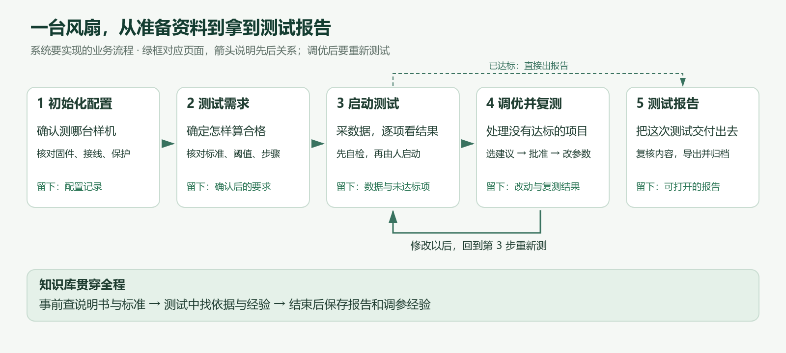

一项测试可以跑很多轮。改过参数后，要重新测一次，用新结果判断有没有改善。已经达标则直接出报告。

## 先准备资料：知识库在哪里，干什么用？

点击页面右上角“知识库”，进入下图。

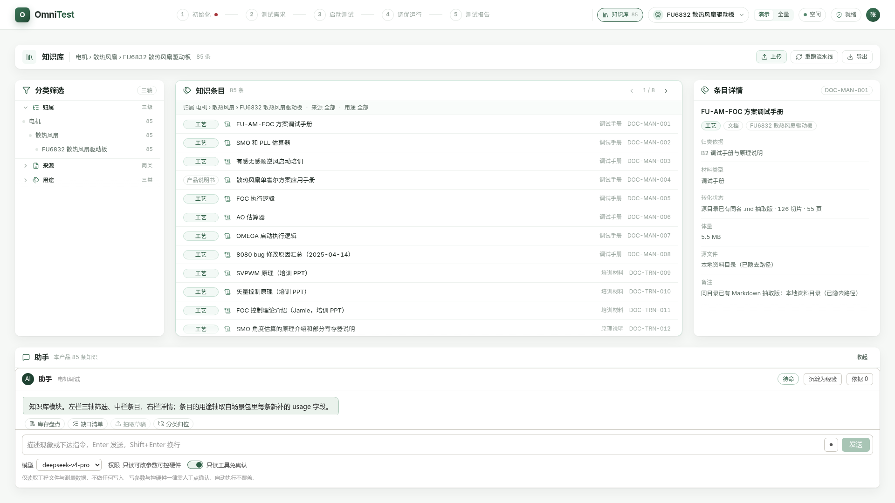

**看图：**左边选产品、资料来源和用途；中间选一份资料；右边查看这是什么文件、处理到哪一步；右上角“上传”用来补资料。下方助手可以盘点现有材料、提示还缺什么。

**用它做什么：**比如确认启动要求时，要能找到对应标准；调参时，要能查到过去相似问题是怎么解决的。测试结束后的报告和有效经验也要回到这里。

**后台还要做：**真正接收文件，解析并建立搜索索引；保存版本和原文位置，让后面的参数或结论能点回依据。现在看到文件列表，不代表在线上传、搜索和更新已经接通。

## 第 1 页：初始化——先说清楚“测的是什么”

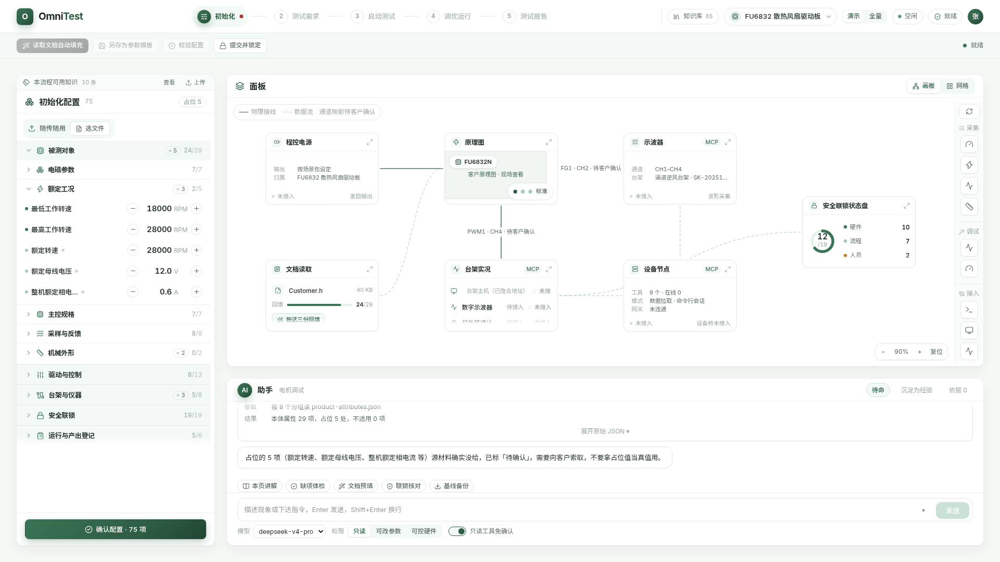

这张图也是其余流程页面的阅读方法：

- **最上面：**选择当前步骤；下一行按钮负责提交、确认等操作。
- **左边：**本页要核对的内容，可以展开分组、调整数值。
- **右上面板：**看设备、接线、图纸或测试结果，卡片可以放大。
- **右下面助手：**问问题、查缺项、准备草稿；按钮随当前步骤变化。

**这里怎么操作：**选好风扇型号，核对左边的产品参数、固件、台架和保护条件。可点助手“文档预填”准备建议值，自己核对后再“提交并锁定”。图中已经标成占位的数值需要补确认，不能直接用来驱动设备。

**后台还要做：**从资料提取字段，保存确认后的配置；刷新或重启后仍能读回。同事还要接硬件参数辨识、电机参数辨识；需要让电机动作的辨识必须先批准。

## 第 2 页：测试需求——这次怎样才算合格？

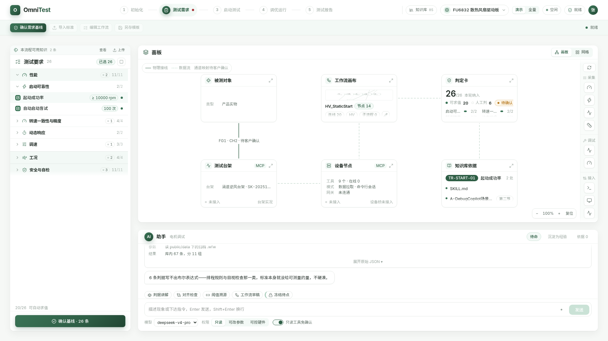

**这里怎么操作：**左边勾本次要测的项目，核对阈值和次数；中间查看按什么步骤测试；右边核对要求的依据。确认无误后点“确认需求基线”，也就是把本次的合格标准固定下来。

点击中间“工作流画布”卡片右上角的斜箭头，放大后如下。它表示测试先做什么、后做什么，分支和循环怎样走。

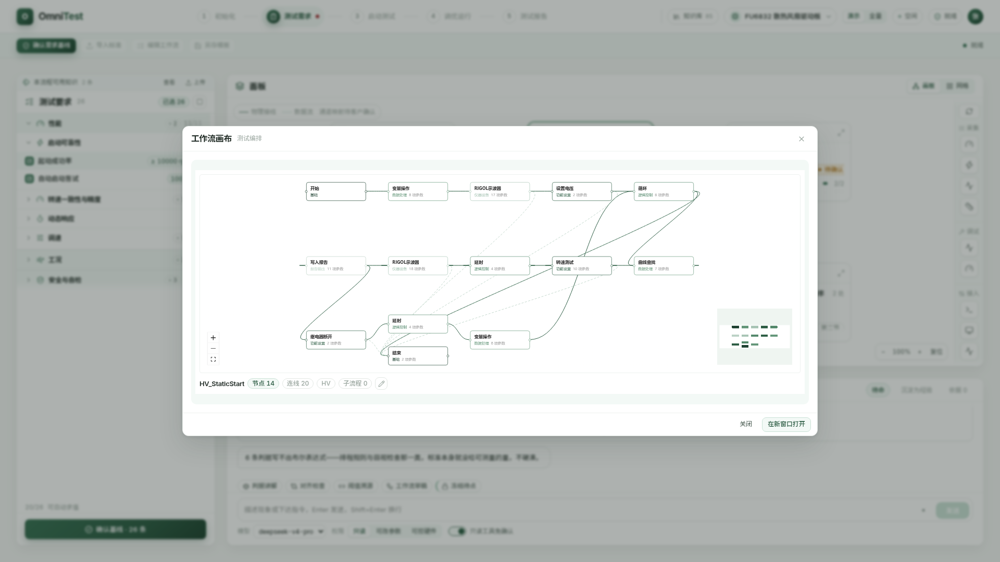

**后台还要做：**保存这次选定的标准和工作流，检查设备能不能完成这些步骤。图上画得出来的节点，如果还没有对应的执行程序，要明确提示“暂不支持执行”。

## 第 3 页：启动测试——现在测得怎么样？

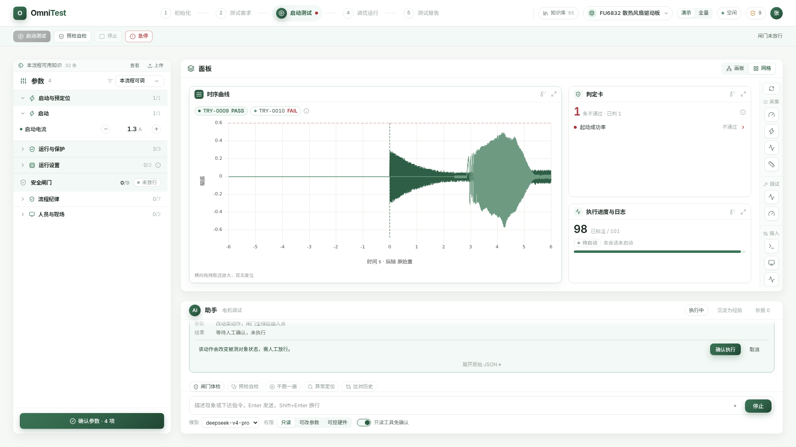

**这里怎么操作：**先核对左侧控制参数和安全条件，再做“预检自检”，由人批准启动。运行时看中间曲线和右侧进度；结束后看“判定卡”告诉你哪项没有达到要求。

这张截图中，右上已经出现“起动成功率不通过”，但进度卡也写着“本会话未启动”。**这是用历史资料展示判定效果，没有在截图时做一轮新测试。** 下方的确认提示也是原型中的演示状态。

**后台还要做：**真正检查设备、发送命令、采集本轮数据，再用第 2 页确认的标准计算结果。停机、失联和超时都要有实际处理；不能让进度条自己走完就显示测试完成。

## 第 4 页：调优运行——没达标，下一步改什么？

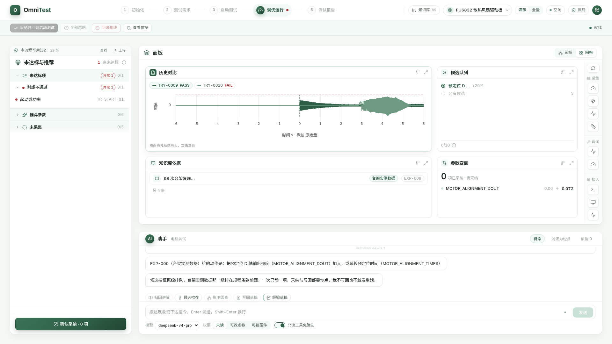

**这里怎么操作：**左边选未达标项，查看候选建议及其依据；右下“参数变更”展示准备从什么值改成什么值。人选定并批准后，再回“启动测试”跑新一轮。

图中从 `0.06` 到 `0.072` 是当前候选展示，不能据此认定设备已经改过。页面也明确写着“0 项已采纳”。

**后台还要做：**把人实际选中的参数交给设备，完成必要的编译、烧录和读回；保存改前、改后的记录。然后用新一轮数据比较是否改善。当前桥调用还有写死的示例参数，必须替换。

## 第 5 页：测试报告——最后交出去什么？

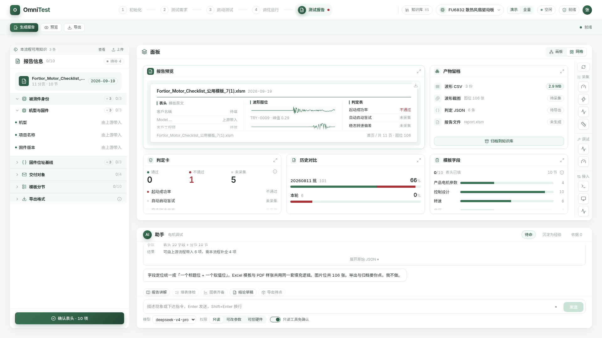

**这里怎么操作：**选模板，补客户、样机和固件信息，检查图表与结论，再生成、复核、导出。最后把报告和这次测试记录归档。

截图右边的“报告文件”仍显示“未生成”。中间有预览，并不表示已经有一个能打开的 Excel 文件。

**后台还要做：**把本次配置、测试结果和波形真正填进模板，生成可下载文件；打开文件核对字段和图片，再归档。客户已有报告工具可以复用，但普通字段的传入还要补接。

## 助手到底在哪里？它和后台是什么关系？

助手就是每页右下方的对话区。下面实际点击了初始化页的“本页讲解”。

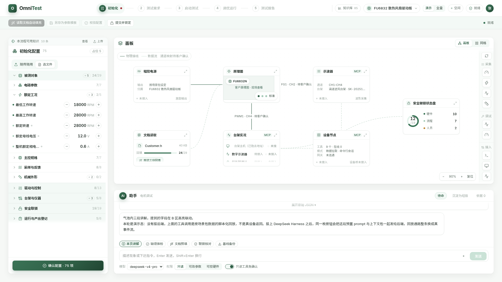

把对话区单独放大，可以看清按钮、回答和输入框：

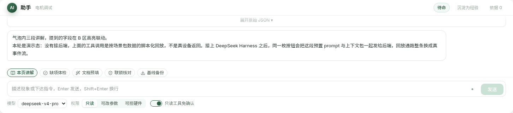

截图里的回答直接说明“没有接后端”“脚本化回放”。因此，**现在有助手界面和演示交互，真实助手后台仍要接。** 每个按钮应该知道当前是哪台样机、哪一步、选了哪份资料，而不是只回复一段固定文字。

下面用“文档预填”说明开发要接通什么：

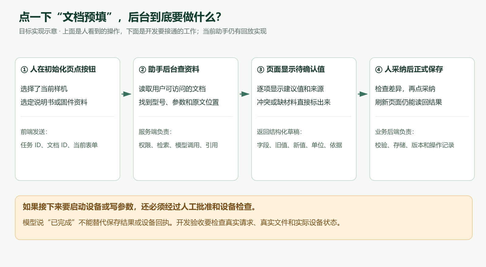

例如资料写着某个参数，助手应指出原文位置，把建议值显示在对应字段旁；你确认后才保存。需要启动设备或写参数时，还要另外经过人工批准和设备检查。

## 看懂页面后，同事从哪里开工？

先完成一条小流程：**建立任务 → 助手读一份资料 → 页面显示预填草稿 → 人采纳 → 保存 → 刷新后仍在。** 这条通了，再接模拟测试、判定和报告，最后做现场设备联调。

| 刚才看到的页面 | 对应开发任务 |
| --- | --- |
| 知识库 | 上传、解析、搜索、版本与经验管理：T06、T36 |
| 初始化 | 登录与任务、配置保存、参数辨识：T01～T04、T35 |
| 测试需求与工作流 | 标准保存、工作流检查与执行适配：T05、T11 |
| 启动测试 | 设备、自检、批准、真实采集与判定：T12～T20 |
| 调优运行 | 候选、实际写回、回滚与复测：T21～T23 |
| 测试报告 | 填模板、生成文件、复核和归档：T24、T25 |
| 每页的助手 | 真实模型、当前页面上下文、工具和草稿回填：T07～T11 |

具体接口、逐项任务、部署方法和验收表，继续查 [v4.0 开发明细](https://hcnd3xtushu0.feishu.cn/wiki/GFHPwZNQYibCrrki2JmcDwlBnzT)。这份图解是阅读入口，详细要求仍以对应明细为准。

版本说明：v4.1 补充当前前端截图与两张说明图，改用页面顺序讲解；没有修改功能代码，也没有把尚未实现的后台标成完成。截图代码基线为 `26dfaad`，2026-09-21 本地浏览器采集。
