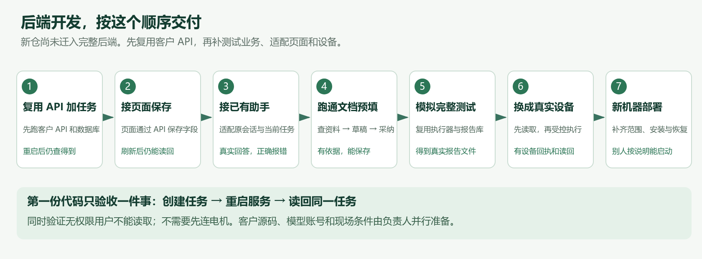

# 后端同事从这里开工 v4.2

## 先回答：后端在哪里？

**当前仓库没有完整的业务后端，也没有一个已经做好、等你启动的 backend 服务。** 前端页面已经能看和操作，但任务保存、真实助手、测试执行和报告还需要组织成服务。客户的另一份代码中已经有业务服务和设备执行逻辑。你的工作是以客户 API 为底座迁入、扩展测试业务，再接新前端；不用从零重写已有账号、模型调用、额度和报告核心。

此前任务表按模块分类，容易看完仍不知道第一步做什么。本页给出实际开工顺序。先完成下图的一步并拿出结果，再往后做；下文的目录是开发落点建议，明确标注尚未创建。



## 现有代码只需要先认这几处

以下路径均相对于 Gitee 仓库 `agent-test-system`，可以直接在代码里查找。

| 位置 | 现在是什么 | 这次怎样用 |
| --- | --- | --- |
| `web/` | 页面原型 | 保留界面，逐步把数据和操作接到业务 API |
| `web/src/features/copilot/index.tsx` | 助手主流程，目前选用 `makeAdapter` 回放 | 第 3 步切换为真实会话；知识库助手另看同目录 `knowledgeAdapter.ts` |
| `web/src/features/agent-chat/api.ts` | 已预留流式请求与确认客户端 | 第 3 步按其实际协议实现服务端，同时修复断流错误处理 |
| `components/spike-device-mcp/bridge.py` | 独立设备桥入口，含批准检查 | 第 6 步由业务服务调用；动作仍需补真实执行和回执 |
| `components/webssh/gateway/server.js` | 独立 SSH 网关 | 用于受控终端和设备侧连接，不能承担任务数据库 |
| `dsh-plugins/` | 助手运行时验证、插件与工具桩 | 复用经过验证的部分，补真实会话与业务工具 |
| `kb-pipeline/` | 离线知识处理脚本 | 第 4 步接到上传、解析和检索服务 |

客户 `api/`、`debug-agent/`、`writeFile_rust/` 在另行交付的客户脱敏工程中，**不在这个仓库里**。项目负责人须通过内部渠道提供版本和使用权限。开发者先领清单；缺资料就登记负责人，不要在仓库里反复找不存在的目录。

## 第一项工作：先跑客户 API，再新增测试任务

**本次要交的结果：创建一项测试任务，服务重启后还能查到它。** 暂时不需要连电机，也不需要真实模型。

建议把经过授权、处理过配置的客户 API 工作副本整理为 `../../../backend`。该目录目前还没有创建。第一步以客户 `api/app/main.py` 为入口，沿用原有依赖、用户、数据库和会话底座；先核验原功能，再加测试任务。

客户 API 已有 `app/db/session.py` 建表及增量迁移，包含 MySQL 和 SQLite 相关处理。先隔离启动、确认选定数据库分支可用，再扩展模型。**不要一开工就换 PostgreSQL；v4.0 的该项建议尚未做兼容验证，本版改为优先保留现有数据库。**

整理后的目标目录可以是：

```text
backend/                       ← 待整理：以客户 api 工作副本为基础
  app/main.py                  ← 保留并整理原服务入口
  app/api/v1/                  ← 保留 auth/chats/agent_chat/credits，新增 tasks
  app/services/                ← 复用原服务，新增测试任务和配置服务
  app/models/                  ← 保留用户等模型，新增任务和快照模型
  app/db/session.py            ← 先沿用并验证原数据库与迁移
  app/adapters/                ← 新增：设备桥、报告库等适配
  tests/                       ← 原能力回归＋新增测试业务
  requirements.txt             ← 原依赖为起点，补可复现版本锁
  .env.example                 ← 清理默认秘密，只保留变量名和安全示例
  README.md                    ← 本项目实际启动、建表、停止和测试命令
```

具体先做四件事：

1. 领取客户 API 源码版本，在隔离库、隔离文件目录中启动。检查配置中的默认凭据并改为受控配置，不连接原客户生产库；不把客户源码或凭据未经授权推到外部仓库。
2. 回归现有登录、用户权限、聊天保存和额度查询。使用独立测试账号，不把单机免登录模式作为多人部署或越权测试的验收结果。
3. 在原模型和路由体系中增加测试任务：健康检查、`POST /api/v1/tasks`、`GET /api/v1/tasks/{id}`。任务保存标题、原用户 ID、场景 ID、版本和状态，复用原鉴权依赖。
4. 提交本项目确切启动命令、迁移记录和可执行接口请求。客户原安装说明对应桌面/本机形态，不能直接当作本项目多人服务部署说明。

**验收：**原登录/聊天/额度回归通过 → 创建任务 → 重启服务 → 按 task_id 读回相同数据 → 第二用户被拒绝访问；旧余额及流水不被新增功能破坏。

对应旧任务 T01～T03。第一份代码提交只需做到这里，不必等全部功能一起交。

## 第二项工作：让初始化页面用上这个服务

**本次要交的结果：在页面改一个产品字段、保存、刷新后还能看到。**

后端按 v4.0 的配置接口保存配置草稿和锁定版本；前端把当前样机、任务和完整字段传过去。先选产品名称等非设备动作字段做联调，再扩大到全部初始化配置及测试要求。

当前 `web/vite.config.ts` 没有业务 API 代理。前后端要一起配置开发环境 `/api` 转发，或者统一 API 地址和跨域配置；生产使用同源反向代理。只把后端启动起来，页面不会自动开始用它。

锁定配置后返回明确的版本号。测试需求也按同样方式保存、确认和冻结；修改已锁定数据要生成新版本，不能改掉历史轮次的依据。

**验收：**通过真实页面保存 → Network 里有成功请求 → 刷新、退出再进入及服务重启都能恢复。后端报错时，页面显示失败，不能继续弹“保存成功”。

对应 T04、T05、T26、T27。前端同事必须参与这一步。

## 第三项工作：把客户已有助手接到新页面

**本次要交的结果：输入一句话，真实模型能根据当前任务回答，回答逐段出现在页面。** 这一步先只读，不开放设备动作。

客户 `api/app/api/v1/agent_chat.py`、`services/agent_chat_service.py`、`services/agent_stream_manager.py` 已有模型调用、工具循环、流式响应、取消和断线重订阅。**先适配这条现有链路，不再新写一套模型调用与会话循环。** 原模型网关和额度计费一起保留，避免双调用、双计费。

新页面请求 `/api/agent/stream` 和 `/api/agent/confirm`；客户后端的路由、事件名及字段不同。在业务服务增加兼容适配层，或者前后端同步改协议。加上当前测试任务、配置和资料上下文，以及本项目工具白名单。确认入口只允许本项目授权动作。

客户的断线恢复使用单 worker 内存流管理；它不等于服务重启后恢复。持久会话、动作对账和多 worker 支持仍需补。

前端将 `copilot/index.tsx` 里的回放选择改为真实适配器；知识库助手也要单独切换。请求增加任务上下文时，前后端共同改协议，不能只在后端实现一个新接口就认为页面已接通。

旧客户端通过 data JSON 的 `type` 分发事件，使用 `messageId`、`callId` 等字段。要保留兼容或同步升级。当前 EOF 会被当成 complete，必须修正：异常断流显示中断，并查询真实状态。

**验收：**问“当前任务叫什么，正在核对哪份配置”，回答来自刚保存的数据；换任务后答案跟着变化。断网、模型超时、取消和额度不足时都能给出明确状态。固定台词回放不计通过。

对应 T07、T08、T11。客户账号或模型服务未到位时，登记阻塞，继续做第 2 步的数据联调；模拟模型只能用于接口调试，不能签为真实助手通过。

## 第四项工作：只接通一个完整助手功能——文档预填

**本次要交的结果：上传一份资料，助手找到参数，页面展示建议值，人采纳后保存。**

先用一份获授权的简单资料：保存原件 → 解析 → 建索引 → 检索相关段落 → 形成字段草稿。每个建议值带单位和原文位置；没有依据就说明缺失。复用 `kb-pipeline/`，把固定输入输出目录改成服务配置。

前端显示旧值、新值和来源，人选择采纳；后端检查配置版本再保存。不要只在聊天框说“预填好了”，也不要直接改已锁定配置。

**验收：**上传一个能识别的字段，页面能点到原文；采纳后刷新读回。再测资料冲突、缺字段、解析失败和拒绝采纳，均不误写。完成这条链路后，再扩展八类资料、双路检索和全部助手按钮。

对应 T06、T09、T10、T36。这是助手功能开发的第一个完整样例，后续按钮按相同方式接，不用 58 条一起起步。

## 第五项工作：用模拟设备跑完“测试到报告”

**本次要交的结果：创建一轮新的模拟测试，产生本轮数据、判定结果和一个能打开的报告文件。**

先复用客户工作流的执行、循环、暂停/取消逻辑，抽离桌面依赖，注入模拟设备执行器并明确标识模拟。业务服务负责运行状态和事件持久化、原始数据保存及本项目判据求值。报告优先封装客户现有库调用。页面从服务端取进度，不自己用计时器假装完成。

准备通过、不通过、缺数据三套可解释的输入；在不通过的例子里选择一个参数候选，经过模拟批准和执行后再跑新轮次，保留前后差异。历史 98 次数据仍标历史，不能换个 run_id 就当成本轮。

报告先用测试模板和模拟数据调用客户 `writeFile_rust::processor::process`，生成可下载并能打开的文件。客户桌面 `report/commands.rs` 已示范变量、图片和 CSV 的映射；CLI 没传变量，不代表库缺少该能力。正式模板到位后核验字段、图片、公式和宏；简化模板不能替代正式模板验收。

**验收：**完成一次完整模拟流程，刷新页面后仍能找回轮次和文件；重复启动不产生两次动作，服务中途退出后能恢复或明确报错；缺数据不能判整体通过。

对应 T13、T15、T18～T25、T33。批准、幂等和失败处理在模拟阶段就要做，不能留到实机才补。

## 第六项工作：换成真实设备，先读再写

**本次要交的结果：使用同一套业务接口，逐项替换模拟适配器，并取得真实设备证据。**

1. 设备负责人先提供接线、通道、限值、驱动和独立急停方案；客户代码、许可证和固件工具按依赖清单领取。
2. 先联只读功能：型号、连接状态、采集和波形文件。确认 mode 不是 mock，采样率足够支持要计算的指标。
3. 再逐项联启动、停止和参数写回；确认卡内容、获批参数、实际发送参数必须一致。补真实回执及读回，未知执行结果禁止盲目重发。
4. 接编译、烧录、回滚、参数辨识和现场报告。急停策略确认且现场条件具备后才能签实机验收。

桥在 `components/spike-device-mcp/`。不要另造一个重复桥，也不要把原型的 `executed:true` 占位响应当成设备已经执行。`flowActions.ts` 中固定示例参数和忽略业务失败的问题要同步修正。

**验收：**对每个真实动作记录实际参数、设备回执、回读及失败结果；断线时页面显示真实状态。没有现场条件的项目标阻塞，不能拿模拟结果代签。

对应 T11～T17、T19、T22、T23、T29、T35。

## 第七项工作：补齐范围，在新机器部署

把已经跑通的链路扩展到两个场景和全部按钮；补模板、布局、语音、知识经验管理及异常界面。逐项回填 v4.0 的 36 项任务和验收矩阵，阶段样例通过不等于所有需求完成。

然后交付固定版本的安装/启动方式、配置模板、数据库迁移、日志、备份恢复、升级回退。用新机器安装，先跑完整模拟流程，再按现场条件跑实机验收。

**验收：**另一位同事从 Git 克隆，按说明启动并恢复数据；无需找原开发者补“只在我电脑上的文件”。所有未完成和外部阻塞有负责人。

对应 T26～T34、T36。权限、秘密保护和审计从前几步就实施，这里做发布前的完整复核。

## 负责人今天可以直接派出的第一张任务单

> 领取客户 API 的获授权工作副本，清理配置并在隔离数据库启动。先回归原登录、用户权限、聊天和额度，再在原服务中增加任务表及创建/查询接口。交付版本、依赖锁、迁移记录、启动说明和请求示例。演示原功能未退化、新任务重启可读回、第二用户不能越权。随后和新前端接初始化页保存；真实设备不作为这一项的前置条件。

客户源码领取、现场参数确认和模型账号申请由项目负责人同时推进，不让后端同事单独猜或代客户确定。后端同事每次汇报只需带本阶段的可运行结果、请求与响应、提交号和阻塞项。

## 复用清单和开发细节

- [客户代码复用清单](客户代码复用清单.md)：具体源文件、怎么接、第一项验证和已做/未做状态。
- [看实际页面：v4.1 图解](https://hcnd3xtushu0.feishu.cn/wiki/PgtDwsWGMiD61KkgS43cIHwVn0w)
- [接口与数据设计](https://hcnd3xtushu0.feishu.cn/wiki/ZbHpwqFSVi1D8tkPSREce558n6e)
- [完整开发任务](https://hcnd3xtushu0.feishu.cn/wiki/MFaewO7TOibidzkG7yMcqR1tnQe)
- [外部材料与待确认事项](https://hcnd3xtushu0.feishu.cn/wiki/TUmww5IDGiciHikIuvscYllXnYc)

本版补充复用方案、开工顺序和责任边界；已经做的是源码定位与静态核查，尚未迁入客户 API、编译客户工具或完成联调。现状核查基于本仓 `203de71`。
