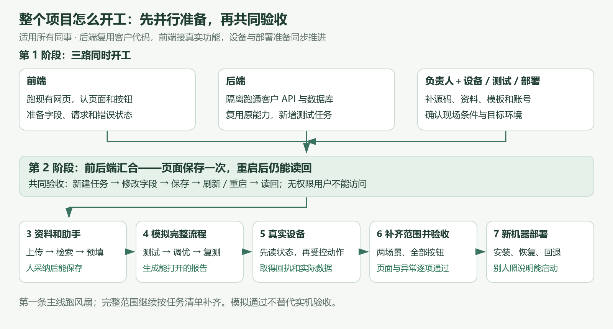

# 整个项目的开工顺序 v4.3

**所有同事从这一页开始。** 本页安排前端、后端、资料、设备和部署的配合顺序。v4.2 后端指南是实施细节，v4.1 图解用来理解页面，v4.0 保留完整功能和验收清单。

目标是让用户在网页上完成：选产品、确认资料与要求、测试、看结果、调参复测、导出报告。先用风扇场景跑通，再补齐第二场景和全部功能。现有页面可以复用；客户 API、助手会话、报告库和设备工具优先复用，经验证后接入。

## 一、按这七个阶段往前走

人员可以一人兼任，表里的角色表示责任。每阶段交出可运行结果后再合并到下一阶段；后续的资料领取和准备工作可以提前做，不必等前一步结束。

| 阶段 | 谁做什么 | 本阶段交出什么，才算可以往下走 |
| --- | --- | --- |
| **1. 三路准备，同时开始** | 前端跑现有网页，对照截图确认页面和按钮；后端领取客户源码，在隔离环境跑原 API；负责人和设备人员补资料、工具、模型账号及现场条件 | 页面能打开；原 API 的登录、聊天保存和额度等基础功能有回归结果；缺件清单写清负责人。设备暂未到位不阻塞页面和无设备开发 |
| **2. 前后端先接通一次保存** | 后端在原 API 中增加测试任务和配置保存；前端配置 API 地址/代理，接初始化页真实保存及错误提示 | 从网页建任务、改一个产品字段、保存；刷新和服务重启后仍能读回。另一个无权限用户读不到。页面到数据库的链路跑通 |
| **3. 接资料和助手** | 后端封装文档上传、解析、检索，并适配客户已有助手会话；前端接流式回答、依据定位、预填草稿和人工采纳 | 上传一份获授权资料，助手返回有出处的字段建议；人采纳后保存。换任务不会串上下文，断流或模型失败有明确提示 |
| **4. 用模拟设备完成整个流程** | 后端复用工作流和报告库，补运行状态、判定、产物保存；前端接进度、结果、调优和文件下载；测试人员验成功及失败 | 从配置、要求确认，到模拟测试、判定、调优复测、报告下载全部跑通。报告是可打开的文件；模拟标记清楚，批准与重复请求处理已验证 |
| **5. 接真实设备** | 设备人员核对接线、限值、驱动和急停；后端接设备适配器；前端显示真实连接、批准和异常状态 | 先通过只读采集，再逐项验证人工批准后的动作、写回、编译烧录和回读。每一步有真实证据，失联不会自动重发未知动作 |
| **6. 补齐范围，联合验收** | 前端补所有页面状态、布局与交互；后端补全部按钮和业务异常；设备及测试人员复核适用功能；负责人确认未决口径 | 两场景隔离、知识库、辨识、助手、调优、报告等逐项对照完整清单；滚动条和目标尺寸真人检查。没有设备的场景保留实机阻塞，不能签为实测通过 |
| **7. 新机器部署，交接使用** | 部署负责人整理启动、配置、迁移、备份恢复和升级回退；开发配合修问题；另一位同事照说明操作 | 从 Git 克隆或安装包开始，按说明完成启动和完整模拟验收；按现场条件再做实机验收。交付版本、文件、证据和剩余问题清楚，负责人签收 |

前端不用等后端全部做完才开始；设备资料和部署环境也从第 1 阶段准备。真正需要等的是共同验收：例如第 2 阶段必须证明网页数据确实存进后端，第 5 阶段必须有现场条件和已验证的动作控制。

## 二、开工当天，直接这样分工

### 前端同事

从 `web/` 跑现有原型，先看初始化页及助手区域。列清“现在读什么数据、哪个按钮发什么请求、失败时怎么显示”。与后端一起确定任务 ID 和配置保存接口，先接一个字段的保存与刷新恢复。后端未就绪时可按约定响应开发界面，联调验收必须换成真实 API。

已有页面按 v4.1 图解使用，优先补功能接入、缺少状态和已知交互问题。其他页面的数据取用、错误提示和按钮接线可以并行准备。

### 后端同事

领取客户 API 的获授权工作副本，隔离数据库和配置，先跑原有服务及必要回归。随后增加测试任务和配置，给前端可执行请求示例。当前 Gitee 尚未迁入客户完整后端；第一步的源文件和复用办法见 v4.2。

客户已有助手会话、模型网关和报告库优先适配。先核验原数据库，再决定迁移；不要把原先的 PostgreSQL 建议当成已经验证的强制选型。

### 设备／固件同事

整理型号、接线、通道、量程、联锁、允许写入的参数，以及编译器、烧录器、驱动和许可证版本。给出能先验证的只读功能清单，并确认急停、失联和断电的处理方式。现场未确认时不做通电、写参数或烧录验证。

### 项目负责人／测试与部署同事

把客户源码、正式资料、报告模板和模型账号交给对应人员，确认使用范围；登记缺件由谁补。选定第一条风扇示例，并准备成功、失败和缺数据的测试输入。确认目标浏览器、部署机器及人员权限。测试和部署要求从开工就参与，最后阶段再做全套复现。

## 三、第一场联合演示，只看这个结果

**在初始化页面建一项测试任务，修改产品名称并保存；刷新页面，再重启服务，信息仍然存在；换另一名无权限用户，不能访问该任务。**

前端演示真实页面和请求，后端演示保存结果与权限。这个结果通过，才说明双方真正接上。它不要求电机已经就位，也不要求先做完全部助手按钮。

## 四、把所有开发项放回阶段里，避免漏掉

下面是 v4.0 任务编号的安排，不是删减需求。同一任务可能先做最小样例，后面再补全并复验。

| 主要实施与复验阶段 | 对应任务 |
| --- | --- |
| 1～2：基础、复用核验与页面保存 | T01～T05、T11 |
| 3：资料和助手的第一条完整功能 | T06～T10 |
| 4：模拟执行、判定、调优和报告 | T12、T14 的模拟适配；T13、T15、T17、T18～T25 |
| 5：现场适配与真实动作 | T12、T14 接实机；T16、T29、T35；复验 T17 及前面所有涉及设备的能力 |
| 持续实施，第 6 阶段集中复核 | T26～T28、T32、T33、T36；逐项复核 36 个任务、58 条按钮及 106 条验收 |
| 从第 1 阶段准备，第 7 阶段签收 | T30、T31、T34 |

预检、动作适配、实际选定参数的传递及前端失败提示，在模拟阶段就要接通，第 5 阶段再验证真实设备。知识库全类型处理、双路检索、所有按钮、语音等共用功能可以在主线打通后扩展，但第 6 阶段要回完整清单逐项确认。权限、批准、设备互斥、错误处理和审计随对应功能一起做，不能拖到上线前才加。

## 五、遇到缺件时怎么继续

缺客户 API 工作副本时，由负责人补交；前端可按约定响应开发并启动现有原型。缺模型账号时，可以做上传、存储和协议测试，但真实助手验收保持阻塞。缺设备、限值或急停方案时，继续完成模拟流程；不能把模拟结果替代实机签收。缺正式报告模板时，先用测试模板验证报告库，正式模板验收单列。

每次交接只需写清：这阶段实际跑通了什么、对应提交和证据、失败在哪里、下一步谁接手。没有证据的功能保留待验收。

## 六、文档只按这个顺序看

1. **本页：项目总体开工顺序。** 所有人先对齐阶段和分工。
2. [v4.1 页面图解](https://hcnd3xtushu0.feishu.cn/wiki/PgtDwsWGMiD61KkgS43cIHwVn0w)：看懂用户每页怎么操作。
3. [v4.2 后端实施指南](https://hcnd3xtushu0.feishu.cn/wiki/OC2lwiqxGiblAJk3GVDchG1WnMg)及[客户代码复用清单](https://hcnd3xtushu0.feishu.cn/wiki/Jz2AwRoPSi83TDklAeccezYdnbh)：技术人员查实际入口和接法。
4. [v4.0 开发明细](https://hcnd3xtushu0.feishu.cn/wiki/GFHPwZNQYibCrrki2JmcDwlBnzT)：按需查接口、完整任务、部署和验收；复用及数据库取舍采用 v4.2 更正。

v4.3 只调整总体实施安排和阅读入口。它不表示相关软件已经实现，也不改变前面确认的完整功能范围。
