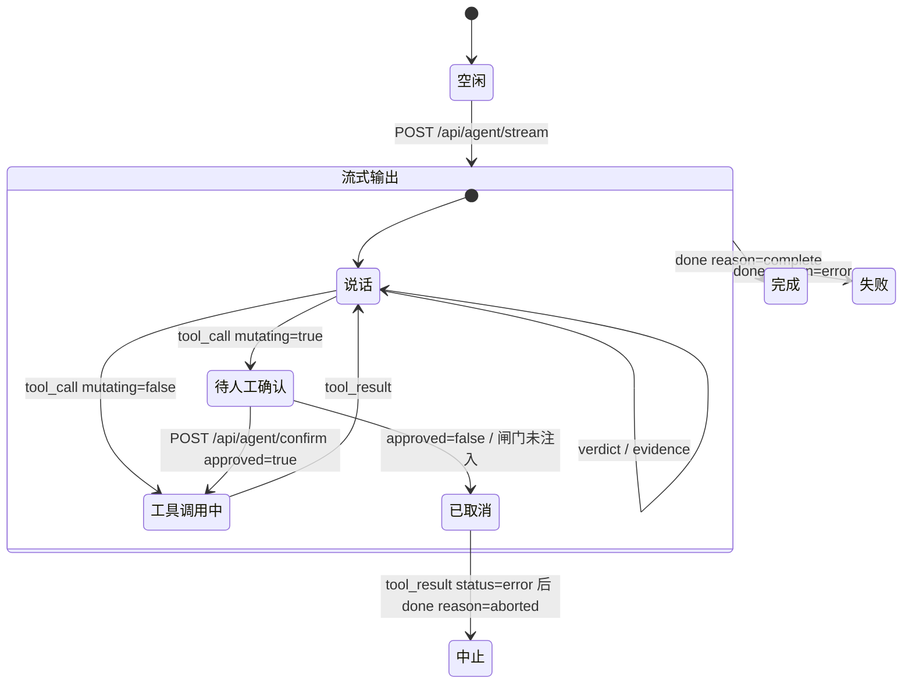

# 后端重构交接书 v3.0 · 主文档

**这份文档是什么**

你的项目里**只有源码、没有文档**。所以这份文档自带全部路线图：它把本项目的文档读了一遍，把「做什么、按什么顺序做、每步的验收动作、源码在哪、坑在哪」全部内联。

你**只需要读源码 + 这份文档 + 附录**，不需要去找别的材料。

| 文档 | 用途 | 怎么读 |
| -- | -- | -- |
| **本文件（主文档）** | 路线、阶段、每步交付、红线 | **从头读到尾** |
| `后端重构交接书-v3.0-附录.md` | 八包任务、106 条验收、58 枚按钮、术语表、技术栈 | **按需查** |

**四条纪律，全程有效**

一、**接口形状以源码为准。** 本文的行号与数字全部经过实测，但**源码会随改动漂移**。遇到本文写的位置找不到时，**按函数名/对象名/注释原文去搜，不要按行号找**。

二、**「打开网络面板记录请求；没有后端请求的按钮不能记作完成。」**

三、**没有证据的功能保留待验收。**

四、**权限、批准、设备互斥、错误处理和审计随对应功能一起做，不能拖到上线前才加。**

**一条开工原则**：**本文该给的推荐都给了，遇到待确认项按推荐做，不要停下来等答复**（唯一例外是涉及真实设备与客户数据的，见第十一章）。

**基准**：`web/`（`src/` 下 114 个 `.ts`/`.tsx`，21399 行）。核对日期 2026-09-22。

**三个提交号，别对错**（本项目文档在不同时刻写的，基线不同）：

| 提交号 | 出处 | 说明 |
| -- | -- | -- |
| `5c078f8b93a62ee2f60bc33d31c7a17c61e50623` | v4.0 交付核验 | 代码起点 |
| `203de71` | v4.2 核查 | 新仓基线 |
| **`26dfaad`** | **v4.1 截图** | **最新**，2026-09-21 本地浏览器采集 |

**本项目自己的四份资料谁管什么**：

| 顺序 | 资料 | 管什么 |
| -- | -- | -- |
| 1 | **v4.3 总开工顺序** | 阶段和分工（所有人先对齐这一层） |
| 2 | v4.1 页面图解 | 用户每页怎么操作 |
| 3 | **v4.2 后端指南 + 客户代码复用清单** | 实际入口和接法 |
| 4 | v4.0 开发明细 | 按需查接口、完整任务、部署和验收 |

⚠️ **v4.0 的「复用」与「数据库取舍」两节已被 v4.2 更正**——以 v4.2 为准。

---

## 第一章 · 先认清三件事

### 1.1 客户代码不在这个仓库里

**这是最重要的前提，先看清楚再动手。**

仓库里**没有完整的业务后端**，也没有一个「做好等你启动」的 `../../backend` 服务。客户的另一份代码（`api/`、`debug-agent/`、`writeFile_rust/`）在**另行交付的客户脱敏工程**中，**不在本仓**。

所以你的工作分两半：

| 半 | 做什么 | 从哪来 |
| -- | -- | -- |
| **第一半（主体）** | 以客户 API 为底座迁入，扩展测试业务，再接新前端 | 客户脱敏工程（**向项目负责人领取**） |
| **第二半（本仓内）** | 把本仓已有的设备桥、知识库流水线、MCP 桩接起来 | 本仓 `components/`、`kb-pipeline/`、`dsh-plugins/` |

⚠️ **缺客户 API 工作副本时**：由负责人补交；**前端可按约定响应开发并启动现有原型，不必停工**。

**三条边界（不可逾越）**：

1. **不要从零重写客户已有能力。** 账号、登录、模型网关、额度、报告库、设备工具，客户仓里都有。你的任务是把它们**抠出来接上**，不是重写。
2. **不要为了演示拆微服务。** 首版形态固定为：**一个业务服务 + 一个任务工作进程 + 关系数据库 + 文件目录**，设备桥独立部署。
3. **数据库选型已被更正。** ⚠️ **不要一开工就换 PostgreSQL。** 客户 API 已有 `app/db/session.py` 建表及增量迁移，含 MySQL 与 SQLite 处理。**先隔离启动、确认选定数据库分支可用，再扩展模型**——保留现有数据库类型，不要同时改业务与存储。

### 1.2 仓库里现在有什么、没有什么

**现存的五个可复用工程**：

| 位置 | 是什么 | 服务端形态 | 这次怎么用 |
| -- | -- | -- | -- |
| `web/` | 页面原型（Vite + React 19 + TS） | 前端 | 保留界面，把数据和操作接到业务 API |
| `components/spike-device-mcp/` | **设备 MCP 桥**，FastAPI，默认 `127.0.0.1:8031` | **真跑得起来** | 第 6 阶段由业务服务调用；六个动作仍需补真实执行与回执 |
| `components/webssh/gateway/` | SSH 网关，Node + express/ws/ssh2，`:8022` | 真跑得起来 | 文档已标「**建议废弃，仅供参考**」，只剩设备节点放大态那个 xterm 终端一个用途 |
| `kb-pipeline/` | 知识库构建流水线（9 个 Python 脚本） | **离线脚本，不起服务** | 第 4 阶段接到上传、解析和检索服务；要改成可配置输入输出目录 |
| `dsh-plugins/` | DeepSeek Harness 运行时验证、插件与三个 MCP 工具桩 | 部分验证过 | 复用经过验证的部分，补真实会话与业务工具 |

`components/` 下另有 `timeseries/`、`workflow/`、`agent-chat/`、`spike-canvas/` —— 这四个是**前端组件独立开发工程**，代码已被复制进 `web/src/features/` 下，**服务端不需要重实现**。

**明确没有的**（实测）：

```
搜 FastAPI( / uvicorn.run / express() / createServer(  → 4 处（桥 2 处、网关 1 处、截图静态服务器 1 处）
搜 main.py                                             → 0 个文件
搜 requirements*.txt                                   → 0 个文件
```

**没有业务后端、没有 API 入口、没有任何 Python 依赖清单。**

### 1.3 前端现在怎么取数：20 处 fetch + 1 处 WebSocket

前端的全部网络调用分四域。三态含义：

| 状态 | 含义 | 前端要不要改 |
| -- | -- | -- |
| **真实** | 服务端存在且可跑，或静态文件由 Web 服务器直接吐 | 不用改，换源即可 |
| **脚本回放** | 前端**有完整调用与解析代码，但当前挂的是本地脚本**，一个字节都没发到网络 | **不用改解析层**，后端补齐即可 |
| **未实现** | 代码里只有占位或恒为 `null` 的字段，没有任何调用点 | 前端也要补 |

| 域 | 处数 | 后端现状 | 优先级 |
| -- | -- | -- | -- |
| **A 助手会话** | 3 | ❌ 无任何实现 | **P0，主干** |
| **B 设备与台架** | 10 | ⚠️ 桥有真实现（spike 级）；网关建议废弃 | P2 |
| **C 知识库** | 2 | ⚠️ 静态文件 | P2 |
| **D 场景包与产物** | 6 | ⚠️ 静态文件；产物**完全没有** | **P0/P1** |

**逐条调用点**（可直接跳去看）：

| 域 | 处数 | 位置 |
| -- | -- | -- |
| A 助手 | 3 | `features/agent-chat/api.ts:396`、`:412`；`features/copilot/actions.ts:82` |
| B 设备与台架 | 9 | `features/remote/bridge.ts:186`、`:189`、`:192`、`:201`、`:216`、`:223`；`features/remote/api.ts:27`、`:30`、`:33` |
| C 知识库 | 2 | `features/scene/kb.ts:152`；`features/knowledge/data.ts:160` |
| D 场景包与产物 | 6 | `features/scene/pack.ts:370`；`features/scene/workflows.ts:119`；`data/loadScene.ts:531`；`features/timeseries/loadCsv.ts:127`；`features/workflow/lib/workflowStore.ts:26`、`:43` |

另有一处 WebSocket，全在 `features/remote/` 下（终端）。

---

## 第二章 · 读源码之前先看三张表

### 2.1 页面 ↔ 开发任务

**如果你是从源码反推，按页面看比按任务号看更直观。**

| 页面 | 对应开发任务 |
| -- | -- |
| 知识库（`/knowledge`） | T06、T36 |
| 初始化（`/init`） | T01～T04、T35 |
| 测试需求与工作流（`/requirements`） | T05、T11 |
| 启动测试（`/run`） | T12～T20 |
| 调优运行（`/tune`） | T21～T23 |
| 测试报告（`/report`） | T24、T25 |
| **每页的助手** | T07～T11 |

### 2.2 36 个任务分别落在哪个阶段

**注意：T12 与 T14 出现两次。** 模拟阶段做「模拟适配」，实机阶段才「接实机」——这解释了为什么它们看着像设备任务，却是第 4 阶段就该做的。

| 主要实施与复验阶段 | 对应任务 |
| -- | -- |
| 1～2：基础、复用核验与页面保存 | T01～T05、T11 |
| 3：资料和助手的第一条完整功能 | T06～T10 |
| 4：模拟执行、判定、调优和报告 | **T12、T14 的模拟适配**；T13、T15、T17、T18～T25 |
| 5：现场适配与真实动作 | **T12、T14 接实机**；T16、T29、T35；复验 T17 及前面所有涉及设备的能力 |
| 持续实施，第 6 阶段集中复核 | T26～T28、T32、T33、T36；**逐项复核 36 个任务、58 条按钮及 106 条验收** |
| 从第 1 阶段准备，第 7 阶段签收 | T30、T31、T34 |

**知识库全类型处理、双路检索、所有按钮、语音等共用功能**可以在主线打通后扩展，**但第 6 阶段要回完整清单逐项确认**。

### 2.3 八包任务（P1~P8）与七阶段对照

| 包 | 一句话范围 | 人日（乐观/中性/悲观） | 落点阶段 |
| -- | -- | -- | -- |
| **P1** | 前端从原型到可维护工程，含画布可维护化与原型遗留缺陷单 | 4 / 6 / 10 | 阶段 1～2 |
| **P2** | 服务端真接口，替代前端的脚本回放与静态 JSON | 5 / 8 / 13 | 阶段 1～2 |
| **P3** | 知识库三轴分类的后端与在线转化流水线 | 4 / 6 / 10 | 阶段 3 |
| **P4** | 智能体集成，助手按钮从回放转真调用 | 5 / 8 / 14 | 阶段 3 |
| **P5** | 设备 MCP 服务从验证工程转正 | 6 / 10 / 16 | 阶段 4～5 |
| **P6** | 五条流程业务逻辑补全 | 5 / 8 / 14 | 阶段 4 |
| **P7** | 场景包契约固化与换包演示 | 3 / 5 / 8 | 阶段 4～6 |
| **P8** | 部署与联调标准作业程序 | 3 / 5 / 9 | 阶段 7 |
| | **合计** | **35 / 56 / 94** | |

逐包的输入、交付物、验收命令见**附录 A**。

**依赖主链（不能跳）**：

```
P7 字段定版 ──▶ P1 画布拓扑下沉 ─┐
                                 │
P2 服务端真接口 ──▶ P3 知识库 ───┤
                                 ├──▶ P6 业务逻辑补全 ──▶ P8 部署与联调
P5 设备 MCP 转正 ──▶ P4 智能体 ──┘
                                        P7 换包演示 ──▶ P8
```

---

## 第三章 · 七阶段路线（一步一交）

**按这个顺序做，不要跳。** 每步做完，按第四章的格式回信，再进下一步。

每步开头先给**「本阶段交出什么才算能往下走」**——这是原文验收语，**不是建议**。

### 阶段 1 · 三路准备，同时开始

**本阶段交出什么**：页面能打开；原 API 的登录、聊天保存和额度等基础功能**有回归结果**；缺件清单写清负责人。**设备暂未到位不阻塞页面和无设备开发**。

| 项 | 要求 |
| -- | -- |
| 三路并行 | 前端跑现有网页；后端领取客户源码在隔离环境跑原 API；负责人与设备人员补资料、工具、模型账号及现场条件 |
| 后端具体做 | 以客户 `api/app/main.py` 为入口，沿用原有依赖、用户、数据库和会话底座；**在隔离库、隔离文件目录中启动** |
| 必须先做的三件事 | ① 领取客户 API 源码版本；② 检查配置里的默认凭据并改为受控配置；③ **不连客户生产库**，不把客户源码/凭据未授权推到外部仓 |
| 还要交 | 确切启动命令、迁移记录、`requirements.txt`（原依赖为起点，补可复现版本锁）、`.env.example`（只留变量名与安全示例）、README |

**验收动作**：页面能打开；`npx tsc -b --force` 与 `npm run build` 退出码 0；原 API 登录/聊天保存/额度**回归通过**；缺件清单写清负责人。

**❓ 阶段 1 就受阻的条件**：**缺客户脱敏代码的内部访问方式**（编号 M01）——没有它本阶段做不了，由项目负责人补交。

---

### 阶段 2 · 前后端先接通一次保存

**本阶段交出什么**：从网页建任务、改一个产品字段、保存；**刷新和服务重启后仍能读回**。**另一个无权限用户读不到**。页面到数据库的链路跑通。

| 项 | 要求 |
| -- | -- |
| 为什么这一步 | 练的是**完整链路**：路由 → 鉴权 → 校验 → 落库 → 读回。链路通了后面都是重复 |
| 具体做 | 在原模型和路由体系中增加测试任务：`POST /api/v1/tasks`、`GET /api/v1/tasks/{id}`，**复用原鉴权依赖** |
| 任务存什么 | 标题、原用户 ID、场景 ID、版本、状态 |
| 先回归 | 登录、用户权限、聊天保存、额度查询四项，用独立测试账号 |
| 前端配合 | 前端把当前样机、任务和完整字段传过去；先选**产品名称**这类非设备动作字段联调 |

⚠️ **前端要一起改一处**：`web/vite.config.ts` 现在是空的（无任何代理配置），前端**直连各服务**。前后端要一起配开发环境 `/api` 转发，或统一 API 地址与跨域配置；生产使用同源反向代理。**只把后端启动起来，页面不会自动开始用它。**

**验收动作**：

1. 从网页建任务 → 改产品字段 → 保存；
2. **刷新页面**，仍能读回；
3. **重启服务**，仍能读回；
4. **换另一个无权限用户**，读不到该任务；
5. 原登录/聊天/额度回归通过；旧余额及流水不被新增功能破坏。

---

### 阶段 3 · 接资料和助手

**本阶段交出什么**：上传一份**获授权**资料，助手返回**有出处**的字段建议；**人采纳后保存**。**换任务不会串上下文**，**断流或模型失败有明确提示**。

**这是全项目最权威的「第一条链路」，先只做通这一条，别铺开**：

```
建立任务 → 助手读一份资料 → 页面显示预填草稿 → 人采纳 → 保存 → 刷新后仍在
```

这句话有两个切面，**是同一件事，不是两次做**：

| 切面 | 强调什么 | 落点 |
| -- | -- | -- |
| **数据真的存下来了** | 刷新/重启后仍在 | 服务端（阶段 2 已通） |
| **助手真的读了资料** | 保存原件→解析→建索引→检索→形成草稿→人采纳 | 助手（本阶段） |

---

#### 3.1 资料侧：知识导入与检索（P3）

| 项 | 要求 |
| -- | -- |
| 五个阶段 | **识别 → 抽取 → 切片 → 结构化 → 索引**，串行，**每阶段可单独重跑** |
| 阶段之间只传文件与 JSON，**不共享内存状态** |
| 前三个阶段直接调 `kb-pipeline/scripts/01_convert_docs.py` 里已封装的 Docling 链路，**不要换成别的解析器** |
| 每份文档状态五值 | 待处理 / 转化中 / 已入库 / 转化失败（给失败阶段与原因）/ **需人工校对**（结构化置信度低于阈值时进此态） |
| 结构化阶段 | 按**八个文档类型**各写一份模板；置信度低于阈值的条目进「需人工校对」，**不允许静默通过** |
| 三轴分类 | **归属**（三级）/ **来源**（文档·经验）/ **用途**（三类），照这个结构建模，**不要建成一棵单树** |
| 条目生命周期两道闸 | ① **软删除**：删除只改状态不抹数据，可查可恢复，原件保留 90 天；② **被引用禁删**：引用计数 >0 时返回 409 并**逐条列出引用方** |
| 版本 | 改文档或改经验**一律出新版本不原地覆盖**，经验的改动理由是必填字段 |
| 检索 | 关键词与向量两路；返回带页码可点回原文 |

**验收动作**：

1. `bash kb-pipeline/scripts/run_all.sh` 离线链路仍能全量重跑；
2. 上传一份文档后轮询状态接口，五个阶段状态依次推进到已入库；
3. 对引用计数 >0 的条目发删除请求，**返回 409 且响应体逐条列出引用方**；
4. 改一条经验后查版本，能查到两个版本且**改动理由非空**；
5. 调检索接口查「FG 输出配置」，**结果同时命中中文段落与宏名**；
6. 前端把知识库取数切到服务端后，三轴筛选计数与切前一致（散热风扇包 85 条、用途轴 8/12/65）。

---

#### 3.2 助手侧：会话服务（P4）

**现状：脚本回放。** 前端的 SSE 解析代码**已写完并在跑**，但应用里挂的是本地脚本 `makeAdapter`（`features/copilot/index.tsx:88`），**没有真实请求发出**。

⚠️ **先适配客户已有链路，不要新写一套。** 客户 `api/app/api/v1/agent_chat.py`、`services/agent_chat_service.py`、`services/agent_stream_manager.py` **已有模型调用、工具循环、流式响应、取消和断线重订阅**。原模型网关和额度计费一起保留，**避免双调用、双计费**。

客户后端的路由、事件名及字段与前端不同。做法二选一：**在业务服务增加兼容适配层**，或**前后端同步改协议**。

**四条硬约束**：

| # | 约束 | 原因 |
| -- | -- | -- |
| 1 | **依赖锁定不许动**：顶层唯一依赖 `@deepseek-ai/dsh@0.1.5-rc.2`，**精确版本不带插入符或波浪号** | 严禁在顶层单独安装任何 DSH 子插件包，它们已内嵌在主包里。重复安装会提升出第二份更老的作用域包副本，两份互不识别 |
| 2 | **安全 Hook 必须走 Claude Code 方言的桥** | Codex 方言的桥会把非命令行形状的工具参数压扁，阻断脚本看不到电流阈值字段 |
| 3 | **助手按钮的红线降级规则** | 按钮的产出只允许答复、草稿、填表三种，三者都不触发六个红线动作中的任何一个 |
| 4 | **忙态只禁执行类按钮** | 按钮分讲解、准备、执行三类，一轮没跑完时**只禁用执行类**，讲解与准备类保持可点 |

**`POST /api/agent/stream` 请求**：

```json
{
  "text": "跑一次预检，然后回放本批 CH1 波形并对判据",
  "model": "deepseek-v4-pro",
  "permission": "readonly",
  "auto_run": true,
  "session_id": "shell-motor.cooling-fan.fortior-fu6832-run"
}
```

| 字段 | 类型 | 必填 | 来[源] | 备注 |
| -- | -- | -- | -- | -- |
| `text` | string | 是 | 输入框，或预置动作按钮的 `prompt` | |
| `model` | string | 是 | 顶栏模型选择器 | 候选四值：`deepseek-v4-pro` / `deepseek-v4` / `claude-opus-5` / `qwen3-max`（`features/agent-chat/types.ts:13-18`） |
| `permission` | string | 是 | 输入区档位选择器 | 三值：`readonly` / `params` / `hardware` |
| `auto_run` | boolean | 是 | 输入区开关 | **只覆盖只读工具，不覆盖改动类动作** |
| `session_id` | string | 否 | 前端拼成 `shell-{sceneId}-{flow}` | 由后端维护上下文 |
| `context` | object | ❌ **前端未上送** | — | 见 3.2.2 |

**权限三档的准确含义**（`features/agent-chat/types.ts:7-11`）：

| 值 | 显示 | 含义 |
| -- | -- | -- |
| `readonly` | 只读 | 仅读取工程文件与测量数据，不做任何写入 |
| `params` | 可改参数 | 允许修改标定参数与配置项，不驱动硬件 |
| `hardware` | 可控硬件 | 允许启停电机、切换负载、控制仪器 |

⚠️ **服务端注意**：**前端不做任何权限拦截**，档位原样下发，**拦截责任全在服务端**。

**响应：SSE 六种事件（字段一个都不许增删）**

服务端以 `text/event-stream` 推送，每条消息一个事件。**`event` 名与 `data` 里的 `type` 必须保持一致**。前端按空行切分、**只认 `data:` 行**。

**① `message_delta`**

```json
{ "type": "message_delta", "messageId": "m1-3", "delta": "斜坡时间 160 ms " }
```

> ⚠️ **后端最容易犯的错**：工具卡片之后继续说话时**必须换一个 `messageId`**，否则新文字会追加回前一个气泡。**多轮会话时 `messageId` 必须逐轮唯一。**

**② `tool_call`**

```json
{
  "type": "tool_call",
  "callId": "tc-2",
  "name": "start",
  "title": "启动电机",
  "args": { "duty_percent": 60, "duration_s": 10 },
  "argsSummary": "空载启动至 3000 rpm，斜坡 160 ms",
  "mutating": true,
  "confirm": {
    "confirm_token": "ct_xxx",
    "prompt": "启动被测电机：台架会真的转起来",
    "args_preview": "duty_percent=60 · duration_s=10",
    "seconds_left": 180
  }
}
```

> **`confirm` 字段是前端已经写好解析的**（`api.ts:50-55`），但后端目前没有实现推它。**这是本次接入最关键的一处**：后端调桥拿到 `confirmation_required` 后，把凭据原样塞进这个字段。

**③ `tool_result`** —— `status` 二值 `ok`/`error`；`resultSummary` **由后端生成**。

**④ `verdict`** —— **`measurements[].value` 是字符串，不是数字。** `pass` 为 `true` 用主色墨绿，`false` 用暗红。

**⑤ `evidence`** —— `id` 可多次推送，前端按标识去重后并入依据池。`kind` 三值：`procedure`/`case`/`document`。`source` **必须给全名**；`href` 缺省则前端按钮禁用。

**⑥ `done`** —— `reason` 三值：`complete`/`aborted`/`error`。

**五点必须遵守的实现细节**：

1. **`messageId` 与 `callId` 必须逐轮唯一**；
2. **`argsSummary` 与 `resultSummary` 由后端生成**，前端不做参数渲染；
3. **协议外的行后端可以发，前端会丢弃不中断流**（`api.ts:487-489`），但不要依赖这个宽容度；
4. **`verdict` 与 `evidence` 不改状态**，可任意位置、多次出现；
5. ⚠️ **前端在流自然结束时补发一条 `done{reason:"complete"}`**（`api.ts:492`）——**这是前端目前的隐患**：后端若是断流而非正常结束，前端会误判为完成。**异常必须显式推 `done{reason:"error"}`。**

**`POST /api/agent/confirm` 请求体（前端实际发四个字段）**：

| 字段 | 类型 | 必填 | 含义 |
| -- | -- | -- | -- |
| `call_id` | string | 是 | 要放行/取消的那次工具调用，即 `tool_call.callId` |
| `approved` | boolean | 是 | `true` 放行，`false` 取消 |
| `actor` | string | 是 | 确认人署名，**写进留痕** |
| `confirm_token` | string | 否 | 桥签发的凭据串，有则带 |

| 情形 | 后端动作 |
| -- | -- |
| 收到 `approved:true` | 持桥 token 调 `POST /confirmations/{token}/approve`（带 `x-approver-pin` 与 `operator`），成功后带同票同参重调工具，再推该 `callId` 的 `tool_result` |
| 收到 `approved:false` | 推 `tool_result{status:"error", result:{cancelled:true, reason:"not_confirmed"}}`，再推 `done{reason:"aborted"}` |
| 未知 `call_id` | 建议 `404` |
| 已确认/已取消/已超时 | 建议 `409` |

**助手一轮的状态机**：



**三处要点**：
1. `verdict` 与 `evidence` **不改变状态**；
2. **`待人工确认` 是唯一会无限期停住的状态**，后端应自设超时，超时后主动推 `tool_result{status:"error"}` + `done{reason:"aborted"}`，**别把会话挂死**；
3. **闸门未注入时按「不放行」处理，绝不默认执行。**

---

#### 3.2.1 判定口径（后端产出 `verdict` 时必须遵守）

**这是后端要照抄的算法**，源码在 `web/src/features/flow-run/evaluate.ts`（**行号已逐行核实**）。

| 情形 | 判什么 | 说明 |
| -- | -- | -- |
| 默认 | 只要有一个现场实测量取不到值 → **`未采集`** | 列出缺哪几个，**不推 `pass:false`**，不拿别的数顶替 |
| **唯一例外：合取式短路** | 某子句所需变量**已全部采到**且算出为假 → 直接推 `fail` 并标 `partial:true` | 依据布尔代数：真 ∧ 未知 = 未知，**但假 ∧ 任何 = 假** |
| 子句求值抛异常 | 吞掉异常，回落 `未采集` | 不编结论 |

> **这条例外是必需的**：没有它，流程 3 永远判不出不通过，流程 4 的调优页就没有输入，整条演示主线的因果链断掉。

**源码定位**：

| 位置 | 内容 |
| -- | -- |
| `evaluate.ts:1-20` | 文件头注释，写明四种量来源与「未采集」纪律 |
| `evaluate.ts:22-36` | `VerdictState` 四值（`pass`/`fail`/`missing`/`manual`）与 `Evaluated` 结构 |
| `evaluate.ts:48-70` | `runtimeMeasures()`：本轮能提供的现场实测量，**采到什么给什么，一个都不推算** |
| `evaluate.ts:86-108` | `resolve()`：变量按 `source` 分派到四个来[源] |
| `evaluate.ts:110-138` | `clausesOf()`：顶层 `&&` 拆分，括号内不拆，**顶层出现 `\|\|` 就直接返回整条不拆** |
| `evaluate.ts:145-201` | `evaluateAll()`：主入口，含合取短路分支（`:171-192`）与抛异常回落（`:197-199`） |

**变量的四种来源**（`evaluate.ts` 的 `resolve()`）：

| `source` | 取值方式 |
| -- | -- |
| `runtime.measure` | 现场实测量，**必须真采到**，采不到就判「未采集」 |
| `threshold` | 本条自己的 `threshold` 字段 |
| `control-parameters` | `control-parameters.json` 里按 `ref` 末段 `key` 取的当前配置值 |
| `constant` | 编译期常量（故障位掩码一类），字面值写在变量自己身上 |

**子句拆分规则**：只拆**顶层 `&&`**，括号内的 `&&` 不拆；**顶层出现 `||` 就不拆**。

**判据等级三档**：**致命 / 主要 / 次要**。整体结论规则由等级决定，例如「全部致命项通过、且主要项通过率不低于某值」才算整体通过。

**❓ 需要确认**：判定求值放后端还是前端？现在前端有本地求值（用于演示），后端接入后**应由谁算**需要拍板。若后端算，前端那份要标记为「演示专用」。

---

#### 3.2.2 上下文包上送（**前端未实现，建议形态**）

**现状：前端已经把上下文算出来了，但只用于本地按钮置灰，一个字节都没上送。**

**证据**：`features/copilot/context.ts` 的 `buildEnvelope()` 构造出完整 `Envelope`；`missingContext()` 拿它判断按钮该不该灰。

**建议形态**：在请求体里加 `context` 字段，值就是 `Envelope`。

**真实结构：`envelope_version` + 九个上下文段 + 一个可空的 `action`**（共 11 个顶层字段，见 `context.ts` 的 `Envelope` 接口）：

| 段 | 回答的问题 | 主要字段 |
| -- | -- | -- |
| `session` | 谁在用、这是哪一轮会话 | `session_id`、`operator`、`started_at`、`transcript_summary` |
| `product` | 测的是什么产品 | `scene_id`、`taxonomy_path`（**恰好 3 项**）、`taxonomy_name`、`product_name` |
| `flow` | 在哪一步 | `id`（**六值**：`kb`/`init`/`req`/`run`/`tune`/`report`）、`label`、`step`、`confirmed` |
| `zoneB` | 左栏表单现在什么样 | `form_groups`、`values`、`missing`、`placeholders`、`touched`、`selected_*`、`interlocks`、`requirements`、`control_params`、`firmware_project`、`report_template` |
| `zoneC` | 画布与设备现在什么样 | `view`（**三值** `grid`/`canvas`/`detail`）、`selected_node`、`workflow_nodes`、`workflow_templates`、`devices`、`bench_status` |
| `lastRun` | 最近一次跑出了什么 | `run_id`、`finished_at`、`overall`（**四值** `pass`/`fail`/`partial`/`invalid`）、`verdicts`、`failed_items`、`missing_measures`、`artifacts`、`precheck` |
| `history` | 历史轮次索引 | `runs`。**当前恒为 `null`** |
| `kb` | 这次查到了什么 | `hits`（对齐 `evidence` 结构）、`index_summary`、`conversion_status`、`experience_summary`、`unclassified` |
| `policy` | 这次能做到哪一步 | `permission`（**三值**）、`auto_run`、`redline_actions`（**六值**） |
| `action` | 点按钮时才填 | `button_id`、`type`、`confirmed`。手打消息时为 `null` |

⚠️ **必填字段**：前端类型层**没有必填标记**（`Envelope` 的字段全是非可选声明，代码里查不到 `required` 这个概念）。**哪些段必填由服务端契约定**，前端不做校验。

**当前为 `null` 的字段，分两类，触发条件不同**（⚠️ 这一条**最容易写错**，务必看清）：

| 类 | 字段 | 触发条件 |
| -- | -- | -- |
| **恒为 `null`** | `history` | 轮次存储未实现，**任何情况下都是 null** |
| | `zoneB.selected_document` | 各流程面板的选中态还在组件局部 `useState`，**拿不到，恒 null** |
| | `zoneB.selected_fail_item` | 同上 |
| **条件为 `null`** | `lastRun.artifacts` | **`runRound === 0` 时为 null**；**`runRound > 0` 时是一个对象**，含 `run_id: 'replay-run-{N}'`、`replay: true`、`note`、`items: ['判定表', '报告草稿']` |
| | `zoneB.selected_candidate` | **`adopted.length === 0` 时为 null**；**勾选候选后是一个对象**，含 `count`、`keys`、`items` |

> ⚠️ **这两条「条件为 null」的字段是刻意做成可用的**——`selected_candidate` 的选中态已在第四轮上提到全局 store，勾了候选「写回草稿」按钮就能亮（这是 `07i` 独立核验 P3 专门修好的）。**别把它当成"还没实现"而写死成 null，那会把按钮又弄灰。**

**两条纪律**：
1. **只装真取得到的东西。** 取不到的写 `null`，不拿别处的数顶上；
2. **参数只送人改过的那几项 diff，不送全量。**

⚠️ **一处前置改造**：`zoneC.selected_node` 与各流程面板的 `selected_*` **现在是组件内的局部 `useState`，副驾拿不到**，必须上提成全局 store。这是接上下文包的**前置改造**，不是可选项。

⚠️ **与旧文档不一致的一处**：**B 区应发送「当前完整有效值及修改信息」**，不能只给 `overrides` 而漏掉未改的默认值。

#### 「什么算缺」的判定口径（前端已实现，后端要对齐）

按钮置灰的判定逻辑在前端 `context.ts` 的 `missingContext()`，调用方是 `ActionBar.tsx` 的 `state()`（据此给按钮置 `off: true`）。

| 值 | 算不算缺 |
| -- | -- |
| `null` | **缺** |
| `undefined` | **缺** |
| **空数组 `[]`** | **不算缺** |
| `0` / `''` / `false` | **不算缺**（只判 null 与 undefined） |

**后端校验 `context_requires` 时必须采同一口径**——否则会出现「前端按钮可点、后端判定缺字段」的两套结果。

---

#### 3.2.3 副驾按钮的产出规格

**按钮的产出只允许三种，一个都不许越界**：

| 类型 | 改变了什么 | 确认闸门 |
| -- | -- | -- |
| **解释类** | 什么都不改，只产出文字与依据 | 不弹 |
| **准备类** | 只改前端暂存态：草稿、清单、候选、待确认队列 | 不弹 |
| **执行类** | 触发一次真实工具调用 | **弹**，走既有确认卡 |

**触碰红线的按钮一律降级**：凡是最终动作落在启动/停止/急停/写回参数/导出/归档这六项上的，**一律不做成执行类**，改成准备类的「备好等人点」形态。

**按钮点击后三段（缺一不可）**：

1. **回显** —— 先在气泡里显示 `echo` 那句话。**回显不是可选项**：用户点按钮时并不知道背后预置了什么 prompt；
2. **确认** —— 只有执行类弹确认卡，走既有 `requestConfirm` 闸门；
3. **执行** —— 按 `operation` 逐条发工具调用。

**四条交互规则**：

| 规则 | 内容 |
| -- | -- |
| **自动执行开关的边界** | 输入区的「开启自动执行」开关**只覆盖只读类工具，不覆盖改动类动作** |
| **随流程切换** | 切流程时按钮条**整条替换**，上一流程的按钮不保留——因为 `context_requires` 是按流程写的，跨流程点必然缺字段 |
| **置灰规则** | `context_requires` 里有字段取不到时按钮置灰，悬停提示缺什么、去哪补 |
| **一行最多 5 枚** | 第 6 枚起收进末尾的「更多」下拉。可见的 5 枚按流程在 JSON 里的书写顺序取前五，**顺序即优先级** |

**全量 29 枚 = 解释类 7 + 准备类 18 + 执行类 4**，两个场景包各 29 枚。**逐枚的 `prompt`、`operation`、`context_requires` 见附录 C。** 注意：**两个场景的按钮构成不是完全一样的**——

| 场景 | 差异 |
| -- | -- |
| 散热风扇包 | 执行类按钮 `available: true`，`confirm_required: true` |
| 玻璃升降器包 | **4 枚执行类按钮 `available: false`**，理由写死：「本场景没有可连的真设备，执行类按钮第一版不开放」 |

**⚠️ 一处容易写错的**：门禁校验的 `flow` 取值是**六个不是五个**（五条主线流程 + `knowledge`），**写成五个会每包误杀 4 枚按钮**。

---

#### 3.2.4 调优候选的排序口径（**已定，不要改**）

前端已经按**证据级**排序，三档序位：

| 档 | 序位 |
| -- | -- |
| 台架实测数据 | **3**（最高） |
| 台架经验与判定工具输出 | 2 |
| 规程条款 | 1 |

代码位置（**已逐行核实**）：

| 位置 | 内容 |
| -- | -- |
| `web/src/features/flow-tune/panel.tsx:137` | `useCandidates()` 函数定义 |
| `web/src/features/flow-tune/panel.tsx:161-163` | 排序口径的注释（写明依据 06d 第 2.2 节、旧口径错在哪） |
| `web/src/features/flow-tune/panel.tsx:164-168` | 排序实现：`rankOf(b.exp) - rankOf(a.exp) \|\| Number(typeof b.suggested === 'number') - Number(typeof a.suggested === 'number')` |
| `web/src/features/flow-tune/panel.tsx:173-178` | 证据级表 `EVIDENCE_RANK`（台架实测数据 3 / 台架经验 2 / 判定工具输出 2 / 规程条款 1） |
| `web/src/features/flow-tune/panel.tsx:655` | `QUEUE_CAP = 10`（候选槽位上限） |

⚠️ **这段没有单元测试，补一支把口径锁住**。**不要重写排序逻辑**——重写会白做半天，或把刚落地的口径改回错的。

**三个来源必须分组展示，不混为一谈**：

| 来[源] | 怎么产生 | 可信度标注 |
| -- | -- | -- |
| **经验库** | 检索相似情形下的历史调参决策，按相似度与历史采纳率排序 | 显示「相似案例 N 条，其中采纳 M 条」 |
| **测试规程** | 规程里写死的固定候选序列，按顺序试 | 显示规程名与第几个候选 |
| **模型推断** | 副驾基于当前数据与参数影响关系推断 | 标「模型建议」，**并要求给出推断依据** |

**候选耗尽的处理**：三个来源的候选**全部试过仍未达标**时，队列末尾给一条「**需人工介入**」，附上已试过的全部组合与各自结果。**不许无限试。**

---

### 阶段 3 验收动作

1. 上传一份**获授权**资料，助手返回**有出处**的字段建议；
2. **人采纳后保存**，刷新后仍在；
3. 发一句「跑一次空载启动并判定」，对话区**依次出现六种事件卡**，顺序是文字 → 工具调用卡 → 待确认闸门 → 工具结果 → 判定卡 → 依据卡；
4. **不点确认时工具永不执行**；
5. **换任务后上下文跟着变**（问「当前任务叫什么」答案不同）；
6. 断网、模型超时、取消、额度不足时**都能给出明确状态**；
7. **固定台词回放不计通过**。

**❓ 本阶段可能受阻的条件**：

| 缺什么 | 影响 |
| -- | -- |
| 模型账号 / 网络可达性 | 可做上传、存储和协议测试，**但真实助手验收保持阻塞** |
| DSH 锁定版本的 Node 集成接口及重连/取消能力 | 助手接入受阻；可用模拟模型做协议调试 |

---

### 阶段 4 · 用模拟设备完成整个流程

**本阶段交出什么**：从配置、要求确认，到模拟测试、判定、调优复测、**报告下载全部跑通**。**报告是可打开的文件**；**模拟标记清楚**，**批准与重复请求处理已验证**。

**这一阶段是「测试到报告」全链路的第一次完整验收**，也是整条演示主线的闭环。

**要交的具体结果**：创建一轮**新的模拟测试**，产生**本轮数据**、**判定结果**和**一个能打开的报告文件**。

**四条准备工作**：

| # | 准备什么 |
| -- | -- |
| 1 | **准备通过、不通过、缺数据三套可解释的输入** |
| 2 | 在「不通过」的例子里选一个参数候选，**经过模拟批准和执行后再跑新轮次，保留前后差异** |
| 3 | **历史 98 次数据仍标历史**，不能换个 `run_id` 就当成本轮 |
| 4 | 报告先用测试模板和模拟数据调客户 `writeFile_rust::processor::process`，生成可下载并能打开的文件 |

---

#### 4.1 轮次产物读写（**整个系统最大的一处空白**）

**现状证据（三处恒为 `null`，出自 `features/copilot/context.ts`，行号已逐行核实）**：

| 位置 | 字段 | 代码原文 |
| -- | -- | -- |
| `context.ts:112-115` | `lastRun.run_id`、`finished_at`、`overall` | `run_id: null`、`finished_at: null`、`overall: 'invalid' as const` |
| `context.ts:116` | `lastRun.overall_note` | 「本轮没有现场实测量，判定不成立，**不是「不通过」**」 |
| `context.ts:126-136` | `lastRun.artifacts` | 「轮次产物：本壳层没有真的落盘文件，跑完一轮后给的是回放态产物索引，字段里写明 replay，别让下游把它当成真交付件。没跑过就如实 null」 |
| `context.ts:224-225` | `history` | 「轮次产物与历史轮次尚无存储，第一版为 null（任务卡第 5 条已明写可为 null）」 |

⚠️ **上表第 4 行的行号是 `:224-225`**（旧版文档写 `:203`，实测偏移）。

**后果**：六枚助手按钮长期置灰；报告预览里的引用链点不回原始轮次。

**另一处要照抄的**：`context.ts:145-147` 的 `envelope_version: '1'` 与 `action: null` 是构造 `buildEnvelope()` 返回体时的固定写法，**后端接收时以这三个字段的实际值为准**。

**建议端点**：

```http
POST   /api/runs                              创建一轮，返回 run_id
GET    /api/runs?scene_id=&limit=             历史轮次索引，填 Envelope 的 history.runs
GET    /api/runs/{run_id}                     一轮的全部产物
PUT    /api/runs/{run_id}/{artifact_kind}     写入一份产物
GET    /api/runs/{run_id}/{artifact_kind}     读一份产物
```

**`artifact_kind` 取七值（一律用流程标识，不用序号）**：

```
config-snapshot  requirement-baseline  run-artifact  verdict-table
gap-list         param-change         report-instance
```

**七份产物的收发关系**：

| 产物 | `schema` 标识 | 产生方 | 消费方 |
| -- | -- | -- | -- |
| 配置快照 | `config-snapshot/v1` | `init` | `tune`、`report` |
| 需求基线 | `requirement-baseline/v1` | `req` | `tune`、`report` |
| 轮次产物包 | `run-artifact/v1` | `run` | `tune`、`report` |
| 判定结果表 | `verdict-table/v1` | `run` | `tune`、`report` |
| 未达标项清单 | `gap-list/v1` | `run` | `tune` |
| 参数改动版本 | `param-change/v1` | `tune` | `run` |
| 报告实例 | `report-instance/v1` | `report` | 归档回 `init` |

**三条贯穿规则**：
1. 每份产物带 `schema` 并**写死版本号**，加字段发新版本；
2. **引用另一份产物一律用标识不内嵌副本**（唯一例外是配置快照里的参数值，为的是让快照自包含）；
3. **模型生成的内容必须带可区分人填与机器填的字段**。

**字段名一律下划线命名**，与场景包 JSON 保持一致，**不转驼峰**。

**表设计建议**：每份产物建一张表，**主键用其自身标识字段，其余内容存 JSON 列**。跨产物引用**只存对方的标识字符串，不要内嵌整个对象**。

⚠️ **七份 Schema 描述的是归档产物，不足以直接承担实时作业状态。** 例如运行中尚无 `ended_at`，**不能强行伪造结束时间来满足归档 Schema**。做法：实现运行表及完成时的**产物转换器**，在转换边界校验。

---

#### 4.2 运行状态机与异常恢复

**运行状态机**：

```
draft → queued → prechecking → awaiting_approval → running
      → collecting → evaluating → completed
```

任一阶段可进入 `failed`；执行中收到停止请求进入 `stop_requested`，设备确认后为 `stopped`。**无法确定设备是否执行时为 `unknown`，锁住后续写入，先人工核对设备和回执。**

**批准与执行分开**：

```
requested → approved/rejected/expired
approved  → executing → succeeded/failed/unknown
```

批准的**完整参数摘要、配置版本、目标设备和有效期必须一致**。**批准后改一个参数也要重新申请。**

**三条硬要求**：
1. **数据库事务先记录动作和幂等键，再发命令**；网络超时**不能证明没有执行**；
2. 恢复进程先查询设备或读取实际参数，**以 `action_id` 对账**；
3. **支持取消的工具才能被真正取消，不支持的要显示「已请求取消，等待工具结束」。**

**文件写入**：写临时路径 → 计算摘要 → **原子移动** → 再登记可下载状态；失败时清理临时文件并保留错误记录。

**七项必须有、容易漏的运行功能**（**不是可选项**）：

| 功能 | 做什么 | 为什么必要 |
| -- | -- | -- |
| **预检自检** | 启动前跑设备连通、通道有信号、参数已写入、基线已存 | **避免跑了半小时才发现某个通道没接** |
| **干跑** | 不施加实际激励，只走一遍工作流逻辑 | 新建工作流后的第一道验证，**零风险** |
| **录制留档** | 整轮原始数据、截图、参数快照、日志打包成轮次产物 | **报告与复现的唯一依据** |
| **与历史对比** | 同产品同工作流的历次结果并排，曲线可叠加 | 单看本次数值看不出来是不是变差了 |
| **异常定位** | 曲线上自动标出判据不满足的时间段 | **从「不通过」到「哪里不通过」，这是结果分析的核心** |
| **断点续跑** | 长轮次中断后从第 N 轮继续 | 一百次启停动辄很久，**中断重来代价太大** |
| **台架占用与排队** | 显示谁在用台架，可排队并在轮到时通知 | 多人共用一套台架时的必需品 |

---

#### 4.3 安全确认闸门与急停

**闸门 = 三件事同时成立，启动按钮才能点**：

```
① 联锁项全部满足（人工类已确认并留名 / 自动类系统校验通过）
② 预检全部通过（设备连通 · 通道有信号 · 原始程序已备份 · 产品初始状态正常）
③ 现场安全总闸已开（必须人当场点，点了本轮有效，跑完自动复位）
```

任一不成立，启动按钮是灰的，**给一行说明差在哪一条，点击直达那一条**。

**急停独立于闸门**，任何时刻可点，**样式为暗红实心**，点击后**先发停机指令，再记录当时全部状态快照**。

**安全联锁是独立数据结构，不是普通参数**：

| 类别 | 联锁项示例 | 检查方式 | 不满足时 |
| -- | -- | -- | -- |
| **人员与现场** | 人员已离开设备区、防护罩已到位、急停按钮已接入并自检通过 | **人工勾选并留确认人** | 启动按钮置灰 |
| **电气量上限** | 母线电压、相电流、温度不超过设定值 | **运行中持续监测** | 触发即按设定动作：停机/降额/仅告警 |
| **流程与基线** | 基线快照已保存、禁改文件未被改动、单次连续运行不超设定时长 | **系统自动校验** | 启动按钮置灰并指出具体项 |

**每条联锁项的数据结构分三组**：
- **标识**：项名与类别
- **判定**：判定方式（人工确认 / 阈值监测 / 系统校验）与阈值单位
- **处置**：触发动作、**是否可临时豁免、豁免需谁批准**

**联锁模板随场景包下发**，人可在本次测试中**收紧**，**放宽需要显式豁免并留记录**。

⚠️ **对开发者最重要的一点**：**联锁在数据结构上必须与普通参数分开**——「能不能点启动」这个判断，**只查联锁，不查普通参数**。

---

#### 4.4 报告生成

**四类自动填充**：

| 类 | 来[源] | 填充方式 |
| -- | -- | -- |
| 字段值 | 配置快照、需求基线、本步信息 | 按映射表直接填 |
| 数据表 | 判定结果、各轮汇总 | 批量写进模板表格区域 |
| 图 | 产物包里的波形图、截图、历史对比图 | 按占位符插图，图题图注自动生成 |
| **结论文字** | 副驾依据判定结果与异常清单撰写 | **生成后标「待复核」，人工过一遍才能导出** |

⚠️ **硬约束**：**报告里出现的每一个数值都必须能点回来源轮次与原始数据**；**副驾撰写的结论段不得出现任何未在数据中出现过的数值**。

**实现含义（原文）**：

> 报告的每个数据单元格**都要带一个来源引用字段，不能只存最终值**。

**报告页十个字段的三层分组**（分组维度是「这一格填错了，谁会先发现、会出什么事」）：

| 层级 | 组名 | 条目 | 默认状态 |
| -- | -- | -- | -- |
| 第一层 | **被测件身份** | Model 机型、項目名稱、韌體版本 | **展开**。任一项为空则「生成报告」置灰 |
| 第二层 | **固件位址基线** | Inlet 起始位址、Outlet 起始位址、Bootloader | 折叠。**只读带入**，与流程 2 快照不一致时整行转异常态 |
| 第三层 | **交付对象** | 客戶名稱、客戶工程師、Email、聯繫電話 | 折叠。为空不阻断，只标「待补」 |

⚠️ **一条关键纠正**：此前检查到 CLI 的 `variable_data=None`，**只是命令行入口没有传变量**（`writeFile_rust/src/main.rs`），**不能据此要求重写整个填表能力**。

| 层 | 状态 |
| -- | -- |
| `writeFile_rust/src/processor.rs` | **已有变量填充** |
| `app/src-tauri/src/.../report/commands.rs` 的 `generate_report` | **已有**，示范了变量、图片、CSV 的映射 |
| CLI 入口 `writeFile_rust/src/main.rs` | 唯独这一处没传变量 |

**所以你要写的是「把系统产物整理成这个库要的输入形态」的适配层，不是补填充能力。** 这两件事的工作量差一个量级。

---

### 阶段 4 验收动作

1. **完成一次完整模拟流程**，刷新页面后仍能找回轮次和文件；
2. **重复启动不产生两次动作**；
3. **服务中途退出后能恢复或明确报错**；
4. **缺数据不能判整体通过**；
5. 导出的报告**能被表格软件打开**，性能表与波形图位都已填充；
6. 看助手按钮，**原先因产物存储与选中态置灰的 6 枚已可点**。

---

### 阶段 5 · 接真实设备

**本阶段交出什么**：**先通过只读采集**，再逐项验证人工批准后的动作、写回、编译烧录和回读。**每一步有真实证据，失联不会自动重发未知动作**。

**这一阶段的目标是「使用同一套业务接口，逐项替换模拟适配器，并取得真实设备证据」。**

**四步走**：

1. **设备负责人先提供**接线、通道、限值、驱动和独立急停方案；客户代码、许可证和固件工具按依赖清单领取；
2. **先联只读功能**：型号、连接状态、采集和波形文件。**确认 `mode` 不是 `mock`**，采样率足够支持要计算的指标；
3. **再逐项联启动、停止和参数写回**；**确认卡内容、获批参数、实际发送参数必须一致**。补真实回执及读回，**未知执行结果禁止盲目重发**；
4. 接编译、烧录、回滚、参数辨识和现场报告。**急停策略确认且现场条件具备后才能签实机验收**。

⚠️ **缺设备、限值或急停方案时**：**继续完成模拟流程**；**不能把模拟结果替代实机签收**。

---

#### 5.1 设备桥（**不要另造一个重复桥**）

**桥的 8 条接口**（代码在 `components/spike-device-mcp/bridge.py`，前端调用点在 `features/remote/bridge.ts:186-227`）：

| # | 方法 | 路径 | 作用 |
| -- | -- | -- | -- |
| 1 | GET | `/health` | 存活探测，**免鉴权** |
| 2 | GET | `/devices` | 一次取全：设备元信息、实时状态、**按层分组的工具菜单** |
| 3 | GET | `/devices/{id}/status` | 单台状态 + 待确认凭据列表 + 闸口状态 |
| 4 | POST | `/devices/{id}/tools/{name}` | 调一个 MCP 工具。**体是 `{"arguments": {...}}`** |
| 5 | POST | `/confirmations/{token}/approve` | 人工批准，需 `x-approver-pin`，体 `{operator, note}` |
| 6 | POST | `/confirmations/{token}/reject` | 驳回，体 `{reason}` |
| 7 | GET | `/confirmations` | 待确认列表（`include_done` 参数）。❌ 前端无封装 |
| 8 | GET | `/confirmations/{token}` | 单张凭据详情。❌ 前端无封装 |

**两级鉴权**：

| 秘密 | 请求头 | 定位 |
| -- | -- | -- |
| `BRIDGE_TOKEN` | `x-bridge-token` | **调用票**。列设备、查状态、调工具、驳回。**调红线工具只拿得到 `pending` 凭据** |
| `BRIDGE_APPROVER_PIN` | `x-approver-pin` | **批准权**。只在桥的配置与进程内存，**绝不进任何 `VITE_` 变量** |

**桥的启动前置三查**（`bridge.py:37-53`）：`BRIDGE_TOKEN` 缺 → 拒绝启动；`BRIDGE_APPROVER_PIN` 缺 → 拒绝启动；**两者同值 → 拒绝启动**。

**MCP 工具面：13 个工具分三层**：

| 层 | 工具 | 闸口 |
| -- | -- | -- |
| 连接 `connection`（3） | `connect`、`status`、`disconnect` | 无 |
| 观测 `observation`（4） | `read_fg`、`read_pwm`、`capture_scope`、`tail_log` | 无 |
| **动作 `action`（6）** | `start`、`stop`、`estop`、`write_param`、`export`、`archive` | **全部 `guarded=true`** |

**响应里判状态，按三字段读，别只看 HTTP 状态码**：

| 判别 | 含义 | 前端该做什么 |
| -- | -- | -- |
| `status == "ok"` 且 `executed == true` | 动作已执行 | 回填工具卡为成功 |
| `status == "confirmation_required"` | 红线动作缺凭据，已签发一张 `pending` 凭据 | 弹确认条 |
| `status == "confirmation_invalid"` | 凭据不合格，四道约束之一没过 | 回填工具卡为失败，`reason` 原样显示 |
| `status == "error"` | 工具内部报错 | 回填工具卡为失败 |

> **关键点：上述四种情况 HTTP 状态码都是 200。** 拒绝执行不是 HTTP 层面的错误，是业务层面的正常结果。

⚠️ **两处限制（别当成已完成的能力）**：

- **`capture_scope` 从未真跑过。** 取证文件自己写着 `"status": "planned"`、`"executed": false`——那是一次干跑计划不是取证。**真抓一次约 20–25 秒、出约 100 MB、且独占示波器。本阶段要做的是首次打通并验采样率。**
- **动作层六个工具目前不真下发控制命令。** 返回里 `dispatch` 字段字面写着「spike 阶段不真发控制命令」。落地时这里要接真实工作流下发。

**采样率的硬约束**：**PWM 载波约 25 kHz，在 25 kSa/s 采样率下只有 1 点/周期，看不了波形形状**；要看载波须另开 1 ms/div 的高速短抓。**不得用 25 kSa/s 测 25 kHz 载波。**

**低采样率数据不得冒充测量结果**：`dsh-plugins/data/faithful_norm1200.csv` 的采样间隔是 20 毫秒，**从它算不出频率、转速、两路反馈比值和故障标志**。在接上真实深存储采集之前，这些字段**一律返回未采集**。

**每个返回体都要带来源字段说明数据来源，桩数据一律标明是桩。**

---

#### 5.2 设备反代（把桥认证收回服务端）

**接入方向**：

| 现在 | 改成 |
| -- | -- |
| 前端直连 `http://127.0.0.1:8031` | 前端只调业务服务端 `/api/v1/devices/**`，由服务端反代桥 |
| 前端 `.env` 里带 `VITE_BRIDGE_TOKEN` | **删掉这个变量**，调用票只存在服务端 |
| 前端 `.env` 里带 `VITE_GATEWAY_TOKEN` | 同上 |

**收益三条**：① 消除跨域白名单这个坑；② 调用票不进浏览器；③ 换端口演示不用改桥配置。

**网关安全边界收口三件事**（当前 `components/webssh/gateway/server.js` 全文检索不到常数时间比较与限流实现）：

1. 令牌比较改**常数时间**；
2. 单一共享密钥换成**按人签发的短期凭据**且只存服务端；
3. 加**每个来源地址的连接数与请求频率限制**。

传输层的加密反向代理配置写成部署文档，不在代码里实现。

---

#### 5.3 改参数与写回的红线

| 红线 | 说明 |
| -- | -- |
| 改宏**只允许定位到那一行逐行改** | **不许整段重写，不许改文件编码，不许用版本控制的强制回退命令还原** |
| **数值外壳必须原样保留** | 定点数标度记法回写时**只许改括号里的数字** |
| **已判通过的参数视为基线，后续不得擅改** | 对应联锁 `SI-PROC-01`「PASS 基线禁改」 |

⚠️ **前三条必须在写回工具里硬编码为保护逻辑，不能指望智能体自觉。**

⚠️ **一处必须替换的**：`redline/flowActions.ts` 的 `BRIDGE_CALL` 表里，六个动作的参数**是写死的示例值**（如 `ALIGN_CURRENT=0.6`、`run_id: 'demo-run'`），**必须替换为页面真实参数**。

**写回顺序**：**写入 → 编译 → 烧录 → 回读核对**，每一步独立记录。**编译成功不等于设备已经应用。**

**回滚**：产生**新的参数版本**，按相同批准和核验流程执行。**禁止用强制 Git 回退覆盖现场工作。**

---

### 阶段 5 验收动作

1. **不带凭据调任一动作层工具** → 拒绝执行，返回待批准凭据；
2. **拿未批准的凭据调同一工具** → 拒绝；
3. **批准后改一个参数值再调** → 拒绝，参数指纹不匹配；
4. **同一张已用过的凭据重调** → 拒绝；
5. **完整走一遍批准后执行** → 真下发控制命令，返回体里**不再出现占位标记**；
6. **示波器识别指令取设备标识**，与场景包登记的值比对，不一致时转降级模式并在返回体里标注；
7. **用错误令牌连网关** → 被拒且有日志记录；
8. **深存储抓取脚本取回的数据** → 采样率高于转速反馈脉冲速率，能算出频率与两路比值；
9. **画布上的设备节点** → 工具数、健康状态、接入形态、地址四项读的是桥的真实返回；
10. **删掉 `VITE_BRIDGE_TOKEN` 后设备节点仍在线**。

---

### 阶段 6 · 补齐范围，联合验收

**本阶段交出什么**：两场景隔离、知识库、辨识、助手、调优、报告等**逐项对照完整清单**；**滚动条和目标尺寸真人检查**。**没有设备的场景保留实机阻塞，不能签为实测通过**。

**本阶段做什么**：把已经跑通的链路**扩展到两个场景和全部按钮**；补模板、布局、语音、知识经验管理及异常界面。**逐项回填 36 项任务和验收矩阵**——**阶段样例通过不等于所有需求完成**。

**逐项对照四份清单**：

| 清单 | 条数 |
| -- | -- |
| 开发任务 | **36 项**（T01~T36） |
| 助手按钮 | **58 条**（两场景 × 29 枚） |
| 验收用例 | **106 条**（A 类 36 + B 类 58 + X 类 12） |
| 高风险失败场景 | **11 条** |

**四项需要真人检查的**（脚本替代不了）：

| 项 | 为什么 |
| -- | -- |
| **B 区滚动条可见性** | 无头浏览器**拍不到滚动条本体**，曾把轨道染成品红重截仍是纯白 |
| **首屏信息元素计数** | 需要真人按屏幕数，脚本无法判定「观众能看见什么」 |
| **目标尺寸下的版式** | 1360 与 1120 两档断点的实际表现 |
| **与参考页的差距** | 「不雷同但同等精致」是人的判断 |

**无设备场景的处理**：**保留实机阻塞，不能签为实测通过**。

---

### 阶段 7 · 新机器部署，交接使用

**本阶段交出什么**：**从 Git 克隆或安装包开始**，按说明完成启动和完整模拟验收；按现场条件再做实机验收。交付版本、文件、证据和剩余问题清楚，负责人签收。

**四个进程**：

| 进程 | 工程 | 端口 | 起不来的后果 |
| -- | -- | --: | -- |
| 前端 | `web/` | 5173 开发态、4173 预览态 | 没有界面 |
| 服务端 | 新建的工程 | 待定 | 界面渲染但全部空态 |
| 设备 MCP 桥 | `components/spike-device-mcp/` | 8031 | 画布上设备节点显示离线，其余可用 |
| 智能体底座 | `dsh-plugins/` | 3080 | 助手不响应，五条流程仍可翻页 |

网页 SSH 网关监听 8022，**只在设备节点放大态开终端时需要，不起也能跑**。

**手册分四段**：

| 段 | 内容 | 硬要求 |
| -- | -- | -- |
| 一 | 环境起停 | **每条命令实际跑一遍确认可用**，不照抄可能过期的说明文件 |
| 二 | 一次完整走查的逐步操作 | 点哪个按钮、填什么值、预期看到什么、大约耗时多久；**耗时实测填写不要估** |
| 三 | 故障处置 | 至少覆盖五类：某个进程没起来、场景包加载失败、助手不响应、台架连不上、判据全部显示未采集 |
| 四 | 兜底切换 | 把一次成功的完整轮次产物存下来，现场出问题时切到回放 |

**备份恢复**：同时覆盖**数据库、产物文件及索引版本**，**不能只恢复数据库而让报告链接全部失效**。

**升级步骤**：备份并核验可读 → 停止接收新任务 → 等待或安全停止运行 → 记录当前版本 → 执行迁移 → 部署 → 健康检查 → 运行模拟验收 → 开放使用。

---

## 第四章 · 每步交付的回信格式

**每步做完，按这个格式回来，不要一次把所有东西交回来**：

```
## 第 N 阶段交付
- 跑通了什么：
- 对应提交/文件：
- 请求与响应示例（真实，不是编的）：
- 验收动作与结果：
- 失败在哪里：
- 下一步谁接手：
```

**每次交接只需写清这六项。** 没有证据的功能保留待验收。

---

## 第五章 · 红线（不可协商）

| # | 条款 | 为什么 |
| -- | -- | -- |
| 1 | **六个动作（启动/停止/急停/写回参数/导出/归档）只能人点** | 工具自身不执行，除非拿到经人工批准的凭据 |
| 2 | **批准接口不做成 MCP 工具** | 这样模型能调到的东西里**没有任何一个能把凭据从 pending 推到 approved** |
| 3 | **闸门未注入时按「不放行」处理** | 绝不默认执行 |
| 4 | **`auto_run` 只覆盖只读工具** | 别把 `auto_run:true` 理解成可跳过确认闸门 |
| 5 | **凭据四道约束只在桥里实现一次** | 单次使用、180 秒过期、绑工具名、绑参数指纹。前后端都不许另起一套 |
| 6 | **不得把「待核实/合成/未采集」改成确定值** | 判据缺实测量就判「未采集」，不拿别的量顶替 |
| 7 | **`BRIDGE_APPROVER_PIN` 不进任何 `VITE_` 变量** | 进了就等于随页面发出去 |
| 8 | **`mock` 数据必须显式标 `mode`** | 合成数据**不冒充实测**，不参与正式结论 |
| 9 | **不许用 HTTP 200 包一个失败结果** | 400/401/403/404/409/422/429/503 按语义用 |

**凭据的四道约束**（核销逻辑在 `device_bench/confirm.py` 的 `redeem()`）：

| # | 约束 | 不过时的 `reason` |
| -- | -- | -- |
| 0 | **凭据不存在**（前置检查） | `confirm_token 不存在或已被清理` |
| 0 | **仍是 `pending`**（前置检查，堵的是「模型自己编一张票」） | `该 confirm_token 尚未经人工批准，拒绝执行` |
| 1 | **单次** | ⚠️ **参数化模板**：`confirm_token 状态为 {state}，拒绝执行` |
| 2 | **180 秒** | 同上一条模板，`state` 为 `expired` |
| 3 | **绑工具名** | ⚠️ **参数化模板**：`confirm_token 是为 {t.tool} 批的，不能用于 {tool}` |
| 4 | **绑参数指纹** | `参数与批准时不一致，拒绝执行；请重新申请确认` |

⚠️ **注意第 1、2 条共用同一个模板**：源码里「已核销」与「已过期」走的是同一条 `f"confirm_token 状态为 {st}，拒绝执行"`，`st` 是运行时算出的状态值。**所以不要按固定字符串去匹配这句话**，要取 `state` 的实际取值。

**`state` 的五个可能值**（`Ticket.effective_state()` 现算）：`pending` / `approved` / `consumed` / `rejected` / `expired`。

**参数指纹算法**：`json.dumps(args, sort_keys=True, ensure_ascii=False, default=str)` 后取 sha256 十六进制前 16 位。**`confirm_token` 自身不进指纹计算。**

**三段式的批准流程**：模型调动作工具（不带 token）→ 工具拒绝并签发 `pending` 凭据 → 人在看板上点确认 → 凭据转 `approved` → 模型带**同一张票、同一组参数**重调 → 执行，凭据转 `consumed`。

**审批链路必须验证的细节**：

- **批准、执行、设备回执分成三个状态。** 桥返回 HTTP 200 **可能只是业务拒绝**；客户端必须检查 `status` 和 `executed`，还要核对真实设备回执。当前 `redline/flowActions.ts` 在调用返回后直接更新页面，**必须修为明确成功后才更新**。
- **审批只出现一次，统一确认卡。** 真 SSE 路径要核验不会先弹通用确认、再弹 PIN 确认造成**重复审批**。
- **拒绝、过期、参数变更、服务重启、事件重复都不能造成二次执行。**
- **票据持久化要保存审计**，但**重启后未执行的批准不得自动恢复执行权**，重新核对现场再申请。

---

## 第六章 · 五条设计原则（裁决顺序）

出现取舍时按这个顺序裁决，**这五条是后面所有规格的依据**：

| # | 原则 | 落地方式 | 违反时的表现 |
| -- | -- | -- | -- |
| 1 | **四块封顶** | 主界面永远只有 A/B/C/D 四个大块，不再增加第五块 | 页面出现浮动侧栏、底部状态条等第五类容器 |
| 2 | **层级不过四级** | 任一块内信息层级最深到四级，第五级必须换承载方式（弹层/独立页/抽屉） | 左侧出现四层以上折叠 |
| 3 | **一屏一态** | 同一时刻界面只服务当前一个流程，切流程整屏换内容而非叠加 | 多个流程的参数同时可编辑 |
| 4 | **结论先行、依据可展开** | 任何判定先给一行结论，依据默认收起、一键展开到原文出处 | 判定与长篇推理混排 |
| 5 | **场景无关** | **界面代码里不出现任何行业专有词**，所有标签、参数、判据来自场景包 | 代码里写死「极对数」「FG2」等电机术语 |

**第五条的可执行判据**：

> `极对数`、`FG2`、`Customer.h` 这些词**只应该出现在场景包的配置文件里和测试数据里，不应该出现在任何 `.ts` / `.py` 源文件的字符串常量中**。

**换场景的验收判据**：**把场景包从 A 换成 B，前端代码一行不改就能跑。**

---

## 第七章 · 最容易踩的七个坑

**坑 1 · `messageId` 与 `callId` 必须逐轮唯一。**
工具卡片之后继续说话时**必须换一个 `messageId`**，否则新文字会追加回前一个气泡。

**坑 2 · 前端 EOF 兜底会把断流误判为完成。**
`api.ts:492` 在流自然结束时**补发** `done{reason:"complete"}`。**后端异常必须显式推 `done{reason:"error"}`**，不能靠断流。

**坑 3 · `VITE_DEVICE_BRIDGE_URL` 是构建期烧进 JS 的，没有 DEV 门。**

```ts
// web/src/features/remote/bridge.ts:28
export const BRIDGE_URL: string = import.meta.env.VITE_DEVICE_BRIDGE_URL ?? 'http://127.0.0.1:8031'
// web/src/features/remote/bridge.ts:41
const DEV_TOKEN: string = import.meta.env.DEV ? (import.meta.env.VITE_BRIDGE_TOKEN ?? '') : ''
```

`BRIDGE_URL` **没有 `DEV` 门**，`build` 时没给值就 baked 进产物，**改它必须重新构建**。
`VITE_BRIDGE_TOKEN` **有** `DEV` 门，`import.meta.env.DEV` 在 build 时被替换成 `false`，**整条分支连同 token 字符串一起被消掉**。所以：开发态从 `.env` 读；构建产物里**没有票**，需现场给票（控制台 `omnitestSetBridgeToken('...')`）或**服务端代转**。

**坑 4 · 桥的 CORS 白名单真的会拦掉请求，而且页面上看不到任何错误。**

```python
# components/spike-device-mcp/bridge.py:56-62
allow_origins=[o for o in os.environ.get(
    "BRIDGE_CORS_ORIGIN", "http://localhost:5173,http://localhost:3080").split(",") if o],
```

**默认只放行 `http://localhost:5173` 与 `http://localhost:3080` 两个来源。** 前端跑在别的端口时，浏览器直接拦掉所有桥请求，**页面上看不到任何错误**。

**SSH 网关那一侧的做法完全不同，不要类推**：网关是手工 `setHeader`，默认通配符 `*`。**桥是白名单制，网关是默认全放行。**

**坑 5 · 桥没有「强制 mock」开关。**

全仓 `grep FORCE_MOCK\|MOCK_ONLY` **零命中**。**要跑 mock 只有两条路**：把 `FORTIOR_WIN_KEY` 清空，或者每次调 `connect` 工具时显式传 `{"force_mock": true}`。**没有第三条路。**

**坑 6 · 信号方向极易搞反。**

**PWM1 和 PWM2 是板子往外输出的**（板子驱动风扇转），**FG1 和 FG2 是外面往板子输入的**（风扇把转速告诉板子）。**板背丝印上四个标识挨着印在一起，看起来像同一类，实际方向相反。**

**坑 7 · 前端有两套互不统一的错误口径，还有两处演示态。**

| 类型 | 行为 |
| -- | -- |
| 场景包、知识库、预置动作三类**静态取数** | **静默回落到兜底数据**，不抛异常不阻塞渲染 |
| 工作流索引与 `.wfw` 文件取数 | **直接抛中文错误** |

**改造服务端时别指望前端统一处理错误。**

三处「看着已完成、实际是演示态」：

| 位置 | 真相 |
| -- | -- |
| `/run` 判定卡 | 右上出现「起动成功率不通过」，但**进度卡写着「本会话未启动」** |
| `/tune` 参数变更 | 显示 `0.06 → 0.072`，但页面同时写着「**0 项已采纳**」 |
| `/report` 报告预览 | 中间有预览，但右边「报告文件」仍显示「**未生成**」 |

---

## 第八章 · 需要你先回来确认的 12 件事

**不要自己拍板。** 抠到相关代码时，**把「代码现状 + 两种可选做法 + 各自代价」列出来问我**，不要替我选：

| # | 事项 | 为什么需要确认 |
| -- | -- | -- |
| 1 | **判定求值放前端还是后端** | 前端现在有 `flow-run/evaluate.ts` 在本地求值；后端接入后应由谁算要看架构拍板 |
| 2 | **批准 PIN 的传递路径** | 现在是浏览器经 `x-approver-pin` 头发给桥；是否改成后端本地确认 |
| 3 | **`actor` 由谁定** | 现在读前端 store（可改）；**应从登录态取** |
| 4 | **桥的凭据是否持久化** | 现在只在内存，重启全丢；审计留痕会断 |
| 5 | **`note` 字段要不要落库** | 桥现在**收下就丢**：`bridge.py:228-230` 定义了 `Approval` 有 `note` 字段，但 `bridge.py:264` 调 `REGISTRY.approve(token, body.operator, ...)` 时**只传 `operator`，`note` 没往下传** |
| 6 | **知识库路径是否改成 `/kb/{sceneId}/...`** | 多产品并存时现有单路径方案必须改 |
| 7 | **场景包走接口还是静态托管** | 要求「场景版本」，意味着后端要管版本 |
| 8 | **SSH 网关要不要留** | 已标「建议废弃」，只剩一个用途 |
| 9 | **`run_id` 生成规则与版本化策略** | 前端要拼进 URL；Schema 要求版本化迁移 |
| 10 | **`Envelope` 是否照单全收** | 前端已算出来但未上送；哪些段后端真会用 |
| 11 | **`assets/waveforms/*.csv` 与 `assets/workflows/*.json` 是否也走接口** | 现在是直接读文件 |
| 12 | **断流时后端是否显式推 `done{reason:"error"}`** | 前端有兜底「自然结束即 complete」的隐患，会误判 |

---

## 第九章 · 十一个「验收时才暴露」的高风险失败场景

实现时就要考虑，**不要留到实机验收才补**：

| 场景 | 预期行为 |
| -- | -- |
| 同一启动请求发送两次 | 返回同一 `action`/`run`，**不重复驱动设备** |
| 批准后改了参数或设备 | **原批准失效**，要求重新批准 |
| 一次性凭据再次使用、过期使用 | 拒绝并记录，不执行 |
| 错误 PIN 达限制 | 按策略锁定，不泄露 PIN，**不可通过换前端绕开** |
| **工具 HTTP 成功但业务失败** | **页面显示失败，不推进阶段、不生成成功报告** |
| 命令已发送但回执丢失 | `unknown`，**禁止盲目重试**，提示现场核对 |
| 样本不足、单位不符、仪器异常值 | 缺数据或错误，**不伪造不通过/通过** |
| 助手取消或 SSE 断线 | 查询执行状态；**不会重复动作或声称设备已停止** |
| 固件编译、烧录、回读任一步失败 | **停止后续链路**，显示失败位置与恢复办法 |
| 报告字段缺失、模板不匹配、图片失败 | 阻止正式导出或明确失败，**不归档空壳报告** |
| 磁盘满、数据库不可用、工作进程退出 | 明确失败、健康检查异常、恢复后可对账 |

**SSE 专项（流中断）**：恢复同一 turn，不重复执行；**未收到有效结束事件或查到结束状态不得声称完成**。另测 **CRLF、多行 `data`、JSON 跨网络块、重复 `done`、EOF 无 `done`**。

---

## 第十章 · 一页速查：去哪找什么

| 想知道 | 找这个文件 |
| -- | -- |
| SSE 六事件的类型定义 | `web/src/features/agent-chat/api.ts:28-94` |
| SSE 解析与确认回执 | `web/src/features/agent-chat/api.ts:395-494` |
| 领域类型（Verdict / ToolCall / EvidenceItem） | `web/src/features/agent-chat/types.ts` |
| **设备桥调用点（收在一个文件）** | `web/src/features/remote/bridge.ts` |
| SSH 网关调用点 | `web/src/features/remote/api.ts` |
| 场景包加载与 `FILES` 清单 | `web/src/features/scene/pack.ts:355-366` |
| 场景包两包差异归一化 | `web/src/features/scene/pack.ts:378-565` |
| 上下文包 `Envelope` 构造 | `web/src/features/copilot/context.ts` |
| 红线确认卡 | `web/src/features/redline/RedlineConfirm.tsx` |
| 全局状态与红线排队 | `web/src/state/useAppStore.ts` |
| **判据求值（后端要照抄的算法）** | `web/src/features/flow-run/evaluate.ts` |
| **调优候选排序（已定，不要改）** | `web/src/features/flow-tune/panel.tsx:163-177` |
| 知识库取数 | `web/src/features/scene/kb.ts` |
| 预置动作定义 | `web/src/features/copilot/actions.ts` |
| **七份产物字段契约** | 主文档 4.1 节（`artifact_kind` 七值 + 收发关系表）；完整 Schema 在 `docs/开发交接/v4.0-20260921/contracts/`，**若没有 docs/ 按 4.1 节 + 场景包 JSON 下划线命名自建** |
| **场景包自检脚本** | `data/scenes/<场景包>/_build/selfcheck.py`（源码内，两包都有，C1~C10）；契约校验器 `docs/08b-场景包契约/validate.py` 在 docs/ 下，**取不到则用 selfcheck.py** |
| 设备桥服务端 | `components/spike-device-mcp/bridge.py` |
| 确认闸口（红线核心） | `components/spike-device-mcp/device_bench/confirm.py` |
| MCP 工具面 13 个工具 | `components/spike-device-mcp/device_bench/server.py` |
| 知识库流水线 | `kb-pipeline/scripts/` |
| DSH 端到端记录 | `dsh-plugins/logs/e2e.md` |

---

## 第十一章 · 开始之前：先跑三条自检命令

**不要先问、先开工。** 跑完下面三条命令，你就知道自己手上这份源码与本文档是否对得上。

### 自检一 · 确认前端取数规模（应得 20 与 1）

```bash
cd web/src
grep -rn "fetch(" --include=*.ts --include=*.tsx . | wc -l          # 应为 20
grep -rn "new WebSocket" --include=*.ts --include=*.tsx . | wc -l   # 应为 1
```

**对上** → 本文「1.3 前端现在怎么取数」一节可直接用。
**对不上** → 源码已变，**以你手上的实际数量为准**，本文该节当参考。

### 自检二 · 确认助手仍是脚本回放（应命中）

```bash
grep -n "makeAdapter" web/src/features/copilot/index.tsx   # 应命中一行
grep -n "mockAdapter" web/src/features/agent-chat/api.ts   # 应命中一行
```

**都命中** → 确认助手**还没接真后端**，本文阶段 3.2 的全部内容都适用。
**只命中一个或不命中** → 有人已经开始接后端了，**先问清楚再动手**。

### 自检三 · 确认设备桥的占位状态（应命中 6 处）

```bash
grep -c "spike 阶段不真" components/spike-device-mcp/device_bench/server.py   # 应为 6
```

**对上** → 确认动作层六个工具仍不下发真命令，本文阶段 5.1 的「两处限制」适用。

### 自检结果怎么用

| 结果 | 怎么办 |
| -- | -- |
| **三条全对** | **直接开工，按第三章七阶段走，不必问任何人** |
| **有对不上** | 记录差异，**以源码为准**，并把它当作「文档落后于代码」的证据——后续所有行号与数字都自己 grep 一遍 |

### 关于第八章那 12 条待确认

**不要停下来等答复。** 每条的处理口径是：

> **先按本文给的「推荐」做**（第八章每条都给了推荐路径）；若你在读源码后判断另一种更合适，**在交付说明里写明理由，自行采用**。

**唯一例外**：涉及**真实设备动作**（阶段 5）与**客户数据/凭据**的，**没有现场条件就别做**，标「阻塞」而不是猜。

### 交付节奏

**别一次把所有东西交回来。按第三章的七阶段，一步一交**，每步按第四章的格式回信。

---

**本文版本**：v3.2 主文档，2026-09-22。基准：`web/`（114 个 `.ts`/`.tsx`，21399 行）。

**v3.1 相对 v3.0 的修订**：修正 1 处逻辑错误（上下文包 null 字段的两种触发条件）、1 处段数错误（Envelope 八段→九段）、4 处行号偏移（全部改用结构性描述）、2 处表述不准（reason 参数化模板、「什么算缺」的口径）；**新增第十一章「执行前三条自检命令」，并把 12 条待确认改为「按推荐做，不必等答复」**。

**v3.2 相对 v3.1 的修订（「不给其他文档」全面检查）**：① 第十章两处 `docs/` 悬空引用改为「指向源码内等价物 + 无 docs/ 时的替代路径」；② 核对记录里 `aicet 2` 笔误改为 `workflowStore 2`。详见文末核对记录。

**配套附录**：`后端重构交接书-v3.0-附录.md`（八包任务 / 106 条验收 / 58 枚按钮 / 术语表 / 技术栈 / 已定决策 / 文档矛盾）。

**凡标「❓ 需要确认」与「建议形态」的条目，都不是既成事实。**
**接口形状以源码为准，不以本文为准**；本文与源码冲突时，回源码核对。

---

## 附：本文的核对记录（2026-09-22 实测）

**本文全部关键断言已回源码逐条核对。核对结果如下。**

### 核对通过的（实测与本文一致）

| 断言 | 核对方式 | 结果 |
| -- | -- | -- |
| 前端 **20 处 `fetch`** | 逐文件数 | ✅ 精确：workflowStore 2 + loadCsv 1 + workflows 1 + kb 1 + pack 1 + bridge 6 + remote/api 3 + knowledge/data 1 + copilot/actions 1 + agent-chat/api 2 + loadScene 1 = **20** |
| **1 处 WebSocket** | 检索 | ✅ `features/remote/RemoteTerminal.tsx:91` |
| 上述 20 处的**逐条行号** | 逐条比对 | ✅ **全部相符** |
| 场景包 `FILES` **十份清单** | 读 `pack.ts:355-366` | ✅ 十份，键名与文件名逐一对应 |
| `makeAdapter` 在 `copilot/index.tsx:88` | 读源码 | ✅ 第 88 行 |
| `api.ts:492` 的 EOF 兜底补 `done{complete}` | 读源码 | ✅ 第 492 行 `yield { type: 'done', reason: 'complete' }` |
| `context.ts:112-115` 的 `run_id`/`finished_at`/`overall` 三处 null | 读源码 | ✅ 精确 |
| `context.ts:126-136` 的 `artifacts` 回放态索引 | 读源码 | ✅ 精确（含「replay」字段与注释原文） |
| `evaluate.ts` 的 `resolve()` 四来源分派 | 读源码 | ✅ 在 `:86-108` |
| `evaluate.ts` 的 `clausesOf()` 拆分规则 | 读源码 | ✅ 在 `:118`，顶层 `\|\|` 直接返回不拆 |
| `flowActions.ts` 的 `BRIDGE_CALL` 写死参数 | 读源码 | ✅ `:31-38`，含 `ALIGN_CURRENT=0.6`、`run_id: 'demo-run'` |
| 桥的启动三查 | 读 `bridge.py:37-53` | ✅ 全部命中 |
| 桥的 CORS 默认白名单 | 读 `bridge.py:56-62` | ✅ `5173` 与 `3080` |
| 凭据 TTL **180 秒** | 读 `confirm.py:41` | ✅ `TTL_SECONDS = 180.0` |
| 六个红线动作名 | 读 `confirm.py:32-39` | ✅ 六个全对（`write_param` 是工具名） |
| 场景包目录**十一份 JSON** | 列目录 | ✅ 十一份（含 `copilot-actions.json`） |
| `contracts/` **七份 Schema + README** | 列目录 | ✅ 8 个文件 |

### 核对发现并已修正的问题（4 处）

**① 一处逻辑错误（最要紧，不是行号问题）**

| 处 | 原写 | 源码实际 |
| -- | -- | -- |
| 上下文包的 null 字段 | 「**恒为 null** 的是 `lastRun.artifacts`、`history`、`selected_document`、`selected_fail_item`、**`selected_candidate`**」 | **其中两个是条件为 null，不是恒为 null**：`artifacts` 在 `runRound > 0` 时是回放态产物索引对象；`selected_candidate` 在勾选候选后是对象。**已被改为「恒为 null 三个 / 条件为 null 两个」两个名单，并写明触发条件。** |

⚠️ **这条比行号错更危险**：照原文实现会把**本来能亮的按钮写死成灰**——而 `07i` 独立核验 P3 专门修的就是这件事。

**② 一处段数错误**

| 处 | 原写 | 源码实际 |
| -- | -- | -- |
| `Envelope` 段数 | **八段** + 一个可空 `action` | **九段** + 一个可空 `action`（**漏的是 `history`**）。另「required 六段」在代码里**无依据**（前端类型层没有必填标记），已改为「必填与否由服务端契约定」 |

**③ 四处行号偏移**（已全部改为结构性描述，不再用行号）

| 处 | 原写 | 实测 |
| -- | -- | -- |
| `history: null` | `context.ts:203` | `:224-225` |
| 调优候选排序 | `panel.tsx:163-167` | `useCandidates()` 在 `:137`；排序在 `:164-168`；`EVIDENCE_RANK` 在 `:173-178`；`QUEUE_CAP` 在 `:655` |
| `requestConfirm` 调用点 | `api.ts:382` | 定义在 `:109`，调用在 `:433-434` |
| `note` 收下就丢 | `bridge.py:170` | `Approval` 定义在 `:228-230`，丢弃发生在 `:264` |

**④ 两处表述不准**

| 处 | 原写 | 改为 |
| -- | -- | -- |
| 四道约束的 `reason` | 引成固定字符串（如 `confirm_token 状态为 consumed，拒绝执行`） | **参数化模板** `confirm_token 状态为 {state}，拒绝执行`——源码里「已核销」与「已过期」**共用同一模板**，`state` 是运行时值 |
| 「什么算缺」 | 未写口径 | 补上：**`null` / `undefined` 算缺；空数组、`0`、`''`、`false` 不算缺**。判定在 `missingContext()`，调用方是 `ActionBar.tsx` 的 `state()` |

⚠️ **这四处偏移的共同原因是：本项目的文档写于不同时刻，源码随改动漂移。**
⚠️ **因此本文对易漂移的位置已全部改用「函数名 / 对象名 / 注释原文」定位**，不再依赖行号。你在其他位置定位时也请照此办理。

### 未能核对的两类

| 类 | 原因 |
| -- | -- |
| **客户仓的代码**（`api/`、`debug-agent/`、`writeFile_rust/`） | **不在本仓**，本文相关描述来自项目文档转述，**未实测**。领取客户代码后需自行核对 |
| **设备桥的动作层真实行为** | `capture_scope` 从未真跑过、动作层六个工具不下发真命令——**本文对这两处的描述来自取证文件自述**，不是实测 |

### 数据与数字的来源说明

本文凡涉及**条数、版本号、人日、占比**的数字，来源是项目文档（v4.0 明细、v4.1 图解、v4.2 指南、v4.3 总顺序、06 系列专题、01 设计规格、02 业务逻辑）。**这些数字本人未逐项重算**，其中：

- **场景包条数**（29/47/70/59/19/21/26/34 等）：来源是 v4.0 与 06b，**未逐份重数**；
- **人日 35/56/94**：原文自述「估算，未经与实施同事对表」；
- **106 条验收、58 条按钮**：来源是 v4.0 的 CSV 与验收矩阵，**条数已核对（106 = 36+58+12、58 = 29×2）**，但**逐条内容未与源码比对**。

⚠️ **凡本文标「实测」的，是本轮真读过源码或列过目录；标「来源项目文档」的，是转述，未经重算。**
