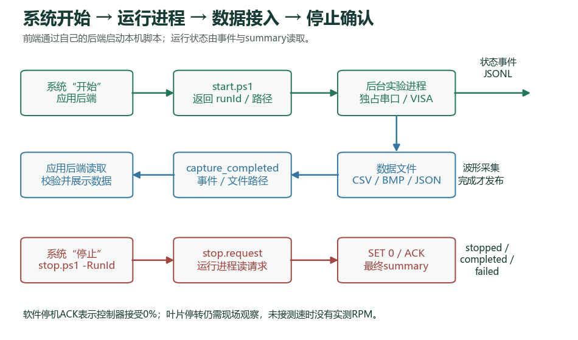
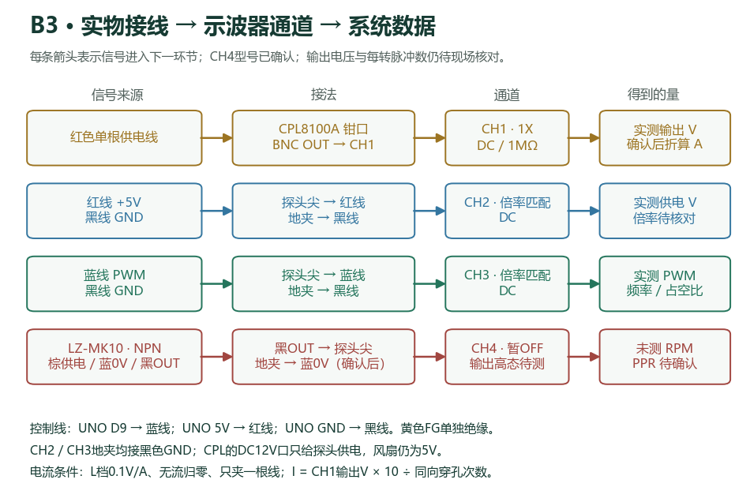
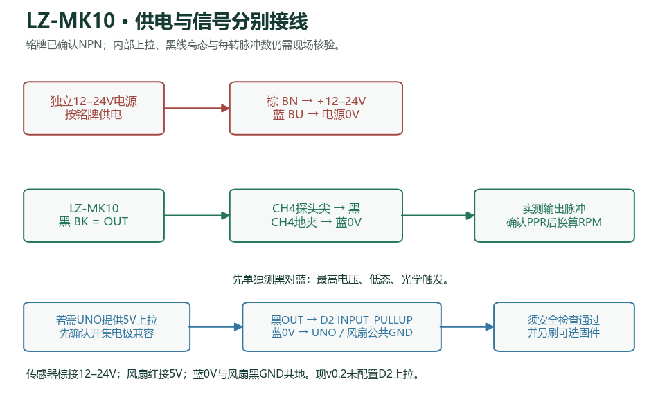
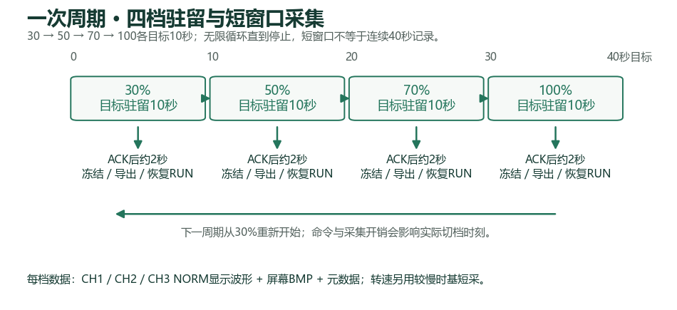

# B3 三个可直接运行入口 v0.5

不需要 Python。解压保留结构，修改 `config/experiment.json` 的本机 COM 与 VISA 地址，然后双击下面的 CMD；同事系统也可调用对应脚本。

|目的|入口|默认行为|依赖|
|---|---|---|---|
|只运行风扇|run-fan.cmd / run-fan.ps1|30、50、70、100%，每档10秒，持续循环|Windows PowerShell 5.1 64位、UNO/CH340串口驱动|
|只采示波器|run-scope.cmd / run-scope.ps1|启动示波器采集，等待2秒，导出一组CH1–3 CSV、BMP和元数据后退出|Windows PowerShell 5.1 64位、NI-VISA 64位；无需UNO连接|
|联合实验|start.cmd / start.ps1|风扇循环并每档采集，异步返回JSON|上述全部依赖|

三个入口都支持 `-ConfigPath` 和 `-RunId`。风扇首次一轮：`run-fan.cmd -ConfigPath config\acceptance.json`，约40秒后发送0%并退出。联合首次一轮：`start.cmd -ConfigPath config\acceptance.json`。示波器一次采集：`run-scope.cmd`。风扇运行期间可通过 `stop.cmd -RunId <运行ID>` 请求停止；前台Ctrl+C也由原执行器处理，尽力发送0%。ACK不代表物理停转，不用关窗口代替停止。同一设备不要同时运行多个入口。

配置原文件不被修改；临时JSON在同config目录，退出删除。输出继续按配置的 `output.root` 解析，默认包内 `runs/`；各次独立RunId不覆盖历史。示波器入口忽略serial配置，不打开串口、不发送风扇命令；会配置示波器、短暂停止取帧、恢复RUN并释放VISA。stdout为逐行JSON，stderr为诊断。

示波器独立模式使用事件外壳，`capture_completed.data.commandedPwmPercent:null` 表示没有发过风扇命令，附加 `fanCommandIssued:false`；capture及summary是独立模式扩展，不能直接套用原联合模式capture/summary schema。保留CH4禁用、物理探头倍率待确认等配置状态；未知PWM命令不会冒充0%或30%。

下文复用v0.4接线与联合接口说明，历史验收属于v0.4；本版新增入口验证见 `../verification/V0.5-VERIFICATION.md`。

# B3 风扇实验与示波器系统交接包 v0.4 参考

本包让同事系统的“开始”按钮调用本地 Windows 脚本：UNO R3 接收 30%、50%、70%、100% PWM 命令，每档目标 10 秒，逐轮运行；Rigol DS1104Z Plus 每档导出三通道短时波形、屏幕图和统计，系统通过 JSONL 事件接收数据及文件路径。“停止”按钮写停止请求，程序尽力发送 `SET 0`，核对 ACK 后退出。PWM 百分比不是 RPM；0% ACK 也不证明叶片已停。



可运行入口是 `start.cmd` / `start.ps1`、`stop.cmd` / `stop.ps1`。源代码、可编辑配置、协议 schema 和测试均在包内；不需要 Python、Keil、HTTP 服务或额外前端平台。当前 UNO 已刷入正确固件，不需重刷。新 UNO 才需要用 Arduino 工具通过 USB 上传附带的 `firmware/uno_fan/uno_fan.ino` 一次；只支持 ATmega328P、5V、16MHz UNO R3，不能刷到 R4 或其它芯片。

## 解压与前置检查

保留目录结构，可解压到任意有写权限的本地路径。使用系统自带 **64 位 Windows PowerShell 5.1**。CMD 包装器从 PowerShell 5.1 或 7 调用都选择系统 5.1，避免不同 .NET 运行时编译差异。

```powershell
.\check-dependencies.cmd
```

该入口只检查环境与端口存在，stdout 返回单行 JSON，缺少条件返回退出码 1；不会打开串口、修改示波器或驱动风扇。NI-VISA 必须可加载 `visa64.dll`，测试机已经安装，不随包分发驱动二进制。其它电脑缺失时从 NI 官方安装 64 位 NI-VISA；确认 NI MAX 中可见真实 USB 资源及设备身份，再修改配置。串口可用 `[IO.Ports.SerialPort]::GetPortNames()` 列举，或在设备管理器确认 UNO/CH340 的 COM 号。缺驱动时使用板卡厂商或 WCH 官方驱动，不能把本机 COM4 当成所有机器固定端口。

关闭占用同一 COM 的旧调速程序、串口监视器；关闭占用示波器的采集程序。程序对同一 COM 加互斥锁，系统也不应为一次开始点击启动多个实验。打开 UNO 串口会重置 UNO，可能短暂改变输出；启动前确认周边安全和供电。

## 现场接线与配置



|连接|当前 B3 5V 实验用途|确认条件|
|---|---|---|
|风扇红线 → 5V；黑线 → GND|风扇供电|仅适用于当前已确认 B3，电源满足启动电流|
|风扇蓝线 → UNO D9；黑线与 UNO 共地|25kHz PWM 控制|D9 是控制信号，不能给风扇供电|
|风扇黄线|当前悬空绝缘|本包不读取该线，不猜测接脚|
|CPL8100A BNC → CH1；钳口穿一根供电导线|实测探头原始输出 V|DC、1X、固定 1MΩ；探头独立 DC12V 供电|
|CH2 探头尖端 → 红线；地夹 → 黑线|供电电压|探头开关倍率必须与 config 相同|
|CH3 探头尖端 → 蓝线；地夹 → 黑线|PWM 电压和周期推算|探头开关倍率必须与 config 相同|
|CH4 预留外部测速传感器|未来实测脉冲及推算 RPM|型号与铭牌供电已登记，输出高态、实际接线和 PPR 待确认；当前关闭|

唯一运行参数来源是本次选用的 JSON 配置：默认 `config/experiment.json`，`cycles: 0` 表示运行到停止；`config/acceptance.json` 是首次同事验收的一轮配置，其余设置相同。修改实际用的一个文件即可，代码不会再用文档中的另一套参数。相对 `output.root` 从该配置所在目录解析，默认结果是包内 `runs/`。

修改 `serial.port`、`scope.resource`、`scope.expectedIdentity` 对应本机设备。示波器身份必须精确匹配，当前为 `RIGOL TECHNOLOGIES,DS1104Z Plus,DS1ZC271600575,00.04.05.SP2`。配置里的 `wiringConfirmed: true` 只描述目前已接好的 B3 台架，换线或换风扇后先改 false，核对后再改 true。

CH2/CH3 当前设置 10X，但物理开关尚未独立核对，`physicalProbeRatioConfirmed` 为 false。系统仍保留原始导出和此标记，绝对电压需先核实实际倍率；不能把 false 改成 true 代替现场检查。CH1 默认保存原始 V；L=0.1V/A、归零已确认，实际是否单根导线及匝数还需同事核对，因此 `currentConversion.enabled: false`。确认后填 `turns`、`gainAmpsPerVolt: 10` 和各确认字段为 true，再启用换算：`current_A = CH1_voltage_V × gainAmpsPerVolt / turns`。50mA 以下低于探头标称范围起点；程序提供 `belowSpecifiedRange` 标记，不能作为精确小电流测量。

本次照片已识别测速传感器为 **JINGJIAKE LZ-MK10 NPN**，铭牌 BN 棕线接 DC12～24V，BU 蓝线为 0V，BK 黑线为 OUT；100mA 是输出能力。**风扇黑线是 GND、蓝线是 PWM；传感器蓝线是 GND、黑线是 OUT，不能按颜色互换。** 风扇仍用 5V，不能把传感器 12～24V 接 UNO 5V、D2 或 D9。



测速预留字段在 `scope.tach` 已登记型号、供电范围和铭牌线序，尚未选择的实际供电 V、输出高电平 V、探头倍率和 PPR 仍为 null。NPN 铭牌不能单独证明黑线没有内部高压上拉；先核对官方输出电路并实测黑对蓝高态电压，确认适合 5V接口。`firmware/uno_fan_sensor_pullup` 是可选固件，仅增加 D2 `INPUT_PULLUP` 提供弱 5V 上拉，编译已通过但**本轮没有刷入当前 UNO**，也不计脉冲。只有确认开集电极且没有内部12V上拉时才考虑黑 OUT 接 D2 与 CH4、蓝0V与UNO共地；弱上拉造成边沿过慢时需要外部合适上拉或接口。是否采用需在现场接入验收，不能把当前固件当成已有 D2 上拉。

可以先独立验证传感器：棕线接合适12V供电、蓝线0V；确认探头及示波器输入额定范围后，用 CH4 探头尖端看黑 OUT、地夹接蓝0V，先不接 UNO。若已有稳定脉冲，示波器可以直接采集其频率，无需 D2；实测为0/12V时按实际倍率和量程配置示波器，仍不能接 UNO 输入。只有明确输出电路为无内部高压上拉的开集电极且缺上拉时才评估可选 D2 方案；万用表单个状态读0V不能证明开集电极。

不要根据旧台架 FG2 的一脉冲/转推定这个激光传感器。每转反光/遮挡标记数及检测方式决定 PPR。只有核对输出与示波器输入范围、必要的上拉/接口和接线后才启用。没有 PPR 时只能输出频率；有可靠 PPR 才按 `RPM = 60 × frequencyHz / pulsesPerRevolution` 推算，仍非 RPM 闭环控制。

## 同事先验收一轮

```powershell
.\start.cmd -ConfigPath .\config\acceptance.json -RunId acceptance_001
```

开始立即返回单行 JSON：`status: launched`、`runId`、`processId`、`directory`、`eventsPath`、`summaryPath`、`stopRequestPath`。`launched` 表示进程已启动，系统继续跟踪 `eventsPath`，以 `controller_identified`、`scope_configured` 和 `step_started` 判断实际进度。`state.json` 是派生快照，读者锁住它时可落后于事件流。正常一轮约 40 秒加握手/配置开销；最后以 `summary.json` 的 `terminalPublished: true`、`state: completed`、`exitCode: 0` 及 `cleanup: pwm_zero_acknowledged_physical_stop_unverified` 验收。`run_finished` 通知收尾进度，其 `terminalPublished: false` 表示权威终态文件随后发布，不能提前判为最终成功。



每档约 2 秒稳定后短暂停止示波器，导出同一 STOP 的 CH1–3 NORM 显示波形 CSV、preamble 和 `screen.bmp`，随后恢复 RUN，等待到目标 10 秒。20µs/div 用来看到 25kHz PWM；输出是短窗口，**不是连续十秒波形，也不是完整深存储**。VISA/磁盘开销超过 10 秒时发 `timing_overrun`，不伪造准确驻留。0%/100% 是直流设定，频率和波形占空比推算值留 null。

未来 CH4 测速用独立 10～100ms/div 慢时基短抓，再恢复 PWM 时基；两个 profile 是不同时间窗口。程序要求至少三段完整周期、每周期二十点及周期一致性，并拒绝削顶波形的 RPM；这些门禁不能替代传感器校准，当前该路径尚未真机验收。

## 系统“开始”和“停止”按钮

“开始”按钮 spawn `start.cmd`（或 `powershell.exe -NoProfile -ExecutionPolicy Bypass -File start.ps1`），带本地绝对 `ConfigPath`，读取返回 JSON 保存 `runId`。日常用默认连续配置：

```powershell
.\start.cmd -ConfigPath .\config\experiment.json -RunId system_20261005_001
.\stop.cmd -ConfigPath .\config\experiment.json -RunId system_20261005_001 -WaitSeconds 30
```

系统保存开始响应的 `directory` 后，建议停止时直接带 `-RunDirectory`，避免后来修改用户配置造成定位变化：

```powershell
$start = & .\start.ps1 -ConfigPath .\config\experiment.json | ConvertFrom-Json
& .\stop.ps1 -RunId $start.runId -RunDirectory $start.directory -WaitSeconds 30
```

“停止”用 `RunDirectory` 或同一配置定位结果目录，写 `stop.request`。也可由系统直接创建开始响应给出的 `stopRequestPath`，不需要另开串口。启动器在派生子进程前原子领取该 RunId，并保存含绝对结果根目录的配置快照，运行途中编辑用户配置不会更改该运行。脚本约每 50ms 在驻留期检查请求；正在 VISA/串口调用时须等当前有限超时操作结束。`status: finished` 返回实际 summary，失败返回 1；30秒内尚未确认收尾时返回 `requested_unconfirmed` / 退出码 2，继续读 summary，不把进程强杀当成停转。若仍采用 ConfigPath 停止，不要更改它的 `output.root`；否则用开始返回的目录或停止请求路径定位。

系统希望直接流式接收 stdout 时调用 `run-experiment.ps1 -ConfigPath ... -RunId ...`，把它作为后台子进程保留，而不是等待 stdout 全部结束。stdout 每行是 `schemas/event.schema.json` 定义的事件；stderr 为诊断，禁止把 stderr 混入 JSON 解析。异步包装模式将 stdout 另存 `stdout.jsonl`，以 `events.jsonl` 作为完整数据接口，避免重复消费。

入口应由设备电脑的常驻后端调用并跟踪真实运行事件。Windows SSH 的 Job 可能在短会话退出时结束它的子进程，所以从短SSH会话启动后立即断开不能保证实验继续；本次实机验证在同一连接保留父进程直到收尾。`launched` 不能作为风扇已经运行的证据，不能通过强杀父进程来“停止”实验。

|事件|系统用途|
|---|---|
|`run_started` / `controller_identified` / `scope_configured`|显示启动、设备身份和配置读回|
|`command_ack` / `step_started` / `step_completed`|显示当前 PWM 档、ACK 和实际驻留秒数|
|`capture_completed`|读取 `data.metrics` 与 `data.artifacts`：波形 CSV、BMP、元数据路径|
|`cycle_completed` / `timing_overrun`|统计轮次、识别驻留超时|
|`run_error` / `run_finished`|展示失败原因及最终软件状态|

每个事件带 schemaVersion、runId、sequence、UTC 时间、type、state、data。按 sequence 去重；读取追加文件时缓冲最后一个尚未结束的行。`capture_completed` 的 `profile` 区分 pwm/tach，`metrics.current/voltage/pwm/tach` 只出现本次实测通道；`frequencyHz` / `dutyPercent` 来自显示波形推算，null 代表无法可靠推算，不能替换成 0。配置和终态 schema 分别在 `schemas/config.schema.json`、`schemas/summary.schema.json`，采集 schema 在 `schemas/capture.schema.json`。

每次 RunId 必须唯一，程序拒绝覆盖历史结果；运行目录保留 `config.snapshot.json`、`events.jsonl`、`state.json`、`commands.csv`、`scope-settings.json`、各采集子目录和最后一次性原子发布的 `summary.json`。CSV 的电压来自示波器 ASCII 输出，不再次乘探头倍率；current_A 仅在人工确认的换算已开启时填值。采集产物路径为运行机器上的绝对路径，系统如需搬运应连同运行目录保存，不把这些路径当网络 URL。

异常同样进入收尾：仅在精确识别 UNO 后发送 0%。串口断线、ACK 错误、未知设备或收尾失败会报告失败/物理状态未知并返回非零。当前固件没有通信丢失自动停转保证；断线、窗口强关、电脑掉电都不能保证停转，需要确定去除驱动力时断开风扇 5V 供电。ACK 与停转证据分别处理。

## 验证与扩展边界

```powershell
powershell.exe -NoProfile -ExecutionPolicy Bypass -File .\verification\run-tests.ps1
powershell.exe -NoProfile -ExecutionPolicy Bypass -File .\verification\fix-regressions.ps1
```

这是明确标记的模拟验证，不开设备：覆盖精确身份、超时、非法 ACK、SCPI 块、生产循环、重复 RunId、串口单实例、异步停止及失败收尾；模拟输出没有示波器数据。附带 `../verification/VERIFICATION.md` 汇总本地与实际设备证据；真实示波器历史图和接线详解见 [图文交接](docs/接线与系统调用.md)。

本包具备设备脚本和系统调用协议，同事系统需完成按钮绑定、事件读取和本地文件展示。外部测速传感器已识别，输出电路、高态电压、实际接入与 PPR 尚待确认，CH4 仍关闭；更长波形、深存储、连续趋势及 RPM 闭环均需单独实现和验收。本包不含客户固件/原始资料、第三方驱动或历史全部大波形，也不向外部服务上传内容。

本版已实机完成一轮四档采集，以及持续模式开始→采集→停止请求→0% ACK；结果和新实机截图见 [验收证据](verification/VERIFICATION.md)。当前支持的是这些脚本入口和数据协议，同事系统的按钮与展示需按上述调用方式接入。
