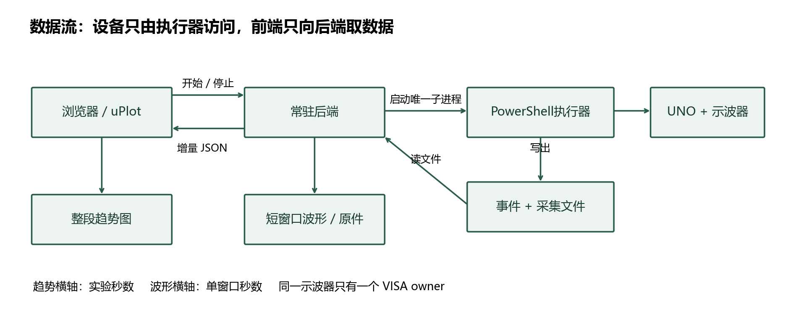
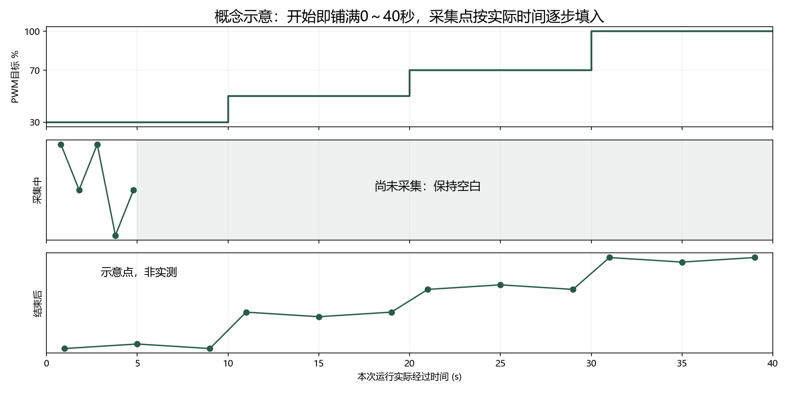

# 示波器数据接 OmniTest：固定时长趋势图方案

## 目标与完成边界

同事要实现：点击开始 → 先展示整段测试时间轴 → 风扇按计划运行 → 电压、电流等趋势逐步填入 → 停止或结束后保留结果。此文是实施规格，附带硬件运行包与**模拟**接口样例；未改 OmniTest 源码，不包含已实现页面截图。图是工程关系示意，不是产品截图。

## 1. 实际代码在哪里

读取范围是用户给的 OmniTest.zip 内 web/src/features/timeseries/{TimeSeriesChart.tsx,types.ts,loadCsv.ts}、web/package.json、backend/app/api/v1/runs.py，以及硬件 start.ps1、run-experiment.ps1、src/ScopeCapture.psm1、config/acceptance.json。OmniTest 原 ZIP 保留，未修改。

前端插件是 **uPlot**（package.json 声明 ^1.6.32），overlayPlugin 只是标注/阈值覆盖层。TimeSeriesChart 当前随 aligned/series/colors 改变重建图；x 只配置 time:false，没有固定范围；双击恢复自动范围。Series.y 类型目前不接收 null，需要与 alignSeries 一起调整。loadCsv 用逗号 split，不能直接读 PowerShell 带引号的 CSV；50万点以上才 worker 抽样，默认抽到4000点。趋势少量点无需走CSV/抽样链路。

现有 backend/app/api/v1/runs.py 提供创建运行、运行详情、产物读写和状态迁移；这些是记录接口，不是本实验的设备执行器。新增路由须避免 /{run_id}/{artifact_kind} 动态路由遮蔽，放独立 `/api/fan-tests` 命名空间。权限校验沿用现有用户/运行归属，不能公开任意脚本路径。

### 旧设备桥与当前通道不能混用

OmniTest旧设备桥通道为CH2 FG1、CH3 FG2、CH4 PWM；当前B3实验为CH1电流、CH2供电、CH3 PWM、CH4预留测速。旧read_fg按频率×60算RPM，若直接用CH3的约25kHz PWM会得到伪转速。此对接只使用v0.5 capture的role/metrics字段，不复用旧FG通道映射。已核实位置：OmniTest/components/spike-device-mcp/device_bench/config.py 与 server.py 的 _read_fg_local/read_pwm。

前后端端口必须一致：Vite默认代理8011；用户若启动后端801，需在启动web前设置 PowerShell `$env:VITE_BACKEND_URL='http://127.0.0.1:801'`（web/vite.config.ts使用该变量），或统一运行 `uvicorn app.main:app --host 127.0.0.1 --port 8011`。网络跨机时业务代理需指向实际后端，不把127.0.0.1当作仪器电脑地址。

## 2. 谁执行，谁传数据

仪器电脑运行常驻后端/设备服务。它创建唯一运行ID，调用硬件 PowerShell 子进程，并读取 events.jsonl 和完成文件。浏览器通过后端HTTP拿数据，不直接访问COM/VISA或Windows路径。如果业务后端在另一台电脑，业务后端调用仪器电脑服务，再转发浏览器。

同一示波器**只有一个VISA owner**。当前联合脚本本身持有VISA连接；第一步适配器只读它的结果文件，不再额外打开VISA。后续需要连续趋势时，在原执行器的同一个VISA循环里排程测量/短抓，或将VISA整体移交到单一常驻执行器，二选一。不要让 run-scope.ps1 和联合脚本并行，不要让多个HTTP请求各自采集。

启动返回的 launched 不算完成。后端跟踪 capture_completed、timing_overrun、错误及停止状态；以 summary.json 的 terminalPublished:true 认定权威终态。读取JSONL时保留半行到下一次读取；根据运行ID隔离数据。短SSH会话不能作为可靠常驻进程宿主。

## 3. 两种数据，分开显示

|数据|横轴|给前端的内容|用途|
|---|---|---|---|
|实验趋势|本次实际经过秒数|每次采集/测量的指标点|比较各PWM档位|
|单次示波器波形|该抓取窗口相对时间 time_s|采样数组、电压数组、通道、单位|查看25kHz PWM细节|

旧 capture_completed 的 data 包含 startedUtc/finishedUtc、cycle、commandedPwmPercent、profile、metrics、artifacts。metrics.current.meanV 是电流探头原始V；仅校准启用时有 meanCurrentA。metrics.voltage.meanV 是配置倍率下的V；metrics.pwm.frequencyHz/dutyPercent 是波形推算。profile=tach 且PPR验证后才能映射RPM。100%恒高时 frequencyHz/dutyPercent 可为null，不能视为错误。

当前每档仅一个短窗口，通常一轮只有4个主抓取；先真实显示4个点，标“每档快照”。后续改执行器为约每秒一次趋势测量（目标1Hz，实际速度待现场验收），在同VISA owner中串行访问；每档原始波形/截图按需保留，不要每秒抓BMP拖慢趋势。趋势点是短窗口统计，**不是连续采样波形**。若仍沿用STOP短抓，注明测量中断；不要声称硬件真正连续记录了10秒。

## 4. HTTP与JSON契约（提案，尚未实现）

|接口|含义|
|---|---|
|POST /api/fan-tests|校验计划、生成run_id、启动一次，返回计划/状态|
|GET /api/fan-tests/{run_id}|计划、状态、实际时长、是否延期|
|GET /api/fan-tests/{run_id}/samples?after_sequence=N|返回sequence>N新增点，每秒轮询|
|POST /api/fan-tests/{run_id}/stop|只停止该运行，返回stopping，随后查终态|
|GET /api/fan-tests/{run_id}/captures/{capture_id}|短波形JSON及授权文件URL|

样例见 examples/01_plan.json、02_samples.json、03_completed.json、04_missing.json、05_duplicate.json、06_overrun.json、07_waveform.json，全部 simulation:true。外层响应若沿用 success_response，前端取 data；此目录展示的是data内容，不是另一套公共接口。

关键字段：run_id 全程一致；sequence 同一run内递增且永不重用；t_s 是执行器单调时钟相对该run启动的实际经过时间（建议Stopwatch），不是“点数×1秒”，不是波形time_s，也不是前端收包时间。旧UTC时间只用于历史适配并标时间来源，不能假冒单调时钟。采样记录 measurement_started_t_s/measurement_finished_t_s，t_s选择测量中点；注明方法，吞吐慢时不伪造缺失秒数。

commanded_pwm_pct 是已确认发出的命令；measured_pwm_duty_pct 是波形推算，两者分开。planned steps 只是计划，不是实测值。所有缺测数值null并附quality原因。current_a 未确认L档、归零、单导线和匝数换算时null；可显示 current_probe_v。probe倍率未确认时 quality.voltage 标 provisional；RPM未接、PPR未知或裁切无可靠边沿时null。

CSV、BMP、capture.json 通过后端受控文件URL下载；后台先核对归属和文件位于run目录，不能接受任意路径。浏览器不能访问 C:\... 或SSH路径；BMP可提供原件下载和后端转换预览PNG。波形JSON独立返回 time_s、channels，不要把1200个微秒采样点铺到40秒时间轴上。

## 5. 固定横轴与前端改法

有限计划总时长 = 每步duration_s相加 × cycles；首轮四档各10秒、一次，计划40秒。测试程序改变时从计划自动算；缺少可计算时长才默认60秒。开始握手属于run实际时间，必要时额外显示“设备准备”；计划区间只是预期，后端另发实际 step_started 时间标注。

正常运行 x=[0,planned_duration_s] 固定。超期就标“延期”，max扩展为 max(计划/默认时长,实际最后时间向上取整)，不裁数据、不把45秒压成40秒。结束保留全记录；提前停止后保留原计划轴空白，注明实际停止时刻，不填满剩余区域。无限循环显式rolling模式，最近60秒窗口，不混用有限计划默认。

给TimeSeriesChart增加 xRange:[number,number]、resetToProgramRange、nullable y。新run或通道结构变化才重建uPlot，数据更新通过已有uRef调用 setData(alignedData,false)，随后 setScale('x',{min:0,max:axisEnd})；固定范围也进入初始化scales.x.range函数。把数据effect与初始化effect拆开；不要仍把aligned/series数组内容作为重建依赖。双击复位到程序范围而非auto；运行默认禁止拖拽改变范围，结束后可缩放但双击回整段。

每秒拉增量，按(run_id,sequence)去重；串行轮询，避免慢请求交叠，切run取消旧请求。sequence游标仅在成功合并后推进。重复same-sequence且内容不同报冲突，不覆盖；不同run丢弃；有效点按t_s排序，乱序/非有限时间拒绝并记录，不用前端时间修正。后端持久化后发布，重连能补取。

nullable y使用普通(number|null)[]，不能用Float64Array把null变0。alignSeries应保持缺测，不做插值；series.spanGaps=false，缺口段断线。无点时也画完整横轴（可用空数据数组或x=[0,axisEnd],y=[null,null]显示占位，不能当实测点）。坐标/游标/导出均明确空值。共享X的分图：PWM目标%、电压V、电流A、转速RPM；校准前电流图用探头原始V并明示，不能标A。状态“未采集”不是0RPM。

## 6. 开发顺序

按 02_逐步实施验收.md 逐项：硬件独立入口 → 模拟JSON固定轴 → 状态/缺测/幂等 → 后端读旧结果适配 → 一次联合 → 执行器持续指标 → 真实联调验收。先拿四个真实快照跑通，再提高采集密度。协议与图先用模拟样例，不需要等仪器在线。
