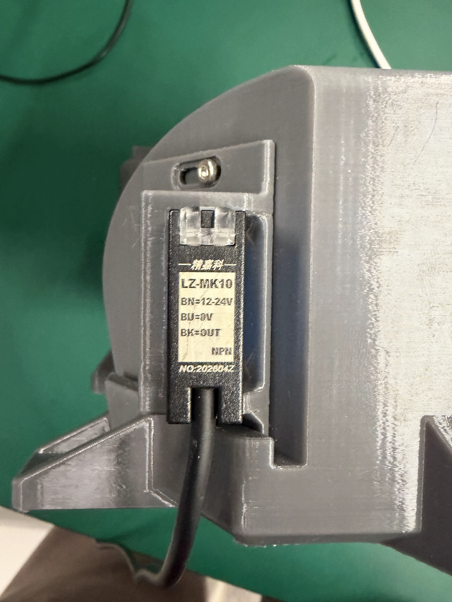
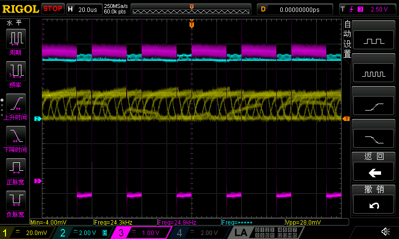
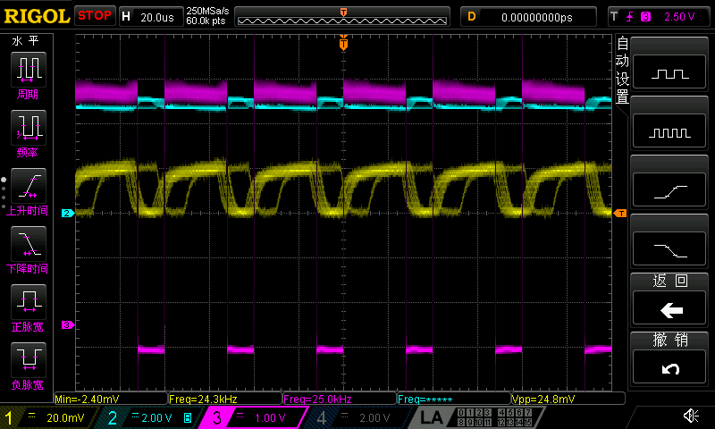

# B3台架接线与系统调用 · v0.4-20261005

本包给接手台架的同事和系统集成人员使用。系统的“开始”动作启动独立实验进程，控制UNO按30% → 50% → 70% → 100%循环，每档目标保持10秒；Rigol保存每档的波形数值、截图与元数据，系统根据数据就绪事件读取文件。默认无限循环，系统“停止”动作请求程序发SET 0并等待最终结果。

当前能够采供电电流探头输出、供电电压和PWM三路。用户照片已经确认测速传感器为精嘉科JINGJIAKE LZ-MK10、NPN，铭牌供电12–24V；输出高态电压、内部上拉和每转脉冲数仍待现场核验，因此随包配置保留CH4但关闭，RPM不能作为已实测能力。数值占空比是控制目标，不是转速百分比。

## 1. 实物接线与通道职责


接线时断开风扇供电，按信号名称和线色核对。当前B3风扇定义为红色+5V、黑色GND、蓝色PWM；UNO 5V接红线、GND接黑线、D9接蓝线。黄色FG线单独绝缘。本包CH4预留给外部测速传感器，没有将黄色FG作为机械转速来源。

| 通道 | 物理连接 | 配置项与读数意义 |
|---|---|---|
| CH1 | CPL8100A钳口只夹红色单根供电导线；探头BNC OUT接CH1 | `scope.channels.current`：DC、1X、20mV/div；固定1MΩ输入。CSV的`voltage_V`是探头输出V |
| CH2 | 普通电压探头尖端接红线，地夹接黑线 | `scope.channels.voltage`：DC、当前软件倍率10、2V/div。实物倍率待核对，绝对电压需确认后解释 |
| CH3 | 普通电压探头尖端接蓝线，地夹接黑线 | `scope.channels.pwm`：DC、当前软件倍率10、1V/div。频率与占空比可由时间轴推算；绝对幅度需核对倍率 |
| CH4 | LZ-MK10的黑色BK OUT经探头尖接CH4，地夹接传感器蓝色BU 0V；先核对电气条件，当前不启动 | `scope.tach.enabled=false`。型号与铭牌线序已填；输出高态、上拉和PPR现场确认后启用 |

CH2、CH3的地夹接同一黑色GND，不能夹红线。CPL8100A侧面的DC12V口是探头电源输入，风扇仍使用5V；BNC才是进入CH1的信号。示波器固定1MΩ输入不需要另发50Ω切换命令。

电流探头先选L档0.1V/A，在没有被测电流、钳口闭合的状态完成Auto Zero，再夹一根供电线。归零和L档已在前次现场由用户确认；每次重新布置、换档或零位漂移后应重做。`I(A)=CH1电压(V)×10÷同向穿孔次数`。红黑同时穿过钳口会抵消，不能用于这一路测量。软件不能自己判断实物匝数、档位和归零，运行前人工确认配置。

L档最低规格范围50mA，厂家典型DC精度3%±50mA。小于50mA的结果只保留原始输出与范围说明，不能作精确电流结论；通过条件检查和软件折算不等于探头校准完成。

## 2. 一个周期与一次采集的区别


每个周期四档，目标40秒。每档收到控制器ACK后，先留约2秒稳定时间，再冻结示波器，导出CH1/CH2/CH3同一帧的NORM显示波形和BMP屏幕图，恢复RUN。采集耗时计入该档驻留；若占用超过目标时间，实际切档会变晚，必须以日志时间判断时序。

NORM是显示抽取数据，不能替代完整采样内存，也不是每档连续10秒记录。PWM短采使用20µs/div，以保留25kHz脉宽细节；将来启用测速时需另用较慢时基，不能沿用239.8µs级短窗口来可靠估计一圈时间。测速与PWM的不同窗口应各有自己的时间轴和元数据，不应合成同一个同步长记录。

程序退出时尝试SET 0并记录ACK。ACK说明控制器接受0%，叶片实际停转需现场观察；未接测速时不能将0档或退出码解释为实测0 RPM。断连、强制终止或掉电时，应用不能假定停机请求已经送达。

## 3. 系统按钮怎样接入


前端按钮调用应用自己的后端；后端在有UNO、Rigol与NI-VISA的64位Windows测试机启动脚本。脚本是本地进程与文件接口，不会自动在浏览器中连接USB，也没有随包新增HTTP服务。

开始返回运行ID、进程ID和结果路径后，后端跟随该runId的事件文件；`capture_completed`发出时才读取对应CSV、BMP和capture元数据。停止针对runId和开始返回的directory写请求，并读取`terminalPublished=true`的最终summary确认结果。不要给每个档位各启动一个进程：每次打开串口会重置UNO，单一常驻进程负责整轮串口和VISA资源。

在包目录中开始，并保存返回值；停止使用返回的稳定目录，避免后续编辑配置改变输出路径：

```powershell
$start = .\start.cmd -ConfigPath .\config\experiment.json -RunId system_20261005_001 | ConvertFrom-Json
.\stop.cmd -RunId $start.runId -RunDirectory $start.directory -WaitSeconds 30
```

开始会先认领运行ID并冻结配置快照，运行进程使用该快照。旧的`stop -ConfigPath`方式仍兼容，但系统集成应优先使用开始返回的`directory`，或直接创建`stopRequestPath`。

入口由设备电脑的常驻后端调用，并根据真实running事件确认实验已开始。Windows SSH的Job可能在短会话退出时结束其子进程，从短SSH会话启动后立即断开不能保证实验继续；本次实际验收在同一连接保留父进程至收尾。`launched`不能单独证明风扇已运行，不能以强杀进程代替停止请求。

调用事件名、目录和字段详见同包README及schemas。消费程序应依据`schemaVersion`识别版本，用`runId`关联实验，用`sequence`排序，保留`timestampUtc`用于显示与记录；该UTC时间不是独立硬件采样触发时钟。状态范围为starting、running、stopping、stopped、completed、failed。停止请求已提交和最终停止结果是不同状态，界面应等待`summary.json`且`terminalPublished=true`再显示完成。`run_finished`是终态通知，`state.json`是派生快照，最终summary是唯一权威完成标记；事件通知后尚无summary时继续等待。

## 4. LZ-MK10测速传感器怎样接入



这张用户原始照片可读出精嘉科、LZ-MK10、NPN，BN=12–24V、BU=0V、BK=OUT；侧面照片另外标OUT100mA。100mA是输出负载能力，不能理解为需要向UNO引脚输入100mA。厂家[同型号官方产品页](https://www.jingjiake.com/h-col-167.html)确认其为激光传感器，支持智能学习与测转速；当前可读页面没有输出电路细节，不能仅由“NPN”保证黑线内没有12V上拉。


| 导线 | 传感器接法 | 与风扇线色区分 |
|---|---|---|
| 棕色BN | 独立12–24V电源正极；采用12V时设置`supplyVoltageV=12` | 不是风扇红色+5V支路，不能接UNO 5V |
| 蓝色BU | 传感器电源0V，验证允许共地后接UNO GND、风扇黑GND及示波器公共地 | 传感器蓝色是地；风扇蓝色是PWM |
| 黑色BK | 传感器OUT；CH4探头尖接这里，CH4地夹接BU蓝/公共GND | 传感器黑色是信号；风扇黑色是地 |

先只用示波器看OUT也可：传感器独立12–24V供电，CH4探头尖接传感器黑BK、地夹接蓝BU/已确认公共GND，暂不接UNO D2；倍率与实物一致，先用能容纳最高可能电平的量程检查高低态。这个观察步骤不依赖可选固件。若开集电极没有上拉，黑线可能浮空或没有明确高态，不能由“没波形”判定传感器损坏；确认输出拓扑后再决定上拉接口。没有实测电平和PPR时，自动配置仍保持CH4关闭。

同事接入时按下列步骤：

1. 将传感器独立供电并核对共地条件，先不把黑线接UNO。测黑对蓝在检测/未检测状态的最低与最高电压，并确认输出是否为无内部高压上拉的开集电极；如果黑线高态超过5V，不能接UNO D2。
2. 只有确认OUT兼容5V上拉后，才使用随包可选固件`firmware/uno_fan_sensor_pullup/uno_fan_sensor_pullup.ino`：它在D2启用`INPUT_PULLUP`，将黑OUT接D2，蓝0V接公共GND，再把CH4探头尖接同一个黑OUT节点、地夹接蓝0V。12–24V正极不接UNO 5V或D2。当前已刷v0.2固件未配置D2上拉；本轮未上传可选固件。可选固件只提供弱5V上拉，不计脉冲，也不承诺边沿质量。
3. 对旋转件设置一个清晰的独立光学标记，固定传感器位置，用智能学习功能建立标记与背景的区分。先手动转一周确认只有一个有效输出脉冲，再把`pulsesPerRevolution=1`写入配置。这是“一周一标记一脉冲”的操作约定，不是厂家固定PPR；若采每片叶片或多个标记，填写真实有效脉冲数，不能默认1。
4. 通过合适探头、范围和时间窗观察稳定脉冲，核对实物倍率。弱上拉边沿太慢、干扰、削顶或脉冲不稳定时，保持无有效RPM状态，先改进接口或光学布置。核验之后才将`scope.tach.enabled`、`wiringConfirmed`、`physicalProbeRatioConfirmed`设true，并填实测`outputVoltageV`、实物`probeRatio`、`scaleVoltsPerDiv`和`triggerLevelV`。

配置已保留`sensorModel`、`supplyVoltageRangeV`、`supplyVoltageV`、`signalWire`、`outputVoltageV`、`outputType`、`probeRatio`、`physicalProbeRatioConfirmed`、`pulsesPerRevolution`、`timebaseSecondsPerDiv`、`scaleVoltsPerDiv`、`triggerLevelV`和`wiringConfirmed`。铭牌信息已填，未知运行参数保持null。转速独立采集窗口默认20ms/div；有效波形推算频率后按`RPM=60×频率/PPR`换算，结果仍需与独立转速基准核对。

缺少有效周期、采样不足、削顶或PPR未知时，输出null与原因，不伪报0 RPM。历史台架FG2的一脉冲每转设置不能证明这只LZ-MK10当前安装的PPR；本轮照片和配置说明也不作为已完成测速现场实验的证据。
## 5. 已有现场证据与本包验收边界



图为本包v0.4在2026-10-05 15:19:59采集的70%档原始实机屏幕，仅将BMP无损转换为PNG，像素未修改。CH1黄为电流钳原始输出、CH2青为供电电压、CH3紫为PWM，CH4关闭。20µs/div下可以读到紫色高约七成、低约三成；对应CSV推算69.975%、约24.964kHz。绝对电压仍受尚未独立核对的CH2/3物理探头倍率条件约束，CH1未启用电流换算，不能从图称已标定电流或RPM。

本包已实际完成一轮30/50/70/100%各目标10秒和四次数据输出，summary为completed、terminalPublished=true、exitCode=0；另一次cycles=0持续模式已验证异步开始、首档真实采集、停止请求、SET 0 → OK DUTY 0、stopped终态，并确认实验进程已退出。完整验收范围与指标见[验收证据](../verification/VERIFICATION.md)。同事系统还需绑定按钮和读取接口；LZ-MK10测速支路未接入，不能作为已验收RPM能力。



图为2026-10-05 14:19:29前版v0.3第1轮70%档的真实Rigol屏幕，来自同台架已完成两轮实验的原始截图。黄色CH1是电流探头输出、青色CH2是供电电压、紫色CH3是PWM，CH4关闭。紫色高电平约占七成，黄色输出有电流脉动；屏幕自动Freq存在噪声误读，不用于验收频率。v0.3 CSV离线计算该档第1轮69.91%、约24.982kHz。

这张旧真机截图保留作历史参考，不替代上方本包v0.4的实际验收。前版CH2/CH3物理倍率未独立确认，CH3边沿有削顶，不能将图中峰值当作定量尖峰结论。新版本脚本入口与停止流程已通过本台架实测，测速支路仍需在已确认输出电路和PPR后另行验收。

交接时先确认COM4对应当前UNO、固件身份为`READY UNO_FAN_V2 25000`，示波器身份与配置序列号一致，关闭其他占用串口和VISA的程序。先运行一周期验收开始返回值、四档ACK、每档数据就绪、CSV/BMP可打开、停止请求与最终summary，再接系统无限循环。传感器参数确认之前保持CH4关闭。


